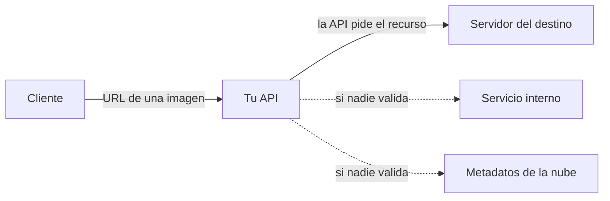

<!-- _class: lead -->

# Módulo 5 - Lógica de negocio, destinos y exposición de datos; GraphQL

### Cuando el código está bien y las reglas del negocio no

**Rogelio Arriaga - Raptor Dev Services**

<!--
Este módulo es de defensa. Cada clase de falla se estudia con la misma ruta: qué es, por qué ocurre, cómo se detecta, cómo se corrige y cómo se verifica la corrección. No hay consultas ni entradas de ataque; las pruebas se escriben contra la aplicación de práctica del curso. GraphQL se estudia como superficie que se acota, no como blanco.
-->

---

## Agenda del módulo

| Bloque | Qué hacemos | Tiempo aprox. |
|---|---|---|
| Apertura | Lema, alcance y la aplicación de práctica | 10 min |
| Parte 1 | Flujos de negocio sensibles (API6:2023): el cupón que se usa dos veces | 22 min |
| Parte 2 | Exposición de datos de más (API3:2023): el contrato de la respuesta | 12 min |
| Parte 3 | Destinos que elige el cliente: SSRF (API7:2023) | 26 min |
| Parte 4 | Consumir otras APIs sin confiar (API10:2023) | 10 min |
| Parte 5 | GraphQL: la superficie se acota | 26 min |
| Cierre | Práctica, tarea y quiz | 14 min |

<!-- Descanso de 10 minutos entre la Parte 3 y la Parte 4. -->

---

## El lema del módulo

> Ningún escáner encuentra que el descuento se puede aplicar dos veces.

- Un escáner mira el **código y el protocolo**; la regla "un cupón por pedido" solo existe en la cabeza del negocio.
- Por eso estas fallas se encuentran **pensando como quien abusa de las reglas**, y se cierran con una regla escrita en el servidor y una prueba que la repite.
- Cuatro riesgos del Top 10 de APIs de 2023 en un módulo: API6, API3, API7 y API10.

---

## Al terminar puedes

- Identificar los flujos de negocio de una API cuyo abuso cuesta dinero o confianza, y proteger cada uno.
- Hacer que una regla de "una sola vez" resista peticiones repetidas y simultáneas, y probarlo.
- Exponer solo lo que el negocio necesita en cada respuesta, y detectar cuando se devuelve la entidad completa.
- Decidir si la API puede visitar un destino que eligió el cliente, con una lista de permitidos, y probar los casos que debe rechazar.
- Explicar qué se acota en una API GraphQL (profundidad, costo, introspección, alias, autorización por campo) y dónde se configura.

---

## Alcance de este módulo

| Sí | No |
|---|---|
| Qué es cada riesgo, por qué ocurre, cómo se detecta, se corrige y se verifica | Procedimientos de explotación o consultas de ataque listas para usar |
| Pruebas contra la aplicación de práctica del curso | Pruebas contra aplicaciones que no sean tuyas |
| Laboratorios **opcionales** (crAPI, DVGA) en tu máquina virtual, para reconocer y escribir el control | Cadenas de ataque, abuso masivo o automatización contra un servicio |
| Fragmentos de configuración de GraphQL, marcados como fragmento | Afirmar que un fragmento corre si no se compiló |

**Marco legal y ético.** Solo laboratorio propio y datos ficticios. Probar sistemas ajenos sin autorización escrita puede constituir un delito; los cursos `/cybersecurity/` y `/cyber-law/` explican el marco y la carta de autorización.

---

## La aplicación de práctica

El código vive en `cursos/api-security/referencia/` (ASP.NET Core, .NET 10, xUnit). En este módulo se usan:

| Pieza | Para qué |
|---|---|
| `POST /api/pedidos/{id}/cupon` | La regla "un cupón por pedido" |
| `GET /api/perfil` y `PerfilDto` | El contrato de respuesta |
| `Destinos.cs` y `POST /api/vistas-previas` | La lista de destinos permitidos |
| `ClienteSeguro` y `LectorDeTercero` | Cómo se visita y se lee un destino (`ClienteSeguro.cs`) |
| `Modulo5Tests.cs` | Las pruebas que se ven fallar |
| Interruptores `Lab:CuponRepetible`, `Lab:EntidadCompleta`, `Lab:SinListaDeDestinos` | Reintroducen la falla, **solo en la práctica** |

> Pedidos, usuarios y hosts son **ficticios** (Ejemplo ilustrativo). Los hosts de ejemplo usan el dominio reservado `.test`.

---

<!-- _class: lead -->

# Parte 1
## Flujos de negocio sensibles (API6:2023)

---

## Qué dice la categoría

**API6:2023 - Unrestricted Access to Sensitive Business Flows** (OWASP API Security Top 10, 2023). OWASP la describe así: quien la abusa suele entender el modelo de negocio de la API, ubicar sus flujos sensibles y **automatizar** el acceso a ellos para dañar al negocio. Una API es vulnerable cuando expone uno de esos flujos sin restringir bien el acceso.

| Flujo | Cómo se daña sin romper nada técnico |
|---|---|
| Comprar un artículo de existencia limitada | Alguien lo acapara con automatización |
| Aplicar un cupón o un bono | Se aplica más veces de las permitidas |
| Reservar o registrar una cuenta | Se llena el inventario o la lista de usuarios |
| Publicar comentarios o reseñas | Se inunda de contenido |

La falla **no** está en el código: está en una regla que nadie escribió o que se escribió solo en el cliente.

---

## Cómo se piensa: el mapa de flujos

Antes de revisar código, se levanta la lista de flujos con **dinero o confianza** de por medio:

| Pregunta | En la aplicación de práctica |
|---|---|
| ¿Qué acción cambia dinero, inventario o reputación? | Aplicar un cupón al pedido |
| ¿Qué regla de negocio la limita? | Un cupón por pedido |
| ¿Dónde vive esa regla? | Debe vivir en el servidor |
| ¿Qué pasa si la repiten 20 veces? ¿Y a la vez? | Debe responder igual que la primera repetición |
| ¿Quién más puede usarla? | Solo el dueño del pedido |

*Pentesting APIs* (Harley, 2024), cap. 9, trata el abuso de la API y las pruebas de lógica de negocio; *Web Application Security* (Hoffman, 2.ª ed.), cap. 18, las vulnerabilidades de lógica de negocio.

---

## El flujo del cupón, correcto

```csharp {1-2|3-4|5|6-7|8-11}
lock (datos.Candado) // revisar y marcar es una sola operacion
{
    var pedido = datos.Pedidos.FirstOrDefault(p => p.Id == id && p.DuenoId == IdDe(yo));
    if (pedido is null) return Results.NotFound();
    if (c.Codigo != "PROMO10") return Results.Problem(statusCode: 422, title: "Cupon desconocido");
    if (pedido.CuponAplicado && !opciones.Value.CuponRepetible)
        return Results.Problem(statusCode: 409, title: "El pedido ya uso un cupon");
    pedido.CuponAplicado = true;
    pedido.Total = Math.Round(pedido.Total * 0.9m, 2);
    return Results.Ok(new PedidoDto(pedido.Id, pedido.Total, pedido.Estado));
}
```

- Cuatro decisiones: **de quién** es el pedido, **si el cupón es válido**, **si ya se usó**, y **marcar y descontar** juntos.
- El `lock` hace que "revisar si ya se usó" y "marcarlo como usado" sean una sola operación. Sin él, dos peticiones simultáneas pueden pasar la revisión antes de que alguna marque.

---

## El mismo flujo con el defecto, a nivel de idea

| Defecto | Efecto | Qué lo causa |
|---|---|---|
| Se quita la revisión "ya se usó" (`Lab:CuponRepetible`) | Cada repetición vuelve a descontar: 500, 450, 405... | La regla no está en el servidor |
| Se revisa pero no se marca de forma atómica | Dos peticiones simultáneas descuentan las dos | Revisar y marcar son pasos separados (*race condition*) |
| La regla solo existe en la pantalla (el botón se deshabilita) | Otro cliente la ignora | La API confía en el cliente |

*Bug Bounty Bootcamp* (Li, 2021), cap. 12, "Race Conditions", y cap. 17, "Application Logic Errors and Broken Access Control", explican por qué ocurre, desde la lectura de quien reporta.

---

## Cómo se detecta

| Técnica | Qué hace | Límite |
|---|---|---|
| Revisar el mapa de flujos con el negocio | Encuentra reglas que nadie escribió | Depende de quién esté en la sala |
| Una prueba que repite la acción | Comprueba "una vez" con peticiones secuenciales | No ve condiciones de carrera |
| Una prueba con peticiones simultáneas | Dispara N a la vez y cuenta resultados | Hay que diseñar el conteo |
| Alertas sobre uso anómalo | Un cliente que completa un flujo más rápido que una persona | Llega después del daño |

OWASP sugiere para API6: identificar los flujos que pueden dañar si se abusan, detectar comportamiento no humano (como completar una compra más rápido de lo que podría una persona) y restringir con rigor las APIs pensadas para máquinas (desarrolladores, B2B).

---

## La prueba, secuencial y simultánea

```csharp {1-6|9-13}
[Fact]
public async Task Un_cupon_se_aplica_una_sola_vez_por_pedido()
{
    Assert.Equal(HttpStatusCode.OK, await Cupon(ana, 100));
    Assert.Equal(HttpStatusCode.Conflict, await Cupon(ana, 100));
    // el total baja una sola vez: 500 menos 10 % = 450
}

[Fact]
public async Task Veinte_peticiones_simultaneas_aplican_el_cupon_una_vez()
{
    var estados = await Task.WhenAll(Enumerable.Range(0, 20).Select(_ => Cupon(ana, 101)));
    Assert.Equal(1, estados.Count(e => e == HttpStatusCode.OK));
}
```

- La segunda prueba mide la **atomicidad**: de 20 peticiones simultáneas exactamente una debe tener éxito.
- Es una prueba contra **tu propia aplicación de práctica**, con datos ficticios.

---

## Cómo se corrige

1. **La regla en el servidor**, no en el cliente: la API es la que dice "ya se usó".
2. **Atomicidad:** revisar y marcar en una sola operación. En memoria, un candado; en una base de datos, una restricción única o una actualización condicional (`UPDATE ... WHERE usado = false`) y comprobar las filas afectadas.
3. **Idempotencia** para operaciones que el cliente puede reintentar: una llave de idempotencia hace que el mismo intento no se aplique dos veces. Lectura: `04-backend/45-idempotency-keys.md`.
4. **Límites de ritmo** sobre el flujo caro (módulo 4) y detección de uso no humano.

El `lock` de la práctica sirve en una sola instancia. Con varias instancias hace falta la restricción en la base de datos: el candado en memoria no cruza procesos.

---

## Error típico: "ya se deshabilita el botón"

| Síntoma | Causa | Corrección |
|---|---|---|
| El descuento se acumula con varias llamadas | La regla vive en la pantalla | Mover la regla a la API |
| A veces pasan dos descuentos "de la nada" | Revisar y marcar separados | Operación atómica y prueba simultánea |
| Funciona con una instancia y falla con tres | Candado en memoria | Restricción en la base de datos |
| Nadie sabe qué flujos importan | No hay mapa | Mapa de flujos con el negocio, por cada versión |

---

<!-- _class: lead -->

# Parte 2
## Exposición de datos de más (API3:2023)

---

## Qué dice la categoría

**API3:2023 - Broken Object Property Level Authorization** fusiona las categorías de 2019 *Excessive Data Exposure* y *Mass Assignment*: la API devuelve **todas** las propiedades de un objeto, o acepta que el cliente modifique propiedades que no le tocan. Los efectos van de la fuga de datos a la escalada de privilegios.

| Dirección | Falla | Corrección |
|---|---|---|
| De salida | Se devuelve la entidad completa y el cliente "ya filtra" | Un DTO de respuesta con solo lo necesario |
| De entrada | Se enlaza la entidad completa al cuerpo | Un DTO de entrada con solo lo editable |

El módulo 3 trató la parte de entrada (el rol que cambia). Aquí se refuerza la de salida con un **contrato de respuesta**.

---

## Entidad contra DTO, en el código

```csharp
return opciones.Value.EntidadCompleta ? Results.Ok(u) : Results.Ok(new PerfilDto(u.Id, u.Nombre, u.Rol));
```

```csharp
public sealed class Usuario { public int Id; public string Nombre; public string Rol;
                              public string HashContrasena; public string NotasInternas; }
public sealed record PerfilDto(int Id, string Nombre, string Rol);
```

- Con `Lab:EntidadCompleta` la respuesta incluye `hashContrasena` y `notasInternas`: campos que el cliente nunca necesitó.
- El DTO es una lista de permitidos de salida: lo que no está en él, no sale, aunque mañana alguien agregue una propiedad a la entidad.
- OWASP recomienda evitar métodos genéricos que serializan todo (`to_json()` en su ejemplo) y seleccionar solo las propiedades necesarias.

---

## La prueba de contrato

```csharp
[Fact]
public async Task El_perfil_no_devuelve_campos_internos()
{
    using var f = new Fabrica();
    using var ana = f.ComoUsuario(1);
    var cuerpo = await (await ana.GetAsync("/api/perfil")).TextAsync();
    Assert.DoesNotContain("hashContrasena", cuerpo, StringComparison.OrdinalIgnoreCase);
    Assert.DoesNotContain("notasInternas", cuerpo, StringComparison.OrdinalIgnoreCase);
}
```

- Afirma lo que **no** debe salir. Es barata y se corre en cada cambio.
- Una variante más fuerte valida la respuesta contra un **esquema** (OWASP lo recomienda): cada propiedad nueva exige una decisión.
- Detectar a mano: leer la respuesta de cada endpoint y preguntar "¿esta propiedad la usa quien llama?"; *Pentesting APIs* (Harley, 2024), cap. 8, trata la exposición de datos.

---

## Error típico: "el front solo muestra lo necesario"

- Lo que el cliente **no muestra** igual **llegó** al cliente: está en la respuesta que cualquiera puede leer.
- Ocultar una columna en la tabla del frontend no es una defensa: lo que importa es el cuerpo de la respuesta.
- Mismo razonamiento que la validación: la defensa vive en el servidor.

| Revisa | Pregunta |
|---|---|
| Cada DTO de respuesta | ¿Cada propiedad la necesita el negocio? |
| Los hashes, notas internas, banderas de administración | ¿Tienen alguna razón de salir? |
| Las listas | ¿Incluyen datos de otros usuarios? |

---

<!-- _class: lead -->

# Parte 3
## Destinos que elige el cliente: SSRF (API7:2023)

---

## Qué es y por qué ocurre

**API7:2023 - Server Side Request Forgery.** OWASP la describe como una falla en la que la API trae un recurso remoto **sin validar una URL que dio el usuario**, lo que permite dirigir las peticiones a destinos no previstos, incluso detrás de un firewall o de una VPN. Es más común en funciones de *webhooks*, vistas previas de URL y descarga de archivos, y más peligrosa en entornos de nube y contenedores.



La API tiene **más alcance de red** que el cliente: llega a lo que él no ve. Por eso un destino elegido por el cliente es una decisión de seguridad.

---

## Cómo se cierra, según OWASP

Para API7, OWASP recomienda (resumen):

| Medida | En palabras |
|---|---|
| Aislar | El mecanismo que trae recursos vive aparte de las redes internas |
| **Listas de permitidos** | Orígenes remotos, esquemas, puertos y tipos de medio |
| Desactivar redirecciones | Una redirección puede llevar a un destino no validado |
| Un analizador de URL probado | No inventar el propio |
| Validar la entrada | Como siempre |
| No devolver respuestas crudas | La API no reenvía al cliente lo que trajo |

El *SSRF Prevention Cheat Sheet* distingue dos casos: si la API solo habla con sistemas **conocidos**, la lista de permitidos de hosts es la defensa preferida; si el usuario puede apuntar a destinos arbitrarios, una lista de bloqueo de rangos internos es el último recurso, y es fácil de evadir.

---

## La lista de permitidos en el código

```csharp {1-3|4-5|6-7|8|*}
public static bool EsPermitido(string? texto, IReadOnlyCollection<string> hostsPermitidos)
{
    if (!Uri.TryCreate(texto, UriKind.Absolute, out var uri)) return false;
    if (uri.Scheme != Uri.UriSchemeHttps) return false;      // solo https
    if (!uri.IsDefaultPort) return false;                    // y solo el puerto 443
    if (!string.IsNullOrEmpty(uri.UserInfo)) return false;   // nada de usuario@host
    if (IPAddress.TryParse(uri.Host.Trim('[', ']'), out _)) return false; // por nombre, no por direccion
    return hostsPermitidos.Contains(uri.Host, StringComparer.OrdinalIgnoreCase);
}
```

- Cada línea cierra una forma de decir "otro destino" sin cambiar el host permitido: esquema, puerto, usuario en la URL, dirección numérica.
- La decisión final es una **igualdad exacta** con la lista, no una búsqueda de texto. `StartsWith("https://imagenes.ejemplo.test")` aceptaría `https://imagenes.ejemplo.test.otro.ejemplo.test`.
- Los hosts permitidos salen de configuración (`Vistas:HostsPermitidos`), no del código.

---

## Qué debe rechazar, por categoría

La prueba (`La_lista_de_destinos_rechaza`) cubre estas categorías con direcciones ficticias:

| Categoría | Por qué se rechaza |
|---|---|
| Esquema distinto de https (`http`, `file`) | Solo se habla cifrado y solo web |
| Puerto distinto del 443 | La lista fija el puerto |
| Host fuera de la lista | La lista manda |
| Usuario antes de `@` | El host real es el de la derecha; la lista compararía el equivocado si no se vigila |
| Dirección numérica (IPv4 o IPv6) | El destino debe ser un **nombre** de la lista |
| URL relativa o vacía | No es un destino |

Todas las entradas de la prueba son ficticias y apuntan a `.test`, un dominio reservado.

---

## Lo que la lista sola no cubre

| Riesgo | Control |
|---|---|
| El **nombre** permitido se resuelve a una dirección interna (un DNS que cambia) | Verificar la dirección **resuelta** antes de conectar |
| Una **redirección** de un host permitido a otro destino | No seguir redirecciones |
| Una respuesta enorme o lenta | Tiempos y tamaño máximo |
| Servicios de **metadatos** de la nube en `169.254.169.254` | Bloquearlos; en AWS, IMDSv2 y deshabilitar IMDSv1 (cheat sheet de OWASP) |

El cheat sheet advierte además que revisar el DNS solo no basta contra el *DNS rebinding*: hay que **conectarse únicamente a la dirección ya validada**, conservando el nombre original para la cabecera `Host`, SNI y el certificado.

---

## Direcciones internas

```csharp {1-3|4-6|7-9}
public static bool EsDireccionInterna(IPAddress ip)
{
    if (ip.IsIPv4MappedToIPv6) ip = ip.MapToIPv4();
    if (IPAddress.IsLoopback(ip) || ip.Equals(IPAddress.Any) || ip.Equals(IPAddress.IPv6Any)) return true;
    if (ip.AddressFamily == AddressFamily.InterNetworkV6)
        return ip.IsIPv6LinkLocal || ip.IsIPv6SiteLocal || ip.IsIPv6UniqueLocal;
    var b = ip.GetAddressBytes();
    return b[0] == 10 || (b[0] == 172 && b[1] is >= 16 and <= 31) || (b[0] == 192 && b[1] == 168)
        || (b[0] == 169 && b[1] == 254) || b[0] == 127 || b[0] == 0;
}
```

- La función es el control **complementario**: se usa sobre la dirección ya resuelta. Normaliza las direcciones IPv4 mapeadas en IPv6 (`::ffff:10.0.0.1`), tal como pide el cheat sheet.
- Las pruebas fijan los límites (`172.16.0.1` es interna, `172.32.0.1` no; `169.254.169.254` es interna).

---

## Visitar el destino: un cliente que se niega

```csharp {1-4|5-8|9-12|13-16}
// De referencia/ApiSeguridad/ClienteSeguro.cs (compilado y probado con .NET 10).
var manejador = new SocketsHttpHandler
{
    AllowAutoRedirect = false,
    ConnectTimeout = TimeSpan.FromSeconds(3),
    ConnectCallback = async (contexto, ct) =>
    {
        var direcciones = await Dns.GetHostAddressesAsync(contexto.DnsEndPoint.Host, ct);
        if (direcciones.Length == 0 || direcciones.Any(Destinos.EsDireccionInterna))
            throw new HttpRequestException("Destino no permitido: se resuelve a una direccion interna.");
        var socket = new Socket(SocketType.Stream, ProtocolType.Tcp) { NoDelay = true };
        await socket.ConnectAsync(new IPEndPoint(direcciones[0], contexto.DnsEndPoint.Port), ct);
        return new NetworkStream(socket, ownsSocket: true);
    },
};
var http = new HttpClient(manejador) { Timeout = TimeSpan.FromSeconds(5), MaxResponseContentBufferSize = 100_000 };
```

- Sin redirecciones; la dirección que se verifica es la **misma** a la que se conecta; tiempos y tamaño máximo.
- Una prueba abre un servidor local en `127.0.0.1` y comprueba que el cliente **no conecta** (nadie llega al servidor).

---

## Verlo fallar

```csharp
[Fact]
public async Task La_API_solo_visita_destinos_de_la_lista()
{
    var bien = await c.PostAsync("/api/vistas-previas", Ayuda.Json("""{"url":"https://imagenes.ejemplo.test/a.png"}"""));
    var mal  = await c.PostAsync("/api/vistas-previas", Ayuda.Json("""{"url":"https://otro.ejemplo.test/a.png"}"""));
    Assert.Equal(HttpStatusCode.Accepted, bien.StatusCode);
    Assert.Equal(HttpStatusCode.UnprocessableEntity, mal.StatusCode);
}
```

| Con el interruptor | Resultado |
|---|---|
| `Lab:SinListaDeDestinos` apagado | 202 para el permitido y 422 para el otro |
| `Lab:SinListaDeDestinos` **encendido** | 202 para los dos: la prueba cae |

La prueba también se valida quitando el arreglo.

---

## Error típico: "bloqueo 127.0.0.1"

| Intento | Por qué no basta |
|---|---|
| Una lista de bloqueo de direcciones conocidas | Hay muchas formas de escribir la misma dirección, y una lista de bloqueo es "último recurso" |
| Validar el nombre y conectar sin revisar la resolución | Un nombre permitido puede resolverse a algo interno |
| Seguir redirecciones | La redirección lleva a un destino no validado |
| Devolver al cliente el cuerpo crudo | El cliente lee lo que la API trajo |
| Confiar en el firewall de la red | La API está **dentro** de la red |

---

<!-- _class: lead -->

# Parte 4
## Consumir otras APIs sin confiar (API10:2023)

---

## Qué dice la categoría

**API10:2023 - Unsafe Consumption of APIs.** OWASP la describe como el riesgo de **confiar demasiado en datos externos**: los desarrolladores tienden a confiar más en lo que devuelve una API de terceros que en lo que escribe un usuario, y debilitan la validación y la seguridad del transporte.

Prevención (OWASP, resumen):

- Evaluar la postura de seguridad del proveedor antes de integrarlo.
- Toda interacción por canales cifrados (TLS).
- **Validar y sanear** lo que devuelven las APIs integradas antes de usarlo o de pasarlo a otros.
- Una lista de destinos de redirección confiables, en vez de seguir redirecciones automáticamente.

La regla se parece a la de la entrada: lo que viene de afuera **no es de confianza**, aunque venga de un socio.

---

## Un lector de terceros que valida

```csharp {1-3|4-6|7-10}
// De referencia/ApiSeguridad/ClienteSeguro.cs (compilado y probado con .NET 10).
using var r = await http.GetAsync(url, HttpCompletionOption.ResponseHeadersRead, ct);
if (!r.IsSuccessStatusCode) return null;
if (r.Content.Headers.ContentType?.MediaType != "application/json") return null;
if (r.Content.Headers.ContentLength is > 10_000) return null;
var texto = await r.Content.ReadAsStringAsync(ct);
Cotizacion? c;
try { c = JsonSerializer.Deserialize<Cotizacion>(texto, JsonSerializerOptions.Web); }
catch (JsonException) { return null; }
return c is { Moneda.Length: 3, Valor: > 0 and <= 1_000_000 } ? c : null;
```

- Se comprueban el **estado**, el **tipo**, el **tamaño** y la **forma** antes de usar el dato; un valor fuera de rango se descarta.
- Cinco pruebas lo cubren: respuesta válida, tipo equivocado, valor negativo, moneda de cuatro letras y cuerpo que no es JSON.

---

<!-- _class: lead -->

# Parte 5
## GraphQL: la superficie se acota

---

## Qué cambia con GraphQL

| REST | GraphQL |
|---|---|
| Muchos endpoints, cada uno con su forma de respuesta | **Un** endpoint; el cliente describe qué quiere |
| Los límites se ponen por ruta | Los límites se ponen por **consulta** (profundidad, costo) |
| La autorización suele ir por ruta | La autorización va por **objeto y por campo** |
| La documentación es opcional | El esquema es consultable (*introspección*) |

- El cliente decide la forma de la consulta; el servidor decide qué **cuesta** y qué se **permite**.
- *Black Hat GraphQL* (Aleks y Farhi, 2023), cap. 3 ("The GraphQL Attack Surface"), mapea la superficie; en este módulo se estudia desde la defensa.

---

## Los cinco frentes, desde la defensa

El *GraphQL Cheat Sheet* de OWASP agrupa las recomendaciones en entrada, denegación de servicio, control de acceso, ataques por lotes y configuración segura:

| Frente | Qué se acota |
|---|---|
| Profundidad y cantidad | Cuántos niveles anida una consulta y cuántos elementos pide |
| Costo y tiempo | Rechazar consultas caras; tiempo máximo de ejecución |
| Introspección | Desactivarla (y las sugerencias de campos) donde no deba haber esquema público |
| Autorización | Por objeto y por campo, en **cada** resolución |
| Alias y lotes | Cuántas operaciones caben en una petición |

Todos se corrigen con **configuración** más una prueba que demuestra el límite.

---

## Profundidad y costo

- Un esquema con relaciones circulares (un autor tiene libros, un libro tiene autor) permite consultas que se anidan **sin fin**, y cada nivel multiplica el trabajo.
- OWASP recomienda limitar la profundidad y la cantidad de elementos, paginar, poner tiempos máximos y, si conviene, analizar el **costo** de la consulta antes de ejecutarla (la propia guía reconoce que es complejo y puede no hacer falta).
- Se detecta **leyendo el esquema**: ¿hay ciclos?, ¿hay listas sin tope?

Hot Chocolate (ChilliCream) lo expone como configuración del servidor (documentación de la versión 15, a noviembre de 2026):

```csharp {1-3|5-9}
// FRAGMENTO de la documentacion de Hot Chocolate 15. No se compilo en este curso.
builder.AddGraphQL()
    .AddMaxExecutionDepthRule(10);

builder.AddGraphQL()
    .ModifyRequestOptions(o =>
    {
        o.ExecutionTimeout = TimeSpan.FromSeconds(10);
    });
```

---

## Más límites del servidor

```csharp
// FRAGMENTO de la documentacion de Hot Chocolate 15. No se compilo en este curso.
builder.AddGraphQL()
    .ModifyParserOptions(o => { o.MaxAllowedRecursionDepth = 100; })
    .ModifyValidationOptions(o => o.MaxAllowedSelectionSetDepth = 100);
```

| Opción | Qué limita (según su documentación) |
|---|---|
| `AddMaxExecutionDepthRule(n)` | Profundidad de **ejecución** |
| `MaxAllowedRecursionDepth` | Anidación que acepta el **analizador** |
| `MaxAllowedSelectionSetDepth` | Profundidad del conjunto de selección en la **validación** |
| `ExecutionTimeout` | Tiempo máximo de ejecución |
| Análisis de costo | Rechaza consultas que pasan un límite de costo de campo, de tipo o de tamaño de respuesta (página de seguridad) |

Los números de la lámina son los de los ejemplos de la documentación, **no recomendaciones**: tu límite sale de tu esquema y de tus mediciones.

---

## Introspección

- **Introspección:** la capacidad de preguntarle al servidor por su esquema. Es útil para herramientas de desarrollo y entrega el mapa completo a quien lo pida.
- OWASP: desactivarla (y GraphiQL) en producción o en entornos de acceso público; si se limita, desactivar también las **sugerencias de campos**, porque dejan adivinar nombres.

```csharp
// FRAGMENTO de la documentacion de Hot Chocolate 15. No se compilo en este curso.
builder.AddGraphQL()
    .AllowIntrospection(false);
```

- La documentación también muestra cómo permitirla por petición con un interceptor, útil para herramientas internas autenticadas.
- **No es una defensa por sí sola:** el esquema se puede reconstruir de otras formas. La autorización sigue siendo lo que protege los datos.

---

## Alias y lotes

- GraphQL permite pedir **varias operaciones** en una sola petición (alias, *batching*).
- Según OWASP, eso puede juntar muchos intentos en una sola petición que **elude los límites de red** por petición.
- Defensa: contar **objetos o intentos** en el código, no solo peticiones HTTP; limitar cuántas operaciones caben en una petición; y desactivar los lotes en operaciones sensibles (login, verificación de códigos).

| Si limitas por petición HTTP | Con lotes |
|---|---|
| "100 por minuto" | 100 peticiones con muchas operaciones cada una |

El límite del módulo 4 debe medir **operaciones**, no solo peticiones.

---

## Autorización por campo y por objeto

OWASP: comprobar el acceso a nivel de **objeto** en cada petición (conocer un identificador no da derecho), controlar el acceso por **campo** según el permiso, autorizar las **mutaciones** y quitar las búsquedas genéricas (`node`/`nodes`) que no se necesiten.

| Idea del módulo 3 | Cómo aterriza en GraphQL |
|---|---|
| BOLA (objeto de otro) | Cada resolución comprueba que el objeto sea del usuario |
| BOPLA (propiedad de más) | El campo sensible exige su propio permiso |
| BFLA (función de otro rol) | La mutación exige el rol, no solo la sesión |

- La autorización **no** vive en el esquema como adorno: vive en el código de cada resolución o en la política que la aplica de forma central.
- Lectura: `12-seguridad/09-graphql-seguridad.md` (nota nueva).

---

## Inyección en GraphQL

- Los argumentos de una consulta son **entradas**: se validan con lista de permitidos (tipos estrictos) y llegan a la base de datos **parametrizados**, igual que en la Parte 2 del módulo 4.
- GraphQL tipa los argumentos, lo cual ayuda, pero un `String` sigue siendo un texto del cliente.
- OWASP: validar con listas de permitidos y tipos estrictos, usar consultas parametrizadas o métodos seguros del ORM.

*Black Hat GraphQL* (Aleks y Farhi, 2023), caps. 4 a 7, recorre reconocimiento, denegación de servicio, divulgación de información y evasión de autorización. Aquí cada uno se lee **como lista de cosas que tu servidor debe resistir**.

---

## Cómo se verifica

| Control | Prueba (descrita, no escrita aquí) |
|---|---|
| Límite de profundidad | Una consulta del propio esquema con más niveles que el límite debe ser **rechazada**; una consulta normal, aceptada |
| Tiempo máximo | Una consulta cara termina con el error de tiempo, sin colgar el servidor |
| Introspección apagada | La consulta de esquema responde con error en el entorno de producción |
| Autorización por campo | Dos usuarios piden el mismo objeto: el segundo no recibe el campo sensible |
| Lotes | Una petición con más operaciones que el tope se rechaza |

- Cada prueba se **valida quitando el control** y viéndola caer.
- No se escribe aquí la consulta profunda: se genera a partir de tu propio esquema, en tu propio proyecto.

---

## Laboratorios opcionales

Solo en tu máquina virtual, en una red aislada (la `192.168.56.0/24` de los cursos `/blue-team/` y `/pentesting-with-kali/`, si los hiciste). **No se ejecutaron al escribir el curso**; siguen sus READMEs oficiales.

| Laboratorio | Qué es | Instalación según su README |
|---|---|---|
| OWASP crAPI | API vulnerable a propósito, mantenida por OWASP (Apache-2.0) | `deploy/docker`: `docker compose -f docker-compose.yml --compatibility up -d`; web en `http://localhost:8888`, correo (Mailhog) en `http://localhost:8025`; retos en `docs/challenges.md` |
| Damn Vulnerable GraphQL Application | Aplicación GraphQL vulnerable a propósito (MIT; Dolev Farhi, Connor McKinnon, Nick Aleks) | `docker build -t dvga .` y `docker run -d -t -p 5013:5013 -e WEB_HOST=0.0.0.0 --name dvga dvga` (o la imagen publicada `dolevf/dvga`); abre `http://localhost:5013` |

Úsalos para **reconocer** una superficie y **escribir el control** que la defendería; el README de DVGA remite a una colección de Postman pública con soluciones y este curso no la usa.

---

## Error típico: "es GraphQL, ya viene validado"

| Idea | Realidad |
|---|---|
| "El esquema ya tipa todo" | Un `String` sigue siendo un texto del cliente |
| "La profundidad no importa, la base aguanta" | Cada nivel multiplica trabajo |
| "Apagué la introspección, estoy protegido" | El esquema se puede inferir; la autorización es lo que protege |
| "Limito 100 peticiones por minuto" | Con lotes, 100 peticiones son miles de operaciones |
| "Autorizo en el esquema" | La autorización vive en cada resolución |

---

## Tu práctica de hoy

Todo en tu computadora con el código de `cursos/api-security/referencia/`:

1. Correr las pruebas de `Modulo5Tests` (y las del módulo 3 de perfil).
2. **Verlo fallar** con `Lab:CuponRepetible`: el cupón se aplica dos veces y las 20 peticiones simultáneas pasan todas.
3. **Verlo fallar** con `Lab:EntidadCompleta`: aparece `hashContrasena` en la respuesta.
4. **Verlo fallar** con `Lab:SinListaDeDestinos`: la API acepta cualquier URL.
5. Escribir una prueba nueva: otro destino que la lista debe rechazar.
6. Leer el esquema de un GraphQL (el tuyo o DVGA en tu VM) con la lista de cinco frentes y anotar qué falta.

Tiempo: 90 minutos. Marco legal y ético al principio de la práctica.

---

<!-- _class: lead -->

# Cierre

## Lo que te llevas

- Las fallas de lógica se encuentran **pensando en las reglas**, y se cierran con la regla en el servidor, atómica, y una prueba simultánea.
- La respuesta se diseña con un DTO: lo que no se declara, no sale; una prueba de contrato lo vigila.
- Un destino que elige el cliente se decide con **lista de permitidos**, sin redirecciones y verificando la dirección resuelta.
- Lo que devuelve un tercero se valida como cualquier entrada.
- En GraphQL se acotan profundidad, costo, introspección, lotes y autorización por campo; los números salen de tu esquema.

**Siguiente módulo:** Corregir, probar y reportar.

---

## Referencias

- OWASP. *API Security Top 10 2023* (API3, API6, API7 y API10). api-security.owasp.org/editions/2023/en/0x11-t10
- OWASP. *Server-Side Request Forgery Prevention Cheat Sheet*; *GraphQL Cheat Sheet*. cheatsheetseries.owasp.org
- ChilliCream. *Hot Chocolate 15: Security, Request Limits, Introspection*. chillicream.com/docs/hotchocolate/v15/security
- OWASP. *crAPI* (github.com/OWASP/crAPI). Farhi, D., McKinnon, C. y Aleks, N. *Damn Vulnerable GraphQL Application* (github.com/dolevf/Damn-Vulnerable-GraphQL-Application).
- Dev Notes: `04-backend/45-idempotency-keys.md`, `04-backend/12-rate-limiting.md`, `12-seguridad/09-graphql-seguridad.md`.
- *Pentesting APIs* (Harley, 2024), caps. 8 y 9. *Web Application Security* (Hoffman, 2.ª ed.), cap. 18. *Black Hat GraphQL* (Aleks y Farhi, 2023), caps. 3 a 7. *Bug Bounty Bootcamp* (Li, 2021), caps. 12, 13, 17 y 24.
