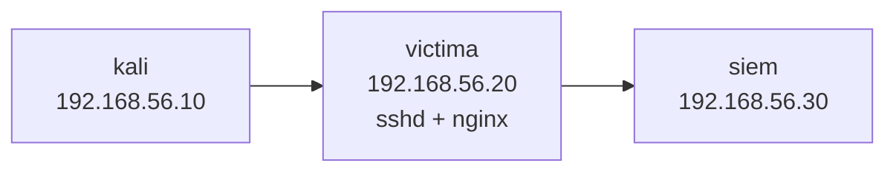
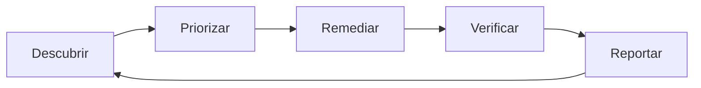

<!-- _class: lead -->

# S01 - Un programa de seguridad que se pueda sostener

### Defensa y respuesta a incidentes

**Rogelio Arriaga - Raptor Dev Services**

<!--
Bienvenida. Antes de empezar, cada equipo confirma que tiene su laboratorio: tres máquinas en una red host-only 192.168.56.0/24 (kali .10, victima .20, siem .30). Hoy solo se usa victima y una terminal local; el SIEM se instala en la sesión 2. Si alguien no tiene el laboratorio del curso de Ciberseguridad, se monta en la apertura, no a la mitad de la práctica.
-->

---

## Agenda del día

| Bloque | Qué hacemos | Tiempo aprox. |
|---|---|---|
| Apertura | Lema, objetivos, cómo funciona el curso | 25 min |
| Parte 1 | Inventario de activos: qué hay y de quién es | 40 min |
| Parte 2 | Clasificar datos y priorizar | 35 min |
| Parte 3 | Políticas, estándares y procedimientos | 35 min |
| Parte 4 | Gestión de vulnerabilidades | 55 min |
| Parte 5 | Práctica: inventario priorizado de un sistema de ejemplo | 90 min |
| Cierre | Errores típicos, tarea y quiz | 20 min |

<!-- Hay un descanso de 10 minutos entre la Parte 2 y la Parte 3, y otro a la mitad de la práctica. -->

---

## El lema de la sesión

> No se defiende lo que no se sabe que existe.

- Un equipo que defiende no empieza por una herramienta: empieza por una lista.
- La pregunta "¿qué tenemos y qué vale?" casi nadie la contesta de memoria.
- Hoy la contestamos por escrito, con un dueño por cada cosa y un orden de atención.

<!-- Pregunta al grupo: ¿alguien sabe cuántos servidores, cuentas y bases de datos tiene su proyecto? Casi nadie. Esa es la razón de la sesión. -->

---

## Al terminar puedes

- Armar un inventario de activos y datos con dueño, clase de datos, criticidad y exposición.
- Decir qué se protege primero y **por qué**, con un criterio escrito.
- Distinguir una política de un estándar, un procedimiento y una guía.
- Priorizar una vulnerabilidad con CVSS, EPSS, KEV y el contexto propio.
- Escribir una política de parches con quién y cuándo.

---

## Cómo se trabaja en este curso

- **Seis sesiones de cinco horas:** clase, práctica, tarea y quiz en la plataforma.
- **Un solo laboratorio** que crece sesión a sesión: `kali`, `victima` y `siem`.
- **Verlo fallar:** una regla de detección que nunca sonó en una prueba no se sabe si funciona. Aplica a todo el curso.
- **Todo lo ficticio se dice ficticio:** los sistemas y empresas de ejemplo son "Ejemplo ilustrativo". Las cifras reales llevan fuente y fecha.
- **Todo ataque, con autorización y en laboratorio propio.** Nada contra sistemas ajenos.

---

## El laboratorio común



- Red **host-only** de 192.168.56.0/24, sin salida hacia redes ajenas.
- `kali` es el atacante del curso de Ciberseguridad; `victima` es Ubuntu Server 24.04 LTS; `siem` llega en la sesión 2.
- Las direcciones son del laboratorio: no las uses fuera de él.

---

<!-- _class: lead -->

# Parte 1
## Inventario de activos

---

## Un marco para ubicarnos: NIST CSF 2.0

El Cybersecurity Framework 2.0 del NIST (26 de febrero de 2024) agrupa los resultados de seguridad en seis funciones:

| Función | Idea |
|---|---|
| **Govern** | Quién decide, con qué políticas y qué estrategia de riesgo |
| **Identify** | Qué tenemos y qué riesgos corre |
| **Protect** | Cómo reducimos la probabilidad y el daño |
| **Detect** | Cómo nos enteramos de que algo pasa |
| **Respond** | Qué hacemos cuando pasa |
| **Recover** | Cómo volvemos a operar |

Hoy trabajamos Govern e Identify. Detect es la sesión 2; Respond y Recover, la 3.

Fuente: NIST CSWP 29 (2024).

---

## Por qué empezar por la lista

| Si no hay inventario | Lo que pasa |
|---|---|
| Una máquina olvidada sigue en internet | Es la entrada más fácil: nadie la parcha |
| No se sabe qué datos hay en un servidor | Una alerta no se puede priorizar |
| Nadie es dueño de un sistema | No hay a quién llamar a las tres de la mañana |
| Un proveedor tiene acceso y nadie lo recuerda | Un incidente en el proveedor es un incidente tuyo |

**Activo:** todo lo que tiene valor para la organización y puede perderse, filtrarse o dejar de funcionar. No son solo servidores: son cuentas, datos, proveedores y personas con acceso.

---

## Las cinco preguntas por activo

1. **¿Qué es y dónde vive?** Nombre, tipo, ubicación o proveedor.
2. **¿De quién es?** Una persona con nombre.
3. **¿Qué datos toca y de qué clase?**
4. **¿Qué tan crítico es?** Qué se detiene si falla.
5. **¿Qué tan expuesto está?** Internet, red interna, solo localhost.

Con estas cinco se puede priorizar. Todo lo demás (versión, licencia, fecha de compra) se añade cuando haga falta, no antes.

Fuente: *Defensive Security Handbook* (Berlin, Brotherston y Reyor, 2024), cap. 2.

---

## Qué cuenta como activo

| Tipo | Ejemplos |
|---|---|
| Equipos | Servidores, VM, laptops, dispositivos de red |
| Aplicaciones y servicios | La API, el sitio, el repositorio, el CI |
| Datos | Bases de datos, respaldos, bitácoras |
| Cuentas y accesos | El dominio, la nube, el correo, las llaves SSH |
| Terceros | Pasarela de pago, hosting, quien tiene acceso a tu repo |
| Personas | Quién sabe operar qué |

Un inventario que solo lista servidores deja fuera por dónde se entra con más frecuencia: las cuentas.

---

## Un esquema mínimo

```csv {1|2-3|*}
id,nombre,tipo,dueno,datos,clase_datos,criticidad,exposicion,notas
A01,tienda-web,aplicacion,ana,pedidos y correos de clientes,confidencial,3,3,nginx en victima puerto 443
A03,postgres-tienda,base de datos,luis,clientes y pedidos,confidencial,3,1,escucha solo en localhost
```

- Un CSV se puede versionar en Git, revisar en un pull request y leer con `awk`.
- **Una fila por activo**, un `id` que no cambia, un dueño que es una persona.
- La escala de `criticidad` y `exposicion` es **nuestra**: 1 a 3. Lo importante es que esté escrita.

---

## Cómo se llena sin empezar de cero

| Fuente | Qué da |
|---|---|
| `ss -tulpn` en cada servidor | Qué escucha y qué proceso lo abrió |
| `dpkg-query -W` | Paquetes y versiones instalados |
| Consola del proveedor de nube y del dominio | Instancias, DNS, cuentas |
| Repositorio de infraestructura como código | Lo que se supone que existe |
| Lista de cuentas del correo y del repositorio | Quién tiene acceso a qué |

El descubrimiento y la memoria del equipo casi nunca coinciden. **La diferencia entre las dos listas es el hallazgo.**

---

## Demostración: qué escucha una máquina

```bash
sudo ss -tulpn
```

| Columna | Qué dice |
|---|---|
| `Netid` | tcp o udp |
| `Local Address:Port` | `0.0.0.0:22` escucha en todas las interfaces; `127.0.0.1:5432` solo en local |
| `Process` | El proceso dueño del puerto |

Un puerto en `127.0.0.1` es **exposición 1**; el mismo servicio en `0.0.0.0` detrás de un firewall abierto es **exposición 3**. La diferencia entre las dos es una línea de configuración.

<!-- Que cada equipo lo corra en su victima. Comparar con el inventario que creen que tienen. Casi siempre aparece algo que nadie puso. -->

---

## Demostración: qué software hay

```bash
dpkg-query -W -f='${Package},${Version}\n' | wc -l
dpkg-query -W -f='${Package},${Version}\n' | grep -E '^(openssh-server|nginx),'
```

- El primer comando cuenta los paquetes; el segundo trae los dos que más importan en `victima`.
- La salida real depende de la máquina: lo importante es que el formato `paquete,versión` ya es un CSV.
- Esa lista alimenta la gestión de vulnerabilidades: **sin versiones no se sabe qué parches faltan**.

---

## El inventario envejece

| Momento | Qué pasa con la fila |
|---|---|
| Alta | Nace con dueño, clase de datos, criticidad y exposición |
| Cambios | Una versión nueva, otro dueño, otra exposición |
| Baja | Se quita de la lista **y** de la red |

- **Alta:** nadie pone algo en producción sin dueño ni fila.
- **Baja:** el activo olvidado (la VM de una demo de hace un año) es el favorito de quien ataca.

Un inventario hecho una vez es un recuerdo. Uno que se actualiza con cada alta y baja es una herramienta.

---

## Reglas para que no se pudra

| Regla | Qué evita |
|---|---|
| **Una sola fuente de verdad** | Tres hojas que dicen cosas distintas |
| **Automatizar lo que se pueda** | Que dependa de que alguien se acuerde |
| **Un equipo o una persona que lo cuida** | Que sea de todos y por lo tanto de nadie |
| **Revisión con fecha** | Que envejezca en silencio |
| **Alguien con autoridad que lo respalde** | Que se ignore cuando estorbe |

Fuente: *Defensive Security Handbook*, cap. 2, "Asset Management Guidelines".

---

## Error típico: el inventario de una sola vez

- Se hace con entusiasmo en enero.
- En marzo hay dos servidores nuevos y un proveedor distinto.
- En junio nadie lo abre.
- En el incidente, es lo primero que se busca y lo que menos sirve.

**Arreglo:** el alta de un activo es parte de ponerlo en producción, y la revisión trimestral es una tarea con dueño y fecha.

---

<!-- _class: lead -->

# Parte 2
## Clasificar datos y priorizar

---

## Clasificar los datos

**Clasificar** es decidir cuánto cuidado merece cada tipo de dato, antes del incidente.

| Clase | Qué es | Ejemplo ilustrativo |
|---|---|---|
| Público | Se puede publicar sin daño | La página de precios |
| Interno | No es secreto pero no es para fuera | El calendario del equipo |
| Confidencial | Su filtración daña a personas o al negocio | Correos y teléfonos de clientes |
| Restringido | Su filtración es grave y el acceso es muy limitado | Contraseñas, llaves, respaldos completos |

No existe una escala única obligatoria: el libro (cap. 2) pide crear una propia. Esta es la del curso.

---

## Una clase vale por lo que dispara

| Si el dato es... | Se decide... |
|---|---|
| Confidencial | Quién puede verlo, si va cifrado en reposo, cuánto se conserva |
| Restringido | Acceso nominal, registro de cada acceso, respaldo cifrado |
| Público | Nada especial, salvo que no se modifique sin autorización |

Una clase que **no cambia ninguna decisión** sobra. Si todo es "confidencial", la clase no distingue nada.

Si los datos son personales, se cruza con la ley aplicable (en México, la ley de protección de datos personales en posesión de particulares): nota `12-seguridad/05-legislacion/12-proteccion-datos-personales.md`.

---

## Criticidad y exposición

| Nivel | Criticidad: qué se detiene si falla | Exposición: quién lo alcanza |
|---|---|---|
| 1 | Molesta, el negocio sigue | Solo la máquina local o una red aislada |
| 2 | Se detiene una parte del negocio | Red interna o acceso con VPN |
| 3 | Se detiene el negocio o hay daño a clientes | Alcanzable desde internet |

Son definiciones **de la lámina**: tu equipo puede cambiarlas. Lo que no puede es no escribirlas.

<!-- Aclarar: estas escalas son un método cualitativo propio, no un estándar. Se defienden por ser claras, no por ser oficiales. -->

---

## Puntaje = criticidad × exposición

```sim riesgo
probabilidad: Exposición 1, Exposición 2, Exposición 3
impacto: Criticidad 1, Criticidad 2, Criticidad 3
nivel: Bajo | 1 | 2
nivel: Medio | 3 | 4
nivel: Alto | 5 | 9
riesgo: Respaldos nocturnos | 1 | 3
riesgo: Servidor de demo viejo | 3 | 1
riesgo: Aplicación de la tienda | 3 | 3
```

- Los datos son un **ejemplo ilustrativo**. Aquí la "probabilidad" de la simulación hace de exposición y el "impacto" de criticidad.
- Cambia los números y mira cómo se mueve cada activo entre los niveles.

---

## Por qué la exposición pesa

| Activo (ejemplo) | Criticidad | Exposición | Puntaje |
|---|---|---|---|
| Aplicación de la tienda | 3 | 3 | **9** |
| Respaldos nocturnos | 3 | 1 | 3 |
| Servidor de demo viejo | 1 | 3 | 3 |

El servidor de demo vale poco, pero está en internet: **empata con los respaldos**, que valen mucho y no están a la vista. Si se atiende solo por criticidad, el servidor olvidado nunca sube en la lista.

El puntaje **no reemplaza el juicio**: empieza la conversación y obliga a escribir por qué primero esto.

---

## Demostración: el inventario ordenado

```bash
./priorizar.sh inventario.csv | head -5
```

```text
9  A01  tienda-web           ana   confidencial
9  A09  cuenta-dns           luis  restringido
6  A02  api-pagos            ana   restringido
6  A05  victima              luis  interno
6  A07  repo-git             ana   confidencial
```

Salida real del script de la práctica sobre el inventario de ejemplo. Observa que **la cuenta del dominio** empata con la tienda: sin ella, quien la controle controla el dominio de todo lo demás.

---

## Datos que faltan = hallazgos

```bash
awk -F, '$4=="sin dueno" {print $1, $2}' inventario.csv
```

```text
A10 demo-2025
```

- Un activo sin dueño es una pregunta que nadie contesta cuando se rompe.
- Un activo sin clase de datos es una decisión que nadie tomó.
- Contar las filas incompletas es la primera métrica útil del inventario.

---

## Error típico: puntaje por intuición

| Qué se hace | Qué pasa |
|---|---|
| "Todo es crítico" | Nada se prioriza; se atiende lo más ruidoso |
| Poner 3 por si acaso | La escala pierde significado |
| Sin escribir el criterio | Cada quien pone un número distinto |
| Olvidar la exposición | El servidor viejo en internet nunca sube |

**Arreglo:** el criterio va en una tabla de tres renglones, a la vista, y se aplica igual a todas las filas.

---

<!-- _class: lead -->

# Parte 3
## Políticas, estándares y procedimientos

---

## Cuatro documentos que se confunden

| Documento | Responde | Cambia |
|---|---|---|
| **Política** | Qué buscamos y por qué; quién manda | Poco (años) |
| **Estándar** | Qué requisito concreto y obligatorio se cumple | A veces |
| **Procedimiento** | Cómo se hace, paso a paso | Seguido |
| **Guía** | Qué se recomienda si hay opciones | Seguido |

Fuente: *Defensive Security Handbook*, caps. 3 y 4.

---

## La misma regla en las cuatro capas

| Capa | Ejemplo ilustrativo |
|---|---|
| Política | "Los sistemas se mantienen actualizados para reducir el riesgo de explotación." |
| Estándar | "Las actualizaciones de seguridad críticas se instalan en un máximo de 7 días." |
| Procedimiento | "Para parchar una VM: `apt update`, `apt upgrade`, reiniciar si lo pide, comprobar el servicio." |
| Guía | "Conviene parchar fuera de las horas de más uso." |

Cada capa cambia a su ritmo. Si el plazo de siete días viviera en la política, cambiarlo exigiría la firma de la dirección. Si los pasos de `apt` vivieran en el estándar, cada cambio de herramienta lo reescribiría.

---

## Qué lleva una política que alguien va a leer

1. **Propósito:** una frase sobre el riesgo que reduce.
2. **Alcance:** a quién y a qué aplica.
3. **Roles y responsabilidades:** quién hace qué.
4. **La regla:** en lenguaje que entienda quien no es técnico.
5. **Excepciones:** cómo se pide, quién autoriza y por cuánto tiempo.
6. **Consecuencias:** qué pasa si no se cumple.
7. **Dueño y fecha de revisión.**

Una página es mejor que diez. Una política que nadie encuentra no existe: se publica donde la gente trabaja.

Fuente: *Defensive Security Handbook*, cap. 3.

---

## Error típico: la política copiada

- Se descarga una plantilla de otra empresa.
- Habla de comités que aquí no existen y de herramientas que nadie usa.
- Nadie la lee. El día de una auditoría o de un incidente se descubre que la organización **no hace** lo que dice que hace.

**Es peor que no tener ninguna**, porque ahora hay evidencia escrita de incumplimiento.

**Arreglo:** escribe solo lo que sí vas a cumplir; lo demás va a la lista de pendientes con dueño.

---

## La excepción también se documenta

Habrá sistemas que no se pueden parchar a tiempo: un proveedor que no certifica la actualización, una ventana de mantenimiento fija.

| Campo de la excepción | Ejemplo ilustrativo |
|---|---|
| Qué se incumple | El parche de `openssh-server` en `victima` |
| Por qué | El servicio de pruebas no tolera reinicios hasta el viernes |
| Control compensatorio | Cerrar el puerto 22 al exterior; solo desde la red de administración |
| Quién autoriza | La persona responsable técnica |
| Vence | En 10 días; se revisa antes |

Sin este camino las excepciones ocurren de todos modos, pero **en silencio**.

---

<!-- _class: lead -->

# Parte 4
## Gestión de vulnerabilidades

---

## Qué es una vulnerabilidad y qué es gestionarla

**Vulnerabilidad:** debilidad que puede aprovecharse.

Gestionarla es un ciclo repetido, no una auditoría anual. Cada paso responde una pregunta distinta.



---

## El ciclo, un paso a la vez

| Paso | Pregunta | Ejemplo en `victima` |
|---|---|---|
| Descubrir | ¿Qué versiones hay y qué fallas conocidas tienen? | `dpkg-query` más una base de CVE |
| Priorizar | ¿Cuál importa primero, aquí y ahora? | CVSS, EPSS, KEV y exposición |
| Remediar | ¿Parcho, cambio la configuración, quito la exposición o acepto el riesgo por escrito? | `apt upgrade` |
| Verificar | ¿Se corrigió de verdad? | Volver a medir la versión y el servicio |
| Reportar | ¿Cuántas hay abiertas y cuánto tardan en cerrarse? | Una tabla mensual |

Fuente: *Defensive Security Handbook*, cap. 18; control 7 de los CIS Controls v8.1.

---

## CVE: el nombre de una falla

- Un **CVE** es un identificador público: `CVE-año-número`.
- No dice cuán grave es, ni si alguien la explota. Solo nombra la falla.
- La severidad, la probabilidad y la explotación vienen de **otras fuentes**.

La base de datos nacional de vulnerabilidades de EE. UU. (NVD) publica cada CVE con su descripción, su puntaje y las versiones afectadas.

---

## Señal 1: CVSS, la severidad técnica

- Lo publica FIRST. La versión 4.0 salió el **1 de noviembre de 2023**.
- Cuatro grupos de métricas: **Base, Threat, Environmental y Supplemental**.

| Calificación | Puntaje |
|---|---|
| None | 0.0 |
| Low | 0.1 a 3.9 |
| Medium | 4.0 a 6.9 |
| High | 7.0 a 8.9 |
| Critical | 9.0 a 10.0 |

Lo que dice: **qué tan grave es la falla en abstracto**. Lo que no dice: si alguien la está explotando ni si en tu sistema importa.

Muchas bases publican todavía puntajes de CVSS **v3.1**: revisa qué versión lees.

---

## Señal 2: EPSS, la probabilidad

- Lo publica FIRST. Estima la probabilidad de que una CVE sea **explotada en la naturaleza en los próximos 30 días**.
- Un valor de 0 a 1, actualizado a diario.
- Es un modelo estadístico: se recomienda combinarlo con CVSS y con KEV, no usarlo solo.

```bash
curl -fsS 'https://api.first.org/data/v1/epss?cve=CVE-2024-6387' |
  jq -r '.data[] | "\(.cve) epss=\(.epss) percentil=\(.percentile) fecha=\(.date)"'
```

```text
CVE-2024-6387 epss=0.995060000 percentil=0.999450000 fecha=2026-11-10
```

Salida real consultada el 11 de noviembre de 2026. Mañana el valor puede ser otro.

---

## Señal 3: KEV, lo que ya se explota

- CISA mantiene el catálogo de vulnerabilidades **explotadas activamente en la naturaleza**.
- Cada entrada trae fecha de alta y fecha límite para las agencias federales de EE. UU.
- Es una lista corta y confiable de "esto ya está pasando", pero **no es exhaustiva**: que no esté no significa que nadie la explote.

```bash
jq -r '"catalogVersion=\(.catalogVersion) total=\(.count)"' known_exploited_vulnerabilities.json
jq -r '.vulnerabilities[] | select(.cveID=="CVE-2024-6387") | .cveID' known_exploited_vulnerabilities.json | wc -l
```

```text
catalogVersion=2026.11.10 total=1779
0
```

Salida real: el catálogo trae 1779 entradas a esa fecha y la CVE del ejemplo **no** está.

---

## Un caso real: CVE-2024-6387

Una condición de carrera en `sshd` de OpenSSH. Afecta de la versión **8.5p1 a la 9.7p1**; se corrigió en la **9.8**, publicada el 1 de julio de 2024.

| Señal | Valor (consultado el 11 de noviembre de 2026) |
|---|---|
| CVSS v3.1 base (NVD) | 8.1, High: `AV:N/AC:H/PR:N/UI:N/S:U/C:H/I:H/A:H` |
| EPSS | 0.995, percentil 0.999 (fecha 2026-11-10) |
| KEV | No está (versión 2026.11.10) |

Fuentes: NVD, API de EPSS de FIRST, catálogo KEV de CISA, notas de OpenSSH 9.8.

---

## Qué dicen las tres señales juntas

- **Severa pero difícil:** `AC:H` es complejidad alta. Con ese mismo vector y complejidad baja el puntaje sería 9.8.
- **Probabilidad alta según el modelo**, pero **sin explotación confirmada** en el catálogo.
- Las notas de OpenSSH 9.8 aclaran el detalle que los titulares omitieron: la explotación se demostró en Linux/glibc de **32 bits** con ASLR y, en laboratorio, requirió **de 6 a 8 horas** de conexiones continuas en promedio.

La decisión correcta depende de **tu contexto**: ¿ese `sshd` está en internet? ¿qué versión corre? Una sola señal habría dado una respuesta equivocada hacia arriba o hacia abajo.

---

## Prioridad = señales + contexto

| Pregunta de contexto | Si la respuesta es sí... |
|---|---|
| ¿El servicio está expuesto a internet? | Sube la prioridad |
| ¿Toca datos confidenciales o restringidos? | Sube |
| ¿Hay un control que lo compense (firewall, VPN, WAF)? | Baja, y se documenta |
| ¿Se puede aplicar el arreglo sin romper el servicio? | Define la ventana, no la prioridad |

Orden de lectura: **KEV** (ya pasa) → **exposición y datos** (aquí importa) → **EPSS** (qué tan probable) → **CVSS** (qué tan grave).

---

## Demostración: ver qué parches faltan

```bash
apt list --upgradable 2>/dev/null
sudo unattended-upgrades --dry-run --debug 2>&1 | tail -n 5
```

- `apt list --upgradable` lista paquetes con una versión más nueva disponible en los orígenes configurados.
- `unattended-upgrades --dry-run` simula lo que instalaría la actualización automática, sin instalarla.
- Un paquete en la lista no es necesariamente una vulnerabilidad: hay que cruzarlo con el aviso de seguridad.

---

## Parches automáticos en Ubuntu

| Archivo | Qué decide |
|---|---|
| `/etc/apt/apt.conf.d/20auto-upgrades` | Con qué frecuencia actualiza la lista y ejecuta `unattended-upgrade` |
| `/etc/apt/apt.conf.d/50unattended-upgrades` | Qué orígenes permite y si reinicia solo |

En una instalación de Ubuntu 26.04 revisada para este curso, los orígenes permitidos por omisión incluyen `${distro_id}:${distro_codename}-security`, y `Unattended-Upgrade::Automatic-Reboot` viene **comentado** (sin activar).

**Consecuencia para la política:** un parche de kernel o de una biblioteca que **no se reinicia no está aplicado del todo**. La política decide quién reinicia y cuándo.

---

## Error típico: parchar sin verificar

```bash
sudo apt install --only-upgrade openssh-server
dpkg-query -W -f='${Version}\n' openssh-server
ps -o pid,lstart,cmd -C sshd
```

- La versión instalada ya es la nueva.
- Pero el proceso `sshd` sigue corriendo con el binario viejo hasta que se reinicie.
- **Verificar** es medir las dos cosas: el paquete **y** el proceso.

<!-- Los dos primeros comandos son los de la práctica. El tercero muestra la fecha de arranque del proceso: si es anterior al parche, sigue corriendo el viejo. -->

---

## La política de parches: quién y cuándo

Cuatro preguntas por tipo de activo y urgencia:

1. **Qué** se parcha.
2. **Quién** lo hace.
3. **Cuándo**: plazo máximo.
4. **Cómo se comprueba.**

Un plazo sin dueño no se cumple. Un dueño sin plazo tampoco.

---

## Una tabla de plazos de ejemplo

| Condición | Plazo máximo | Quién |
|---|---|---|
| Explotada activamente (en KEV o con evidencia propia) | 3 días | Responsable técnico |
| CVSS crítico o alto en un servicio expuesto a internet | 7 días | Responsable técnico |
| CVSS alto en un servicio interno | 30 días | Administrador del sistema |
| El resto | Siguiente mantenimiento mensual | Administrador del sistema |

**Ejemplo ilustrativo.** Los plazos son decisión de cada organización, no un estándar.

Como referencia de lo que una autoridad considera urgente: las entradas del catálogo KEV agregadas entre junio y noviembre de 2026 traen fechas límite de **3 o 14 días** después de su alta. Es una obligación para agencias federales de EE. UU., no para cualquier organización.

---

## Métricas que sirven y que engañan

| Sirven | Engañan |
|---|---|
| % de activos con dueño | "Cero vulnerabilidades": nadie las ve todas |
| % del inventario con datos clasificados | El número bruto de hallazgos del escáner |
| Tiempo medio de remediación por severidad | "% de parches instalados" sin decir de qué |
| Vulnerabilidades abiertas más allá de su plazo | Parches instalados sin reiniciar |

Una métrica buena **cambia una decisión**. Si el número sube o baja y nadie hace nada distinto, es decoración.

---

<!-- _class: lead -->

# Parte 5
## Práctica

---

## Qué vas a hacer

Con un sistema de ejemplo (**Ejemplo ilustrativo**, una tienda pequeña):

1. Armar el inventario de 12 activos con las cinco preguntas.
2. Clasificar los datos y calcular criticidad × exposición.
3. **Verlo fallar:** meter un dato inválido y descubrir cómo se pierde un activo de la lista.
4. Consultar CVSS, EPSS y KEV de una CVE real y decidir con contexto.
5. Escribir la regla de excepción de un parche que no puedes aplicar.

El detalle paso a paso está en `practica.md`.

---

## Verlo fallar

Escribe `alta` en lugar de `2` en la criticidad de una fila y corre el script.

- ¿Qué pasa con esa fila en la lista priorizada?
- ¿El script avisa? ¿Con qué código de salida termina?
- ¿Lo notarías si solo miraras la lista?

**La lección:** una herramienta que descarta en silencio un activo es peor que ninguna: da una lista que parece completa y no lo es.

<!-- Dejar que descubran que la fila desaparece. Luego mostrar el mensaje por stderr y el código de salida distinto de cero. -->

---

<!-- _class: lead -->

# Cierre

---

## Errores típicos de la sesión

| Error | Se ve así |
|---|---|
| Inventario de una sola vez | Funciona un mes |
| Activo sin dueño | "Eso lo hizo alguien que ya no está" |
| Todo es crítico | Nada se prioriza |
| Política copiada | Nadie la cumple |
| Priorizar solo por CVSS | Una cola de críticos que no importan |
| Parchar sin verificar ni reiniciar | El proceso viejo sigue vivo |
| Excepciones en silencio | Hay riesgos aceptados que nadie firmó |

---

## Lo que se lleva esta sesión

- Una lista de activos con dueño, clase de datos, criticidad y exposición.
- Un criterio escrito de prioridad, aplicado igual a todos.
- La diferencia entre política, estándar, procedimiento y guía.
- Tres señales para priorizar una vulnerabilidad (CVSS, EPSS, KEV) y el contexto que las completa.
- Una política de parches con quién y cuándo, y un camino para las excepciones.

---

## Tarea

La **política de parches** de ese sistema de ejemplo: alcance, plazos por condición, responsables, cómo se verifica y cómo se pide una excepción.

- Entregable: un documento de una a dos páginas en Markdown.
- Criterios y formato en `tarea.md`.
- Lectura previa: la nota `12-seguridad/06-blue-team/01-programa-de-seguridad.md`.

Libros: *Defensive Security Handbook* (Berlin, Brotherston y Reyor, 2024), caps. 1 a 4 y 18.

---

## Libros de la sesión

| Libro | Capítulos |
|---|---|
| *Defensive Security Handbook* (Berlin, Brotherston y Reyor, 2024) | Cap. 1 Creating a Security Program; cap. 2 Asset Management and Documentation; cap. 3 Policies; cap. 4 Standards and Procedures; cap. 18 Vulnerability Management |

Se citan por capítulo. Cada quien consigue su copia.

---

<!-- _class: lead -->

# Gracias
## Quiz de la sesión 1 en la plataforma
