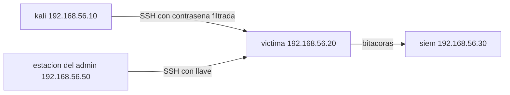
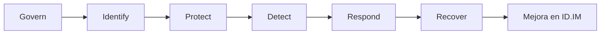
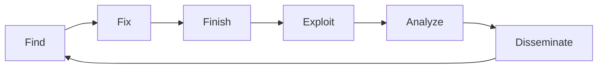

<!-- _class: lead -->

# S03 - Responder a un incidente

### Defensa y respuesta a incidentes

**Rogelio Arriaga - Raptor Dev Services**

<!--
Bienvenida. Antes de empezar, cada equipo confirma sus tres máquinas del laboratorio (kali, victima, siem) y toma una instantánea de victima: la práctica la va a romper dos veces y hay que poder volver.
Si alguien no tiene victima con SSH funcionando, se resuelve en la apertura, no a la mitad del simulacro.
-->

---

## Agenda del día

| Bloque | Qué hacemos | Tiempo aprox. |
|---|---|---|
| Apertura | Lema, objetivos, reglas del laboratorio, el escenario | 25 min |
| Parte 1 | Evento, incidente y cómo ordena NIST la respuesta | 50 min |
| Parte 2 | Roles, bitácora, triage y comunicación | 45 min |
| Parte 3 | Contener, erradicar y recuperar | 60 min |
| Parte 4 | F3EAD: la respuesta como ciclo de inteligencia | 25 min |
| Parte 5 | Práctica: el simulacro | 80 min |
| Cierre | Errores típicos, tarea y quiz | 15 min |

<!-- Hay un descanso de 10 minutos entre la Parte 2 y la Parte 3, y otro a la mitad del simulacro. -->

---

## El lema de la sesión

> Contener antes de entender borra la evidencia; entender sin contener deja al atacante adentro.

- La noche del incidente nadie piensa bien. Por eso el orden se decide **antes**.
- Hoy practicamos el orden hasta que sea un reflejo, y lo practicamos fallando a propósito.
- Un incidente bien resuelto se reconoce por su bitácora, no por su heroísmo.

<!-- Pregunta al grupo: ¿alguien ha reiniciado un servidor "para ver si se arreglaba"? En un incidente, ese reflejo es el error más caro. -->

---

## Al terminar puedes

- Distinguir un **evento** de un **incidente** y declararlo con un criterio escrito.
- Explicar cómo organiza NIST SP 800-61 Rev. 3 la respuesta y qué cambió respecto a la Rev. 2.
- Asignar los cuatro papeles de una respuesta y llevar una bitácora con hora.
- Decidir **qué se preserva antes de contener** y ejecutar la contención en un Linux.
- Erradicar con una lista de persistencias, no con una corazonada.
- Aplicar F3EAD para que cada incidente mejore la detección del siguiente.

---

## Reglas del laboratorio

> **Marco legal y ético.** Todo lo que se hace hoy ocurre en **tu** laboratorio, sobre máquinas **tuyas**, con la misma carta de autorización del curso de Ciberseguridad. Nada de esto se prueba contra un sistema que no sea tuyo, ni siquiera "para ver si funciona".

- El "atacante" de hoy es un compañero de equipo que ejecuta un guion benigno en tu red aislada.
- Las contraseñas, usuarios, IP y datos son **ficticios**. Ninguna contraseña real entra al laboratorio.
- Si el simulacro se descontrola, se restaura la instantánea: no pasa nada que no se pueda deshacer.

<!-- Insiste en que "contener" nunca significa responder a un tercero. El capítulo 6 de Brown y Roberts se llama "Finishing Is Not Hacking Back". -->

---

## El escenario (Caso hipotético)



- `victima`: Ubuntu Server 24.04 LTS con SSH y datos ficticios en `/srv/datos`.
- `kali`: el atacante. `siem`: donde se ven las alertas. `estación del admin`: quien responde.
- **Caso hipotético:** personas, hosts y datos son inventados para enseñar.

---

## La señal de la noche

```
2026-11-10T02:30:41  Invalid user ubuntu from 192.168.56.10
2026-11-10T02:30:43  Failed password for invalid user ubuntu
2026-11-10T02:31:02  Failed password for soporte
2026-11-10T02:31:17  Accepted password for soporte from 192.168.56.10
```

- Una IP que nunca había entrado.
- Dos fallos y un acierto: alguien **probaba** y de pronto **sabía**.
- Las 2:31 de la mañana, de un martes.
- `soporte` es un usuario real; su contraseña llevaba meses en una lista filtrada.

¿Esto es un evento o un incidente?

<!-- Deja que el grupo debata dos minutos antes de pasar a la siguiente lámina. No hay respuesta única: depende de los criterios de la organización. -->

---

<!-- _class: lead -->

# Parte 1
## Evento, incidente y el ciclo

---

## Evento frente a incidente

| | Evento | Incidente |
|---|---|---|
| Qué es | Cualquier ocurrencia observable en activos de cómputo | Ocurrencia que pone en peligro, real o inminentemente y sin autoridad legal, la integridad, confidencialidad o disponibilidad, o viola ley o políticas de seguridad |
| Ejemplo | Un inicio de sesión | Un inicio de sesión con una credencial robada |
| Quién decide | Nadie: ocurre | Alguien, con un criterio |

Fuente: NIST SP 800-61r3 (abril de 2025), sección 1; la definición de incidente viene de la ley FISMA de 2014.

> "Se necesita análisis adicional" para saber si un evento adverso indica un incidente.

---

## Declarar es una decisión con dueño

La subcategoría **DE.AE-08** pide declarar un incidente **cuando los eventos cumplen criterios definidos**, considerando los falsos positivos conocidos.

Criterios mínimos que cabe en una hoja (Ejemplo ilustrativo):

| Criterio | Ejemplo |
|---|---|
| Acceso de una cuenta desde una IP nunca vista, fuera de horario | `soporte` a las 02:31 desde 192.168.56.10 |
| Uso de privilegios que la cuenta no suele usar | `sudo tee` a `/etc/cron.d` |
| Cambio de persistencia sin cambio autorizado | una llave nueva en `authorized_keys` |

Dos criterios o más: se declara. Declarar activa el plan, el líder y la bitácora.

<!-- Estos criterios son de la lámina, no de un estándar. Cada organización escribe los suyos. -->

---

## Lo que cambió: NIST SP 800-61

| | Revisión 2 (agosto de 2012) | Revisión 3 (abril de 2025) |
|---|---|---|
| Forma | Un ciclo de cuatro fases | Un perfil comunitario del CSF 2.0 |
| Alcance | Cómo manejar incidentes, con detalle técnico | Recomendaciones y consideraciones de gestión de riesgo |
| Respuesta | Fases propias | Funciones Detect, Respond y Recover |
| Mejora | Al final: actividad posterior | Continua, en todas las funciones |

La Rev. 3 **sustituye** a la Rev. 2. Fuente: NIST SP 800-61r3, secciones 1.1 y 2.1.

<!-- Aviso: en muchos materiales y libros aún se enseña el ciclo de la Rev. 2. Es útil conocerlo, pero la referencia vigente es la Rev. 3. Cita la fecha: a noviembre de 2026. -->

---

## Las seis funciones del CSF 2.0



- **Govern, Identify y Protect** no son la respuesta: son la preparación.
- **Detect, Respond y Recover** son la respuesta.
- Las lecciones de **todas** se alimentan a la categoría de mejora, y no se esperan al final.

---

## De las fases viejas a las funciones

<!-- _pasos: filas -->

| Fase de la Rev. 2 | Funciones de la Rev. 3 |
|---|---|
| Preparación | Govern, Identify (todas), Protect |
| Detección y análisis | Detect, Identify (mejora) |
| Contención, erradicación y recuperación | Respond, Recover, Identify (mejora) |
| Actividad posterior al incidente | Identify (mejora) |

Es la tabla 1 de la publicación. Si tu equipo aprendió las cuatro fases, ya sabe dónde cae cada una.

---

## Una lista operativa para el teclado

Los libros de respuesta ordenan las acciones así (*Intelligence-Driven Incident Response*, Brown y Roberts, 2023, cap. 3):

<!-- _pasos: lista -->

1. **Preparación:** lo que hiciste antes del incidente.
2. **Identificación:** saber que hay uno.
3. **Contención:** que no se extienda.
4. **Erradicación:** que no pueda volver.
5. **Recuperación:** volver a operar con confianza.
6. **Lecciones aprendidas:** que el siguiente cueste menos.

En el curso se usa como **lista de comprobación**; cada paso se sostiene con una subcategoría de NIST.

---

## Cada paso con su subcategoría

| Paso | Qué pide NIST SP 800-61r3 |
|---|---|
| Identificar | Triage y validar (RS.MA-02), categorizar y priorizar (RS.MA-03), declarar (DE.AE-08) |
| Analizar | Qué ocurrió y causa raíz (RS.AN-03), bitácora de acciones con integridad (RS.AN-06), datos con su procedencia (RS.AN-07) |
| Contener | Evitar la expansión (RS.MI-01) |
| Magnitud | Buscar indicadores y persistencia en otros activos (RS.AN-08) |
| Erradicar | Eliminar persistencia y puntos de entrada (RS.MI-02) |
| Recuperar | Restaurar, verificar integridad y declarar el fin (RC.RP-01 a RC.RP-06) |

---

## Demostración: ¿hubo un incidente?

Una consulta sobre la bitácora de `victima`, de menos a más pregunta:

```bash
grep -E "Accepted|Failed|Invalid" auth.log
awk '/Accepted/ {print $9}' auth.log | sort | uniq -c
awk '/Accepted/ {print $9}' auth.log | sort -u > ips-conocidas.txt
```

```
      1 192.168.56.10
      1 192.168.56.50
```

Dos IP aceptadas. La `.50` es la estación del administrador. ¿De quién es la `.10`?

Una lista de IP conocidas, mantenida, convierte "esta IP es nueva" en una regla de detección.

<!-- Estas salidas son de un auth.log de ejemplo (Caso hipotético), no de una máquina real. -->

---

## Error típico: reiniciar para limpiar

- "Mejor reinicio el servidor y vemos."
- Se pierden la memoria, las conexiones abiertas y los procesos.
- Los procesos del atacante que vivían **solo en memoria** desaparecen sin dejar rastro.
- Lo que sobrevive es lo que estaba en disco... incluida su persistencia.

Un reinicio no contiene: **destruye lo que más cuesta recuperar** y deja intacto lo que el atacante necesita para volver.

Fuente de la regla: RFC 3227, sección 2.2 (no apagar antes de completar la recolección de evidencia).

---

<!-- _class: lead -->

# Parte 2
## Quién hace qué

---

## La respuesta ya no es solo del equipo técnico

NIST SP 800-61r3, sección 2.2, lista quiénes participan:

| Rol | Qué aporta |
|---|---|
| Liderazgo | Autoriza acciones de alto impacto, como apagar o reconstruir servicios |
| Incident handlers | Verifican, reúnen y analizan datos, priorizan y limitan el daño |
| Tecnología | Arquitectos, administradores, desarrolladores |
| Legal | Revisa planes y consecuencias legales |
| Comunicación | Habla con medios y público |
| Recursos humanos, seguridad física, dueños de los activos | Según el caso |
| Terceros | Proveedores de nube, de servicios de seguridad: responsabilidad compartida |

Los roles cambian según la organización y el incidente.

---

## Los cuatro papeles de un equipo pequeño

<!-- _pasos: filas -->

| Papel | Responsabilidad |
|---|---|
| **Líder del incidente** | Decide y coordina (RS.MA-01 sugiere designar uno por incidente) |
| **Responsable técnico** | Ejecuta contención y análisis |
| **Escriba** | Registra cronología y decisiones, con hora |
| **Comunicaciones** | Habla con dirección, clientes y terceros |

Con una sola persona hay que jugar los cuatro papeles. Por eso la bitácora se escribe **mientras** se actúa, no después.

*Digital Forensics and Incident Response* (Johansen, 2020), caps. 1 y 2: equipos de respuesta (CSIRT), escalación desde un SOC y sala de guerra.

---

## La bitácora de respuesta

NIST pide que las acciones de la investigación se registren y que **se preserve la integridad y la procedencia** de esos registros (RS.AN-06).

| Hora UTC | Quién | Acción | Resultado | Evidencia |
|---|---|---|---|---|
| 02:58:10 | Ana | Declaro incidente: 2 criterios | Incidente abierto | alerta del SIEM #17 |
| 03:04:30 | Beto | `sudo ss -tanp` a archivo | 2 conexiones de `.10` | `ss-0304.txt` |
| 03:15:10 | Beto | `ufw deny from 192.168.56.10` | Regla aplicada | `ufw status` |

(Ejemplo ilustrativo. Nombres ficticios.)

Cada fila responde: ¿cuándo, quién, qué, con qué resultado y dónde está la prueba?

---

## Triage: la primera media hora

Los pasos de RS.MA son un guion:

1. **Validar** con una revisión preliminar: ¿realmente ocurrió? Estimar severidad y urgencia (RS.MA-02).
2. **Categorizar** por tipo: brecha de datos, ransomware, toma de cuenta, negación de servicio (RS.MA-03).
3. **Priorizar** por alcance, impacto, urgencia y recursos (RS.MA-03).
4. **Escalar o elevar** (RS.MA-04): escalar es más recursos o tiempo; elevar es involucrar un nivel superior.

También hay un canal para que terceros reporten incidentes, y se toman en serio (RS.MA-02).

---

## Escalar no es lo mismo que elevar

| | Escalar | Elevar |
|---|---|---|
| Qué crece | Los recursos o los plazos | El nivel de gestión involucrado |
| Ejemplo | Llamar a más técnicos; pedir otra noche | Avisar a dirección general |
| Cuándo | El incidente es más grande que el equipo | Hay decisiones que el equipo no puede tomar |

Un incidente puede escalar **sin** elevarse, y al revés. Se rastrea el estado de todos los incidentes abiertos para ver cuál necesita cambiar de estrategia (RS.MA-04).

---

## Comunicar: cuatro cosas distintas

NIST SP 800-61r3, RS.CO:

| Tipo | Qué es | Ejemplo |
|---|---|---|
| Coordinación | Quién hace qué ahora entre las partes con rol | Canal del equipo |
| Notificación | Avisar formalmente a clientes, empleados, socios o reguladores | Aviso de brecha |
| Comunicación pública | Hablar con medios y público | Comunicado |
| Intercambio de información | Compartir amenazas con otros | Indicadores con un ISAC |

Las notificaciones deben cumplir las leyes aplicables, y esa regulación evoluciona con frecuencia (RS.CO-02). Para México, ver la nota de protección de datos personales.

---

## Reglas de una comunicación sana

- **Un** canal de mando y **un** escriba.
- Lo que sale al exterior sale de **un** documento, aprobado por el líder.
- Los detalles técnicos sensibles (vulnerabilidades, cuentas implicadas) se restringen: la bitácora de respuesta es información sensible (RS.AN-06).
- Se dice lo que se sabe, lo que no se sabe y cuándo habrá una novedad.

Mensaje de ejemplo al dueño del sistema (Ejemplo ilustrativo):

> 03:00 UTC. Detectamos un acceso no autorizado a `victima`. Lo estamos conteniendo. No sabemos aún qué datos se vieron. Próxima actualización a las 03:30.

---

<!-- _class: lead -->

# Parte 3
## Contener, erradicar y recuperar

---

## El dilema

Dos objetivos legítimos, que chocan:

- **Reunir lo volátil** antes de que desaparezca: memoria, conexiones, procesos.
- **Cortar al atacante** cuanto antes.

NIST lo dice sin rodeos: cada estrategia tiene concesiones; una que observa al atacante puede ir en contra de volver rápido a operar (RS.MA-03 R3 y N1).

Observar al atacante puede dejarlo escalar privilegios o tocar otros sistemas. Si se piensa redirigirlo a un entorno aislado, se discute primero con el área legal (RS.MI, R1).

---

## Lo que dice el RFC 3227

Guía de recolección de evidencia, febrero de 2002 (BCP 55):

| Evitar | Por qué |
|---|---|
| Apagar antes de terminar de recolectar | Se pierde lo volátil |
| Confiar en los programas del sistema | Pueden estar reemplazados |
| Ejecutar programas que cambian las fechas de acceso de todo (`tar`, `xcopy`) | Altera la evidencia |
| Desconectar de la red sin pensar | Puede activar mecanismos que borran evidencia |

Y como principios: minimizar cambios, **recolectar antes de analizar**, y llevar notas fechadas con la zona horaria.

---

## Un orden razonable

<!-- _pasos: lista -->

1. Anotar la hora y el estado, **sin tocar nada**.
2. Capturar conexiones y procesos en archivos de texto (segundos).
3. Capturar memoria, si hay una herramienta de confianza lista.
4. Aislar: bloquear la IP del atacante y terminar su sesión.
5. Verificar que el acceso se cortó. No apagar ni reiniciar.

La decisión de contener rápido es del líder. El orden solo la hace **informada**.

---

## Instantáneas en segundos

```bash {1-2|4-6|8-9|*}
sudo mkdir -p /mnt/evidencia/s03
date -u +%FT%TZ | sudo tee /mnt/evidencia/s03/hora-inicio.txt

sudo ss -tanp        | sudo tee /mnt/evidencia/s03/ss-tanp.txt  >/dev/null
sudo ss -tlnp        | sudo tee /mnt/evidencia/s03/ss-tlnp.txt  >/dev/null
sudo ps -eo pid,ppid,user,lstart,cmd --sort=lstart | sudo tee /mnt/evidencia/s03/ps.txt >/dev/null

who -a               | sudo tee /mnt/evidencia/s03/who.txt      >/dev/null
sudo journalctl -u ssh --since "2 hours ago" --no-pager | sudo tee /mnt/evidencia/s03/ssh-journal.txt >/dev/null
```

`/mnt/evidencia` es un **disco aparte**: escribir las pruebas en el disco comprometido las mezcla con lo que se quiere estudiar. En Ubuntu la unidad de SSH se llama `ssh` (`ssh.service`).

---

## Qué enseña `ss -tanp`

```
State   Local Address:Port  Peer Address:Port   Process
ESTAB   192.168.56.20:22    192.168.56.10:52144 users:(("sshd",pid=2211,...))
LISTEN  0.0.0.0:8081        0.0.0.0:*           users:(("python3",pid=2310,...))
```

(Ejemplo ilustrativo con los datos del escenario.)

- Una conexión **establecida** desde la IP nueva: el atacante está dentro ahora.
- Un puerto **escuchando** que nadie instaló, con `python3` como dueño: un servicio preparado para sacar datos.
- Todo esto vive en memoria. Si reinicias, desaparece.

---

## El binario borrado

Una técnica común: ejecutar un programa y borrarlo del disco. Sigue corriendo.

```
$ ls -l /proc/4038328/exe
... /proc/4038328/exe -> /tmp/.../x/mal
$ rm x/mal
$ ls -l /proc/4038328/exe
... /proc/4038328/exe -> /tmp/.../x/mal (deleted)
$ cp /proc/4038328/exe recuperado
$ sha256sum recuperado /usr/bin/bash
3efccc187bafa75ff1e37d24...  recuperado
3efccc187bafa75ff1e37d24...  /usr/bin/bash
```

Mientras el proceso viva, el ejecutable se recupera desde `/proc/<PID>/exe`. El manual de `proc` documenta la cadena `(deleted)`. Matar el proceso **antes de copiarlo** pierde el binario.

<!-- Salida real de una prueba hecha al preparar la clase: se copió /usr/bin/bash como "mal", se ejecutó, se borró y se recuperó. Los hashes (recortados) coinciden. -->

---

## Contener en Ubuntu

```bash {1-2|4-6|8-9|*}
# 1) cortar a la IP en el firewall
sudo ufw deny from 192.168.56.10

# 2) ver las sesiones y terminar la del atacante
loginctl list-sessions
sudo loginctl terminate-session 14

# 3) comprobar que ya no hay conexiones suyas
sudo ss -tanp | grep 192.168.56.10
```

- `ufw deny from <IP>` bloquea el tráfico de esa IP.
- `loginctl terminate-session` mata **todos** los procesos de la sesión (man `loginctl`).
- No detengas `ssh` entero: con él caes tú y los usuarios legítimos.

<!-- Ojo: en Ubuntu 24.04 SSH usa activación por socket (ssh.socket). Detener ssh.service no cierra el puerto: ssh.socket vuelve a arrancarlo con la siguiente conexión. Es otra razón para no usar "stop ssh" como contención. -->

---

## Bloquear la cuenta: lo que no hace `passwd -l`

El manual de `passwd` dice que `-l` bloquea **la contraseña**: la cambia por un valor que no coincide con ninguna contraseña cifrada.

La llave SSH es **otro camino**: no es una contraseña. En nuestro escenario el atacante dejó una llave en `authorized_keys`.

> Predice: si bloqueas la contraseña de `soporte` con `passwd -l`, ¿puede entrar con la llave?

Lo vas a probar en la práctica y anotar lo que ves. Documentación de la comunidad señala que un bloqueo de contraseña no detiene la autenticación por llave pública; **la prueba es tuya**.

<!-- No afirmes el resultado sin que lo vean: la práctica lo hace visible. Si en su VM entra, es el "verlo fallar" número 2. -->

---

## Erradicar no es cortar la sesión

NIST SP 800-61r3, RS.MI-02: erradicar es mitigar los efectos y **eliminar la persistencia y los puntos de entrada**: borrar malware, deshabilitar cuentas vulneradas, identificar y mitigar **todas** las vulnerabilidades explotadas.

| Cortar la sesión | Erradicar |
|---|---|
| El atacante pierde su conexión | El atacante pierde su forma de volver |
| Segundos | Horas |
| No revisa nada | Revisa un listado fijo |

Si no encuentras la persistencia, el atacante regresa **sin contraseña** y sin que suene una alerta nueva.

---

## El listado de persistencias en Linux

| Dónde | Comando de revisión |
|---|---|
| Llaves SSH | `sudo find /home /root -name authorized_keys -exec ls -l {} \;` |
| Tareas programadas | `ls -l /etc/cron.d /etc/cron.*`, `sudo crontab -l -u <usuario>`, `systemctl list-timers --all` |
| Cuentas nuevas o modificadas | `getent passwd`, `getent group sudo` |
| Servicios | `systemctl list-unit-files --state=enabled` |
| Archivos de la ventana del incidente | `sudo find / -xdev -type f -newermt "<inicio>" ! -newermt "<fin>"` |
| Puertos escuchando | `sudo ss -tlnp` |

Se recorre **entero**, aunque aparezca algo en el primer renglón.

---

## Un filtro por fecha

```bash {1-3|5-6|*}
sudo find / -xdev -type f \
  -newermt "2026-11-10 02:30" ! -newermt "2026-11-10 03:30" \
  -printf '%TY-%Tm-%Td %TH:%TM:%.2TS %u %p\n' 2>/dev/null | sort

# 2026-11-10 02:36:10 soporte /home/soporte/.ssh/authorized_keys
# 2026-11-10 02:41:50 root    /etc/cron.d/sync-cache
```

- `-newermt` compara la fecha de **modificación** con la que pasas.
- `-xdev` no cruza a otros sistemas de archivos: `/proc` y `/sys` quedan fuera.
- Un atacante puede cambiar fechas de modificación; la ventana es una pista, no una prueba.

(El filtro se probó con archivos de ejemplo de fechas conocidas.)

---

## Magnitud: ¿solo `victima`?

NIST, RS.AN-08: estimar la magnitud es de lo más difícil. Busca indicadores y persistencia **también en otros activos**; hacerlo a medias puede subestimar el incidente y dejarlo continuar "indefinidamente" en otros objetivos.

Preguntas mínimas:

- ¿Esa contraseña se usa en otros equipos?
- ¿Esa IP intentó otros equipos del laboratorio?
- ¿Hay tráfico de `victima` hacia otros hosts desde las 02:31?
- ¿Qué datos hay en `/srv/datos` y qué se copió?

---

## Recuperar

NIST SP 800-61r3, Recover: restaurar, confirmar que todo funciona y remediar la causa.

<!-- _pasos: lista -->

- **Verificar las copias** antes de restaurar: indicadores de compromiso y corrupción (RC.RP-03).
- **Restaurar en orden**, con los dueños del sistema (RC.RP-04).
- **Comprobar y remediar la causa raíz antes de volver a producción** (RC.RP-05).
- **Declarar el fin** con criterios y completar la documentación (RC.RP-06).
- **Informe posterior**: el incidente, las acciones, las lecciones aprendidas.

Si el atacante es sofisticado y no se conoce todo su alcance, a veces hay que reemplazar hardware: está en la propia guía.

---

<!-- _class: lead -->

# Parte 4
## F3EAD

---

## El modelo

Find, Fix, Finish, Exploit, Analyze, Disseminate. Un ciclo que une **operaciones** (actuar) con **inteligencia** (aprender). *Intelligence-Driven Incident Response* (Brown y Roberts, 2023), cap. 3; los caps. 4 a 9 dedican uno a cada fase.



Origen militar: Roberts (2015) lo atribuye a la colaboración de fuerzas especiales e inteligencia en las guerras de Afganistán e Irak.

---

## F3EAD en nuestro incidente

<!-- _pasos: filas -->

| Fase | Qué significa | En el laboratorio |
|---|---|---|
| **Find** | Elegir qué investigar | La alerta de acceso desde la `.10` |
| **Fix** | Localizar al adversario en tu entorno | Qué sesión, usuario, procesos y conexiones |
| **Finish** | Ejecutar la acción operativa | Bloquear la IP, cerrar la sesión, quitar persistencias |
| **Exploit** | Reunir lo que dejó el incidente | Bitácoras, memoria, archivos, tiempos |
| **Analyze** | Desarrollarlo para el siguiente ciclo | ¿Qué más hizo ese actor? ¿Qué buscar en otros equipos? |
| **Disseminate** | Compartirlo con quien lo necesita | Informe, regla nueva para el SIEM |

---

## Lo que F3EAD cambia

Sin F3EAD, el incidente termina al restaurar. Con F3EAD, **termina cuando lo aprendido llegó a quien detecta**.

- Del incidente sale una regla: "acceso exitoso desde IP nueva fuera de horario".
- Del incidente sale una pregunta de cacería: "¿hay otras cuentas con la misma contraseña?" (sesión 5).
- Del incidente sale un cambio: "`soporte` no debe estar en el grupo `sudo`".

Finish **no** es "hackear de vuelta" (cap. 6 del libro). En este curso nunca se actúa contra sistemas que no son tuyos.

---

<!-- _class: lead -->

# Parte 5
## El simulacro

---

## Cómo se organiza

- Equipos de tres: **A** atacante (en `kali`), **R** responsable técnico (en la estación del admin) y **E** escriba y líder.
- **Dos rondas.** La primera, haciendo mal el orden a propósito. La segunda, bien.
- Instantánea de `victima` antes de cada ronda.
- La bitácora se escribe en vivo, con hora UTC.

| Ronda | Qué falla a propósito |
|---|---|
| 1 | Contener "a la mala": reiniciar `victima` y bloquear solo la contraseña |
| 2 | El orden correcto: preservar, contener, erradicar, recuperar |

Detalle paso a paso en la guía de práctica.

---

## Verlo fallar

<!-- _pasos: lista -->

1. R reinicia `victima` en cuanto ve la alerta.
2. Se comprueba qué desapareció: la sesión, el puerto del atacante, los procesos.
3. R bloquea la contraseña de `soporte` con `passwd -l`.
4. A intenta volver a entrar con la **llave**. Se anota lo que pasa.
5. Se comprueba que la tarea programada **sigue** escribiendo su marca de hora.

Lo que desapareció y lo que no es el aprendizaje de la sesión.

---

## Qué se espera en la segunda ronda

- Una bitácora con hora para cada acción de R.
- Instantáneas de conexiones y procesos **antes** de aislar.
- Bloqueo de la IP y terminación de la sesión sin apagar nada.
- Una lista de persistencias encontradas, con su comando y su hora.
- Rotación de credenciales y retiro de `soporte` del grupo `sudo`.
- Una verificación final: seis minutos después, la marca de hora de la tarea no avanza.

---

<!-- _class: lead -->

# Cierre
## Lo que te llevas

---

## Errores típicos de la sesión

| Error | Qué provoca | Cómo se evita |
|---|---|---|
| Reiniciar "para limpiar" | Pierde memoria, conexiones y procesos | Preservar antes de aislar |
| Confiar en los programas del sistema | Salida falsa si fueron reemplazados | Binarios de medios de confianza |
| Bloquear solo la contraseña | La llave sigue abierta | Revisar `authorized_keys` y bloquear la IP |
| No buscar persistencia | El atacante vuelve sin alerta | Listado fijo, completo |
| Bitácora al final | Horas y orden inventados | Escribir mientras se actúa |
| Declarar el fin sin criterio | Incidente abierto sin saberlo | Criterios de RC.RP-06 |

---

## Lo que te llevas

- Un incidente es un evento que cumple criterios **escritos**.
- NIST SP 800-61 Rev. 3 sustituyó a la Rev. 2: respuesta con Detect, Respond y Recover; preparación con Govern, Identify y Protect.
- Cuatro papeles: líder, responsable técnico, escriba y comunicaciones.
- Preservar lo volátil, **luego** contener; nunca apagar ni reiniciar por reflejo.
- Contener no es erradicar: se recorre el listado de persistencias.
- F3EAD: lo aprendido tiene que llegar a quien detecta.

---

## Tarea

**El reporte del incidente**, con su línea de tiempo.

- Resumen para dirección, de una página, sin jerga.
- Línea de tiempo en UTC con fuente por fila.
- Acciones de contención, erradicación y recuperación, con su resultado.
- Lecciones aprendidas con responsable y fecha.

Detalle completo en la guía de tarea.

---

## Lecturas y libros

**Obligatorias**

- `dev-notes/12-seguridad/06-blue-team/03-respuesta-a-incidentes.md`, completa.

**Recomendadas**

- NIST SP 800-61r3, secciones 1 y 2 y las categorías RS y RC de la sección 3.
- *Intelligence-Driven Incident Response* (Brown y Roberts, 2023), caps. 3 a 9.
- *Digital Forensics and Incident Response* (Johansen, 2020), sección 1 (caps. 1 a 3).

---

## Siguiente sesión

### S04 - Evidencia y análisis forense

- Cómo reunir evidencia que resista la pregunta "¿cómo sabes que no la cambiaste?".
- Orden de volatilidad, imagen forense, suma de verificación y cadena de custodia.
- Una línea de tiempo del incidente de hoy.

> Si no se puede demostrar quién tocó la evidencia, no sirve como evidencia.

---

## Quiz: responder a un incidente

- 10 preguntas por intento, sacadas de un banco de 12.
- Individual, sin la VM abierta.
- Lo que falles, búscalo en la nota `03-respuesta-a-incidentes` antes del siguiente intento.

<!-- Últimos 15 minutos. Revisa en voz alta la pregunta que más se falle. -->
