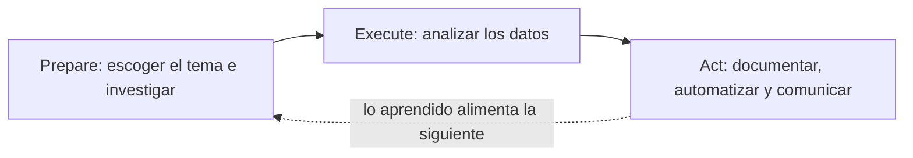
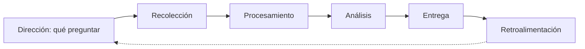
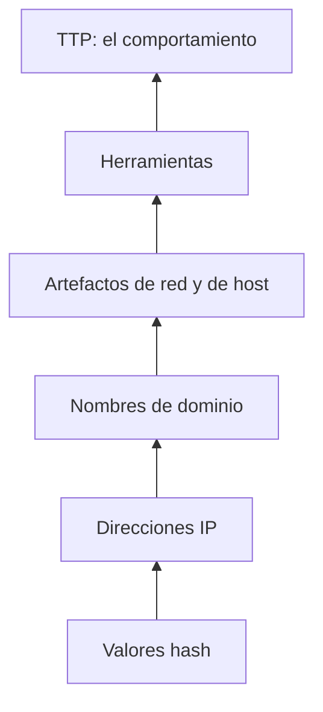
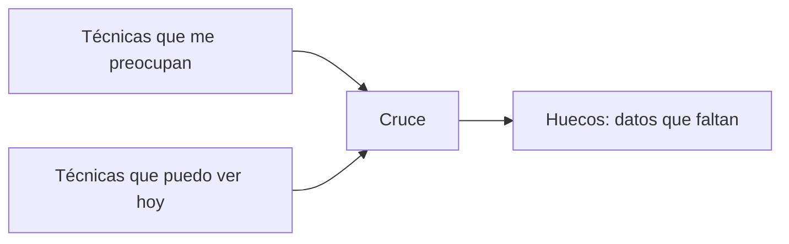

<!-- _class: lead -->

# S05 - Inteligencia de amenazas y cacería

### Defensa y respuesta a incidentes

**Rogelio Arriaga - Raptor Dev Services**

<!--
Bienvenida. Antes de empezar, cada equipo confirma que su laboratorio azul arranca: kali (192.168.56.10), victima (192.168.56.20) y siem (192.168.56.30) en la red host-only 192.168.56.0/24. Si alguien no tiene la VM, trabaja con el conjunto de datos de ejemplo de la práctica; no se pierde nada.
-->

---

## Agenda del día

| Bloque | Qué hacemos | Tiempo aprox. |
|---|---|---|
| Apertura | Lema, objetivos, autorización y alcance | 20 min |
| Parte 1 | De la alerta a la hipótesis | 40 min |
| Parte 2 | Inteligencia de amenazas | 45 min |
| Parte 3 | MITRE ATT&CK | 50 min |
| Parte 4 | Una cacería, de la hipótesis a la consulta | 40 min |
| Parte 5 | Emular tres técnicas | 25 min |
| Parte 6 | Práctica: emular y cazar | 50 min |
| Cierre | Errores típicos, tarea y quiz | 30 min |

<!-- Hay un descanso de 10 minutos entre la Parte 2 y la Parte 3, y otro a la mitad de la práctica. -->

---

## El lema de la sesión

> Cazar es partir de una hipótesis sobre el adversario, no esperar la alerta.

- Una regla detecta lo que alguien ya supo describir.
- Un adversario que no se parece a ninguna regla pasa sin que suene nada.
- Hoy aprendemos a ir a buscarlo, y a **documentar también cuando no lo encontramos**.

<!-- Pregunta al grupo: ¿cuántas alertas suenan en su laboratorio de la sesión 2? ¿Cuántos ataques que no sean la fuerza bruta de Hydra detectarían hoy? Casi ninguno. Ese hueco es el tema. -->

---

## Al terminar puedes

- Explicar la diferencia entre un dato y una inteligencia, y entre una alerta y una cacería.
- Usar ATT&CK para nombrar un comportamiento y encontrar qué dato lo mostraría.
- Escribir una hipótesis de cacería que se pueda refutar con datos.
- Emular tres técnicas en tu propio laboratorio y cazarlas en las bitácoras.
- Documentar cada cacería: hipótesis, consulta, resultado y lectura, incluso cuando no hay hallazgo.

---

## Antes de tocar nada: alcance y autorización

Hoy **se ejecuta comportamiento de atacante**. Reglas de la sesión:

1. Solo contra **tu** máquina `victima`, en tu red host-only, **con la carta de autorización** del módulo 1 del curso de Ciberseguridad (Autorización, ética y marco legal) firmada para esta práctica.
2. Solo las tres técnicas de la práctica. Nada de explotar, nada de salir de la red del laboratorio.
3. **Cada acción se anota con su hora.** Sin hora no sabrás después si lo que ves es tu emulación o algo más.
4. Cada técnica se **limpia** al terminar.

> Un permiso verbal no es una autorización. Si no está firmado, no existe.

<!-- Insistir: es la misma regla del curso de Ciberseguridad. Aquí cambia el lado de la mesa: ahora el que ejecuta también es el que defiende. -->

---

<!-- _class: lead -->

# Parte 1
## De la alerta a la hipótesis

---

## Dos formas de encontrar a alguien

| | Detección | Cacería |
|---|---|---|
| Se dispara | Una regla ya escrita | Una persona con una pregunta |
| Parte de | Un patrón conocido | Una hipótesis sobre el adversario |
| Si no hay nada | Silencio | Un resultado documentado |
| Mejora | Se afina la regla | Nace una regla nueva, o un hueco de datos |

Son complementarias: lo que la cacería encuentra y se repite, **se convierte en regla**.

Fuente: *Practical Threat Intelligence and Data-Driven Threat Hunting* (Palacín, 2021), cap. 2.

---

## Qué es y qué no es una cacería

**Sí es:**

- una búsqueda dirigida por una pregunta, en datos que ya tienes;
- repetible: otra persona corre tu consulta y obtiene lo mismo;
- documentada, aunque no encuentres nada.

**No es:**

- mirar bitácoras "a ver qué sale";
- correr un escáner;
- esperar el correo del proveedor de EDR.

<!-- "A ver qué sale" es el error más común del que empieza. Sin hipótesis no hay forma de saber cuándo terminaste ni qué descartaste. -->

---

## Tres tipos de cacería

El marco **PEAK** (Bianco y Fetterman, 2023) distingue:

| Tipo | En una línea |
|---|---|
| Basada en hipótesis | Supones algo sobre el adversario y lo pruebas contra los datos |
| De línea base | Defines lo normal y buscas lo que se desvía |
| Asistida por modelos | Un modelo de aprendizaje automático marca lo raro |

Hoy usamos la primera. La de línea base aparece sin pedirla: para decir "este comando es nuevo" hay que saber cuáles eran los de siempre.

Fuente: Bianco, D. J. y Fetterman, R. (2023, 18 de abril), *The PEAK threat hunting framework*, Splunk.

---

## Las tres fases de PEAK



- **Prepare:** ¿qué técnica, por qué, con qué datos?
- **Execute:** la consulta y su lectura.
- **Act with Knowledge:** reporte, regla nueva, hueco de datos.

<!-- El nombre completo es Prepare, Execute, Act with Knowledge. La flecha punteada es la idea de que cada cacería deja conocimiento para la siguiente. -->

---

## El error típico: la cacería sin datos

> "Busqué `authorized_keys` en las bitácoras y no salió nada. No hay compromiso."

La consulta vacía puede significar tres cosas distintas:

1. El evento **no ocurrió**.
2. El evento ocurrió y **nadie lo registró** (punto ciego).
3. La consulta está **mal escrita**.

Solo la primera es "limpio". Hoy vamos a ver en vivo la segunda.

---

<!-- _class: lead -->

# Parte 2
## Inteligencia de amenazas

---

## Dato o inteligencia

| Es un dato | Es inteligencia |
|---|---|
| `192.168.56.10` | Esa IP intentó 30 contraseñas contra `soporte` en 30 segundos, y entró al intento 31 |
| Un hash | Un archivo visto antes en esta red, con fuente, fecha y nivel de confianza |
| Una técnica de ATT&CK | Esa técnica es relevante para **mi** negocio por esta razón |

Inteligencia es un dato **analizado, con contexto y para decidir algo**.

El NIST define la información sobre ciberamenazas como cualquiera que ayude a identificar, evaluar, monitorear y responder a esas amenazas: indicadores, TTP, acciones sugeridas y hallazgos del análisis de incidentes (NIST SP 800-150, 2016).

---

## El ciclo de inteligencia



- Empieza con una **pregunta**, no con una fuente.
- Termina con alguien que **decide** y dice si le sirvió.
- Cada libro nombra las etapas a su manera; el patrón es el mismo.

Fuentes: Palacín (2021), cap. 1; Brown y Roberts (2023), cap. 2.

---

## Tres niveles de consumo

| Nivel | Pregunta | Quién la usa |
|---|---|---|
| Estratégico | ¿Qué adversarios y riesgos importan a este negocio? | Dirección |
| Operativo | ¿Cómo y cuándo me atacarían? ¿Qué campañas hay? | Jefes de seguridad y respuesta |
| Táctico | ¿Qué técnicas, herramientas y artefactos usan? | Analistas, cazadores, ingenieros de detección |

La cacería vive en el nivel **táctico**, alimentada por el operativo.

<!-- Un negocio pequeño como el de nuestros ejemplos casi nunca produce inteligencia estratégica propia: la consume de fuentes públicas. Lo que sí produce es inteligencia táctica de su propio entorno: lo que encontró cazando. -->

---

## De dónde sale la inteligencia

Para una organización pequeña, las fuentes realistas son:

- **Públicas y abiertas:** la propia base de ATT&CK (grupos, campañas, software), avisos de organismos como CISA, reportes de proveedores.
- **De tu entorno:** lo que dejó el último incidente, lo que viste cazando, tus bitácoras.
- **De tu comunidad:** quien comparte indicadores y técnicas en tu sector.

No hay que comprar nada para empezar: la fuente más valiosa es **tu propia telemetría analizada**.

Fuente: *Intelligence-Driven Incident Response* (Brown y Roberts, 2023), caps. 2 y 3.

---

## La Pirámide del Dolor



Cada escalón es **más difícil de cambiar** para el adversario cuando lo detectas.

Fuente: Bianco, D. J. (2013, 1 de marzo), *The pyramid of pain*.

---

## Qué significa para una detección

| Nivel | Cuánto dura una regla sobre eso |
|---|---|
| Hash | Cualquier cambio al archivo cambia el hash |
| IP | El adversario cambia de dirección con facilidad |
| Dominio | Debe registrar y alojar otro |
| Artefactos | Debe cambiar herramientas o configuración |
| Herramientas | Debe encontrar o fabricar reemplazos |
| TTP | Debe aprender un comportamiento nuevo |

Una lista de hashes envejece rápido. Una regla sobre **"crea una cuenta local y programa una tarea"** sobrevive a que cambie de herramientas.

<!-- No digas que los indicadores bajos son inútiles: son baratos y rápidos de usar y sirven para triage. Lo que dice la pirámide es que no deben ser tu única capa. -->

---

## Un sesgo que arruina cacerías

**Sesgo de confirmación:** buscas lo que esperas encontrar y te detienes cuando lo encuentras.

Defensas simples:

- Escribe **qué resultado refutaría** tu hipótesis antes de correr la consulta.
- Anota lo que **descartaste**, no solo lo que encontraste.
- Pide a otra persona que corra tu consulta sin leer tu conclusión.

Fuentes: *Practical Threat Intelligence and Data-Driven Threat Hunting* (Palacín, 2021), cap. 1 (sesgo y análisis); *Intelligence-Driven Incident Response* (Brown y Roberts, 2023), cap. 2.

---

<!-- _class: lead -->

# Parte 3
## MITRE ATT&CK

---

## Qué es

> "Una base de conocimiento de tácticas y técnicas adversarias basada en observaciones del mundo real." (MITRE)

- **Táctica:** el objetivo (el porqué). Ejemplo: persistir.
- **Técnica:** cómo lo logra. Ejemplo: crear una cuenta.
- **Subtécnica:** el cómo con más detalle. Ejemplo: cuenta **local**.
- **Procedimiento:** cómo lo hizo un grupo o una campaña concreta.

Cada técnica tiene identificador: T1136 es la técnica y T1136.001 su subtécnica.

---

## Versión vigente: v20.1

A noviembre de 2026 (MITRE, s. f.):

| Versión | Vigente desde |
|---|---|
| v20.1 | 13 de octubre de 2026 (vigente) |
| v19.2 | 28 de abril de 2026 |
| v18.1 | 28 de octubre de 2025 |
| v17.1 | 22 de abril de 2025 |

**Siempre escribe la versión** cuando cites una técnica o una táctica: los nombres, los identificadores y la sección de detección cambian entre versiones.

---

## Las 15 tácticas de Enterprise

```text
 1 Reconnaissance            TA0043      9 Credential Access    TA0006
 2 Resource Development      TA0042     10 Discovery            TA0007
 3 Initial Access            TA0001     11 Lateral Movement     TA0008
 4 Execution                 TA0002     12 Collection           TA0009
 5 Persistence               TA0003     13 Command and Control  TA0011
 6 Privilege Escalation      TA0004     14 Exfiltration         TA0010
 7 Stealth                   TA0005     15 Impact               TA0040
 8 Defense Impairment        TA0112
```

A noviembre de 2026. Tu libro seguramente dice **14** y "Defense Evasion": en la v19 (abril de 2026) esa táctica se dividió en **Stealth** y **Defense Impairment**.

<!-- Verifiquen la lista contra https://attack.mitre.org/matrices/enterprise/ el día de la clase: es la fuente. Los libros del curso son anteriores a la división; sus conceptos siguen valiendo. -->

---

## Lo que cambió en la detección (v18, octubre de 2025)

Antes, cada técnica traía un texto de "Detección" y una lista de **fuentes de datos**. Desde la v18:

- los textos se reemplazaron por **estrategias de detección** (identificadores `DET...`);
- cada estrategia agrupa **analíticas** (`AN...`), una por plataforma;
- las fuentes de datos quedaron **deprecadas** y se sustituyen por **componentes de datos**.

Es decir: la propia técnica ya trae **qué buscar y en qué plataforma**. Para cazar, es el mejor punto de partida.

Fuente: MITRE, notas de versión de octubre de 2025.

---

## Ejemplo: una técnica leída completa

**T1136.001 - Create Account: Local Account** (MITRE, página consultada en noviembre de 2026)

| Campo | Valor |
|---|---|
| Táctica | Persistence (TA0003) |
| Plataformas | Containers, ESXi, Linux, Network Devices, Windows, macOS |
| Qué hace | Crea cuentas locales para conservar el acceso sin dejar herramientas remotas |
| Estrategia de detección | DET0447 |
| Analítica para Linux | AN1236: binarios de administración de usuarios (`useradd`, `adduser`) o ediciones de `passwd` y `shadow` |
| Mitigaciones | M1032 autenticación multifactor; M1026 gestión de cuentas privilegiadas |

La analítica **ya dice qué buscar**: `useradd` y `adduser`.

---

## Tres técnicas para hoy

| Técnica | ID | Táctica | Qué dato la mostraría |
|---|---|---|---|
| Create Account: Local Account | T1136.001 | Persistence | `new user:` de `useradd` |
| Scheduled Task/Job: Cron | T1053.003 | Execution, Persistence, Privilege Escalation | `crontab[...]` y `CRON[...] CMD` |
| Account Manipulation: SSH Authorized Keys | T1098.004 | Persistence, Privilege Escalation | Login con una huella nueva; el cambio del archivo **no** deja línea |

Las tres son persistencia en Linux: **lo que un adversario hace después de entrar con una contraseña filtrada**, como en el simulacro de la sesión 3.

<!-- Conecten con S3: el atacante entró por SSH con una contraseña filtrada. Lo que haga después para no depender de esa contraseña es lo que cazamos hoy. -->

---

## ATT&CK Navigator

Aplicación web de MITRE para **ver y anotar** las matrices con capas: colorear técnicas, comentar, asignar valores.

- Corre en el navegador, también se puede alojar en tu propia máquina.
- Una **capa** es un archivo JSON con tu vista.

Uso en un equipo azul: una capa con **las técnicas que sí puedes ver** y otra con **las que te preocupan**. Donde no se cruzan hay un hueco.

Fuente: github.com/mitre-attack/attack-navigator. Libro: *Adversary Emulation with MITRE ATT&CK* (Selmanaj, 2024), cap. 6.

---

## Del mapa a la cobertura



Ese cruce es **la lista de cacerías** del trimestre: cada hueco se vuelve una pregunta ("¿puedo ver esta técnica? ¿con qué dato?").

No es una lista para cubrir todas las casillas: es para decidir **cuáles importan aquí**.

---

## Datos y herramientas de ATT&CK

- **STIX**: el conocimiento completo en formato legible por máquinas.
- **Servidor TAXII**: acceso programático por HTTPS.
- **mitreattack-python**: biblioteca para consultarlo desde código.
- **Workbench**: para extender la base con tus propias técnicas.

Para este curso basta la página web de cada técnica y el Navigator.

Fuente: attack.mitre.org/resources/attack-data-and-tools/ (consultada en noviembre de 2026).

---

<!-- _class: lead -->

# Parte 4
## Una cacería, de la hipótesis a la consulta

---

## La hipótesis con cinco partes

1. **Hipótesis:** una frase que se pueda refutar.
2. **Técnica ATT&CK:** con ID y versión.
3. **Dato que lo mostraría:** qué fuente, qué campo.
4. **Consulta:** exacta, con su ventana de tiempo.
5. **Resultado y lectura:** lo que apareció, lo que descartaste, y qué significa si no apareció nada.

Si no puedes llenar la 3, **aún no tienes una cacería**: tienes una idea.

---

## Los datos del ejemplo

Para las demostraciones usamos un `eventos.log` (el `auth.log` y el `syslog` de `victima`, reunidos) **generado para el curso** (Ejemplo ilustrativo: el formato es el real, los eventos son inventados). 97 líneas, del 2 al 9 de noviembre de 2026.

```bash
wc -l datos/eventos.log
# 97 datos/eventos.log
```

La práctica trae el script que lo genera. Con tu `victima` verás el mismo patrón, con tus horas y tus huellas.

---

## Un ayudante para leer mejor

Las marcas de tiempo de rsyslog son largas (ISO 8601, con microsegundos y zona; confirma la tuya con `head -1 /var/log/auth.log`). Esta función las recorta:

```bash
limpia() { sed -E 's/\.[0-9]{6}[+-][0-9:]{4,5} [a-z]+ / /'; }
```

```bash
head -2 datos/eventos.log | limpia
# 2026-11-02T02:00:00 CRON[37884]: (root) CMD (/usr/local/bin/respaldo.sh)
# 2026-11-02T09:30:00 sshd[36768]: Accepted publickey for admin1 from 192.168.56.1 port 53781 ssh2: ED25519 SHA256:...
```

(Las huellas `SHA256:...` serán distintas en tu corrida: las genera `ssh-keygen`.)

---

## Cacería 1: una cuenta nueva (T1136.001)

> **Hipótesis:** quien entró con la contraseña filtrada creó una cuenta local para volver sin depender de ella.

```bash
grep -E 'useradd\[[0-9]+\]: new user' datos/eventos.log | limpia | cut -c1-165
```

```
2026-11-03T10:15:00 useradd[47428]: new user: name=monitor, UID=1001, ...
2026-11-09T22:42:10 useradd[41589]: new user: name=sysupdate, UID=1002, ...
```

Dos cuentas nuevas. **¿Cuál es legítima?** El registro no lo dice: hay que compararlo con el calendario de cambios.

---

## ¿Quién la creó?

`useradd` no registra quién lo invocó, pero `sudo` sí:

```bash
grep -E 'sudo\[[0-9]+\]: .*COMMAND=/usr/sbin/(useradd|adduser)' datos/eventos.log | limpia
```

```
2026-11-03T10:15:00 sudo[10018]: admin1 : TTY=pts/0 ; ... COMMAND=/usr/sbin/useradd -m -s /bin/bash monitor
2026-11-09T22:42:10 sudo[31310]: soporte : TTY=pts/0 ; ... COMMAND=/usr/sbin/useradd -m -s /bin/bash sysupdate
```

- `monitor`: creada por `admin1` el 3 de noviembre, a las 10:15, en horario de oficina. Hay un cambio aprobado.
- `sysupdate`: creada por **`soporte`**, de noche, sin cambio aprobado, con un nombre que imita a un servicio.

<!-- Aquí se ve por qué la consulta sola no es el hallazgo: el hallazgo es el cruce con el contexto (quién, cuándo, hay ticket). Pregunta: ¿qué dato necesitarían para marcar monitor como "esperado" automáticamente? Respuesta: el calendario de cambios. -->

---

## Resultado de la cacería 1

| Campo | Valor |
|---|---|
| Hipótesis | Creación de cuenta local para persistir |
| Técnica | T1136.001 (v1.5, página de noviembre de 2026) |
| Dato | `useradd` y `sudo` en `/var/log/auth.log` (aquí, en `eventos.log`) |
| Consulta | Las dos anteriores, ventana 2 al 9 de noviembre |
| Resultado | 2 cuentas nuevas; 1 con cambio aprobado; **`sysupdate` sin cambio** |
| Siguiente | Es un incidente: pasa a respuesta (sesión 3) y a evidencia (sesión 4) |

Esto es una cacería **terminada**: se puede repetir, se puede revisar y se puede automatizar.

---

## Cacería 2: tareas programadas (T1053.003)

> **Hipótesis:** el adversario programó una tarea con `cron` para ejecutar algo cada pocos minutos.

Primera consulta: **ediciones de crontab**.

```bash
grep -E 'crontab\[[0-9]+\]: \(.*\) (BEGIN EDIT|REPLACE|DELETE)' datos/eventos.log | limpia
```

```
2026-11-09T22:43:20 crontab[2585]: (sysupdate) BEGIN EDIT (sysupdate)
2026-11-09T22:44:00 crontab[2585]: (sysupdate) REPLACE (sysupdate)
```

Un hallazgo claro: la cuenta `sysupdate` editó su crontab minutos después de existir.

---

## Verlo fallar: lo que esa consulta no ve

El adversario puede soltar un archivo en `/etc/cron.d/` o editar `/etc/crontab` **sin usar el programa `crontab`**. Eso **no deja línea `crontab[...]`**.

Segunda consulta: **qué se ejecuta y quién**, contra la línea base.

```bash
grep -E 'CRON\[[0-9]+\]: \(.*\) CMD' datos/eventos.log \
  | sed -E 's/.*\]: \(([^)]*)\) CMD \((.*)\)$/\1 \2/' | sort -u \
  | grep -vxFf datos/cron-base.txt
```

```
root /opt/.cache/healthd
sysupdate /tmp/.u/sync.sh >/dev/null 2>&1
```

La primera consulta mostró **una** persistencia; la segunda, **dos**. La segunda, `root /opt/.cache/healthd`, nunca pasó por `crontab`.

---

## Qué hizo falta para ver la segunda

Una **línea base**: `datos/cron-base.txt` con el único par usuario-comando legítimo (`root /usr/local/bin/respaldo.sh`).

- Sin línea base, "nuevo" no existe: todo parece normal.
- La línea base se construye **antes** del incidente, en una semana tranquila.
- Se versiona y se revisa cuando cambia el sistema.

<!-- Este es el momento didáctico de la sesión: la cacería de línea base no se eligió, se volvió necesaria. -->

---

## Cacería 3: llaves SSH nuevas (T1098.004)

> **Hipótesis:** el adversario agregó su llave pública a `authorized_keys` para entrar sin contraseña.

Problema: **cambiar `authorized_keys` no genera línea en `auth.log`**. Sí la genera el **login con esa llave**, y `sshd` registra la **huella** de la llave usada.

```bash
grep -E 'Accepted publickey' datos/eventos.log | grep -oE 'SHA256:\S+' | sort | uniq -c | sort -n
```

```
      1 SHA256:i6D7HQTw...
      9 SHA256:XZT4e648...
     12 SHA256:CETTVYUH...
```

Una huella que aparece **una sola vez**, justo en el día del incidente. Sin línea base no sabemos si es mala; con ella, sí.

---

## Con la línea base de huellas

`datos/huellas-base.txt` guarda las huellas de las llaves que **sí** deben existir (las que se obtienen con `ssh-keygen -lf` sobre los `authorized_keys` cuando el sistema estaba sano).

```bash
grep -E 'Accepted publickey' datos/eventos.log \
  | sed -E 's/^(\S+)\.[0-9]{6}[+-][0-9:]{4,5} .*for (\S+) from (\S+) port .* (SHA256:\S+)$/\1 \2 \3 \4/' \
  | while read ts u ip fp; do
      grep -qxF "$fp" datos/huellas-base.txt || echo "$ts $u $ip $fp"
    done
```

```
2026-11-09T23:10:00 sysupdate 192.168.56.10 SHA256:i6D7HQTw...
```

El usuario `sysupdate` entró desde `192.168.56.10` con una llave que **nadie autorizó**.

---

## Y si no hubiera línea base

| Pregunta | Sin línea base | Con línea base |
|---|---|---|
| ¿Hay llaves nuevas? | No se puede contestar | Sí, una |
| ¿Es mala? | "Quién sabe" | No está en la lista autorizada |
| Costo de tenerla | - | Una tarea: `ssh-keygen -lf` por usuario |

Y aun así falta el **cuándo** se agregó la llave. Para eso se necesita **auditd** (o monitoreo de integridad de archivos) vigilando `authorized_keys`: eso es un **hueco de datos** y va al reporte.

---

## Cacería 0: la entrada (T1110.001)

Ya la hiciste en la sesión 2 con la fuerza bruta de Hydra. Aquí se ve como hipótesis:

```bash
grep 'Failed password' datos/eventos.log | grep -oE 'from [0-9.]+' | sort | uniq -c
```

```
      2 from 192.168.56.1
     30 from 192.168.56.10
```

- Treinta fallos desde una IP que luego entra: el patrón de la analítica **AN1522** de ATT&CK (fallos de SSH seguidos de un posible éxito).
- Dos fallos de `192.168.56.1` son ruido: una persona que se equivocó.

La cacería no es solo "encontrar": es **separar el ruido de lo que importa** y decir por qué.

---

## Una cacería que no encuentra nada

> **Hipótesis:** desde `victima`, el adversario se movió a otra máquina por SSH (T1021.004).

```bash
grep -cE 'Accepted .* from 192\.168\.56\.20' datos/eventos.log
# 0
```

Cero. ¿Está limpio? **No se puede decir.** El `auth.log` de `victima` registra las conexiones que **entran** a `victima`, no las que salen de ella. El dato que la contestaría está en las bitácoras **de las otras máquinas** (por ejemplo `siem`), y esa fuente no se revisó.

Resultado correcto: **"no se encontró en la fuente revisada; la cobertura es parcial"**, con la fuente que falta.

---

## Qué se hace con cada resultado

| Resultado | Acción |
|---|---|
| Algo malicioso | Incidente: respuesta y evidencia (sesiones 3 y 4) |
| Legítimo pero inesperado | Documentar y agregar a la línea base |
| Nada | Documentar igual, con consulta, ventana y fuentes |
| Hueco de datos | Levantar la mejora ("registrar cambios en `authorized_keys`") |
| Consulta buena y repetible | Convertirla en **regla** con prueba de disparo (sesión 2) |

<!-- Esta tabla es la que van a usar en la tarea. -->

---

## En un SIEM: la misma pregunta

Fragmento: **no ejecutado al preparar este material.** Con Elastic, las cuentas nuevas se leen de la fuente de autenticación del Elastic Agent (sus campos `user.target.name` y `system.auth.useradd.home` según la documentación de la integración System):

```esql
FROM logs-system.auth-*
| WHERE system.auth.useradd.home IS NOT NULL
| KEEP @timestamp, host.name, user.target.name, system.auth.useradd.home
| SORT @timestamp DESC
| LIMIT 50
```

Y las fallas de contraseña por origen, buscando en el mensaje:

```esql
FROM logs-system.auth-*
| WHERE message LIKE "*Failed password*"
| STATS fallos = COUNT(*) BY source.ip
| SORT fallos DESC
```

Ajusta los nombres de campo a lo que tu ingesta produzca. La lógica es la misma que con `grep`.

---

<!-- _class: lead -->

# Parte 5
## Emular tres técnicas

---

## Qué es emular

**Emulación de adversario:** reproducir, con autorización y en un entorno controlado, técnicas de ATT&CK para saber si tu detección las ve.

| | Prueba de penetración | Equipo rojo | Emulación |
|---|---|---|---|
| Objetivo | Encontrar vulnerabilidades | Alcanzar un objetivo como un adversario | Probar si la defensa ve técnicas concretas |
| Quién conoce el plan | Casi todos | Casi nadie | El equipo azul **lo sabe** |

En esta sesión el equipo azul conoce el plan: queremos medir **cobertura**, no sorprender a nadie.

Fuente: *Adversary Emulation with MITRE ATT&CK* (Selmanaj, 2024), cap. 1.

---

## Emulación a mano o con Atomic Red Team

**Atomic Red Team** (Red Canary) es una biblioteca de pruebas pequeñas por técnica, cada una con su comando y su limpieza.

Para T1136.001 existe la prueba *Create a user account on a Linux system*:

```bash
useradd -M -N -r -s /bin/bash -c evil_account evil_user    # ataque (requiere root)
userdel evil_user                                          # limpieza
```

Se ejecuta con el módulo `Invoke-AtomicRedTeam` de PowerShell (también en Linux con `pwsh`):

```powershell
Invoke-AtomicTest T1136.001 -TestNumbers 1
```

Hoy lo haremos **a mano**: son tres comandos y entiendes qué pasa. Atomic Red Team queda como tarea opcional.

Fuente: Red Canary, atomics/T1136.001 y wiki de Invoke-AtomicRedTeam.

---

## Lo que vamos a ejecutar en `victima`

| Técnica | Qué se ejecuta | Limpieza |
|---|---|---|
| T1136.001 | `sudo useradd -m -s /bin/bash sysupdate` | `sudo userdel -r sysupdate` |
| T1053.003 | un crontab del usuario con una tarea inocua y otra en `/etc/cron.d/` | borrar ambos |
| T1098.004 | agregar una llave de laboratorio a `authorized_keys` de `sysupdate` | borrar el archivo |

Todas las "cargas" son comandos inocuos: `echo`, `date`, `touch` en `/tmp`. Se prueba la **detección**, no un daño.

<!-- Reiterar: nada de descargar nada de internet, nada de shells inversas. Solo comportamiento observable en bitácora. -->

---

## El registro de la emulación

Una hoja, una línea por acción, **antes** de ver las bitácoras:

| Hora (UTC) | Técnica | Comando | Resultado esperado en la bitácora |
|---|---|---|---|
| 22:42:10 | T1136.001 | `useradd -m -s /bin/bash sysupdate` | `new user: name=sysupdate` |
| ... | ... | ... | ... |

Al cazar, la columna **esperado** se compara con lo **encontrado**. Cada diferencia es un hallazgo de **cobertura**.

---

<!-- _class: lead -->

# Parte 6
## Práctica

---

## Lo que haces en la práctica

1. Confirmas el laboratorio y la autorización.
2. Construyes la **línea base** de `victima`: cuentas, crontabs, huellas de llaves.
3. Emulas las tres técnicas y anotas la hora de cada una.
4. Cazas cada una con su consulta y llenas la ficha de cacería.
5. **Verlo fallar:** buscas la persistencia de `/etc/cron.d/` con la consulta de `crontab` y compruebas que no la ve.
6. Limpias y comparas contra la línea base.

Con tu `victima`, y también con el conjunto de datos de ejemplo.

---

## Errores típicos

| Error | Consecuencia |
|---|---|
| Cazar sin línea base | "Nuevo" no se puede distinguir de "normal" |
| Interpretar un resultado vacío como "limpio" | Se declara seguro lo que es un punto ciego |
| No anotar la hora de la emulación | No puedes separar tu ejercicio de un incidente real |
| Escribir la hipótesis después de ver los datos | Sesgo de confirmación |
| Olvidar la limpieza | Dejas persistencia real en el laboratorio |
| Una consulta que solo funciona con tu ejemplo | No es repetible |

---

## Qué entregas

Tarea de la sesión:

- Una **ficha por cacería** (las tres de hoy más la de línea base): hipótesis, técnica con ID y versión, dato, consulta, resultado, lectura y siguiente paso.
- Una **cuarta ficha con resultado vacío** y su lectura honesta.
- Una capa del Navigator (o una tabla) con las técnicas que **sí** puedes ver y las que no.

Criterio: otra persona puede repetir cada consulta y llegar a lo mismo.

---

## Lo que te llevas

- Cazar empieza en una **hipótesis refutable**, no en las bitácoras.
- ATT&CK da el **vocabulario y la analítica**; versiónalo siempre.
- La Pirámide del Dolor dice **qué indicadores merecen tu tiempo**.
- Sin **línea base** y sin **dato**, la consulta vacía no demuestra nada.
- Una cacería sin hallazgo **también es un resultado**, si dice qué cubrió y qué no.

---

## Lecturas y libros

- Nota de dev-notes: `12-seguridad/06-blue-team/05-threat-hunting-attack.md`.
- *Practical Threat Intelligence and Data-Driven Threat Hunting* (Palacín, 2021), caps. 1 a 9.
- *Adversary Emulation with MITRE ATT&CK* (Selmanaj, 2024), caps. 3 a 6.
- MITRE ATT&CK: attack.mitre.org (versión vigente y notas de versión).
- Bianco, *The Pyramid of Pain* (2013) y *The PEAK threat hunting framework* (2023).

Siguiente sesión: ejercicio de mesa y postmortem.

<!-- Aquí cierra la clase. Pasa a la práctica y después al quiz de la plataforma. -->
