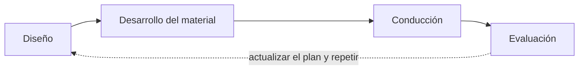

<!-- _class: lead -->

# S06 - Ejercicio de mesa y postmortem

### Defensa y respuesta a incidentes

**Rogelio Arriaga - Raptor Dev Services**

<!--
Bienvenida. Esta sesión es distinta: la mitad es clase y la mitad es un ejercicio de mesa completo con reloj. Antes de empezar, formen equipos de 7 u 8 personas y asignen quién será facilitador y quién anotador de cada equipo (se rotan en la práctica). Lleven impresas o abiertas las hojas de la práctica.
-->

---

## Agenda del día

| Bloque | Qué hacemos | Tiempo aprox. |
|---|---|---|
| Apertura | Lema, objetivos y reglas | 15 min |
| Parte 1 | Qué es un ejercicio de mesa y para qué sirve | 35 min |
| Parte 2 | Diseñarlo: objetivos, escenario, injects | 50 min |
| Parte 3 | Conducirlo: roles, reloj, hojas de decisión | 30 min |
| Parte 4 | El escenario de ransomware (caso hipotético) | 15 min |
| Parte 5 | Práctica: el ejercicio y su debrief | 90 min |
| Parte 6 | Postmortem sin culpables | 45 min |
| Cierre | Tarea, proyecto final y quiz | 20 min |

<!-- Hay un descanso de 10 minutos entre la Parte 2 y la Parte 3. La práctica es larga: no la recorten, es el corazón de la sesión. -->

---

## El lema de la sesión

> El primer incidente de verdad no debe ser el primer ensayo.

- Un plan de respuesta que nadie ha ensayado es una hipótesis.
- En un incidente se descubre en minutos lo que en una mesa se descubre en una tarde, pero sin costo.
- Hoy ensayamos un incidente con un equipo y lo convertimos en **mejoras con dueño y fecha**.

<!-- Pregunta al grupo: ¿quién sabe, sin abrir nada, a quién llama primero si mañana a las 7 cifran el servidor de archivos de su empresa? Casi nadie. Ese hueco es lo que un ejercicio de mesa muestra. -->

---

## Al terminar puedes

- Explicar qué es un ejercicio de mesa y en qué se distingue de un ejercicio funcional.
- Diseñar uno: objetivos, participantes, escenario corto, injects con reloj y criterios de evaluación.
- Facilitarlo: llevar el reloj, preguntar sin dirigir y registrar decisiones.
- Escribir un informe posterior al ejercicio y un postmortem **sin culpables**.
- Convertir lo aprendido en acciones con responsable, fecha y criterio de "hecho".

---

## Reglas del día

1. **Todo es ficticio.** El escenario es un **caso hipotético**: la empresa, las personas, los sistemas y los atacantes no existen.
2. **Se discute, no se hace.** Nadie ejecuta un comando. Se dice qué se haría, quién lo haría y con qué información.
3. **Nadie se evalúa.** Se evalúa **el plan y el proceso**, no a las personas.
4. **Se actúa desde el rol asignado**, no desde lo que uno sabe por su trabajo real.
5. **Se registra todo:** decisiones, horas, dudas y lo que faltó.

<!-- Las reglas 3 y 4 son las que más cuesta cumplir. Si alguien responde "yo lo resolvería rápido" sin decir con qué información, regrésenlo a la hoja de decisión. -->

---

<!-- _class: lead -->

# Parte 1
## Qué es un ejercicio de mesa

---

## Definición

El NIST describe el ejercicio de mesa (tabletop) como un evento **basado en discusión**: las personas con funciones en un plan se reúnen, en un aula o en grupos, para hablar de sus funciones y de sus respuestas ante una emergencia concreta.

- Lo guía un **facilitador** que presenta un escenario y hace preguntas.
- Es **solo discusión**: no se despliega equipo ni se actúa sobre sistemas.
- Se hace en un ambiente informal, con objetivos definidos de antemano.
- Dura, normalmente, de **dos a ocho horas** según la audiencia y los objetivos.

Fuente: NIST SP 800-84 (2006), sección 4.

---

## Mesa frente a ejercicio funcional

| | Ejercicio de mesa | Ejercicio funcional |
|---|---|---|
| Qué se hace | Se **habla** de qué se haría | Se **ejecutan** las funciones en un entorno operativo simulado |
| Qué se prueba | Que el plan sea viable, los roles correctos y la coordinación clara | Que las personas, los procedimientos y los activos funcionen |
| Despliega equipo | No | Puede incluir equipos y activos |

Según el NIST, los ejercicios funcionales validan la preparación operativa realizando las tareas como en una emergencia real, de forma simulada. **Hoy hacemos el primero.**

Fuente: NIST SP 800-84 (2006), secciones 1 y 5.

---

## Para qué sirve

NIST SP 800-84 fija tres objetivos de todo ejercicio de mesa:

1. Validar el **contenido** del plan y de las políticas y procedimientos relacionados.
2. Validar los **roles y responsabilidades** que el plan documenta.
3. Validar las **interdependencias** que el plan documenta.

Y en la guía de respuesta a incidentes del NIST (SP 800-61r3, 2025) los ejercicios aparecen como una **fuente de mejoras**: sirven para evaluar el programa y preparar a las personas y a terceros para el incidente de verdad.

---

## Qué NO es

- **No es una prueba de penetración** ni un ejercicio de equipo rojo.
- **No es un examen** para el equipo.
- **No es una demostración** donde todo sale bien.
- **No es una reunión de lecciones aprendidas** de un incidente que ya pasó (eso es el postmortem, hoy lo vemos al final).

Es un ensayo con preguntas incómodas, hecho a propósito **antes** de que importe.

---

## Las cuatro fases

- **Diseño:** tema, alcance, objetivos, participantes, personal y logística.
- **Desarrollo:** briefing, guía del facilitador, guía del participante, informe posterior.
- **Conducción:** el ejercicio y el debrief.
- **Evaluación:** el informe y las acciones.

Fuente: NIST SP 800-84 (2006), sección 4.

---

## Dos audiencias, dos ejercicios

El NIST recomienda ejercitar **por separado** a los equipos de nivel directivo y de nivel operativo al principio, y juntarlos después para validar la coordinación entre ellos.

| Nivel | Qué decide | Duración típica (SP 800-84) |
|---|---|---|
| Directivo | Toma de decisiones y supervisión | 2 a 4 horas |
| Operativo | Procedimientos y acciones técnicas | 2 a 8 horas |

Hoy mezclamos ambos niveles en una mesa para ver **dónde se atora la información** entre ellos.

<!-- En una empresa real harían dos sesiones separadas primero. En clase juntamos para ver el roce entre técnico y dirección, que es donde más se aprende. -->

---

<!-- _class: lead -->

# Parte 2
## Diseñarlo

---

## Empieza por los objetivos

Un ejercicio sin objetivos es una charla.

Cada objetivo es una **pregunta que el plan debe poder contestar**:

| Objetivo | Cómo se ve cumplido |
|---|---|
| O1. Los roles están claros | En 5 minutos hay una persona nombrada al mando del incidente |
| O2. La contención no destruye evidencia | El equipo decide aislar **antes** de apagar y dice por qué |
| O3. La comunicación está ordenada | Se define quién habla con la dirección, con el personal y con los clientes |
| O4. La recuperación sigue prioridades | Restauran en orden de importancia del negocio (sesión 1) |
| O5. El plan se puede usar | Encuentran el plan y la lista de contactos sin buscar mucho |

**Los criterios de evaluación se escriben antes del ejercicio**, no después (SP 800-84).

---

## Quién participa

- Las personas con **roles en el plan**, no quienes caen bien.
- Un facilitador y un **recolector de datos** (anotador), que conozcan el plan y los objetivos.
- Opcional: observadores, un invitado externo (legal, proveedor).

El NIST señala que los participantes suelen sentarse **lejos de sus compañeros habituales**, para fomentar el pensamiento independiente y que cada área oiga a las demás.

Libro: *Cybersecurity Tabletop Exercises* (Lelewski y Hollenberger, 2025), cap. 2.

---

## El escenario: corto

> Un error común es creer que el escenario debe ser muy detallado. Suele ser más eficaz uno corto y conciso. (Traducción libre de NIST SP 800-84.)

El NIST lo explica: con escenarios largos y detallados, la gente gasta el tiempo **discutiendo el escenario** en lugar de cumplir los objetivos. Si hace falta detalle, que lo revise alguien que conozca el plan, y el facilitador debe poder **redirigir** del escenario a los objetivos.

El escenario es el **pretexto** para que el plan se ponga a prueba, no una novela.

Fuente: NIST SP 800-84 (2006), sección 4.3.

---

## Los injects

Un **inject** es una pieza de información que el facilitador "inyecta" en un momento fijo para empujar el escenario y forzar una decisión.

Propiedades de un buen inject:

- **Breve y clara:** un párrafo, un dato nuevo.
- **Con hora de escenario:** "T+30 min".
- **Dirigida a un rol:** quién debe decidir.
- **Con una pregunta:** qué se tiene que contestar.
- **Que escala:** cada una complica la anterior.

Libro: *Cybersecurity Tabletop Exercises* (Lelewski y Hollenberger, 2025), cap. 3 (injects, ritmo de escalada y documento de verdad fundamental).

---

## El documento de verdad fundamental

El facilitador necesita **saber qué es verdad** en el escenario aunque los jugadores no lo sepan todavía:

| Qué pasó realmente | Qué sabe el equipo en cada inject | Qué se esperaría |
|---|---|---|
| El acceso inicial fue con una credencial filtrada | Nada | - |
| Hay copia de datos hacia afuera | Hasta el inject 5 | Que pregunten por datos personales |
| El respaldo está dañado | Hasta el inject 6 | Que prioricen la restauración |

Sin este documento, el facilitador improvisa respuestas a preguntas que los jugadores sí harán, y las respuestas se contradicen.

---

## Los documentos del ejercicio (NIST)

Un ejercicio de mesa suele tener:

| Documento | Qué lleva |
|---|---|
| **Briefing** | Agenda y logística para los participantes |
| **Guía del facilitador** | Propósito, alcance, objetivos, escenario, **preguntas** y el plan que se ejercita |
| **Guía del participante** | Lo de la guía del facilitador **sin** la lista de preguntas |
| **Informe posterior** (after action report) | Antecedentes, observaciones y recomendaciones |

Fuente: NIST SP 800-84 (2006), sección 4.3.

---

## CISA y los paquetes listos

La agencia estadounidense CISA publica **paquetes de ejercicios de mesa** (CTEP) con escenarios, objetivos, preguntas de discusión, presentaciones, una plantilla de invitación, un formulario de retroalimentación y una plantilla de informe posterior. Entre los escenarios de ciberseguridad hay ransomware, amenazas internas y phishing.

Úsalos como **punto de partida**, y adáptalos a tu organización: un escenario genérico en una empresa que no tiene ese sistema no ejercita nada.

Fuente: cisa.gov, *CISA Tabletop Exercise Packages* (consultado en noviembre de 2026).

---

<!-- _class: lead -->

# Parte 3
## Conducirlo

---

## Los roles de la mesa

| Rol | Qué hace |
|---|---|
| **Facilitador** | Presenta el escenario, lleva el reloj, hace preguntas, redirige |
| **Anotador (recolector de datos)** | Registra decisiones, horas y dudas |
| **Participantes** | Juegan su rol: mando del incidente, técnico, comunicación, legal, dirección |
| **Observador** | Escucha y evalúa contra los objetivos; no interviene |

El facilitador **no juega** y **no resuelve**: pregunta.

---

## El facilitador: qué hace y qué no

**Sí:**

- Lee cada inject tal como está escrito.
- Pregunta "¿quién decide eso?" y "¿con qué información?".
- Reparte la palabra: pregunta a quien no ha hablado.
- Detiene los debates que se salen de los objetivos.

**No:**

- Da la respuesta correcta.
- Corrige a una persona frente al grupo.
- Deja que el más técnico conteste por todos.

<!-- Un buen facilitador pregunta más de lo que habla. Practiquen: "¿cómo lo sabrían?" "¿quién les da ese dato?" "¿y si no contesta?" -->

---

## El reloj

Hay **dos relojes**:

- **Reloj real:** lo que dura la actividad (por ejemplo, 90 minutos).
- **Reloj de escenario:** el tiempo ficticio ("T+60 min", "lunes 7:00").

El facilitador anuncia **el reloj de escenario** en cada inject y reparte el reloj real entre ellos. Si un tema se pasa del tiempo, **se corta**: "lo anotamos como pendiente".

Un reloj visible (proyectado o impreso) obliga a decidir con información incompleta, que es lo que pasa en un incidente.

---

## La hoja de decisión

Una hoja por inject, que llena el equipo:

| Campo | Qué se escribe |
|---|---|
| Reloj de escenario | T+__ min |
| Decisión | Qué se decidió hacer |
| Quién decide | Rol, no nombre |
| Información que faltó | Lo que habrían necesitado saber |
| Riesgo de la decisión | Qué puede salir mal |
| Pendiente | Lo que quedó sin resolver |

La hoja es la **evidencia** del ejercicio: de ella sale el informe.

---

## Preguntas que no dirigen

| En vez de | Pregunta |
|---|---|
| "¿No deberían aislar el servidor?" | "¿Qué hacen con el servidor ahora?" |
| "Eso viola el plan" | "¿Dónde dice el plan que se haga eso?" |
| "Yo lo haría así" | "¿Quién del equipo puede autorizar eso?" |

Las preguntas abiertas descubren lo que el equipo **de verdad** haría. Las cerradas descubren lo que el equipo cree que el facilitador quiere oír.

---

## El debrief inmediato (hotwash)

Al terminar el ejercicio, **sin pausa**, el facilitador y el anotador preguntan a los participantes:

1. ¿En qué áreas se desempeñaron bien?
2. ¿En qué áreas necesitan más capacitación?
3. ¿Qué partes del plan hay que actualizar?

Se llena también un formulario de evaluación. Lo que se dice en caliente se pierde si no se anota.

Fuente: NIST SP 800-84 (2006), sección 4.4.

---

<!-- _class: lead -->

# Parte 4
## El escenario de la práctica

---

## Caso hipotético: Distribuidora Ejemplo

**Caso hipotético. La empresa, las personas y los hechos no existen.**

- 45 personas, una sola oficina y una bodega.
- Un servidor de archivos, un sistema de pedidos y facturación, y 20 computadoras.
- Respaldo nocturno a un NAS que el servidor tiene **siempre montado**.
- Un proveedor externo de TI de medio tiempo y una persona interna de soporte.
- Plan de respuesta a incidentes: **existe en un PDF de hace dos años**.

El viernes por la tarde empieza un ataque de ransomware.

---

## Los siete injects

| # | Reloj de escenario | Qué pasa |
|---|---|---|
| 1 | T+0, viernes 17:40 | Una persona de contabilidad no puede abrir archivos y ve una nota |
| 2 | T+15 | Varias computadoras y el servidor de archivos afectados; el NAS está montado |
| 3 | T+30 | Una cuenta de soporte inició sesión de madrugada desde una dirección extraña |
| 4 | T+45 | Dirección pregunta cuándo se opera; un cliente pregunta por WhatsApp |
| 5 | T+60 | Los atacantes dicen que se llevaron datos y fijan un plazo |
| 6 | T+75 | El último respaldo bueno es de hace nueve días |
| 7 | T+90, lunes 7:00 | La empresa debe decidir si abre y en qué modo |

Los textos completos, las preguntas y la verdad fundamental están en la **práctica**.

---

## El marco de discusión: CISA #StopRansomware

La guía conjunta de CISA, MS-ISAC, NSA y FBI (septiembre de 2023) ordena la respuesta a ransomware en cuatro fases:

1. **Detección y análisis:** aislar los sistemas afectados, evaluar cuáles restaurar, revisar bitácoras y buscar amenazas.
2. **Reporte y notificación:** involucrar a las partes interesadas internas y externas, reportar y cumplir las obligaciones de aviso.
3. **Contención y erradicación:** capturar imágenes del sistema y memoria, identificar la brecha inicial, contener accesos y reconstruir.
4. **Recuperación y actividad posterior:** restaurar desde respaldos sin conexión y cifrados, documentar lo aprendido y compartir indicadores.

Fuente: cisa.gov, *#StopRansomware Guide* (septiembre de 2023), parte 2.

---

## Lo que ya sabes, aplicado

| Sesión | Qué aparece en la mesa |
|---|---|
| S1 | Qué activos se restauran primero (prioridad del inventario) |
| S2 | Qué bitácoras habría que revisar y si existen |
| S3 | Quién manda, cómo se contiene sin destruir evidencia |
| S4 | Qué se conserva antes de apagar o reconstruir |
| S5 | Qué técnicas buscarían para saber hasta dónde llegó |

El ejercicio es la **integración** del curso: si en la mesa no saben contestar una pregunta, ahí hay una acción para el postmortem.

---

<!-- _class: lead -->

# Parte 5
## Práctica: el ejercicio

---

## Cómo corre la práctica

1. Cada equipo asigna roles (la práctica trae las tarjetas).
2. Un equipo **conduce** (facilitador y anotador) y otro **juega**; luego se invierten si hay tiempo.
3. Siete injects con reloj, hoja de decisión por inject.
4. Debrief inmediato.
5. El anotador entrega sus hojas: son la entrada de la **tarea**.

Para la tarea necesitas **tus propias hojas**, así que anota con cuidado.

---

<!-- _class: lead -->

# Parte 6
## Postmortem sin culpables

---

## Qué es

Un **postmortem** es el registro escrito de un incidente: su impacto, lo que se hizo para mitigarlo o resolverlo, sus causas y las acciones de seguimiento para que no se repita.

Sus metas: documentar el incidente, entender **todas las causas que contribuyeron** y poner en marcha medidas preventivas que funcionen.

Fuente: Lunney, J. y Lueder, S., *Postmortem Culture: Learning from Failure*, cap. 15 de *Site Reliability Engineering* (Google, 2017), sre.google.

---

## Sin culpables

**Idea central del capítulo:** un postmortem se enfoca en las causas que contribuyeron, no en culpar a personas o equipos.

- Se parte de que cada persona actuó **de buena fe**, con la información que tenía.
- Se busca arreglar **sistemas y procesos**, no a las personas.
- Culpar desalienta que la gente reporte problemas, y eso **aumenta** el riesgo de la organización.
- No es un castigo: es una oportunidad de aprendizaje para toda la organización.

Fuente: sre.google/sre-book/postmortem-culture/ (consultado en noviembre de 2026).

---

## "Sin culpables" no es "sin responsables"

| Se evita | Se hace |
|---|---|
| "Fulano olvidó revisar el respaldo" | "El proceso no verificaba el respaldo, y nada lo hacía visible" |
| Buscar quién falló | Buscar qué condiciones permitieron el fallo |
| "Hay que capacitar a la gente" como única acción | Acciones concretas sobre el sistema: alerta, verificación, permiso |

Las **acciones** sí tienen responsable. Los **hechos** no se atribuyen a personas, sino a condiciones.

<!-- Esta diferencia es la que más se malentiende. El postmortem sin culpables no esconde nombres en las acciones: pone un dueño en cada acción y no un culpable en cada falla. -->

---

## Cuándo se escribe uno

Criterios típicos que sugiere el capítulo de Google (se definen **antes** de que pase un incidente):

- caída o degradación visible para los usuarios por encima de un umbral;
- cualquier pérdida de datos;
- intervención de un ingeniero de guardia (revertir un cambio, redirigir tráfico);
- tiempo de resolución por encima de un umbral;
- una falla de monitoreo que hizo que el incidente se encontrara a mano.

Cualquier interesado puede pedir uno. Para nosotros, **todo incidente que pase de un umbral y todo ejercicio de mesa** tiene el suyo.

---

## Qué lleva

Estructura que usaremos (criterio de este curso, apoyado en los contenidos que describe el capítulo de Google y en el informe posterior del NIST):

| Sección | Qué responde |
|---|---|
| Resumen | Qué pasó, en tres líneas |
| Impacto | A quién y cuánto afectó |
| Línea de tiempo | Qué ocurrió y cuándo (hora, evento, fuente) |
| Detección y respuesta | Cómo se supo, qué se hizo, qué funcionó |
| Causas contribuyentes | Qué condiciones lo permitieron (no "quién") |
| Qué salió bien | Lo que hay que conservar |
| Qué salió mal | Lo que hay que mejorar |
| Acciones | Qué, quién, cuándo y cómo se sabe que está hecho |

---

## Del informe posterior del NIST al postmortem

El informe posterior de SP 800-84 incluye: introducción (propósito, objetivos, participantes, escenario), **observaciones** y **recomendaciones**. Cada observación lleva su recomendación.

El postmortem de un incidente real suma la **línea de tiempo** y el análisis de causas. En un ejercicio de mesa, el "incidente" es el ejercicio y la línea de tiempo es la de la hoja de decisión.

| Ejercicio de mesa | Incidente real |
|---|---|
| Observaciones del facilitador y del anotador | Hechos de la línea de tiempo |
| Recomendaciones | Acciones de seguimiento |
| Informe posterior | Postmortem |

---

## Una acción que sirve

Una acción mala: "Mejorar los respaldos."

Una acción que sirve (criterio de este curso) tiene cuatro partes:

| Parte | Ejemplo |
|---|---|
| **Qué** | Desmontar el NAS del servidor y montarlo solo durante el respaldo |
| **Quién** | El rol responsable (nombre en la tabla real) |
| **Cuándo** | Una fecha, no "pronto" |
| **Cómo se sabe que está hecho** | Se muestra que, con el servidor comprometido, el NAS no es accesible |

Una acción sin responsable ni fecha **no se hace**: es un deseo.

---

## Las acciones se cierran

El postmortem no termina al escribirse:

- Cada acción entra al **tablero** del equipo con su fecha.
- Se revisa su avance en una reunión periódica.
- Una acción cerrada se **verifica**: no basta con que alguien diga que ya.
- Lo aprendido actualiza el plan, las reglas de detección (S2) y las cacerías (S5).

La guía de respuesta del NIST (SP 800-61r3, 2025) lo pone como mejora continua: las lecciones aprendidas se comparten **en cuanto se identifican**, sin esperar al cierre del incidente.

---

## Errores típicos

| Error | Consecuencia |
|---|---|
| Un ejercicio sin objetivos | Una charla agradable sin mejoras |
| Un escenario novelado | La gente discute la historia, no el plan |
| El experto contesta por todos | No se descubre quién sabe qué |
| Postmortem que nombra culpables | La gente deja de reportar |
| Acciones sin dueño ni fecha | Nada cambia |
| Hacerlo una sola vez | El plan se pudre otra vez |

---

## El proyecto final

Un laboratorio de detección con **cinco reglas**, cada una vista disparar, y el **informe completo del incidente simulado**: línea de tiempo, evidencia y postmortem.

Piezas que ya tienes:

- Las reglas de la sesión 2 (tres más en su tarea).
- La respuesta al simulacro y su línea de tiempo (sesión 3).
- La evidencia y su cadena de custodia (sesión 4).
- Las fichas de cacería (sesión 5).
- El postmortem del ejercicio de mesa (esta sesión).

---

## Lo que te llevas

- Un ejercicio de mesa es **discusión con objetivos, injects y reloj**, y se evalúa al plan, no a las personas.
- Los criterios de evaluación se escriben **antes**.
- El postmortem busca **causas contribuyentes**, no culpables.
- Una acción necesita **qué, quién, cuándo y cómo se verifica**.
- Todo ejercicio y todo incidente dejan acciones que se cierran.

---

## Lecturas y libros

- Notas de dev-notes: `12-seguridad/06-blue-team/03-respuesta-a-incidentes.md`; `12-seguridad/04-seguridad-informacion/15-pruebas-y-mantenimiento-del-plan.md`.
- *Cybersecurity Tabletop Exercises* (Lelewski y Hollenberger, 2025), Parte I (caps. 1 a 5) y Parte II (caps. 6 a 8, escenarios de ejemplo).
- *Intelligence-Driven Incident Response* (Brown y Roberts, 2023), caps. 10 y 11.
- NIST SP 800-84 (2006), sección 4; NIST SP 800-61r3 (2025); CISA, *#StopRansomware Guide* (2023); Google, *Site Reliability Engineering*, cap. 15.

<!-- Aquí cierra la clase. Pasa a la práctica (el ejercicio) y después al quiz de la plataforma. -->
