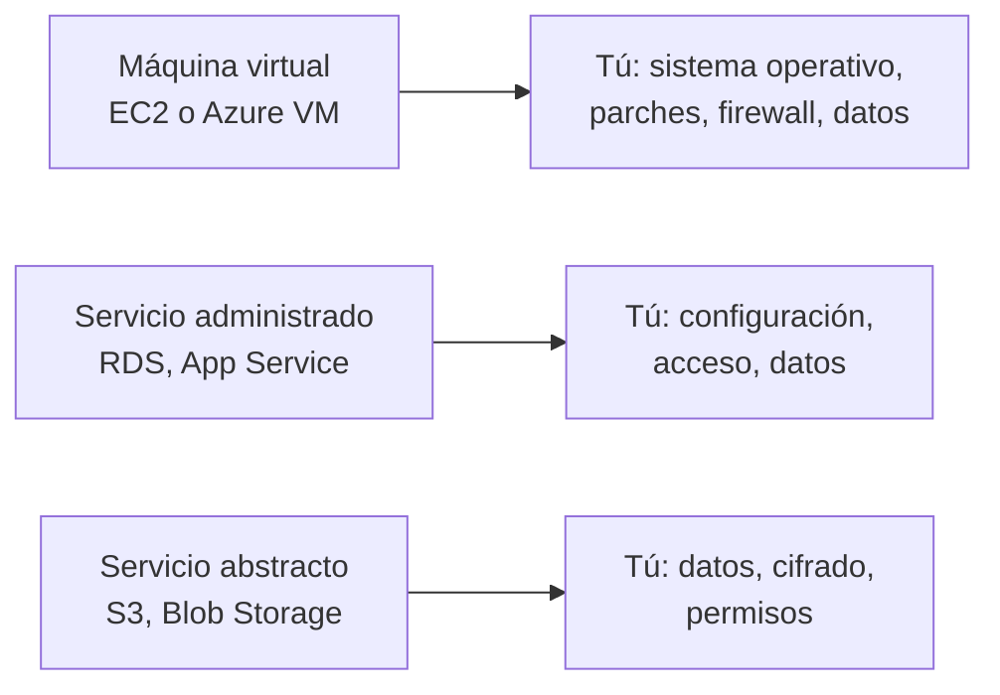

<!-- _class: lead -->

# M01 - Responsabilidad compartida y activos

### Seguridad en la nube y Zero Trust

**Rogelio Arriaga - Raptor Dev Services**

<!--
Módulo 1 de 6 (2 h). Todo el curso gira alrededor de una pregunta: ¿qué es mío de proteger? Hoy se contesta con el modelo de responsabilidad compartida y con un inventario.
Antes de empezar: cada quien necesita Python 3.10 o más reciente para la práctica. Todo corre en su máquina, sin cuenta de nube y sin costo.
-->

---

## La idea de hoy

> El proveedor protege la nube; lo que pongan dentro es de ustedes.

- La nube no vuelve segura una carga de trabajo: cambia **quién** hace cada parte
- Lo que no está en el inventario no se protege, porque nadie sabe que existe
- Hoy dejamos dicho qué nos toca, y lo medimos en una cuenta de laboratorio

<!-- Pregunta de arranque: si mañana alguien lee los datos de sus clientes en la nube, ¿de quién es la falla, del proveedor o de ustedes? Que respondan antes de ver el modelo. -->

---

## Agenda

| Bloque | Tema |
|---|---|
| 1 | Qué le toca a cada quien |
| 2 | El mismo modelo en AWS y en Azure |
| 3 | Activos: no se protege lo que no se ve |
| 4 | Etiquetas, dueño y clasificación |
| 5 | Proteger los datos: acceso público y cifrado |
| 6 | Práctica: inventario de una cuenta de laboratorio |

---

## De dónde venimos

- Dev Notes tiene las notas de AWS (`10-cloud/01-aws-basics.md`) y de costos (`10-cloud/06-costos.md`)
- `/devops-essentials/` lleva la aplicación del repositorio a producción
- Este curso es lo que falta: **defenderla** una vez que está ahí

Este curso no repite cómo se despliega. Cada módulo toma una cosa que ya sabes crear y pregunta quién puede alcanzarla, quién se enteraría si algo cambia y cómo lo demuestras.

---

<!-- _class: lead -->

# Parte 1
## Qué le toca a cada quien

---

## Dos frases que se confunden

| Frase | Quién |
|---|---|
| Seguridad **de** la nube | El proveedor |
| Seguridad **en** la nube | Tú |

AWS lo dice así: es responsable de proteger la infraestructura que corre todos los servicios de la nube de AWS, y la responsabilidad del cliente la determinan **los servicios que elige**.

Fuente: AWS, "Shared Responsibility Model" (aws.amazon.com/compliance/shared-responsibility-model/), a noviembre de 2026.

<!-- Subrayar: "los servicios que elige". La línea no está en el mismo lugar para todos los servicios. -->

---

## La línea se mueve según el servicio



- Con una **máquina virtual** el sistema operativo es tuyo: parches incluidos
- Con un **servicio abstracto** como S3, AWS dice que tú administras tus datos (incluidas las opciones de cifrado) y los permisos
- En **todos** los casos los datos y las identidades son tuyos

---

## La tabla de Azure, completa

Microsoft publica la matriz con cuatro columnas. Lo que sigue es la suya, a noviembre de 2026:

| Área | Local | IaaS | PaaS | SaaS |
|---|---|---|---|---|
| Datos del cliente | Cliente | Cliente | Cliente | Cliente |
| Configuraciones | Cliente | Cliente | Cliente | Cliente |
| Identidades y usuarios | Cliente | Cliente | Cliente | Cliente |
| Dispositivos cliente | Cliente | Cliente | Cliente | Compartida |
| Aplicaciones | Cliente | Cliente | Compartida | Compartida |
| Controles de red | Cliente | Cliente | Compartida | Microsoft |
| Sistema operativo | Cliente | Cliente | Microsoft | Microsoft |
| Hosts físicos, red física, centro de datos | Cliente | Microsoft | Microsoft | Microsoft |

Fuente: Microsoft Learn, "Shared responsibility in the cloud" (actualizada el 2026-08-24).

---

<!-- _pasos: filas -->
## Lo que nunca se transfiere

| Fila | Qué significa para tu equipo |
|---|---|
| Datos | Clasificarlos, decidir cómo se cifran, cumplir las reglas que les apliquen |
| Identidades | Altas, bajas, MFA, quién puede qué |
| Configuraciones | Un bucket mal configurado es una configuración tuya |
| Dispositivos | La laptop desde la que entras a la consola |

Microsoft lo dice como "responsabilidades que siempre conservas": datos, endpoints, cuentas y administración de accesos.

---

## Controles heredados, compartidos y propios

AWS distingue tres tipos de control:

| Tipo | Definición de AWS | Ejemplo que da AWS |
|---|---|---|
| Heredados | Los que el cliente hereda por completo | Controles físicos y ambientales |
| Compartidos | Se aplican a la capa de infraestructura y a la del cliente | Gestión de parches, de configuración, concientización y capacitación |
| Específicos del cliente | Recaen solo en el cliente según su aplicación | Seguridad de zonas, enrutamiento de datos |

Un control **compartido** se parte en dos: AWS parchea la infraestructura, tú parcheas tu sistema operativo invitado. Si ambos asumen que el otro lo hace, nadie lo hace.

---

## Error típico: asumir que el proveedor cubre "la seguridad"

Frases que se oyen en una revisión:

- "Está en la nube, así que ya está cifrado y respaldado"
- "El bucket es privado porque AWS lo hace privado"
- "La base es administrada, no hay que parchar nada"

Cada una mezcla las dos mitades. Ejemplo: un servicio administrado se parcha solo, pero **quién puede conectarse** a la base sigue siendo configuración tuya.

<!-- Pedir que cada quien reescriba una de las tres frases para decir qué parte hace el proveedor y qué parte ellos. -->

---

## Caso real: migrar sin evaluar el riesgo

El 6 de agosto de 2020, la OCC (el regulador bancario de Estados Unidos) anunció una multa civil de **80 millones de dólares** contra Capital One. Entre sus motivos citó la "falla en establecer procesos efectivos de evaluación de riesgos antes de migrar operaciones significativas de tecnología" a la nube, y la lentitud para corregir esas deficiencias.

La lección para este curso no es el monto: es el orden. **Primero** se decide quién protege qué y se evalúa el riesgo; **después** se migra.

Fuente: OCC, comunicado NR 2020-101 (6 de agosto de 2020).

---

## Para esta carga: qué es nuestro

Caso hipotético: **Taller Demo** corre `api-lab`, una API en .NET con una base PostgreSQL (`db-lab`) y un bucket de archivos (`lab-datos`).

| Pieza | Servicio | Lo nuestro |
|---|---|---|
| `api-lab` | Máquina virtual (IaaS) | Sistema operativo, parches, firewall, la aplicación |
| `db-lab` | Base administrada (PaaS) | Quién se conecta, usuarios de la base, respaldos que probamos |
| `lab-datos` | Almacenamiento de objetos | Permisos, acceso público, cifrado, datos |
| Cuenta de nube | Plataforma | Identidades, MFA, bitácoras, presupuesto |

Todo el curso protege esta carga. Ejemplo ilustrativo: no existe como negocio.

---

<!-- _class: lead -->

# Parte 2
## Activos: no se protege lo que no se ve

---

## Qué es un activo en la nube

*Practical Cloud Security* (Dotson, 2023), cap. 3, enumera los tipos de activos de nube: cómputo (máquinas, contenedores, funciones), almacenamiento (bloques, archivos, objetos, bases, colas), **configuración, secretos, llaves y certificados**, repositorios y pipelines, y la red (VPC, DNS, balanceadores).

La lista es más larga que "los servidores" porque cada uno de esos tipos se puede configurar mal. Una llave de cifrado sin dueño también es un activo.

---

## Diferencias con el inventario tradicional

- Los recursos se crean con una llamada: no hay orden de compra que los registre
- Los crea un pipeline, una persona o una herramienta, y desaparecen igual de rápido
- Hay cuentas, regiones y servicios que nadie abre de seguido

Resultado típico: el inventario de la hoja de cálculo tiene 12 recursos y la cuenta tiene 40. Los 28 sin registro son los que nadie parcha ni vigila.

Fuente de la idea: *Practical Cloud Security* (Dotson, 2023), cap. 3, "Differences from Traditional IT".

---

## Dónde preguntarle a la nube qué tiene

| Nube | Herramienta | Qué hace |
|---|---|---|
| AWS | **AWS Config** | Vista detallada de la configuración de los recursos, sus relaciones y su historial; reglas que marcan lo no conforme |
| AWS | API de etiquetado (Resource Groups Tagging API) | Busca y gestiona recursos por etiqueta |
| Azure | **Azure Resource Graph** | Consulta recursos a escala entre suscripciones, con lenguaje basado en KQL; sin costo |

Dos aclaraciones de las fuentes oficiales: AWS Config **graba solo los tipos de recurso que tú eliges** y necesita un bucket de S3 para su historial; Resource Graph no es fuertemente consistente (hay una pequeña latencia de indexado).

Fuentes: AWS Config Developer Guide, "What Is AWS Config?"; Microsoft Learn, "Overview of Azure Resource Graph", a noviembre de 2026.

---

## Cómo se ve un inventario útil

Un inventario sirve cuando cada fila contesta cuatro preguntas:

1. **¿Qué es?** Tipo y nombre del recurso
2. **¿De quién es?** Un dueño con nombre de equipo, no "TI"
3. **¿Qué tan delicado es lo que guarda?** Clasificación
4. **¿Cómo está expuesto?** Público o privado, cifrado o no

Si una fila no tiene dueño, **no es un dato faltante: es un hallazgo**.

---

<!-- _class: lead -->

# Parte 3
## Etiquetas, dueño y clasificación

---

## Clasificar antes de proteger

*Practical Cloud Security* (Dotson, 2023), cap. 2, pone la identificación y clasificación de datos antes de decidir cómo protegerlos.

Ejemplo ilustrativo de cuatro niveles para el Taller Demo (los niveles los define cada organización; estos son nuestros):

| Nivel | Ejemplo en el Taller | Mínimo de protección |
|---|---|---|
| Pública | Folleto de servicios | Integridad |
| Interna | Registros de la aplicación | Acceso por rol |
| Confidencial | Datos de clientes en `lab-datos` | Acceso por rol, cifrado, bitácora de acceso |
| Restringida | Llaves y secretos | Mínimo número de personas, rotación |

Lo importante no es el nombre del nivel sino que **cada nivel traiga una regla**.

---

## Etiquetas: el mecanismo

Una etiqueta es un par clave-valor en el recurso. Límites verificados en la documentación oficial (a noviembre de 2026):

| | AWS | Azure |
|---|---|---|
| Máximo por recurso | 50 etiquetas de usuario | 50 pares nombre-valor |
| Clave | 1 a 128 caracteres | Hasta 512 (128 en cuentas de almacenamiento) |
| Valor | 0 a 256 caracteres | Hasta 256 |
| Mayúsculas | Claves y valores distinguen | Nombres **no** distinguen para operar; **valores** sí |
| Herencia | No | Los recursos **no** heredan las del grupo de recursos |

Dos advertencias de ambas nubes: **no pongas datos personales ni secretos en etiquetas** (se ven en facturación, plantillas exportadas y bitácoras), y decide una convención.

Fuentes: AWS Resource Groups and Tag Editor, "Best practices and strategies"; Microsoft Learn, "Use tags to organize your Azure resources".

---

## Una convención que se puede auditar

Siguiendo la recomendación de AWS (minúsculas, guiones, prefijo de la organización):

```
taller:owner           equipo-api
taller:clasificacion   confidencial
taller:entorno         laboratorio
```

- Dueño: un equipo con buzón, no una persona que se puede ir
- Clasificación: uno de los cuatro niveles
- Una etiqueta que nadie verifica es decoración: se verifica con un script, y lo hacemos hoy

---

## Gobernanza reactiva y proactiva

AWS las distingue:

| Tipo | Cuándo actúa | Ejemplo |
|---|---|---|
| **Reactiva** | Encuentra lo que ya existe sin etiquetas | Resource Groups Tagging API, reglas de AWS Config, un script |
| **Proactiva** | Impide crearlo mal | CloudFormation, Service Catalog, políticas de etiquetas de Organizations |

En Azure la herencia de etiquetas y su obligatoriedad se resuelven con **Azure Policy**.

Hoy hacemos la reactiva a mano para entenderla. En el módulo 6 la volvemos automática.

---

<!-- _class: lead -->

# Parte 4
## Proteger los datos

---

## Dos configuraciones que cuestan caro

| Configuración | Qué es | Por qué importa |
|---|---|---|
| Acceso público a un bucket | Una política o ACL que permite leer a cualquiera | El contenido sale por internet, sin credenciales |
| Datos sin cifrar | Objetos guardados sin cifrado | Quien llegue al disco o a una copia lee texto plano |

La nube moderna ya cubre una parte: según AWS, **los buckets y objetos nuevos no permiten acceso público por omisión**, y desde el **5 de enero de 2023** todo objeto nuevo se cifra con SSE-S3 (AES-256) sin costo.

Pero ambos defaults se pueden cambiar, y lo cifrado por omisión usa llaves que administra AWS.

Fuentes: AWS S3 User Guide, "Blocking public access to your Amazon S3 storage" y "Default encryption FAQ".

---

## Block Public Access: cuatro interruptores

| Ajuste | Qué hace en una frase |
|---|---|
| `BlockPublicAcls` | Rechaza guardar ACL públicas |
| `IgnorePublicAcls` | Ignora las ACL públicas que ya existan |
| `BlockPublicPolicy` | Rechaza políticas de bucket que permitan acceso público |
| `RestrictPublicBuckets` | Con política pública, solo deja pasar a servicios de AWS y a la propia cuenta |

- Se pueden aplicar a un bucket, a toda la cuenta o a la organización
- AWS recomienda activar **los cuatro** a nivel de cuenta
- Si activas uno de más, tu aplicación puede dejar de funcionar: **verifica antes** (por ejemplo, un sitio estático público necesita otra configuración)

Cuidado: quitar el bloqueo no borra la política; si había una pública, el bucket vuelve a quedar público.

---

## Detectar, corregir, verificar

El ciclo de todo el curso, aplicado a un bucket:

```python {1-3|5-8|10-13}
# Detectar: ¿está bloqueado el acceso público?
bpa = s3.get_public_access_block(Bucket="lab-logs")
# Si no hay configuración, la llamada falla: NoSuchPublicAccessBlockConfiguration

# Corregir: los cuatro ajustes en true
s3.put_public_access_block(Bucket="lab-logs", PublicAccessBlockConfiguration={
    "BlockPublicAcls": True, "IgnorePublicAcls": True,
    "BlockPublicPolicy": True, "RestrictPublicBuckets": True})

# Verificar: leer de nuevo y comprobar que los cuatro son True
cfg = s3.get_public_access_block(Bucket="lab-logs")["PublicAccessBlockConfiguration"]
assert all(cfg.values())
```

Fragmento de ejemplo. En la práctica corre contra una nube simulada.

---

## Error típico: confiar en un solo control

Un bucket sin acceso público puede seguir mal protegido:

- Una **identidad con permisos de más** lo lee entero (módulo 2)
- Una **llave de cifrado** compartida con quien no debía
- **Sin bitácora**, nadie sabe quién lo leyó (módulo 5)

Por eso el curso es una cadena: inventario, identidad, red, confianza, detección y cumplimiento. Una capa sola no basta. *Practical Cloud Security* (Dotson, 2023), cap. 1, la llama defensa en profundidad.

---

## Cifrado: qué decide quién

*Practical Cloud Security*, cap. 2, separa tres niveles donde se cifra: disco, plataforma y aplicación. Y separa **quién guarda la llave**:

| Opción | Quién administra la llave | Cuándo conviene |
|---|---|---|
| Llave del proveedor | El proveedor | Base mínima, sin trabajo extra |
| Llave propia en el servicio de llaves (KMS) | Tú, en el servicio | Quieres controlar quién usa la llave y auditarlo |
| Cifrado del lado del cliente | Tú, antes de subir | El proveedor no debe ver el texto en claro |

No hay una respuesta única: depende de la clasificación del dato. Los **secretos** (contraseñas, llaves de API) merecen su propio servicio y su propio módulo de reglas (`10-cloud/05-secretos-produccion.md`).

<!-- Libros: Cloud Native Security Cookbook (Armitage, 2022), cap. 4, recetas 4.2 a 4.6, para cifrar en reposo con y sin llaves propias. -->

---

## Costo y seguridad van juntos

Dev Notes ya trae `10-cloud/06-costos.md`. Dos puntos de contacto:

- Una cuenta con **presupuesto y alerta** detecta antes un uso anómalo (por ejemplo, recursos que nadie lanzó)
- Un recurso con **dueño** es un recurso que alguien apagará cuando deje de servir

Un recurso olvidado cuesta dinero y suma superficie de ataque. *Attack Surface Management* (Eddings y Kaufmann, 2025), cap. 4, trata justo la identificación y clasificación de activos.

---

## Lo que cubre y lo que no cubre este módulo

| Cubre | No cubre (módulo) |
|---|---|
| Qué le toca a quien | Permisos finos de identidad (2) |
| Inventario con dueño y clasificación | Red y segmentación (3) |
| Acceso público y cifrado básicos | Zero Trust (4), detección (5) |

---

## Práctica de hoy

**Inventario de una cuenta de laboratorio simulada.** Levantas una nube local falsa (moto), le siembras recursos con y sin etiquetas, produces el inventario con dueño y clasificación, **ves** qué recursos no tienen dueño ni bloqueo de acceso público, los corriges y vuelves a medir.

Sin cuenta de nube, sin tarjeta, sin costo. Archivo: `practica.md`.

---

## Qué te llevas

1. Los **datos, las identidades y la configuración** son tuyos en cualquier modelo
2. Cada servicio mueve la línea: confirma en la documentación oficial qué te toca en **ese** servicio
3. Un inventario útil tiene **dueño y clasificación** por fila
4. Detectar, corregir, verificar: el ciclo se repite en todo el curso
5. Una capa sola no basta

**Para el módulo 2:** `10-cloud/15-aws-iam-seguridad.md`.

---

## Referencias

- AWS, "Shared Responsibility Model": aws.amazon.com/compliance/shared-responsibility-model/
- Microsoft Learn, "Shared responsibility in the cloud": learn.microsoft.com/azure/security/fundamentals/shared-responsibility
- AWS S3 User Guide, "Blocking public access to your Amazon S3 storage"; "Default encryption FAQ"
- AWS, "Tagging best practices" (Tag Editor); Microsoft Learn, "Use tags to organize your Azure resources"
- AWS Config Developer Guide, "What Is AWS Config?"; Microsoft Learn, "Overview of Azure Resource Graph"
- OCC, comunicado NR 2020-101, 6 de agosto de 2020
- Libros: *Practical Cloud Security* (Dotson, 2023), caps. 1 a 3. *AWS Certified Security - Specialty (SCS-C02) Exam Guide* (Book y Scott, 2024), cap. 1. *Cloud Native Security Cookbook* (Armitage, 2022), caps. 2 y 4. *Security Architecture for Hybrid Cloud* (Buckwell et al., 2024), cap. 7
