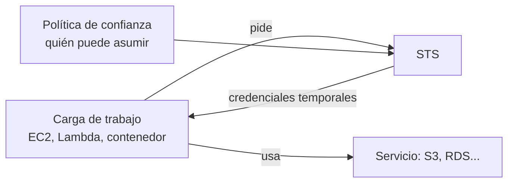

<!-- _class: lead -->

# M02 - Identidad y mínimo privilegio

### Seguridad en la nube y Zero Trust

**Rogelio Arriaga - Raptor Dev Services**

<!--
Módulo 2 de 6 (2 h). Hoy se contesta: ¿quién puede hacer qué, y cómo lo demostramos? La práctica corre en una nube simulada local (moto): sin cuenta, sin costo.
Prerrequisito: leer 10-cloud/15-aws-iam-seguridad.md. Esta clase no la repite: la usa para defender.
-->

---

## La idea de hoy

> Casi todos los incidentes en la nube empiezan con una identidad con demasiado permiso.

- En la nube **todo es una llamada de API**, y cada llamada la hace una identidad
- Una llave filtrada hace exactamente lo que su política permite, ni más ni menos
- Mínimo privilegio no es un adjetivo: es un resultado que se **demuestra**

<!-- Matiz: "casi todos" es la frase de la propuesta del curso, no una cifra medida. No la citen como estadística. -->

---

## Agenda

| Bloque | Tema |
|---|---|
| 1 | Humanos y cargas de trabajo: dos clases de identidad |
| 2 | Credenciales de corta vida y roles |
| 3 | Cómo decide AWS: la evaluación de políticas |
| 4 | Mínimo privilegio: escribirlo y verlo negar |
| 5 | Azure: RBAC, identidades administradas y acceso privilegiado |
| 6 | Práctica: tres identidades, un bucket |

---

## De dónde venimos

- **M1:** inventario con dueño y clasificación; datos e identidades son nuestros
- Hoy: qué identidades existen sobre esos activos y qué pueden hacer
- `10-cloud/15-aws-iam-seguridad.md` explica cómo se crea cada pieza. Hoy: **cómo se defiende**

---

<!-- _class: lead -->

# Parte 1
## Dos clases de identidad

---

## Humanos y cargas de trabajo

AWS separa sus recomendaciones en dos grupos:

| Identidad | Qué es | Recomendación de AWS |
|---|---|---|
| **Humana** | Personas, administradores, desarrolladores | Federación con un proveedor de identidad y **credenciales temporales** (IAM Identity Center para acceso centralizado) |
| **Carga de trabajo** | Una aplicación o proceso | **Roles de IAM** con credenciales temporales, no llaves de un usuario |

Y para ambos, MFA cuando exista un usuario IAM o el usuario raíz; AWS recomienda MFA **resistente al phishing** (passkeys y llaves de seguridad) donde sea posible.

Fuente: AWS, "Security best practices in IAM", a noviembre de 2026.

---

## Error típico: el usuario IAM «de servicio» con llaves largas

```
app-prod  (usuario IAM)
  └─ AWS_ACCESS_KEY_ID / SECRET   <- en .env, en un repo, en un contenedor
```

- Una llave de acceso **no caduca sola**
- Se copia: a una laptop, a un CI, a un chat
- Si se filtra, el atacante hereda **todos** los permisos del usuario, desde donde sea

AWS lo plantea así: para los casos que sí exigen credenciales largas, actualízalas cuando haga falta (por ejemplo, cuando alguien deja la empresa) y apóyate en la información de **último uso** para retirarlas con seguridad.

---

## La alternativa: el rol que se asume



- Cuando corres en un servicio de cómputo de AWS (EC2, Lambda, ...), AWS entrega **las credenciales temporales de un rol** al recurso, y los SDK las encuentran solos
- No hay secreto que distribuir
- Fuera de AWS (tu servidor, otro proveedor, un CI): IAM Roles Anywhere con un certificado X.509, o `AssumeRoleWithSAML` / `AssumeRoleWithWebIdentity` con un token de tu proveedor de identidad

---

## Cuánto dura una credencial temporal

Según la documentación de IAM (a noviembre de 2026), para `AssumeRole`:

| Dato | Valor |
|---|---|
| Mínimo de la sesión | 15 minutos (900 s) |
| Valor por omisión | 1 hora |
| Máximo | El «máximo de sesión» del rol: entre 1 y 12 horas |
| Encadenar roles (role chaining) | La sesión queda limitada a **1 hora** |

Menos tiempo de vida significa menos tiempo de uso útil si se filtra. Las credenciales de EC2 no están sujetas a ese máximo del rol: las rota el servicio.

Fuente: AWS IAM User Guide, "Methods to assume a role".

---

## CI/CD sin llaves: GitHub Actions con OIDC

El patrón que `10-cloud/15-aws-iam-seguridad.md` ya muestra, visto como defensa. Según la documentación de GitHub:

- El proveedor de identidad es `https://token.actions.githubusercontent.com`
- La **audiencia** (`aud`) es `sts.amazonaws.com` con la acción oficial
- La política de confianza del rol **debe restringir** el `sub` (qué repositorio y qué rama o entorno puede asumirlo)
- El workflow necesita `id-token: write`, que no da acceso de escritura a recursos

Una confianza sin condición de `sub` deja que **cualquier** repositorio de GitHub intente asumir tu rol. Esa condición es el control.

Fuente: GitHub Docs, "Configuring OpenID Connect in Amazon Web Services". Ojo: el formato exacto del `sub` cambió para repositorios nuevos (la propia página lo avisa); lee su versión vigente antes de escribir la condición.

---

## Usuario raíz: el caso especial

La documentación de AWS (a noviembre de 2026):

- Todo tipo de cuenta (independiente, de administración o miembro) exige **MFA** en el usuario raíz; se debe registrar en los 14 días de su primer intento de inicio de sesión en la consola
- Se pueden registrar hasta **ocho** dispositivos MFA
- **No crees llaves de acceso** para el usuario raíz
- En Organizations, se recomienda **quitar las credenciales raíz de las cuentas miembro** y centralizar el acceso raíz
- **Monitorea** su uso: alertas ante cualquier inicio de sesión raíz

Fuente: AWS IAM User Guide, "Root user best practices for your AWS account".

---

<!-- _class: lead -->

# Parte 2
## Cómo decide AWS

---

## Primero entender, después escribir

Una solicitud se autentica, se arma su contexto y luego se evalúan **todos** los tipos de política. Las reglas que más te importan, según la documentación:

| Combinación | Resultado |
|---|---|
| Identidad + recurso (misma cuenta) | **Unión**: lo permite cualquiera de los dos |
| Identidad + límite de permisos | **Intersección**: debe permitirlo ambos |
| Identidad + SCP / RCP (Organizations) | **Intersección**: debe permitirlo todo |
| Un `Deny` explícito en cualquiera | **Anula** cualquier `Allow` |

Sin `Allow` aplicable, el resultado es **denegado** (por omisión).

Fuente: AWS IAM User Guide, "Policy evaluation logic".

---

<!-- _pasos: filas -->
## Para qué sirve cada tipo

| Política | Qué hace | Concede permisos |
|---|---|---|
| Basada en identidad | Dice qué puede hacer esta identidad | Sí |
| Basada en recurso | Dice quién puede tocar este recurso | Sí |
| Límite de permisos | Techo para delegar a roles de equipos | No |
| SCP (Organizations) | Barandal para todas las identidades de las cuentas | No |
| RCP (Organizations) | Barandal para los recursos de la organización | No |

AWS lo dice sin rodeos: **las SCP y las RCP no conceden permisos**; hace falta además una política de identidad o de recurso.

---

## Error típico: «tiene un Deny, entonces no puede»

Un `Deny` explícito anula los `Allow`, **pero solo si llega a evaluarse para esa acción y ese recurso**.

```json
{ "Effect": "Deny", "Action": "s3:DeleteObject", "Resource": "arn:aws:s3:::lab-datos" }
```

Esto no protege los objetos: `DeleteObject` aplica a **objetos** (`lab-datos/*`), no al bucket. La política dice lo que dice, no lo que quisiste.

Cómo se detecta: probándola. Una política sin prueba es una intención.

---

## Condiciones: el segundo candado

AWS recomienda usar condiciones para restringir más. Ejemplo que la propia documentación menciona: exigir que las solicitudes usen TLS.

```json {1|2-3|4}
{ "Effect": "Deny",
  "Action": "s3:*",
  "Resource": ["arn:aws:s3:::lab-datos", "arn:aws:s3:::lab-datos/*"],
  "Condition": { "Bool": { "aws:SecureTransport": "false" } } }
```

Fragmento de ejemplo (patrón de la documentación de S3; no se ejecuta en la práctica).

---

<!-- _class: lead -->

# Parte 3
## Mínimo privilegio, medido

---

## Qué significa en concreto

AWS: conceder solo los permisos necesarios para una tarea, definiendo **acciones** sobre **recursos** específicos bajo **condiciones** específicas. Y aclara que puedes empezar amplio mientras exploras y **reducir** conforme el caso madura.

Tres preguntas por política:

1. ¿Cada **acción** es necesaria? (`s3:*` casi nunca)
2. ¿Cada **recurso** está acotado? (`"Resource": "*"` casi nunca)
3. ¿Hay **condiciones** que reduzcan más? (TLS, red, etiquetas)

---

## Del permiso amplio al ajustado

| Política | Dice | Qué permite en la práctica |
|---|---|---|
| Amplia | `s3:*` sobre `*` | Leer, escribir, **borrar**, listar y cambiar políticas de **cualquier** bucket |
| Ajustada | `s3:GetObject`, `s3:PutObject` sobre `lab-datos/clientes/*` | Leer y escribir objetos de **una** carpeta |
| Amplia con `Deny` | `s3:*` + `Deny s3:DeleteObject` | Casi todo, menos borrar |

En la práctica corremos las tres con el mismo código y vemos la diferencia.

---

## Herramientas para llegar a mínimo privilegio

| Herramienta | Qué hace |
|---|---|
| **IAM Access Analyzer**, generación de políticas | A partir de la actividad en CloudTrail, genera una política con solo lo que la identidad usó |
| **Access Analyzer**, validación | Más de 100 revisiones de políticas, con recomendaciones |
| **Información de último acceso** | Qué servicios y acciones se usaron; sirve para retirar lo que sobra |
| **Access Analyzer**, acceso externo | Hallazgos de acceso público o entre cuentas |

Lo que hace cada una está en la guía de buenas prácticas de IAM. Ninguna corre en el simulador: son servicios de AWS. Se usan en una cuenta real **de tu organización**; aquí los conoces.

---

## Detectar lo amplio antes de que corra

Un revisor automático lee la plantilla y marca la política. En la práctica corremos **checkov** sobre una plantilla de CloudFormation:

```
Check: CKV_AWS_62: "Ensure no IAM policies that allow full "*-*" administrative privileges are not created"
	FAILED for resource: AWS::IAM::Role.RolApi
Check: CKV_AWS_63: "Ensure no IAM policies documents allow "*" as a statement's actions"
	FAILED for resource: AWS::IAM::Role.RolApi
```

Salida real (checkov 3.2.459, noviembre de 2026). Con la política ajustada, los 9 chequeos pasan. Esto se mueve al pipeline en `/infrastructure-as-code/` y en el módulo 6.

---

## Reporte de credenciales: quién tiene qué

El **credential report** de IAM lista cada usuario con su estado de contraseña, MFA y llaves.

```
juan | mfa: false | password: false | llave1: true
ana  | mfa: false | password: true  | llave1: false
```

Salida real del simulador. En una cuenta real el reporte trae más columnas, entre ellas la fecha del último uso de cada llave. Lectura de defensor: `juan` tiene una llave activa sin MFA ni contraseña. ¿Quién la usa? ¿Cuándo se usó por última vez? Si nadie responde, se desactiva.

---

## Identidades de carga: el metadato de la instancia

Una instancia EC2 recibe credenciales de su rol a través del servicio de metadatos (IMDS). AWS documenta dos versiones:

- **IMDSv1:** petición/respuesta simple
- **IMDSv2:** orientada a sesión, con un token que se pide con un `PUT` (TTL de 1 segundo a 6 horas) y se envía en cada `GET`

Por omisión se aceptan **ambas**; puedes configurar una instancia para que **solo acepte IMDSv2**, y entonces las llamadas v1 fallan. El token no sirve fuera de la instancia que lo generó.

En la API de EC2 se llama `MetadataOptions.HttpTokens` con valores `optional` o `required`.

Fuente: AWS EC2 User Guide, "Use the Instance Metadata Service to access instance metadata".

---

<!-- _class: lead -->

# Parte 4
## Azure

---

## Azure RBAC: tres elementos

Una asignación de rol tiene tres partes (Microsoft Learn):

| Elemento | Qué es |
|---|---|
| **Entidad de seguridad** | Usuario, grupo, entidad de servicio o identidad administrada |
| **Definición de rol** | Colección de permisos (por ejemplo, Reader, Contributor, Owner) |
| **Ámbito** | Dónde aplica: grupo de administración, suscripción, grupo de recursos o recurso |

El ámbito es una jerarquía padre-hijo: asignar en la suscripción alcanza todo lo que contiene.

---

## Azure es aditivo: no hay unión que se "arregle" abajo

Microsoft lo explica con un ejemplo: si un usuario tiene **Contributor** en la suscripción y **Reader** en un grupo de recursos, el efecto es Contributor en la suscripción; la asignación Reader no cambia nada. Azure RBAC es un modelo **aditivo**: tus permisos efectivos son la suma de tus asignaciones.

Existen **denegaciones** (deny assignments): si una aplica, el acceso se bloquea. Regla práctica: no se "quita" un permiso poniendo un rol más chico debajo; se quita **la asignación amplia**.

---

## Identidades administradas: el equivalente del rol de la instancia

Microsoft: una identidad administrada permite a una aplicación obtener tokens de Microsoft Entra **sin administrar credenciales**. Dos tipos:

| | Asignada por el sistema | Asignada por el usuario |
|---|---|---|
| Se crea | Con el recurso | Como recurso independiente |
| Ciclo de vida | El mismo del recurso (se borra con él) | Independiente |
| Compartir | No, un solo recurso | Sí, varios recursos |

Código en .NET: se usa `Azure.Identity` o MSAL para pedir el token; no hay secreto en la configuración. Sin costo adicional.

Fuente: Microsoft Learn, "Managed identities for Azure resources" (actualizada en 2026-06).

---

## Acceso privilegiado a demanda: PIM

**Privileged Identity Management** (Microsoft Entra) ofrece: acceso **justo a tiempo**, asignaciones **con vigencia**, **aprobación** para activar, **MFA** al activar, justificación, notificaciones y **revisiones de acceso**. Distingue asignaciones **elegibles** (hay que activar) de **activas**.

Requiere licencias (la documentación remite a su página de licenciamiento): verifica el costo antes de proponerlo. Es la respuesta a «el administrador lo es 24/7».

Fuente: Microsoft Learn, "What is Privileged Identity Management?" (2026-04).

---

## Mismo problema, dos vocabularios

| Idea | AWS | Azure |
|---|---|---|
| Humanos federados | IAM Identity Center | Microsoft Entra ID |
| Carga sin secretos | Rol de IAM (perfil de instancia) | Identidad administrada |
| Permiso | Política de IAM | Rol de Azure RBAC |
| Barandal de organización | SCP / RCP | Azure Policy y jerarquía de grupos de administración (equivalencia aproximada) |
| Privilegio temporal | Credenciales de `AssumeRole` | PIM |

Sirve para traducir, no para igualar: **los modelos de evaluación difieren** (AWS parte de denegar y suma permisos con denegación explícita; Azure RBAC es aditivo con denegaciones propias).

---

## Qué mirar en una revisión de identidades

Checklist de 10 minutos:

- [ ] ¿Cuántos usuarios con llaves largas hay? ¿Quién las usa?
- [ ] ¿Todo usuario humano entra por federación o tiene MFA?
- [ ] ¿Algún `Action: "*"` o `Resource: "*"`?
- [ ] ¿Las confianzas de los roles tienen condiciones (`sub`, cuenta)?
- [ ] ¿Se alerta del uso del usuario raíz?
- [ ] ¿Hay identidades sin usar en los últimos 90 días? *(umbral de ejemplo de la clase; cada organización fija el suyo)*

Libros: *Practical Cloud Security* (Dotson, 2023), cap. 4. *Identity-Native Infrastructure Access Management* (Kontsevoy et al., 2023), caps. 2 a 6.

---

## Práctica de hoy

**Tres identidades, un bucket.** En un simulador de AWS local: una identidad con permisos amplios, una con mínimo privilegio y una con un `Deny`. El mismo código intenta leer, escribir, borrar y listar con cada una; **ves** qué se niega. Después: checkov sobre una plantilla con `Action: "*"`, y el reporte de credenciales.

Sin cuenta de nube, sin costo. Archivo: `practica.md`.

---

## Qué te llevas

1. Dos clases de identidad: humanos (federación) y cargas (roles). **Sin llaves largas** donde se pueda
2. Credenciales cortas limitan el daño de una filtración
3. En AWS, un `Deny` explícito anula todo; las SCP no conceden
4. Mínimo privilegio se **mide**: acciones, recursos, condiciones y una prueba que niega
5. En Azure, RBAC suma; se quita retirando la asignación amplia

**Para el módulo 3:** `10-cloud/11-aws-vpc-networking.md`.

---

## Referencias

- AWS IAM User Guide: "Security best practices in IAM"; "Policy evaluation logic"; "Methods to assume a role"; "Root user best practices for your AWS account"
- AWS EC2 User Guide: "Use the Instance Metadata Service to access instance metadata"
- GitHub Docs: "Configuring OpenID Connect in Amazon Web Services"
- Microsoft Learn: "What is Azure role-based access control (Azure RBAC)?"; "Managed identities for Azure resources"; "What is Privileged Identity Management?"
- moto, "IAM-like Access Control": docs.getmoto.org
- Libros: *Practical Cloud Security* (Dotson, 2023), cap. 4. *Identity-Native Infrastructure Access Management* (Kontsevoy et al., 2023), caps. 2 a 6. *AWS Certified Security - Specialty (SCS-C02) Exam Guide* (Book y Scott, 2024), caps. 13 a 16. *Cloud Native Security Cookbook* (Armitage, 2022), cap. 2. *Security and Microservice Architecture on AWS* (Raje, 2021), cap. 2. *Keycloak - Identity and Access Management for Modern Applications* (Thorgersen y Silva, 2023), cap. 3 (estándares: OAuth 2.0, OpenID Connect, SAML)
