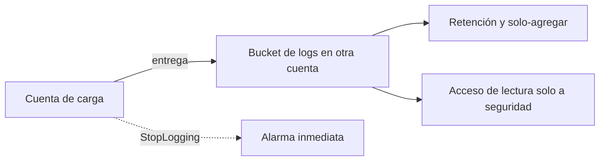
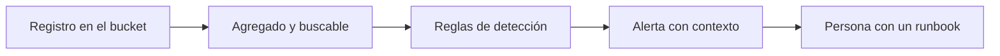

<!-- _class: lead -->

# M05 - Detección y respuesta en la nube

### Seguridad en la nube y Zero Trust

**Rogelio Arriaga - Raptor Dev Services**

<!--
Módulo 5 de 6. Hasta aquí el curso trató de evitar el incidente: responsabilidad compartida (M1), identidad (M2), red (M3), Zero Trust (M4). Hoy se asume que algo falla y se pregunta: ¿nos enteramos? ¿cuándo? ¿con qué evidencia?
Todo lo que se ve hoy corre en el laboratorio local o es un registro de ejemplo con el formato documentado. No se toca ninguna cuenta de nube real.
-->

---

## La idea de hoy

> En la nube, la evidencia está en las bitácoras del proveedor, si se encendieron a tiempo.

- No hay disco que apagar ni servidor que fotografiar: lo que pasó quedó como llamadas a una API
- Quien no registró ayer no puede investigar hoy
- Detectar es una consulta sobre esos registros; responder es cambiar permisos y recursos por la misma API

<!-- Pregunta de arranque: si mañana alguien usa una llave de su cuenta, ¿en qué archivo lo verían y cuánto tiempo hacia atrás pueden mirar? Que contesten sin abrir la consola. -->

---

## Agenda (2 horas)

| Bloque | Tema | Min |
|---|---|---|
| 1 | Qué vigilar: CloudTrail, Activity Log, registros de recursos | 30 |
| 2 | Cómo vigilar: de registro a alerta | 25 |
| 3 | Quién detecta por ti: GuardDuty, Config, Security Hub | 15 |
| 4 | Responder: ciclo, contención, evidencia | 20 |
| 5 | Práctica: leer, detectar, apagar el registro y verlo fallar | 25 |
| 6 | Cierre y tarea | 5 |

---

## De dónde venimos

- **M1:** qué le toca proteger a tu equipo
- **M2:** identidades con el permiso justo, sesiones de corta vida
- **M3:** una red donde solo lo necesario es alcanzable
- **M4:** decidir por identidad, dispositivo y contexto, no por la red

Hoy: cada una de esas decisiones deja un **rastro**. Si el rastro no existe, no se puede demostrar que el control funcionó ni saber cuándo dejó de hacerlo.

---

## Caso hipotético: Taller Demo

> Caso hipotético, inventado para enseñar. Cualquier parecido con una empresa real es coincidencia.

- Cuenta de laboratorio `111122223333`, región `us-east-1`
- Carga **api-lab**: API en .NET, base `db-lab`, bucket `lab-datos`
- Un usuario de despliegue `app-deploy` con llave larga que alguien dejó en un repositorio
- Pregunta del módulo: **¿qué habría que tener encendido para enterarnos en minutos y no en meses?**

<!-- Todo el módulo regresa a este caso. El registro de ejemplo de la práctica es de esta cuenta ficticia, con IP de documentación (203.0.113.0/24 y 198.51.100.0/24). -->

---

<!-- _class: lead -->

# Parte 1
## Qué vigilar

---

## Tres planos, tres tipos de evidencia

| Plano | Qué contiene | Ejemplo en AWS | Ejemplo en Azure |
|---|---|---|---|
| **Control** | Quién cambió la configuración | CloudTrail, eventos de administración | Activity Log |
| **Datos** | Quién leyó o escribió el contenido | CloudTrail, eventos de datos (S3) | Registros de recursos |
| **Red** | Quién habló con quién | VPC Flow Logs, DNS | Registros de flujo de red |

Cada plano se enciende por separado. Tener el primero no te da el segundo.

Fuentes: documentación de CloudTrail (tipos de eventos) y de Azure Monitor (activity log frente a resource logs), a noviembre de 2026.

---

## CloudTrail: lo que ya tienes

CloudTrail viene activo en tu cuenta. Su **historial de eventos** es una vista consultable, descargable e inmutable de los **últimos 90 días de eventos de administración**, por región.

```bash
aws cloudtrail lookup-events --lookup-attributes AttributeKey=EventName,AttributeValue=StopLogging
```

Fragmento (no ejecutado: requiere una cuenta real). Fuente: AWS CloudTrail User Guide, "Working with CloudTrail event history".

El historial **no** muestra eventos de datos, ni de Insights, ni de actividad de red; busca en una sola región, con un solo filtro de atributo; y no agrega la organización.

---

## Por qué el historial no basta

| Necesidad | Historial de eventos | Trail |
|---|---|---|
| Más de 90 días | No | Sí, tú decides la retención en tu bucket |
| Eventos de datos (S3) | No | Sí, con costo adicional |
| Todas las regiones en un lugar | No | Sí, un trail multirregión |
| Toda la organización | No | Sí, un trail de organización |
| Proteger contra borrado | Es inmutable, pero expira | Validación de integridad |

Un **trail** entrega los eventos a un bucket de S3 y es el que debes tener en cualquier cuenta que importe.

<!-- Error típico: "CloudTrail está prendido por defecto, ya cubrimos eso". Cubre 90 días de administración y nada más. -->

---

## Qué tipos de evento registra

- **Administración (management):** operaciones del plano de control, por ejemplo `AttachRolePolicy`, `CreateTrail`, y también `ConsoleLogin`. Un trail los registra **por defecto**
- **Datos:** operaciones sobre el contenido, como leer un objeto. No van por defecto y tienen cargo adicional
- **Insights:** detecta ritmos inusuales de llamadas o de errores de la API; también opcional y con cargo
- **Actividad de red:** llamadas hechas desde un punto de enlace de VPC

Se puede elegir **lectura**, **escritura** o **ambas** en los de administración.

Fuente: CloudTrail User Guide, "Logging management events", a noviembre de 2026.

---

## Un caso de costo contra cobertura

AWS KMS genera un volumen enorme: según la documentación, `Encrypt`, `Decrypt` y `GenerateDataKey` suman **más de 99 %** de sus eventos y se registran como lectura. Las acciones raras y relevantes (`Disable`, `Delete`, `ScheduleKey`) suman **menos de 0.5 %** y son de escritura.

Decisión razonable y documentada: registrar **solo escritura** de administración en un segundo trail, conservar los eventos de KMS de escritura y no pagar por millones de lecturas.

Decisión peligrosa: **excluir KMS completo** sin saber que ya no verás quién deshabilitó una llave.

Fuente: CloudTrail User Guide, "Logging management events".

---

## Anatomía de un registro de CloudTrail

```json {1-3|4-8|9-11|12-14|*}
{
  "eventVersion": "1.11",
  "eventTime": "2026-11-10T14:05:40Z",
  "userIdentity": { "type": "IAMUser", "userName": "app-deploy" },
  "eventSource": "cloudtrail.amazonaws.com",
  "eventName": "StopLogging",
  "awsRegion": "us-east-1",
  "sourceIPAddress": "203.0.113.50",
  "userAgent": "aws-cli/2.x",
  "requestParameters": { "name": "trail-lab" },
  "responseElements": null,
  "eventType": "AwsApiCall",
  "readOnly": false,
  "recipientAccountId": "111122223333"
}
```

Ejemplo ilustrativo con el formato de la documentación (la versión de formato vigente es 1.11 a noviembre de 2026).

---

## Los campos que sirven para detectar

| Campo | Pregunta que contesta |
|---|---|
| `userIdentity` | ¿Quién? (usuario, rol asumido, root, servicio) |
| `eventTime` | ¿Cuándo? Siempre en UTC |
| `eventSource` + `eventName` | ¿Qué hizo y en qué servicio? |
| `sourceIPAddress`, `userAgent` | ¿Desde dónde y con qué herramienta? |
| `errorCode`, `errorMessage` | ¿Funcionó? Incluye fallos de autorización |
| `requestParameters` | ¿Sobre qué recurso? |
| `readOnly` | ¿Cambió algo o solo miró? |

Fuente: CloudTrail User Guide, "CloudTrail record contents".

<!-- Insistir en readOnly: la mitad de las reglas útiles son "escritura sobre X". -->

---

## Lo que se denegó también es evidencia

Un `errorCode` de acceso denegado dice que alguien **intentó** algo que su rol no permite.

- Un deploy que falla una vez: configuración
- La misma identidad con muchos denegados seguidos sobre recursos distintos: alguien está **explorando** lo que puede hacer, o un código está mal
- Un denegado en un recurso que ese rol **jamás** toca: vale una pregunta

Es la señal que el mínimo privilegio del M2 te regala: mientras menos permisos, más ruido significativo cuando intentan usarlos.

---

## Demostración: leer un registro con jq

```bash {1|2|*}
jq -r '.Records[] | select(.errorCode)
  | [.eventTime,.userIdentity.arn,.eventName,.errorCode] | @tsv' eventos-lab.json
```

Salida real (jq, noviembre de 2026), sobre el archivo de la práctica:

```
2026-11-10T14:06:01Z	arn:aws:sts::111122223333:assumed-role/api-lab-rol/sesion-api	GetObject	AccessDenied
2026-11-10T14:06:03Z	arn:aws:sts::111122223333:assumed-role/api-lab-rol/sesion-api	GetObject	AccessDenied
2026-11-10T14:06:05Z	arn:aws:sts::111122223333:assumed-role/api-lab-rol/sesion-api	GetObject	AccessDenied
```

Tres denegados en cuatro segundos, mismo rol, tres archivos distintos de `nominas/`. Eso ya es una pregunta para el dueño de la API.

---

## Integridad: ¿alguien tocó el registro?

Con la **validación de integridad** activada, CloudTrail:

1. calcula un hash (SHA-256) de cada archivo de registro que entrega;
2. cada hora entrega un **archivo de resumen** con los hashes de esa hora;
3. firma el resumen con SHA-256 y RSA, con un par de llaves distinto por región;
4. lo deja en una carpeta separada del mismo bucket.

Resultado: se puede afirmar que un archivo **no cambió**, o notar que **faltan** archivos.

Activarla no valida nada por sí sola: hay que validar con la CLI o con una herramienta propia.

Fuente: CloudTrail User Guide, "Validating CloudTrail log file integrity".

---

## Proteger el registro de quien lo quiera borrar



- El bucket vive **fuera** de la cuenta que se vigila
- El permiso de borrar no lo tiene nadie del día a día
- Apagar el trail es en sí un evento que dispara alarma

Fuente de la idea: *Practical Cloud Security* (Dotson, 2023), cap. 7 (agregación y retención); *Cloud Native Security Cookbook* (Armitage, 2022), receta 3.5.

---

## Fragmento: impedir apagar el trail desde las cuentas miembro

```json
{
  "Version": "2012-10-17",
  "Statement": [{
    "Sid": "ProtegerRegistro",
    "Effect": "Deny",
    "Action": ["cloudtrail:StopLogging", "cloudtrail:DeleteTrail", "cloudtrail:UpdateTrail"],
    "Resource": "*"
  }]
}
```

Fragmento (no ejecutado): una política de control de servicio (SCP) de ejemplo.

Una SCP **no concede** permisos, solo limita; afecta a las cuentas miembro (incluido su root) y **no** a la cuenta de administración de la organización. Por eso esa cuenta no debe correr cargas. Fuente: AWS Organizations User Guide, "Service control policies".

---

## En Azure: el Activity Log

- Registra operaciones de **administración** (crear, actualizar, borrar, acciones) **por defecto**, sin configurar nada; no lo puedes cambiar ni borrar
- Retiene **90 días**; para más, un **diagnostic setting** que lo envíe a Log Analytics, Event Hubs o una cuenta de almacenamiento
- Normalmente no captura lecturas
- **No es una bitácora de autenticación ni autorización:** una petición que Resource Manager rechaza antes de empezar la operación no genera entrada
- Es el único lugar que guarda **quién creó** un recurso

Fuente: Microsoft Learn, "Activity log in Azure Monitor" (actualizada el 2026-11-03).

---

## En Azure: los registros de recursos hay que encenderlos

Los **registros de recursos** (plano de datos: leer un secreto de un almacén de claves, consultar una base) **no se recolectan por defecto**: requieren un *diagnostic setting*.

Mismo patrón que en AWS: el plano de control viene encendido, el de datos se decide.

| Pregunta | AWS | Azure |
|---|---|---|
| ¿Quién cambió la configuración? | CloudTrail (historial o trail) | Activity Log |
| ¿Cuánto guarda por defecto? | 90 días (administración) | 90 días |
| ¿Cómo se guarda más? | Trail a S3 o event data store | Diagnostic setting |
| ¿Quién leyó los datos? | Eventos de datos | Registros de recursos |

---

## Error típico: la bitácora sin dueño ni hora

- Se encendió en una región, la actividad ocurrió en otra
- Se guarda en la misma cuenta donde un atacante con permiso de administrador puede borrarla
- Nadie la lee: existe pero no hay una sola consulta ni alarma
- Retención de 90 días y el incidente se descubre al día 120
- Horas en distinta zona al correlacionar con los registros de la API: `eventTime` es **UTC**

Cada una de esas se detecta con una pregunta de auditoría y se **verifica** con un comando que devuelve OK o FALLA. Lo vemos en la práctica.

---

<!-- _class: lead -->

# Parte 2
## Cómo vigilar

---

## De registro a alerta



*Practical Cloud Security* (Dotson, 2023), cap. 7, separa **qué vigilar** de **cómo vigilar**: agregación y retención, análisis del registro, búsqueda y correlación, alertas y respuesta automática.

Una alerta sin persona ni runbook es otro registro que nadie lee.

---

## Seis reglas que casi toda cuenta debería tener

| Regla | Pregunta que contesta | Campos |
|---|---|---|
| Uso del root | ¿Alguien usó la cuenta sin límites? | `userIdentity.type = Root` |
| Inicio de sesión sin MFA | ¿Entraron con solo contraseña? | `ConsoleLogin` + `additionalEventData.MFAUsed` |
| Se tocó el registro | ¿Intentan cegarnos? | `StopLogging`, `DeleteTrail`, `UpdateTrail` |
| Cambios de IAM | ¿Cambió quién puede qué? | `eventSource = iam` y `readOnly = false` |
| Cambio de acceso a un bucket | ¿Se abrió un dato? | `PutBucketPolicy`, bloqueo de acceso público |
| Ráfaga de denegados | ¿Alguien explora permisos? | `errorCode` + misma identidad |

Son punto de partida, no catálogo. El *CIS AWS Foundations Benchmark* trae recomendaciones de monitoreo de este tipo; consulta la versión vigente en cisecurity.org.

---

## La regla es código, no una captura de pantalla

```python {1|3-5|7-8}
registros = json.load(open(sys.argv[1]))["Records"]

for r in registros:
    if r["userIdentity"]["type"] == "Root":
        hallazgos.append(("ALTA", "uso de root", r["eventName"], r["eventTime"]))

    if r["eventSource"] == "cloudtrail.amazonaws.com" and r["eventName"] in ("StopLogging", "DeleteTrail"):
        hallazgos.append(("ALTA", "se toco el registro", r["eventName"], r["eventTime"]))
```

Fragmento del script de la práctica (`buscar.py`). Corre sobre un archivo con el formato de CloudTrail. En producción la misma lógica vive en una consulta del SIEM o en una regla de tu plataforma; lo que importa es que **se pueda probar con un registro conocido**.

---

## Cómo se ve una alarma en CloudWatch

Un **filtro de métrica** sobre el grupo de logs donde CloudTrail escribe cuenta las coincidencias de un patrón y una **alarma** actúa sobre esa métrica, con notificación por SNS.

La mecánica de métricas, alarmas y SNS ya está en la nota `10-cloud/16-aws-cloudwatch.md`: aquí no se repite.

Lo nuevo para seguridad: el umbral suele ser **1**. Un `StopLogging` no es una tendencia, es un evento.

---

## Ruido: la forma más segura de que nadie mire

- Una regla que dispara 40 veces al día se silencia al tercer día
- Antes de activar: probar contra una semana de registros y contar
- Excluir la identidad **conocida** (el pipeline legítimo) por ARN, no por nombre parcial
- Cada alerta lleva su contexto: quién, desde qué IP, sobre qué
- Revisar mensualmente: reglas sin disparos (¿sirven?) y con demasiados (¿afinar?)

Medidas de seguimiento de *Practical Cloud Security* (Dotson, 2023), cap. 7: tiempo medio de remediación, porcentaje de falsos positivos y de falsos negativos.

---

<!-- _class: lead -->

# Parte 3
## Quién detecta por ti

---

## Amazon GuardDuty

Servicio de detección de amenazas que analiza fuentes de datos y registros de tu cuenta con inteligencia de amenazas y modelos de aprendizaje automático.

- Al activarlo, ingiere por sí solo los eventos de **administración** de CloudTrail, los **VPC Flow Logs** de EC2 y los registros de **DNS**
- Los planes de protección (S3, EKS, RDS, malware, etc.) se habilitan aparte; al activarlo por primera vez, entra una **prueba gratuita de 30 días**
- Sus hallazgos llegan a Security Hub CSPM, a Detective y a EventBridge

**No previene nada:** avisa. Y no reemplaza tus reglas: no sabe qué es "raro" para *tu* negocio.

Fuente: Amazon GuardDuty User Guide, "What is Amazon GuardDuty?", a noviembre de 2026.

---

## AWS Config: el estado, no los eventos

CloudTrail dice **quién cambió**. Config dice **cómo está ahora** y si cumple.

- Las **reglas administradas** son reglas predefinidas y personalizables que evalúan si un recurso cumple una práctica común
- Ejemplo: `S3_BUCKET_PUBLIC_READ_PROHIBITED` revisa el bloqueo de acceso público, la política y la ACL del bucket; se evalúa por cambio de configuración y periódicamente
- Si una regla marca **NON_COMPLIANT**, el bucket no cumple

Es el puente al M6: la regla que detecta la deriva en cuanto aparece.

Fuente: AWS Config Developer Guide, "AWS Config managed rules" y la página de la regla `s3-bucket-public-read-prohibited`, noviembre de 2026.

---

## Cada herramienta contesta algo distinto

| Herramienta | Contesta | No contesta |
|---|---|---|
| CloudTrail | Qué llamadas se hicieron | Si fue una amenaza |
| GuardDuty | Qué parece una amenaza | Si tu configuración cumple |
| Config | Si el recurso cumple su regla | Quién lo cambió |
| Security Hub CSPM | Todo junto, priorizado | Qué hacer con ello |
| Tu regla propia | Lo que importa a tu negocio | Lo que no pensaste |

Fuentes: *AWS Certified Security - Specialty (SCS-C02) Exam Guide* (Book y Scott, 2024), caps. 5 y 6; *Practical Cloud Security*, cap. 7.

---

## Azure: el mismo reparto

- **Azure Monitor:** Activity Log, registros de recursos, alertas
- **Azure Policy:** evalúa recursos contra reglas y su efecto (`audit`, `deny`, `deployIfNotExists`, `modify`...); el M6 lo trabaja
- Los registros se envían, con un *diagnostic setting*, a donde tu equipo de seguridad los lee

No se afirma aquí nada sobre Microsoft Defender for Cloud: ese servicio queda fuera del curso hasta contrastarlo con su documentación vigente.

<!-- Nota de honestidad: es mejor decir lo que no está cubierto que describir un servicio con planes y precios que cambian sin haberlo contrastado. -->

---

<!-- _class: lead -->

# Parte 4
## Responder

---

## Hallazgo no es incidente

> Definiciones de trabajo de este curso, para ordenar la conversación; no son citas de un estándar.

- **Hallazgo:** algo que una regla o un servicio marcó
- **Evento de seguridad:** un hallazgo confirmado como actividad real y relevante
- **Incidente:** un evento que afecta o puede afectar confidencialidad, integridad o disponibilidad y exige respuesta

La primera tarea de quien responde es **clasificar**, rápido y por escrito.

---

## La guía de referencia

La NIST SP 800-61 **Revisión 3** (abril de 2025) integra la respuesta a incidentes con la gestión de riesgo de ciberseguridad usando el marco **CSF 2.0**. La Revisión 2 quedó retirada y reemplazada por completo.

Idea práctica de la guía: las seis funciones del CSF 2.0 intervienen en la respuesta; no es solo "contener y recuperar". Parte del trabajo (gobernar, identificar, proteger) ocurre **antes** del incidente.

Fuente: NIST, SP 800-61r3 (final, 3 de abril de 2025), csrc.nist.gov.

<!-- Detalle de la Rev. 3 queda a la lectura del documento; aquí solo se usa lo verificado: fecha, que Rev. 2 está retirada y que se organiza con CSF 2.0. -->

---

## Qué cambia en la nube

| En un servidor propio | En la nube |
|---|---|
| Aíslas desenchufando | Aíslas cambiando una regla de red o un permiso por la API |
| La evidencia es un disco | La evidencia es el registro de la API y copias de recursos |
| Perder la sesión SSH es el riesgo | Perder el registro por no haberlo encendido es el riesgo |
| Un responsable de todo | Responsabilidad compartida: el proveedor no investiga **tu** cuenta |

Fuentes: *Incident Response in the Age of Cloud* (Ozkaya, 2021), cap. 11; *Practical Cloud Security* (Dotson, 2023), cap. 7 (forensia en la nube).

---

## Contener no es apagar

- **Aislar:** quitar permisos de la identidad o cambiar la regla de red que alcanza el recurso
- **Preservar:** guardar una copia del estado (instantánea, exportación del registro) **antes** de borrar o reconstruir
- **Rotar:** reemplazar credenciales y secretos expuestos
- **Reconstruir** desde la definición en código, no "limpiar" a mano

Apagar el recurso pierde memoria y procesos que explican qué ocurrió. Aislar primero conserva ambas cosas.

Idea tomada de *Building Secure and Reliable Systems* (Adkins et al., 2020), cap. 15 (investigar sistemas) y 17 (gestión de crisis).

---

## Guion para "una credencial se expuso"

1. **Confirmar:** en el registro, ¿qué hizo esa identidad desde que se expuso?
2. **Limitar:** quitar o acotar sus permisos; no borrarla todavía (se pierde el rastro)
3. **Rotar:** nueva credencial; mejor, pasar a un rol con sesiones temporales
4. **Buscar lo creado:** usuarios, llaves, roles y políticas nuevos en la ventana del incidente
5. **Verificar:** repetir la consulta del paso 1 y comprobar que no hay actividad nueva con la credencial vieja
6. **Aprender:** ¿por qué estaba la llave ahí? ¿qué regla debió avisar antes?

Mismo método para cualquier credencial: se confirma, se limita, se rota, se verifica y se registra.

---

## Demostración: las cinco preguntas del registro

| Pregunta | Dónde está |
|---|---|
| ¿Quién? | `userIdentity.arn` |
| ¿Qué? | `eventSource` + `eventName` |
| ¿Cuándo? | `eventTime` (UTC) |
| ¿Desde dónde? | `sourceIPAddress`, `userAgent` |
| ¿Funcionó? | `errorCode` presente o ausente |

Con el registro de Taller Demo: `app-deploy` apagó el trail a las 14:05:40 UTC desde `203.0.113.50`, tres minutos después de un inicio de sesión de root sin MFA desde esa misma IP. **Ese orden de eventos** es la historia del incidente.

---

## Error típico en la respuesta

- Borrar la llave "para parar el problema" y perder la pista de qué hizo
- Reconstruir el servidor sin guardar su estado ni el registro
- Descubrir a la mitad que no había eventos de datos y no se sabe qué se leyó
- Comunicar sin un responsable: nadie decide cuándo avisar
- No escribir la línea de tiempo mientras ocurre

<!-- Que cada equipo diga cuál de estas ya les pasó en cualquier sistema, no necesariamente en la nube. -->

---

## Ensayar antes: el simulacro de mesa

Un **tabletop** es una conversación guiada con un escenario inventado: planear, escribir el escenario, facilitarlo y actuar sobre lo aprendido.

- No toca ningún sistema
- Descubre quién no sabe a quién llamar y qué registro no estaba encendido
- Termina con acciones con dueño y fecha

Fuente: *Cybersecurity Tabletop Exercises* (Lelewski, Hollenberger), caps. 1 a 5. El M6 del curso blue-team (`/blue-team/`) lo trabaja con profundidad; aquí solo importa el escenario de nube.

---

## Escenario de mesa para tu equipo (Caso hipotético)

> Un martes a las 14:02 UTC aparece un inicio de sesión de root sin MFA y, tres minutos después, un `StopLogging`.

Discutan en 15 minutos:

1. ¿Quién recibe la alarma y qué hace en los primeros 10 minutos?
2. ¿Qué consulta responde "qué hizo esa identidad"?
3. ¿Qué decisión de contención toman y qué evidencia conservan antes?
4. ¿Cuál es la regla que **debió** avisar antes?

---

## Lo que no se cubre aquí

- Análisis forense profundo de discos y memoria: curso de forense del catálogo
- Operación continua de un SOC y caza de amenazas: `/blue-team/`
- Respuesta a incidentes en Kubernetes: `/kubernetes/`
- Cumplimiento y reglas como código: el siguiente módulo

---

<!-- _class: lead -->

# Parte 5
## Práctica

---

## Lo que haremos

En el laboratorio local (sin cuenta de nube, sin costo):

1. **Leer** un registro con el formato de CloudTrail con `jq`
2. **Detectar** con `buscar.py`: root sin MFA, `StopLogging`, ráfaga de denegados, cambio de bucket
3. **Auditar** un trail simulado con `auditar_trail.py` y ver `OK`
4. **Verlo fallar:** apagar el registro y ver cómo la auditoría pasa a `FALLA`
5. Escribir la **línea de tiempo** del incidente

El simulador (moto) imita la API de AWS en `127.0.0.1`; **no** genera eventos de CloudTrail reales.

---

## Resumen del módulo

- El plano de control viene registrado por defecto; el de datos y la retención larga **los enciendes tú**
- El historial de CloudTrail dura **90 días**; un trail con validación de integridad y bucket protegido dura lo que decidas
- Una regla de detección es código **probado contra un registro conocido**
- GuardDuty avisa, Config evalúa el estado, tus reglas cubren tu negocio
- Responder: clasificar, limitar, preservar, rotar, verificar, aprender
- Apagar el registro es en sí una señal de ataque o de error grave

---

## Tarea y adelanto

- **Tarea:** auditar la bitácora de un laboratorio y escribir 3 reglas con su prueba
- **Lectura:** `10-cloud/16-aws-cloudwatch.md` (ya vista) y la sección de CloudTrail de `10-cloud/15-aws-iam-seguridad.md`
- **Libros:** *Practical Cloud Security* (Dotson, 2023), cap. 7; *AWS Certified Security - Specialty (SCS-C02) Exam Guide* (Book y Scott, 2024), caps. 4 a 9; *Cloud Native Security Cookbook* (Armitage, 2022), cap. 3
- **Siguiente módulo:** cumplimiento como código: que una regla marque el recurso mal configurado en cuanto aparece

<!-- Cierre: pedir a cada equipo una frase con "yo no sabría contestar X con mis bitácoras de hoy". Eso es su lista de trabajo. -->
