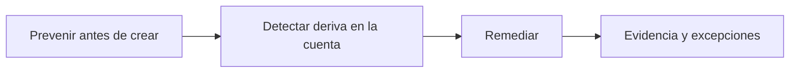
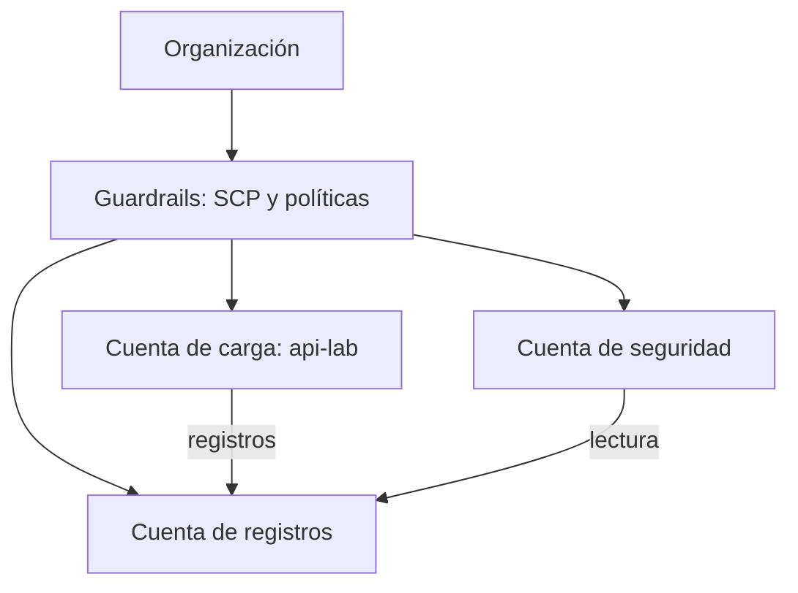

<!-- _class: lead -->

# M06 - Cumplimiento como código y arquitectura

### Seguridad en la nube y Zero Trust

**Rogelio Arriaga - Raptor Dev Services**

<!--
Módulo 6 de 6. Cierra el curso: los cinco módulos anteriores dejaron decisiones (responsabilidad, identidad, red, Zero Trust, detección). Hoy se convierten en reglas que se evalúan solas y en decisiones de arquitectura con registro.
Traslape declarado con /infrastructure-as-code/ (su sesión 6 trata política como código dentro del pipeline): aquí el enfoque es el cumplimiento en la nube; allá, la herramienta en el pipeline. No se repite esa sesión: se enlaza.
Todo corre en local: checkov y cfn-lint sobre plantillas, y moto como cuenta simulada. Ninguna cuenta real.
-->

---

## La idea de hoy

> Una revisión manual cada trimestre deja tres meses de deriva sin ver.

- Una política que solo vive en un documento se cumple hasta que alguien tiene prisa
- Una política escrita como regla se evalúa **cada vez**: al pedir el recurso, al cambiarlo y periódicamente
- Y cada regla deja evidencia para quien audita

<!-- Pregunta de arranque: ¿cuántos recursos de su cuenta fueron creados "a mano en la consola" y no existen en ningún repositorio? Esa es la deriva potencial. -->

---

## Agenda (2 horas)

| Bloque | Tema | Min |
|---|---|---|
| 1 | De la política a la regla: prevenir, detectar, remediar | 25 |
| 2 | Reglas sobre plantillas: checkov y reglas propias | 25 |
| 3 | Reglas sobre la cuenta viva: AWS Config y Azure Policy | 20 |
| 4 | Excepciones, deriva y evidencia | 10 |
| 5 | Arquitectura segura y decisiones con registro | 15 |
| 6 | Práctica y cierre | 25 |

---

## De dónde venimos

- **M1:** inventario, dueño y clasificación de cada recurso
- **M2:** mínimo privilegio y credenciales de corta vida
- **M3:** red con lo mínimo alcanzable
- **M4:** decisiones por identidad y contexto
- **M5:** registro encendido y reglas de detección

Hoy: cada uno de esos acuerdos se vuelve una **regla que marca un recurso mal configurado en cuanto aparece**.

---

## Caso hipotético: Taller Demo

> Caso hipotético, inventado para enseñar.

- La auditoría trimestral revisa 40 recursos a mano y tarda dos días
- Encuentra un bucket sin bloqueo de acceso público que existe desde hace 70 días
- Nadie sabe quién lo creó; la consola no recuerda quién lo hizo si pasaron los 90 días del registro
- El equipo pregunta: **¿cómo habría saltado esto el día 1?**

<!-- Conectar con M5: el registro de administración sí diría quién lo creó, mientras esté dentro de la retención. -->

---

<!-- _class: lead -->

# Parte 1
## De la política a la regla

---

## Cuatro eslabones

| Eslabón | Ejemplo en Taller Demo |
|---|---|
| **Política** (lenguaje humano) | "Los datos de clientes no son públicos" |
| **Control** (qué mecanismo lo cumple) | Bloqueo de acceso público del bucket |
| **Regla** (código que lo comprueba) | Regla de AWS Config, política de Azure o un chequeo en el pipeline |
| **Evidencia** (lo que se guarda) | Resultado de la evaluación, con fecha y recurso |

Si falta un eslabón, hay un hueco: política sin control es deseo; control sin regla se pudre; regla sin evidencia no sirve a la auditoría.

Fuente de la separación en capas: *Cloud Native Security Cookbook* (Armitage, 2022), cap. 7 (Compliance as Code).

---

## Cuatro momentos para actuar



- **Prevenir:** chequeo en el pipeline, política que niega la creación
- **Detectar:** evaluación continua sobre lo que existe
- **Remediar:** corregir, con aprobación o automático
- **Evidencia:** qué cumple, qué no y quién aceptó la excepción

El libro de Armitage dedica una receta a cada acción en AWS y Azure: detectar (7.5, 7.6), prevenir (7.8, 7.9) y remediar (7.11, 7.12).

---

## Empieza por prevenir

| Dónde se bloquea | Cuándo | Costo de equivocarse |
|---|---|---|
| Pipeline (chequeo de la plantilla) | Antes de desplegar | Un PR en rojo |
| Política de la plataforma (`deny`, SCP) | Al pedir el recurso | Un despliegue que falla |
| Detección continua | Después de existir | Un hallazgo que hay que corregir |
| Revisión manual | Cuando alguien mire | Meses de deriva |

Lo más barato es lo que no se crea mal. Lo que se crea por la consola se salta el pipeline: por eso hacen falta **las dos** capas.

---

## Etiquetas: el inventario se hace regla

La regla "todo recurso tiene un dueño" convierte el inventario del M1 en algo comprobable.

- Etiquetas mínimas: `dueno`, `entorno`, `clasificacion`
- Sin etiqueta no hay a quién avisar cuando una regla falla
- En el pipeline se exige; en la cuenta, se detecta lo que no la tiene

Armitage (2022), cap. 7, recetas 7.2 (AWS) y 7.3 (Azure), tratan el etiquetado como primer paso de cumplimiento.

---

<!-- _class: lead -->

# Parte 2
## Reglas sobre plantillas

---

## Chequear la plantilla antes de desplegar

`checkov` revisa plantillas de infraestructura como código (CloudFormation, Terraform, otros) contra reglas incluidas y las que tú agregues.

```bash {1|2|*}
v/bin/checkov -f taller-malo.yaml --framework cloudformation --compact --quiet
echo "salida: $?"
```

El código de salida es lo que el pipeline lee: **0** aprueba, **1** bloquea.

La herramienta y el pipeline son tema de `/infrastructure-as-code/` (sesión 6). Aquí interesa **qué reglas** y **por qué**.

---

## La plantilla mala (a propósito)

```yaml {1-5|6-15|16-25}
Resources:
  DatosLab:
    Type: AWS::S3::Bucket
    Properties:
      BucketName: lab-datos
  SgBase:
    Type: AWS::EC2::SecurityGroup
    Properties:
      GroupDescription: base de datos del laboratorio
      VpcId: vpc-0123456789abcdef0
      SecurityGroupIngress:
        - IpProtocol: tcp
          FromPort: 5432
          ToPort: 5432
          CidrIp: 0.0.0.0/0
  DbLab:
    Type: AWS::RDS::DBInstance
    Properties:
      DBInstanceClass: db.t3.micro
      Engine: postgres
      AllocatedStorage: "20"
      MasterUsername: lab
      ManageMasterUserPassword: true
      PubliclyAccessible: true
      StorageEncrypted: false
```

Ejemplo ilustrativo (fragmento): un bucket sin protecciones, un puerto de base de datos abierto al mundo y una base pública y sin cifrar.

---

## Lo que dice checkov

Salida real (checkov 3.2.459, noviembre de 2026), resumen:

```
Passed checks: 7, Failed checks: 12, Skipped checks: 0
```

Algunos de los fallos, de la salida:

- `CKV_AWS_54` y `CKV_AWS_56`: bloqueo de política y de buckets públicos del bucket
- `CKV_AWS_21`: el bucket no tiene versionado
- `CKV_AWS_16`: la base no está cifrada en reposo
- `CKV_AWS_17`: la base es públicamente accesible

Cada fallo trae identificador, recurso y archivo con líneas. La lista cambia según la versión de la herramienta: **fija la versión** en el pipeline.

---

## Lo que NO dijo

En esa misma salida, el grupo de seguridad con **PostgreSQL abierto a `0.0.0.0/0`** no aparece entre los 12 fallos. Solo marcó que la regla no tiene descripción (`CKV_AWS_23`).

Esto no es un defecto de la herramienta: **las reglas incluidas no saben lo que tu organización decidió**. Tu política dice "ningún puerto de base de datos a Internet" y alguien tiene que escribirla.

Error típico: "pasamos el escáner, estamos bien". Pasaste las preguntas que el escáner sabe hacer.

<!-- Detalle: la salida es la de la versión indicada. Pedir que lo comprueben en su propia máquina en la práctica. -->

---

## Una regla propia en Python

```python {1-6|8-9|10-14|*}
class SgSinDbAbierta(BaseResourceCheck):
    def __init__(self):
        super().__init__(
            name="TALLER_001: un grupo de seguridad no abre puertos de base de datos a Internet",
            id="CKV_TALLER_001", categories=[CheckCategories.NETWORKING],
            supported_resources=["AWS::EC2::SecurityGroup"])

    def scan_resource_conf(self, conf):
        reglas = conf.get("Properties", {}).get("SecurityGroupIngress", [])
        for r in reglas:
            origen = r.get("CidrIp") or r.get("CidrIpv6")
            rango = set(range(int(r["FromPort"]), int(r["ToPort"]) + 1))
            if origen in {"0.0.0.0/0", "::/0"} and rango & PUERTOS_DB:
                return CheckResult.FAILED
        return CheckResult.PASSED
```

Versión resumida del código de la práctica. Se carga con `--external-checks-dir politicas` y su identificador se puede exigir con `--check`.

---

## La regla propia, funcionando

Salida real (checkov 3.2.459), con las dos reglas propias:

```
Passed checks: 0, Failed checks: 2, Skipped checks: 0
Check: CKV_TALLER_002: "TALLER_002: todo bucket lleva la etiqueta dueno"
	FAILED for resource: AWS::S3::Bucket.DatosLab
Check: CKV_TALLER_001: "TALLER_001: un grupo de seguridad no abre puertos de base de datos a Internet"
	FAILED for resource: AWS::EC2::SecurityGroup.SgBase
```

Una regla propia es una política escrita en una forma que se puede **probar**: con una plantilla que falla y otra que pasa.

---

## La plantilla corregida y el resultado

Correcciones: bloqueo de acceso público completo, versionado, cifrado con KMS, etiqueta `dueno`, base privada y cifrada, puerto de la base solo desde la subred de la aplicación (`10.20.1.0/24`).

Salida real, con las nueve reglas del "gate" del taller:

| Plantilla | Resultado | Código de salida |
|---|---|---|
| `taller-malo.yaml` | 0 aprobadas, 9 fallidas | 1 |
| `taller-bueno.yaml` | 9 aprobadas, 0 fallidas | 0 |

Quien arregla ve la regla pasar de rojo a verde. Eso **verifica** la corrección.

---

## Ojo: un gate no es todo el catálogo

Con **todas** las reglas incluidas, la plantilla corregida aún falla 4:

- `CKV_AWS_18`: bucket sin registro de acceso
- `CKV_AWS_161`: la base sin autenticación IAM
- `CKV_AWS_157`: sin Multi-AZ
- `CKV_AWS_118`: sin monitoreo mejorado

Se decide **cuáles son obligatorias** para este entorno y se justifica el resto. Un laboratorio con una sola base no necesita Multi-AZ; una base de producción, sí. Lo importante es que la decisión esté escrita.

---

<!-- _class: lead -->

# Parte 3
## Reglas sobre la cuenta viva

---

## La plantilla no es la cuenta

- Alguien crea un recurso desde la consola
- Alguien cambia una regla de red "solo un momento"
- Un recurso se creó antes de que existiera la regla

La plantilla pasó, la cuenta no. La regla tiene que evaluarse **sobre lo que existe**, de forma continua.

---

## AWS Config: reglas administradas

AWS Config ofrece **reglas administradas**: reglas predefinidas y personalizables que evalúan si los recursos cumplen prácticas comunes, con alcance por tipo de recurso y parámetros.

```yaml {5|6-8|9-11}
Resources:
  BucketSinLecturaPublica:
    Type: AWS::Config::ConfigRule
    Properties:
      ConfigRuleName: s3-bucket-public-read-prohibited
      Source:
        Owner: AWS
        SourceIdentifier: S3_BUCKET_PUBLIC_READ_PROHIBITED
      Scope:
        ComplianceResourceTypes:
          - AWS::S3::Bucket
```

Valida con `cfn-lint` (salida 0). **No se desplegó:** requiere una cuenta con Config activado. Fuente: AWS Config Developer Guide, regla `s3-bucket-public-read-prohibited`.

---

## Qué evalúa esa regla

- Revisa el bloqueo de acceso público, la política del bucket y la ACL
- Es **conforme** si el bloqueo restringe políticas públicas (o la política no permite lectura pública) y lo mismo para las ACL
- Es **no conforme** si alguna de las dos vías permite lectura pública
- Se evalúa por **cambio de configuración** y **periódicamente**

Un detalle útil de la documentación: una política es no conforme si da acceso con un comodín o con variables de política; un valor fijo que contiene comodín aún puede ser conforme.

Fuente: AWS Config Developer Guide, noviembre de 2026.

---

## Azure Policy: efectos

Cada definición de política tiene **un efecto** en su regla. Los efectos de la documentación incluyen `audit`, `auditIfNotExists`, `deny`, `denyAction`, `deployIfNotExists`, `modify`, `append`, `disabled` y `manual`.

Orden de evaluación al crear o actualizar (documentación):

1. `disabled`
2. `append` y `modify`
3. `deny` (antes que `audit`, para no registrar dos veces lo no deseado)
4. `audit`, `manual`, `auditIfNotExists`
5. `denyAction` al final

`auditIfNotExists` y `deployIfNotExists` se evalúan después de que el proveedor responde con éxito.

Fuente: Microsoft Learn, "Azure Policy definitions effect basics" (a noviembre de 2026).

---

## Azure Policy: una definición con efecto por parámetro

```json {1-4|5-7|8-16|*}
{
  "properties": {
    "displayName": "Taller Demo: las cuentas de almacenamiento no permiten acceso anonimo",
    "mode": "Indexed",
    "parameters": {
      "effect": { "type": "String", "allowedValues": ["Audit", "Deny", "Disabled"], "defaultValue": "Audit" }
    },
    "policyRule": {
      "if": { "allOf": [
        { "field": "type", "equals": "Microsoft.Storage/storageAccounts" },
        { "field": "Microsoft.Storage/storageAccounts/allowBlobPublicAccess", "notEquals": false }
      ]},
      "then": { "effect": "[parameters('effect')]" }
    }
  }
}
```

Fragmento (no ejecutado, JSON válido). Patrón del ejemplo de Microsoft Learn sobre acceso anónimo a blobs. Empieza en `Audit`, mira cuántos marca y pasa a `Deny`.

---

## Capas de políticas

- Varias asignaciones pueden afectar un mismo recurso, en el mismo o en distintos ámbitos
- Cada una se evalúa **por separado**
- El resultado neto es el **más restrictivo acumulado**
- Un recurso no se "cuela" por una diferencia de ámbito

Si una política deniega y otra solo audita, el resultado para un recurso nuevo es que se **deniega**.

Equivalente en AWS: las SCP de organización se suman a los permisos de IAM; una SCP no concede, limita (M5).

---

## Remediar: corregir con cuidado

| Estilo | Cómo | Riesgo |
|---|---|---|
| Manual con ticket | Se crea un ticket con dueño y fecha | Lento, pero seguro |
| Automático acotado | Una acción que corrige solo una propiedad (por ejemplo, activar el bloqueo público) | Puede romper una carga que dependía del estado anterior |
| Reconstruir desde código | Se vuelve a aplicar la plantilla | Pierde cambios manuales: a veces es lo que quieres |

Reglas de oro: remediación automática **solo** sobre lo que es seguro y reversible, siempre con registro, y siempre con un camino para excepciones.

Referencia: *Cloud Native Security Cookbook* (Armitage, 2022), recetas 7.11 y 7.12.

---

<!-- _class: lead -->

# Parte 4
## Excepciones, deriva y evidencia

---

## La excepción también es código

Las reglas se saltan; lo que importa es **cómo**:

```yaml {1-3|4-7|*}
DatosLab:
  Type: AWS::S3::Bucket
  Metadata:
    checkov:
      skip:
        - id: CKV_AWS_18
          comment: "Excepcion EXC-004, dueno equipo-api, caduca 2027-02-01: el bucket de logs aun no existe"
```

Salida real (checkov 3.2.459): `Skipped checks: 1`. La excepción queda **en el repositorio**, con dueño, motivo y **fecha de caducidad**, y alguien la revisa antes de esa fecha.

Una excepción sin dueño ni caducidad es una regla desactivada en silencio.

---

## Deriva: la cuenta cambia sola

`deriva.py` recorre los buckets de una cuenta (simulada) y reporta cuáles no tienen bloqueo de acceso público ni cifrado:

```
lab-datos        bloqueo-publico=False cifrado=False NO CONFORME
lab-reportes     bloqueo-publico=False cifrado=False NO CONFORME
salio 1
```

Salida real (moto 5.2.5 / boto3 1.44.0, noviembre de 2026). **Ojo:** moto no reproduce los valores por defecto de AWS. En AWS real, desde el 5 de enero de 2023 S3 aplica cifrado SSE-S3 a cada objeto nuevo, y los buckets nuevos nacen con el bloqueo de acceso público activado. El simulador sirve para practicar la **lógica** de la regla, no para medir cuentas reales.

Fuente: página de seguridad de Amazon S3 y anuncio de AWS (noviembre de 2026).

---

## Corregir y volver a medir

Después de activar el bloqueo en los dos buckets y el cifrado solo en uno:

```
lab-datos        bloqueo-publico=True  cifrado=True  CONFORME
lab-reportes     bloqueo-publico=True  cifrado=False NO CONFORME
salio 1
```

- El que corregiste **cambió**; el que olvidaste **sigue marcado**
- El código de salida sigue en 1: la regla no se deja engañar por un arreglo parcial
- Esta es la verificación: **volver a ejecutar la misma regla**

---

## La evidencia es el resultado

Para una auditoría sirve más:

- El **resultado fechado** de la regla (qué recursos, qué versión de la regla, cuándo)
- La **excepción** con dueño y caducidad
- La **plantilla** versionada que muestra qué se pidió

que una captura de pantalla tomada la víspera. La regla es el control; sus resultados, la evidencia.

---

## Cumplir no es estar seguro

- Un benchmark (por ejemplo el *CIS Amazon Web Services Foundations Benchmark*; consulta en cisecurity.org la versión vigente) es un **mínimo acordado**, no un diseño
- Una regla que pasa solo prueba lo que mide
- Una cuenta puede aprobar y tener una arquitectura con un solo punto de falla

Por eso la última parte del módulo trata de **diseño**.

---

<!-- _class: lead -->

# Parte 5
## Arquitectura segura y decisiones con registro

---

## Una arquitectura, no una lista de servicios



- Cuentas separadas por función: la carga no puede borrar sus propios registros
- Guardrails desde arriba, no por equipo
- Un lugar para ver lo de todos

Ideas de *Cloud Native Security Cookbook* (Armitage, 2022), cap. 2 (estructuras de cuentas escalables), y de *Security Architecture for Hybrid Cloud* (Buckwell et al., 2024), cap. 8.

---

## Cómo se piensa una arquitectura

*Practical Cybersecurity Architecture* (Moyle y Kelley, 2020), caps. 3 a 6, propone partir del **alcance y los requisitos**, usar una **caja de herramientas** y luego dibujar planos (empresa y aplicación).

Aplicado a Taller Demo:

1. **Alcance:** api-lab y sus datos de clientes
2. **Requisitos:** lo que debe cumplirse (política del M1)
3. **Contexto del sistema:** quién habla con quién (M3 y M4)
4. **Amenazas razonables:** qué podría fallar y qué lo detectaría (M5)
5. **Controles y decisiones:** cuáles se eligen y por qué

*Threat Modeling* (Tarandach y Coles, 2020), caps. 1 a 3, es la lectura para el paso 4.

---

## Quién es responsable de qué

*Security Architecture for Hybrid Cloud* (Buckwell et al., 2024), cap. 7, trata las **responsabilidades compartidas** como parte del diseño, no como una nota al pie.

En el M1 se vio el modelo; aquí se vuelve una tabla del proyecto:

| Control | Lo hace el proveedor | Lo hace el equipo | Cómo se comprueba |
|---|---|---|---|
| Cifrado en reposo del bucket | Ofrece la función | Elegir la llave y exigirla | Regla `taller` y Config |
| Registro de la API | Ofrece CloudTrail | Encenderlo, protegerlo, leerlo | Auditoría del trail (M5) |

La columna de la derecha es lo que convierte el reparto en cumplimiento.

---

## Decisiones con registro (ADR)

Una decisión de arquitectura sin registro se rediscute cada tres meses. Un registro corto basta:

| Campo | Qué lleva |
|---|---|
| Contexto | El problema y las restricciones |
| Decisión | Lo que se eligió |
| Alternativas | Lo que se descartó y por qué |
| Consecuencias | Costos, riesgos y qué regla lo vigila |
| Dueño y fecha | Quién revisa y cuándo |

Referencia: *Security Architecture for Hybrid Cloud* (Buckwell et al., 2024), cap. 9 (patrones y decisiones de arquitectura).

---

## Un ejemplo de ADR (Caso hipotético)

> **ADR-0001: el bucket de registros vive en otra cuenta**
> **Contexto:** la cuenta de carga tiene administradores humanos y pipelines con permisos amplios.
> **Decisión:** los registros de CloudTrail se entregan a un bucket en la cuenta de registros; ninguna identidad de la carga puede borrar ahí.
> **Alternativas:** bucket en la misma cuenta (más simple, pero quien comprometa la cuenta puede borrar la evidencia).
> **Consecuencias:** hay que mantener una cuenta más; se vigila con la regla "trail activo" del M5.
> **Dueño:** equipo-api. **Revisión:** 2027-02-01.

Ejemplo ilustrativo.

---

## El curso en una tabla

| Módulo | Decisión | Regla que la vigila |
|---|---|---|
| M1 | Todo recurso tiene dueño y clasificación | Etiqueta `dueno` obligatoria |
| M2 | Roles con sesiones de corta vida | Reglas de IAM y detección de llaves largas |
| M3 | La base no es pública | Regla de acceso público, puertos de BD |
| M4 | Se decide por identidad | Registro de accesos y excepciones |
| M5 | El registro siempre está encendido | Auditoría del trail |
| M6 | Las reglas se ejecutan solas | Pipeline y evaluación continua |

---

## Errores típicos

- Escribir 200 reglas y no mantener ninguna
- Un escáner sin su versión fijada: el pipeline cambia de color un lunes sin que nadie toque el código
- Remediación automática que corrige una cosa y rompe otra
- Excepciones que no caducan
- Cumplir el benchmark y no revisar la arquitectura
- Reglas que nadie probó con un caso que **debe** fallar

---

## Resumen del módulo

- Política, control, regla y evidencia: los cuatro eslabones
- Prevenir en el pipeline, detectar en la cuenta, remediar con cuidado
- Las reglas incluidas no saben tu política: escribe las tuyas y pruébalas con un caso que falle
- Una excepción lleva dueño, motivo y caducidad
- Verificar es volver a ejecutar la misma regla
- La arquitectura se decide y se registra; el cumplimiento solo la vigila

---

<!-- _class: lead -->

# Parte 6
## Práctica y cierre

---

## Lo que haremos

En el laboratorio local (sin cuenta de nube, sin costo):

1. **Verlo fallar:** `checkov` sobre `taller-malo.yaml`
2. Escribir **dos reglas propias** y verlas marcar su recurso
3. Corregir la plantilla y ver **las nueve reglas en verde**
4. Una **excepción** con dueño y caducidad
5. Detectar **deriva** en una cuenta simulada y corregirla
6. Escribir un **ADR** de tu cuenta

---

## Proyecto final

Revisar la seguridad de una cuenta de laboratorio con una carga de trabajo real: identidades, red, bitácoras y cumplimiento, con cada hallazgo corregido y verificado.

Este módulo aporta el cierre: cada hallazgo tiene una **regla** que lo detecta y una **verificación** que lo comprueba, y las decisiones tienen **registro**.

---

## Tarea y adelanto

- **Tarea:** convertir 3 políticas de tu equipo en reglas con prueba positiva y negativa, y un ADR
- **Libros:** *Cloud Native Security Cookbook* (Armitage, 2022), caps. 6 y 7; *Security Architecture for Hybrid Cloud* (Buckwell et al., 2024), caps. 7 y 9; *Policy as Code* (Ray, 2024), caps. 1 y 11 a 13; *Security as Code* (Das y Chu, 2023), caps. 3 a 5
- **Curso relacionado:** `/infrastructure-as-code/`, sesión 6 (política como código en el pipeline) y `/kubernetes/`

<!-- Cierre del curso: pedir un compromiso concreto por equipo: una regla que pondrán en su pipeline esta semana. -->
