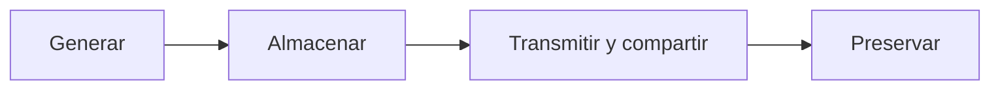

<!-- _class: lead -->

# U1 - TIC: elementos fundamentales

### Introducción a la ciberseguridad

**Rogelio Arriaga - Raptor Dev Services**

<!--
Clase de 120 minutos. Hilo conductor: la tecnología es una herramienta; la ciberseguridad existe porque
dependemos de ella. Se abre con la pregunta del foro (¿somos ciberadictos?) y se cierra con el reto del
analfabetismo digital. Tener a la mano el artículo 6o. constitucional y la ENDUTIH más reciente.
-->

---

## Objetivo de la unidad

Analizar la dependencia que generan las TIC para ubicar su beneficio y su aplicación en los servicios del ciberentorno, y explicar el riesgo que llevan implícito con base en datos públicos.

Al terminar puedes distinguir herramienta de riesgo, nombrar los derechos que sostienen el uso de internet y reconocer el analfabetismo digital a tu alrededor.

---

## Agenda

| Bloque | Qué vemos |
|---|---|
| 1 | Por qué existe la ciberseguridad |
| 2 | Tema 1: revolución sociotecnológica y herramental TIC |
| 3 | Tema 2: era digital, derechos y brechas |
| 4 | Tema 3: de la infotecnología al infotech, exceso y ciberadicción |
| 5 | Cierre, práctica, tarea y quiz |

---

## Lo que está en juego

Todo lo que vive en un sistema conectado puede atacarse, copiarse, exponerse o venderse:

- identidad, reputación y datos personales;
- sistemas, equipos y sitios web;
- bases de datos, imágenes y repositorios en la nube.

Cuando operamos en línea creamos relaciones jurídicas. Por eso un incidente no es solo técnico: también es legal.

<!--
Pedir al grupo un ejemplo propio de cada renglón. Casi siempre aparece la cuenta de correo o de redes
robada: anotarlo, se retoma en el tema 2 (datos personales) y en la tarea.
-->

---

## La definición de trabajo: UIT-T X.1205

La ciberseguridad es el conjunto de medios con los que se protegen los activos en el ciberentorno:

- herramientas, políticas y conceptos de seguridad;
- salvaguardas y gestión de riesgos;
- formación y buenas prácticas.

Protege activos físicos, lógicos e información de organizaciones, usuarios y gobiernos.

Fuente: UIT (2008), Recomendación X.1205.

---

<!-- _class: lead -->

# Tema 1
## Revolución sociotecnológica y herramental TIC

---

## Una revolución que nos volvió dependientes

- Revoluciones hubo siempre: la industrial cambió cómo producir.
- En el siglo XX llegó la **revolución tecnológica**: computadoras, telecomunicaciones e internet al alcance de todos.
- Resultado: una sociedad que organiza su evolución alrededor de la tecnología.

Cuanto más depende una actividad de un sistema, más valioso es atacarlo.

---

## La tecnología es una herramienta

- No es buena ni mala: se juzga por su uso.
- Los usuarios se dieron principios propios (no son leyes) para defender la neutralidad, el acceso a la información y la libertad de expresión.
- Recomendación de la materia: **decidir con información**, no con lo que otros nos cuentan.

<!--
Frase para cerrar la lámina: una máquina sustituye el trabajo de muchas personas comunes, pero no el
criterio de una persona preparada (idea atribuida a Elbert Hubbard).
-->

---

## Tecnología y ciencia

| Concepto | Idea clave |
|---|---|
| Tecnología (Aquiles, 2008) | Saberes y procesos ordenados para producir bienes y servicios que mejoran la vida |
| Tecnología (Gallo, 2000) | Habilidades, procedimientos e instrumentos para transformar lo material |
| Ciencia (Ossorio, 1999) | Saber cierto por principios y causas; doctrina con método; erudición; destreza |

La ciencia sentó las bases del desarrollo tecnológico actual.

---

## Información no es conocimiento

| Etiqueta | Acento |
|---|---|
| Sociedad de la información | Obtener y compartir datos al instante, desde cualquier lugar |
| Sociedades del conocimiento (UNESCO) | Lo que las personas hacen con esos datos |
| Sociedad red | Las redes que organizan a la sociedad |

Fuentes: Cremades (2003); UNESCO (2005); Krüger (2006).

---

## Los cuatro principios de la UNESCO

1. Libertad de expresión.
2. Acceso universal a la información y al conocimiento.
3. Respeto a la diversidad cultural y lingüística.
4. Educación de calidad para todos.

La privacidad y la ética en el uso de las TIC son la condición para ejercerlos con seguridad.

---

## Qué hace "tecnológica" a una herramienta

- Combina componentes informáticos, físicos y humanos.
- Puede conectarse a una red privada o pública.
- Las TIC sirven para crear, modificar, guardar, proteger y recuperar información.

De una llave a la Estación Espacial Internacional: todo es herramienta; no toda herramienta es TIC.

---

## Once rasgos de las TIC (Belloch)

| | | |
|---|---|---|
| Inmaterialidad | Interactividad | Interconexión |
| Instantaneidad | Alta calidad de imagen y sonido | Digitalización |
| Influencia en los procesos | Penetración en todos los sectores | Innovación |
| Tendencia a la automatización | Diversidad | |

<!--
Pedir que elijan un rasgo y digan qué riesgo abre. Ejemplo: instantaneidad, un error o una fuga se
replica en segundos; automatización, un fallo se repite sin que nadie lo mire.
-->

---

## Beneficios y desventajas

| Beneficios | Desventajas |
|---|---|
| Acceso, comunicación, aprendizaje, juego | Distracción e información de calidad desigual |
| Trabajo colaborativo y emprendimiento con poca inversión | Dependencia, aislamiento y costos ocultos |
| Ingresos lícitos desde casa | Desigualdad de acceso y riesgos de privacidad |

---

## Un potencial difícil de medir

- **2017:** un equipo de la Universidad de Washington escribe malware en ADN sintético y toma el control de la computadora que lo secuencia (Ney et al., 2017).
- **2020:** el MIT pone decenas de miles de memristores que imitan sinapsis en un chip del tamaño de un confeti.

Lo público es una muestra; lo militar y de seguridad nacional suele ir más adelante.

---

## Informatizar la información

Preservar es lo que más se olvida: Notre Dame (2019) y la Biblioteca de Alejandría lo recuerdan. Instrumentos: Lund (2001), Consejo de la UE (2002), Carta de la UNESCO (2003), Década Digital 2030 de la UE.

---

## Brecha digital, acceso y neutralidad

- **Brecha:** educación, idioma, género, ingreso, edad, geografía y, muchas veces, falta de infraestructura.
- **Acceso:** La Rue (2011) y las resoluciones del Consejo de Derechos Humanos (2018) lo ligan a la libertad de expresión.
- **Neutralidad:** el proveedor trata igual todo el tráfico. En México: artículos 131 y 132 de la Ley en Materia de Telecomunicaciones y Radiodifusión (2025).

<!--
Actualización al 2026: la ley de 2025 abrogó a la de 2014 y el IFT desapareció; los lineamientos los
emite ahora la Comisión Reguladora de Telecomunicaciones.
-->

---

<!-- _class: lead -->

# Tema 2
## Era digital y TIC

---

## Qué es la era digital

- Una era es un cambio duradero; a veces la marca un hecho (en México, el sismo de 1985).
- La era digital nace con la revolución tecnológica y crea una **cultura digital**.
- Trae ventajas, pero descuida lo humano.
- Su gran reto: manejar, transmitir y proteger el exceso de información.

---

## El derecho a la información

- **Declaración Universal, art. 19:** investigar, recibir y difundir información por cualquier medio.
- **Constitución, art. 6o.:** acceso a información plural y oportuna, y acceso a las TIC, a la banda ancha y a internet.
- Tres vertientes: allegarse información, informar y ser informado.

Acceso no es gratuidad: el servicio se paga.

---

## Sus límites

El propio artículo 6o. marca la frontera:

- la moral, la **vida privada** y los derechos de terceros;
- provocar un delito;
- perturbar el orden público.

Publicar datos de otra persona no está protegido por la libertad de expresión.

<!--
Actualización al 2026: el INAI se extinguió en marzo de 2025; el acceso a la información federal lo
atiende "Transparencia para el Pueblo" y hay nueva ley de datos personales en posesión de particulares.
-->

---

## Brechas que se suman

| Fenómeno | Qué es |
|---|---|
| Analfabetismo digital | No saber usar las TIC de forma eficaz y segura |
| Brecha generacional | Distancia por edad, decisiones y temores más que por recursos |
| Migración digital | Varias generaciones obligadas a usar las mismas herramientas |
| Nativos e inmigrantes (Prensky, 2001) | Quien creció con las TIC y quien las aprendió de adulto |

---

## Los números

| Año | Usuarios de internet en México (6 años o más) |
|---|---|
| 2018 | 74.3 millones (ENDUTIH) |
| 2022 | 88.6 millones, 75.6 % (Asociación de Internet MX) |
| 2025 | 104.9 millones, 86.1 % (ENDUTIH) |

Mundo, 2026: unos 6,300 millones conectados (76 %) y 2,000 millones fuera (UIT).

---

## Tecnologías cotidianas, riesgos cotidianos

| Tecnología | Riesgo |
|---|---|
| Geolocalización y trazabilidad | El rastro de ubicación es un dato personal |
| Biometría | Una huella filtrada no se cambia |
| Internet de las cosas | Cada objeto conectado es un equipo atacable |
| Nube | Contratos de adhesión y datos en servidores ajenos |
| IA, big data, blockchain | Suplantación, fugas masivas, llaves mal resguardadas |

---

<!-- _class: lead -->

# Tema 3
## De la infotecnología al infotech

---

## Dos palabras, dos enfoques

| Término | Enfoque |
|---|---|
| Infotecnología | Cultura de trabajo con herramientas informáticas para buscar y procesar información |
| Infotech | Industria: hardware, software y los negocios que los venden |

---

## Aplicabilidad tecnológica

- **Educación:** analfabetismo de más de 9 % (2000) a 4.7 % (2020); educación a distancia e insignias abiertas.
- **Negocios:** blockchain en suministro, banca y títulos académicos.
- **Movilidad:** transporte por aplicación con viajes registrados.
- **Gobierno electrónico:** trámites, pagos e información pública en línea.

El uso, y su contenido, los decide el usuario.

---

## Cinco puntos de riesgo del exceso tecnológico

1. Consumismo tecnológico exacerbado.
2. Capacitación no generalizada.
3. Información indiscriminada.
4. Falta de netiqueta, ética y uso responsable.
5. Ausencia de conocimientos de seguridad de la información.

<!--
El quinto conecta con toda la materia: ataques, usurpación de identidad, malware y la vulnerabilidad del
propio usuario. Ejemplo: WannaCry, 12 de mayo de 2017, más de 200,000 equipos en al menos 100 países en horas (NAO, 2017).
-->

---

## Cuándo lo lúdico se vuelve patológico

- Tres frentes: internet, teléfono móvil y videojuegos.
- Señal: la conducta desplaza otras actividades y responsabilidades.
- Mecanismo: activa los circuitos de recompensa del cerebro.

**Actualización:** la CIE-11 de la OMS (2022) reconoce el trastorno por uso de videojuegos (6C51); la adicción a internet en general sigue sin categoría propia.

---

## Tecnopatías

| | | |
|---|---|---|
| Nomofobia | Llamada fantasma | "Apnea" de WhatsApp |
| Depresión de Facebook | Cibercondría | Síndrome de Google |
| Hipersensibilidad electromagnética | Neofilia | *Phubbing* |

<!--
Preguntar cuántas reconocen en sí mismos o en su casa. Sirve de puente al foro de la práctica.
-->

---

## Información confiable y crimen organizado

- Antes de creer o reenviar: autoría, fecha, fuentes, seguridad del sitio (modelo de María Pinto).
- Las TIC sirven también al crimen organizado (Blanco).
- La curiosidad o la ignorancia no eximen: desconocer la ley no excusa su cumplimiento.

---

## Cierre de la unidad

- Las revoluciones seguirán; adaptarse exige mente abierta y aprender siempre.
- Conocer los principios de la tecnología permite decidir en vez de ser controlado; la autorregulación y la regulación consensuada necesitan usuarios informados.
- Toda herramienta, presente o futura, tiene un lado oscuro: hay que asumirlo para prevenirlo.
- Los derechos humanos no se respetan solos en línea: defenderlos es tarea colectiva.
- Si algo es gratis, probablemente el producto eres tú y tus datos.
- Prevenir es mejor que lamentar: la ciberadicción ya se atiende en clínicas de varios países.

<!--
Cierre recreado de las conclusiones de la unidad. Subrayar la idea de cultura de ciberseguridad desde la
academia: gradual, imparcial y con derechos humanos y regulación incluidos.
-->

---

## Para la próxima

| Actividad | Qué es |
|---|---|
| Práctica | Foro "¿Somos ciberadictos?": postura argumentada y réplica a tres compañeros |
| Tarea | Reto "El analfabetismo digital que me rodea": encuesta de 20 preguntas a 10 personas e informe |
| Quiz | 10 preguntas de la unidad en la plataforma |
| Lecturas | Notas 01, 02 y 03 de `12-seguridad/01-introduccion` |

---

<!-- _class: lead -->

# Gracias

### Siguiente unidad: ciudadanía digital y ciberprevención
