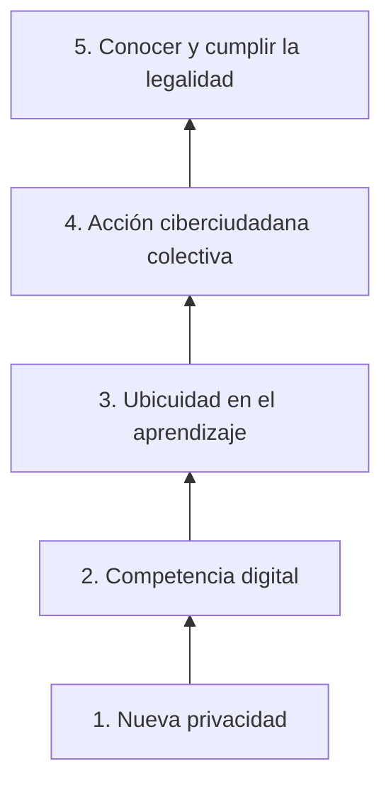
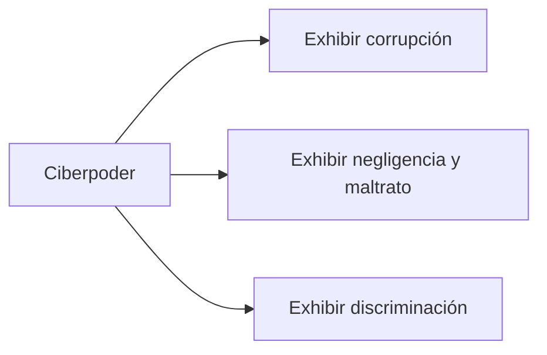
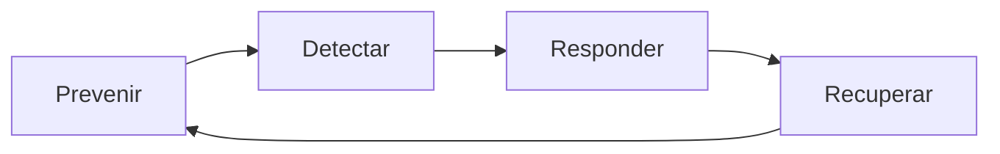

<!-- _class: lead -->

# U2 - Ciudadanía digital y ciberprevención

### Introducción a la ciberseguridad

**Rogelio Arriaga - Raptor Dev Services**

<!--
Unidad de 120 minutos. Hilo conductor: los derechos de siempre (identidad, participación, expresión,
información) ejercidos con tecnología, y lo que eso exige en seguridad. Se abre con la idea de que la
ciudadanía tiene derechos y deberes en cualquier entorno, y se cierra con la ciberprevención como hábito.
Preparar: una búsqueda del propio nombre en un buscador para mostrar la huella digital en vivo
(con datos del instructor, nunca de un alumno).
-->

---

## El lema de hoy

> La ciudadanía no se apaga cuando entras a internet: cambian las herramientas, no los derechos ni los deberes.

La sociedad define derechos y obligaciones para convivir, en cualquier país y en cualquier época. En el entorno digital esas reglas siguen valiendo.

---

## Objetivo de la unidad

Al terminar podrás:

- **Documentar** conductas inapropiadas en línea y relacionarlas con las dimensiones de la ciudadanía digital.
- **Argumentar** ventajas e inconvenientes del uso de redes sociales en la vida pública.
- **Explicar** por qué conviene que los servicios públicos se difundan por redes, y con qué cuidados.

<!--
Los tres objetivos se evalúan en la práctica (discusión sobre límites a la libertad de expresión), en la
tarea (ensayo de un caso real) y en el quiz.
-->

---

## Agenda

| Bloque | Qué vemos |
|---|---|
| 1 | Cambio sociopolítico y TIC: Estado, identidad y campos de apropiación |
| 2 | Ciberciudadanía y ciberparticipación: empoderamiento y ciberpolítica |
| 3 | Ciberseguridad, in-seguridad y ciberprevención |
| 4 | Cierre, práctica, tarea y quiz |

---

<!-- _class: lead -->

# Tema 1
## Cambio sociopolítico y TIC

---

## Tres nombres, una idea

| Término | Énfasis |
|---|---|
| Ciudadanía digital | La condición de ciudadano en el entorno digital |
| E-ciudadanía | Trámites, consultas e información pública en línea |
| Ciberciudadanía | Ejercer derechos, deberes y libertades políticas con TIC |

Tener acceso no garantiza ejercer derechos: hace falta **alfabetización digital**.

<!--
La definición clásica, atribuida a Gascó, menciona internet, televisión, radio y telefonía móvil.
Pregunta al grupo: ¿qué trámite hicieron este mes que hace diez años exigía ir en persona?
-->

---

## El acceso es obligación del Estado

> El Estado garantizará el derecho de acceso a las tecnologías de la información y comunicación, así como a los servicios de radiodifusión y telecomunicaciones, incluido el de banda ancha e Internet. (...)

Artículo 6o. constitucional, párrafo adicionado en 2013 y reformado el 20 de diciembre de 2024.

La apropiación de las TIC es **necesidad**, **oportunidad** y **obligación**.

---

## Cómo usa el sector público las TIC

- Gobierno electrónico: trámites y servicios en línea.
- Transparencia: datos abiertos y rendición de cuentas.
- Participación: plataformas para opinar, proponer y votar.
- Servicios: salud, educación y seguridad más eficientes.
- Comunicación: redes oficiales y colaboración entre dependencias.
- Capacitación: alfabetización digital de los servidores públicos.

Límite: cada gobierno decide qué digitaliza, con criterios poco claros.

---

## La brecha en números

| Dato | Fuente |
|---|---|
| 74 % del mundo en línea; 2,200 millones sin conexión | ITU, 2025 |
| México: 100.2 millones de usuarios, 83.1 % de la población de 6 años o más | INEGI, ENDUTIH 2024 |
| México urbano 86.9 % frente a rural 68.5 % | INEGI, ENDUTIH 2024 |

<!--
Un servicio que solo existe en línea deja fuera a casi uno de cada tres habitantes rurales.
-->

---

## Cinco campos de apropiación

Se sube de lo básico (cuidar los propios datos) a lo exigente (ejercer derechos dentro de la ley).

---

## La nueva privacidad

- Más datos que nunca: la nube y el internet de las cosas.
- Neutralidad de la red y mercantilización de los datos.
- Vigilancia masiva: en 2014 el TJUE anuló la directiva europea de conservación de datos.
- Conclusión de Osés (2014): responsabilidad individual, conciencia social y protección institucional, las tres a la vez.

<!--
Actualización: la ley mexicana de telecomunicaciones de 2014 fue sustituida en julio de 2025 por la
Ley en Materia de Telecomunicaciones y Radiodifusión; la geolocalización para la justicia sigue regulada.
-->

---

## Competencia digital

Marco europeo DigComp 2.2 (2022): cinco áreas.

1. Información y datos
2. Comunicación y colaboración
3. Creación de contenido
4. **Seguridad**
5. Resolución de problemas

Mandujano (2017): no basta con habilidades técnicas, hace falta **educación digital** y formar **prosumidores**.

---

## Internet y acción colectiva

| Rasgo | Efecto |
|---|---|
| Inmediatez | Sin barreras de tiempo ni distancia |
| Interactividad | De uno a muchos, a muchos a muchos |
| Multiautoría | Cualquiera produce información |
| Accesibilidad | Bajo costo, pero choca con la brecha |
| Libertad de expresión | Texto, imagen, audio y video para todos |

Seattle 1999, 15-M 2011, #YoSoy132 2012, candidaturas independientes en 2015 (Ramos Chávez, 2015).

---

## La identidad es un derecho

> Toda persona tiene derecho a la identidad y a ser registrado de manera inmediata a su nacimiento. (...)

Artículo 4o. constitucional. El 20, apartado C, protege la identidad de las víctimas.

**Atributos de la personalidad:** nombre, sexo, estado civil, domicilio, filiación, nacionalidad y edad.

---

## ¿Una identidad o muchas?

| Postura | Idea |
|---|---|
| Identidades múltiples | Un perfil por servicio: confusión y personalidades distintas |
| Identidad multinivel (Gascó, 2008) | La misma identidad en lo presencial y lo virtual |
| Identidad global (La Rosa, 2009) | Válida en cualquier país, para las ciberacciones |

En línea casi nunca hay certeza de quién está del otro lado: ahí nace el riesgo de suplantación.

---

## Edificar la ciberciudadanía: siete frentes

| | Frente |
|---|---|
| A | Transparencia y rendición de cuentas |
| B | Participación ciudadana |
| C | Presupuesto participativo |
| D | Iniciativa de normas |
| E | Educación en ciudadanía digital |
| F | Trámites y servicios |
| G | Debate social y conciencia crítica |

---

## Presupuesto participativo

- Aguirre Sala (2014): el instrumento más democratizador porque es anual, deliberativo y vinculante.
- Belo Horizonte: la versión electrónica tuvo **siete veces** más participación con una cuarta parte de los recursos.
- Ciudad de México hoy: **4 %** del presupuesto anual de las alcaldías (Ley de Participación Ciudadana, art. 116).

<!--
El dato de 3 % era de la ley del Distrito Federal de 2010, abrogada en 2019.
-->

---

<!-- _class: lead -->

# Tema 2
## Ciberciudadanía y ciberparticipación

---

## La tecnología no lo resuelve todo

- Facilita la participación, pero no garantiza un buen gobierno en ningún país.
- Actitud recomendada: **probar antes de opinar y dudar para aprender**.
- Informarse en línea sobre lo público es ejercer el derecho de acceso a la información.

---

## Participar no es lo mismo que activarse

| | Participación ciudadana | Participación política | Ciberactivismo |
|---|---|---|---|
| Base | Autonomía social | Mecanismo legal | Movilización en red |
| Obliga a la autoridad | No | Sí | No |
| Ejemplo | Colectivo vecinal | Consulta popular | Campaña viral |

---

## Mecanismos con rango constitucional

Artículo 35: derechos de la ciudadanía.

- VII. Iniciar leyes.
- VIII. Votar en consultas populares.
- IX. Participar en la revocación de mandato (desde 2019).

Las TIC pueden volverlos más accesibles, por ejemplo con la recolección electrónica de apoyos.

---

## Ciberempoderamiento y ciberanimación

- **Empoderamiento ciudadano:** la acción fortalecida de personas o grupos para incidir en decisiones públicas y mejorar su comunidad.
- **Ciberanimación** (Viché, 2016): campañas, eventos virtuales y multimedia para movilizar y conectar.

Presencia en línea no es lo mismo que resultados políticos.

---

## Movimientos con huella digital

| Movimiento | Año |
|---|---|
| Primavera Árabe | 2010-2012 |
| Occupy Wall Street | 2011 |
| Black Lives Matter | 2013 a la fecha |
| #MeToo | 2017 |
| March for Our Lives y Fridays for Future | 2018 |
| Protestas en Hong Kong | 2019 |

---

## Lo que el ciberpoder sí consigue

Lo que no consigue: obligar a un político a cumplir sus promesas de campaña.

<!--
Dato de Przeworski recogido por Aguirre Sala: ningún tribunal ha fallado a favor del electorado contra un
gobierno por incumplir promesas. El ciberpoder presiona, no obliga.
-->

---

## Caso: no se bloquea a quien pregunta

**Amparo en revisión 1005/2018, Segunda Sala de la SCJN (20 de marzo de 2019).**

- Un fiscal bloqueó en Twitter a un periodista.
- Si el servidor público informa de su función en su cuenta, aunque sea personal, esa información es de interés público.
- Bloquear restringe el acceso a la información: es acto de autoridad.
- Se ordenó desbloquear.

<!--
Pregunta para el grupo: ¿y si el usuario insulta o amenaza? El criterio protege la pregunta respetuosa sobre
la función pública, no la conducta ilícita, que se denuncia.
-->

---

## Los riesgos de la ciberpolítica

- **Desinformación:** contenido falso para manipular.
- **Polarización:** bandos cada vez más cerrados.
- **Manipulación** de la opinión pública.
- **Exceso de credibilidad:** la puerta al fraude y a la suplantación.

Expectativas realistas: las redes son herramienta, no arma.

---

<!-- _class: lead -->

# Tema 3
## Ciberseguridad, in-seguridad y ciberprevención

---

## La huella digital

Todo deja rastro: publicaciones, búsquedas, compras, ubicaciones.

| Por qué cuidarla | |
|---|---|
| Permanece | Se copia, se indexa y se archiva |
| Construye reputación | Personal y profesional |
| La usan terceros | Para bien o para mal |
| Revela más de lo que parece | Vida íntima y laboral |

<!--
Demostración: buscar el nombre del instructor y mostrar qué aparece. Nunca con datos de un alumno.
-->

---

## Ciberprevención y ciberresiliencia

- Ciberprevención: medidas **antes** del daño.
- Ciberresiliencia: además, recuperarse rápido y limitar el impacto.
- Todos somos vulnerables, no solo empresas y gobiernos.

---

## Proximidad social o ciberactivismo

- **Proximidad social:** ciudadanía y autoridad de seguridad cerca, en los dos sentidos.
- **Vigilancia vecinal** en Facebook y WhatsApp: útil hasta que se vuelve convocatoria sin control.
- **Ciberactivismo:** difundir una causa con tres ventajas:

| Velocidad | Viralidad | Horizontalidad |
|---|---|---|
| En segundos | Crece por reenvíos | Sin jerarquías |

---

## El hacktivismo cruza la línea

- Protesta con técnicas de intrusión, saturación o alteración de sitios.
- Anonymous es el ejemplo más conocido.
- En México, el acceso ilícito a sistemas está en el Código Penal Federal, artículos 211 bis 1 a 211 bis 7, sin importar la causa.

---

## Inseguridad e in-seguridad

| Inseguridad | In-seguridad |
|---|---|
| Falta de seguridad | Estar **dentro** de la seguridad |
| Se padece | Se construye con aprendizaje y decisiones |

La seguridad es necesidad básica: segundo nivel de la pirámide de Maslow.

---

## Por qué en línea nos portamos peor

- Anonimato percibido y sin contacto físico: menos sentido de responsabilidad.
- Resultado: ciberacoso, fraude, contenido indebido.

**Tres límites:** reglas de seguridad, ética y legalidad.

> La manifestación de las ideas no será objeto de ninguna inquisición judicial o administrativa, sino en el caso de que ataque a la moral, la vida privada o los derechos de terceros, provoque algún delito, o perturbe el orden público; (...)

Artículo 6o. constitucional, primer párrafo.

---

## Nueve elementos de la ciudadanía digital

Ribble (2023), marco S3: segura, informada y social.

| | | |
|---|---|---|
| Acceso | Comercio | Comunicación y colaboración |
| Etiqueta y empatía | Fluidez | Bienestar |
| Ley | Derechos y responsabilidades | Seguridad |

---

## Ciberprevención personal mínima

- Buscarte en internet y saber qué hay.
- Revisar la privacidad de cada red.
- Dos factores o llaves de acceso.
- Gestor de contraseñas, una distinta por servicio.
- Actualizar sistema, navegador y apps.
- Respaldos fuera del equipo.
- Revocar aplicaciones que ya no usas.
- Pensar antes de publicar.

---

## Cierre de la unidad (1/2)

- Los gobiernos también usan redes para acercarse a la ciudadanía; el proceso es lento y no siempre confiable. Cumplir la función pública es responsabilidad del servidor, no de la red.
- La identidad digital es necesaria y hay que aprender a protegerla, medir su huella, su reputación y sus riesgos.
- La ciberciudadanía necesita más investigación e indicadores; sin referentes, persiste la desconfianza.
- La convocatoria digital es poderosa: úsala de forma legal, informada y fundamentada.

---

## Cierre de la unidad (2/2)

- De la participación al ciberactivismo hay un paso: hacer justicia por propia mano puede ser delito o exponer datos ajenos.
- Menos énfasis en la inseguridad y más en aprovechar la tecnología con resiliencia. La responsabilidad no es solo del Estado.
- La prevención salvó vidas en la protección civil; en lo digital debe volverse hábito.
- Tu presencia digital te sobrevive: decide a quién le confías tu información.

---

## Para la próxima

| Actividad | Qué haces |
|---|---|
| Práctica | Discusión: ¿debe haber límites a la libertad de expresión en redes? Postura fundamentada y réplica a tres compañeros |
| Tarea | Ensayo de un caso real: un servidor público que exhibía infracciones en transmisiones en vivo |
| Quiz | 10 preguntas sobre la unidad, en la plataforma |

Lecturas: notas 04, 05 y 06 de `12-seguridad/01-introduccion`.
