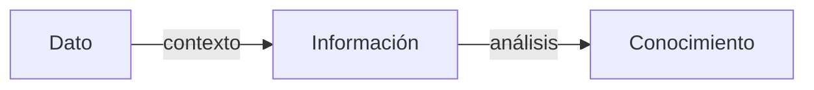
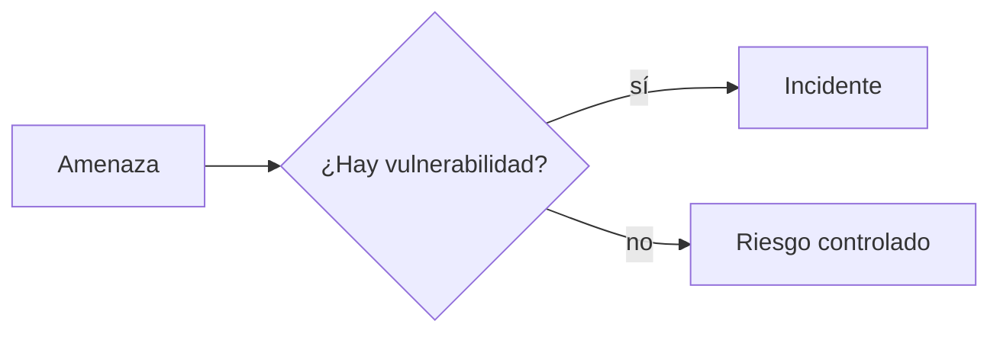

<!-- _class: lead -->

# U3 - Ciberentorno: riesgos y vulnerabilidades

### Introducción a la ciberseguridad

**Rogelio Arriaga - Raptor Dev Services**

<!--
Unidad de 120 minutos. Hilo conductor: del vocabulario (internet, ciberentorno, dato, información) a la
medición del riesgo y de ahí a las amenazas reales y a qué hacer cuando ocurre un incidente.
Preparar: un caso de noticia reciente de filtración de datos en México para abrir la discusión, y la hoja
de cálculo vacía para el ejercicio de la matriz de riesgo.
-->

---

## La frase de hoy

> "Creo que los virus informáticos deberían contar como vida. Dice mucho de nosotros que la única forma de vida que hemos creado sea puramente destructiva." (Stephen Hawking, citado en el temario)

El ciberentorno ofrece oportunidades enormes y, al mismo tiempo, un campo fértil para el delito. Hoy aprendemos a anticiparnos.

---

## Objetivo de la unidad

Al terminar podrás:

- Explicar por qué cualquier innovación (internet de las cosas u otra tecnología disruptiva) trae vulnerabilidades probables.
- Simular un riesgo de seguridad por incumplimiento profesional en la protección de datos personales en una pyme y explicar sus consecuencias sociales, técnicas y jurídicas.
- Explicar las principales ciberamenazas contra la privacidad de la información personal.

<!--
Mensaje clave de la apertura: ni el gobierno, ni la ley, ni el antivirus resuelven esto solos. Cada usuario
tiene una responsabilidad inmediata, aunque no sea experto: aprender y adaptarse.
-->

---

## Agenda

| Bloque | Qué vemos | Min |
|---|---|---|
| 1 | Ciberentorno: aproximaciones y tendencias | 35 |
| 2 | ¿Riesgos o vulnerabilidades? | 35 |
| 3 | Ciberamenazas: principales dimensiones | 35 |
| 4 | Cierre, práctica, tarea y quiz | 15 |

---

## Por qué esta unidad

- El sistema de justicia mexicano todavía batalla con la evidencia digital y con leyes que no alcanzan a la tecnología.
- La seguridad absoluta no existe: siempre habrá riesgos, vulnerabilidades y amenazas.
- La única defensa sostenible es anticiparse con aprendizaje continuo.

---

<!-- _class: lead -->

# Tema 1
## Ciberentorno: aproximaciones y tendencias

---

## Internet en tres rasgos

Según la definición del Federal Networking Council (1995), internet es un sistema global de información que:

1. Comparte un solo espacio de direcciones basado en IP.
2. Transporta comunicaciones con TCP/IP o protocolos compatibles.
3. Ofrece servicios de alto nivel sobre esa infraestructura.

Debajo: fibra, cables submarinos, centros de datos, enrutadores. Encima: web, correo, redes sociales, banca, video.

---

## Internet no es el ciberentorno

| Internet | Ciberentorno |
|---|---|
| La red de redes y sus protocolos | Todo lo conectado: personas, procesos, datos, dispositivos, servicios |
| ¿Cómo viajan los datos? | ¿Qué hay que proteger y quién interviene? |

Y es **híbrido**: lo que se decide en línea tiene efectos en la vida física.

<!--
Pregunta al grupo: ¿qué decisión de esta semana tomaron en línea que tuvo efecto real? Transferencia,
compra, cita médica, publicación. Así se aterriza que lo virtual también es real.
-->

---

## Dato, información, conocimiento

- Informar viene de "dar forma": quien recibe decide si algo le informa.
- El dato solo no trae juicio de valor ni dice qué hacer.
- El canal no es el contenido: más tecnología no es más información.

---

## El dato personal en la ley

- **Dato personal:** información de una persona identificada o identificable.
- **Dato sensible:** el de la esfera más íntima; su mal uso puede discriminar o causar un riesgo grave (origen étnico, salud, genética, creencias, opiniones políticas, preferencia sexual).

Fuente: Ley General de Protección de Datos Personales en Posesión de Sujetos Obligados, art. 3, fr. IX y X (nueva ley, DOF 20-03-2025).

---

## Seguridad informática y seguridad de la información

| Seguridad informática | Seguridad de la información |
|---|---|
| Equipos, programas, redes | La información en cualquier soporte |
| Técnica | Técnica, organizacional, legal y humana |
| Una pieza | El marco completo |

La segunda es el continente; la primera, uno de sus contenidos.

---

## Las propiedades que se protegen

| Propiedad | Garantiza |
|---|---|
| Confidencialidad | Solo accede quien tiene autorización (necesidad de saber) |
| Integridad | La información es exacta y no fue alterada |
| Disponibilidad | Está ahí cuando se necesita |
| No repudio | El firmante no puede negar su firma electrónica |
| Autenticidad | Hay certeza de quién emitió el documento |

Las dos últimas tienen base legal en el art. 8 de la Ley de Firma Electrónica Avanzada.

---

## Tecnologías disruptivas

| Sostenida | Disruptiva |
|---|---|
| Mejora algo establecido | Llega inmadura, con fallas y público reducido, y termina desplazando a la dominante |

Christensen, *The Innovator's Dilemma* (1997).

Su inmadurez es el problema de seguridad: la función llega antes que la protección.

---

## Tres casos para discutir

- **Bioinformática y neurotecnología:** DARPA anunció en 2017 estimulación neuronal para aprender más rápido. Un implante también se puede atacar.
- **Realidad aumentada:** ¿qué graba la cámara y quién procesa esas imágenes?
- **Realidad virtual:** en 2019, fallas en Bigscreen permitían espiar sesiones y tomar control de equipos ajenos.

<!--
Pedir a cada equipo una tecnología que usen a diario y que hace cinco años no existía. ¿Qué datos
recolecta? ¿Quién los guarda? Esto prepara la tarea de internet de las cosas.
-->

---

## El factor humano

- El eslabón más débil no es el software: son las percepciones y hábitos de las personas.
- Quien cree que sus datos "no le interesan a nadie" comparte de más.
- Remedio: educación, políticas claras y cultura que valore los datos.

Biohacking: cada implante o dato biométrico conectado es información sensible.

---

<!-- _class: lead -->

# Tema 2
## ¿Riesgos o vulnerabilidades?

---

## Cuatro palabras distintas

| Concepto | Pregunta |
|---|---|
| Vulnerabilidad | ¿Por dónde pueden entrar? |
| Amenaza | ¿Qué puede pasar? |
| Riesgo | ¿Qué tan probable es y cuánto dolería? |
| Peligro | ¿Qué tan inminente es? |

*Vulnus* = herida: vulnerable es lo que puede ser herido. El peligro es una causa del riesgo.

---

## Amenaza más vulnerabilidad

- Vulnerabilidades: fallas de diseño, de configuración o de procedimiento.
- Amenazas: naturales, accidentales o intencionales; internas o externas.

---

## Nada es completamente seguro

- Mayo de 2019: una falla en WhatsApp permitió instalar software espía en decenas de teléfonos sin que sus dueños hicieran nada, aun con cifrado de extremo a extremo.
- El cifrado protege el mensaje en tránsito, no el teléfono comprometido ni los respaldos.

Pregunta útil ante cualquier medida: ¿qué protege y qué deja fuera?

---

## Medir el riesgo

**Riesgo = probabilidad × impacto**

**Riesgo = (amenaza × vulnerabilidad) / contramedidas**

- Probabilidad empírica (lo que ya pasó) o subjetiva (juicio experto).
- Las contramedidas van en el denominador: cada control eficaz baja el riesgo.
- Primero una autoevaluación: a más dependencia tecnológica, más riesgo.

---

## Análisis de riesgos en seis pasos (INCIBE)

1. Definir el alcance.
2. Identificar activos.
3. Identificar amenazas.
4. Identificar vulnerabilidades y salvaguardas.
5. Evaluar el riesgo.
6. Tratarlo: transferir, eliminar, aceptar o mitigar.

<!--
Ejercicio de 10 minutos: en equipos, tres activos de una pyme, una amenaza por activo, probabilidad e
impacto de 1 a 5, umbral 10. Cada equipo comparte el activo con riesgo más alto y su tratamiento.
-->

---

## Riesgos que no salen en el reporte técnico

| Riesgo | Raíz |
|---|---|
| Analfabetismo digital | Ignorancia, resistencia al cambio, desactualización o aplicación inadecuada |
| Incumplimiento profesional | Mala praxis o manipulación de quien debía proteger |
| Obsolescencia jurídica | Lagunas, insuficiencia de la ley o falta de precedentes |

Los tres son humanos y los tres se reducen con educación.

---

## Incumplimiento profesional

Tareas mínimas de quien resguarda datos del personal:

- Servidores activos, cortafuegos habilitados, software actualizado.
- Red libre de malware y privilegios bien definidos.
- Monitoreo según bitácora y capacitación continua.

Ninguna excusa (tiempo, presupuesto) exime de la responsabilidad. Prevenir cuesta menos que recuperarse.

---

<!-- _class: lead -->

# Tema 3
## Ciberamenazas: principales dimensiones

---

## Qué, quién y por qué

| Motivación | Ejemplo |
|---|---|
| Económica | Ransomware, venta de datos, fraude |
| Ideológica | Ciberactivismo y hacktivismo |
| Desestabilización | Ataques a infraestructura crítica |
| Prestigio | Notoriedad entre atacantes |
| Reto técnico | Explotar una falla por demostrar que se puede |

Detrás de los grandes ataques suele haber delincuencia informática organizada.

---

## Casos que marcaron época

- **Ashley Madison (2015):** 10 GB de datos de usuarios de 46 países; extorsiones y suicidios.
- **WannaCry y NotPetya (2017):** ransomware que paralizó hospitales y empresas.
- **Cambridge Analytica (2018):** datos de millones de usuarios usados por un tercero para influir en política.
- **Uber (2016-2017):** ocultó un ataque que expuso datos de 57 millones de personas.

---

## El panorama europeo

ENISA 2022: ransomware, malware, ingeniería social, amenazas contra los datos, denegación de servicio, amenazas contra internet, desinformación y cadena de suministro.

Actualización al 2026: en el informe de ENISA de 2025, la denegación de servicio fue el 77 % de los incidentes, el phishing abrió cerca del 60 % de las intrusiones y el ransomware fue la amenaza de mayor impacto.

---

## Ransomware en América Latina

- México, entre los más afectados de la región en 2019 y 2020.
- Pemex, noviembre de 2019: 5 % de sus computadoras afectadas y una exigencia de 565 bitcoins.
- Vías: correo, escritorio remoto expuesto, USB, software pirata, publicidad maliciosa.
- Existe el ransomware como servicio.

Prepararse, responder, recuperarse: y decidir antes del ataque si se pagaría.

---

## Phishing y denegación de servicio

| Phishing y variantes | Denegación de servicio |
|---|---|
| Correo, SMS (smishing), llamada (vishing), dirigido (spear phishing) | Saturar el servicio hasta tumbarlo |
| Ataca a la persona | Ataca la disponibilidad |
| Defensa: verificar por otro canal | Defensa: menos superficie expuesta, capacidad y filtrado |

---

## Evento o incidente

- **Evento:** algo imprevisto afecta un activo, pero la información no se compromete.
- **Incidente:** la información o la seguridad de los usuarios sí queda comprometida.

Los titulares exageran o minimizan; la magnitud la miden los especialistas.

---

## Prioridades al responder

1. La vida y la seguridad de las personas.
2. La información secreta y confidencial.
3. Otra información valiosa.
4. Hardware y software.
5. La continuidad de los servicios.

Actualización al 2026: NIST SP 800-61 Rev. 3 (abril de 2025) alinea la respuesta a incidentes con las seis funciones del CSF 2.0.

---

## Ingeniería social y ciberactivismo

- La ingeniería social explota la confianza, el miedo y la curiosidad. Antídoto: una pausa y una verificación por otro canal.
- El ciberactivismo no es ilegal; se vuelve hacktivismo sancionable cuando incita al delito o ataca sistemas.

---

<!-- _class: lead -->

# Cierre
## Lo que te llevas

---

## Conclusiones de la unidad

- El vocabulario importa: describir bien una conducta lesiva es el primer paso para denunciarla y repararla.
- Cada innovación trae vulnerabilidades; enamorarse de la tecnología no exime de revisarlas.
- Los riesgos son previsibles y se reducen; la fórmula ayuda a decidir qué atender primero.
- Analfabetismo, incumplimiento y leyes obsoletas potencian cualquier riesgo técnico.
- Medir riesgos y evaluar amenazas son cosas distintas, y de esa diferencia dependen las decisiones.
- Después de un incidente nada vuelve a ser igual: lo que se decide después es la siguiente prevención.

---

## Para la próxima

- **Práctica:** debate "¿Estamos o nos sentimos ciberamenazados?" con postura fundamentada y réplica a tres compañeros.
- **Tarea:** "De la curiosidad a la vulnerabilidad": tres tecnologías de internet de las cosas y sus vulnerabilidades.
- **Quiz:** en la plataforma, 10 preguntas sobre los tres temas.
- **Lecturas:** notas 07, 08 y 09 de `12-seguridad/01-introduccion`.

<!--
Siguiente unidad: ciberdelitos y otras conductas atípicas. Lo de hoy (vulnerabilidad, amenaza, incidente)
es el vocabulario técnico que la unidad 4 traduce a vocabulario jurídico (conducta, hecho, delito).
-->
