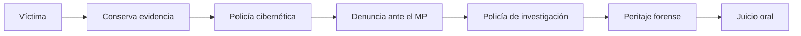

<!-- _class: lead -->

# U4 - Ciberdelitos y otras conductas atípicas

### Introducción a la ciberseguridad

**Rogelio Arriaga - Raptor Dev Services**

<!--
Unidad de 120 minutos. Hilo conductor: un mismo incidente (una cuenta tomada y un video íntimo difundido)
se lee tres veces: ¿es delito?, ¿qué delito y dónde está escrito?, ¿cómo se investiga y se prueba?
Preparar: el Código Penal Federal vigente abierto en el Título Noveno (arts. 211 bis 1 a 7) y el
artículo 227 del CNPP. Lecturas: notas 10, 11 y 12 de 12-seguridad/01-introduccion.
-->

---

## El punto de partida

> Que algo nos dañe no lo convierte en delito. Delito es lo que la ley penal describe y castiga.

En el ciberespacio hay conductas criminales por la misma razón que fuera de él: la libertad de decidir incluye la de decidir mal. Hoy aprendemos a distinguir lo que la ley castiga de lo que todavía no alcanza.

---

## Lo que podrás hacer al terminar

- Distinguir conductas y omisiones que la legislación penal mexicana considera delitos de las que no.
- Reconocer los delitos informáticos tipificados en el país y sus penas.
- Investigar e interpretar las consecuencias de los ciberdelitos ligados a tecnologías emergentes.

<!--
Son los tres resultados de aprendizaje de la unidad. Al cierre, volver a esta lámina y preguntar al grupo
cuál le costó más.
-->

---

## Agenda

| Bloque | Qué vemos | Min |
|---|---|---|
| 1 | Entre conductas, hechos y delitos | 35 |
| 2 | Los ciberdelitos en México: típicos y atípicos | 40 |
| 3 | Investigar el ciberdelito | 30 |
| 4 | Cierre, práctica, tarea y quiz | 15 |

---

<!-- _class: lead -->

# Tema 1
## Entre conductas, hechos y delitos

---

## Conducta, acto y hecho

| Palabra | Para quién | Qué significa |
|---|---|---|
| Conducta | Psicología | Todo lo observable que hace una persona |
| Acto | Derecho | Acción concreta con consecuencias jurídicas |
| Hecho jurídico | Derecho | Acontecimiento natural o humano que crea, cambia o extingue derechos |

La ley regula **conductas humanas**. Cuando les pone una pena, son **conductas típicas**.

---

## El delito también se comete sin hacer nada

CPF, art. 7o.: delito es el **acto u omisión** que sancionan las leyes penales.

- **Acto involuntario:** no hay conducta penal.
- **Sin vínculo entre resultado y voluntad:** tampoco.
- **Comisión por omisión:** sí hay delito. Quien tenía el deber de evitar el resultado (por ley, contrato o por crear el riesgo) y no lo evitó.

<!--
Ejemplo para el grupo: el responsable de respaldos que por contrato debe verificarlos y decide no hacerlo
durante meses, contra quien nunca supo que existía el riesgo. Preguntar: ¿en qué caso hay omisión?
-->

---

## Quién comete y quién sufre

| Papel | Quién |
|---|---|
| Sujeto activo | Quien comete: el atacante |
| Sujeto pasivo | Quien sufre: persona, empresa o gobierno |

- Desde los **12 años** una conducta puede tratarse como delito, en el sistema de justicia para adolescentes.
- Las **personas morales** también responden: desde multas hasta la disolución (CPF, art. 11; CNPP, art. 421).

---

## Para que haya delito, todo tiene que cumplirse

| Elemento | Pregunta |
|---|---|
| Tipicidad | ¿Está descrita en la ley penal? |
| Antijuridicidad | ¿Contraviene el orden jurídico sin justificación? |
| Culpabilidad | ¿Se le puede reprochar al autor? |
| Imputabilidad | ¿Tenía edad y capacidad para responder? |
| Punibilidad | ¿La ley le asigna pena? |

Si falta uno, la conducta es **atípica**: puede ser dañina, pero no es delito.

---

## Tres palabras que se confunden

| Concepto | Quién | Qué hace |
|---|---|---|
| Tipificación | Legislador | Escribe la conducta como delito en la ley |
| Tipo penal | La ley | La descripción misma |
| Tipicidad | Juez | Revisa si el caso encaja por completo |
| Calificación | Fiscal | Decide con qué delito acusa |

Fuente: Peña y Almanza (2010).

---

## Por qué cuesta tipificar lo digital

- La tecnología cambia más rápido que el proceso legislativo.
- Rapidez, anonimato y dificultad para rastrear al responsable.
- Legisladores sin formación en derecho informático; expertos técnicos que no son consultados.
- Faltan definiciones homologadas: técnicos, abogados y autoridades no hablan el mismo idioma.
- Leyes tardías, o hechas al vapor que no se entienden.

<!--
Leer en voz alta la fracción VII del art. 201 del Código Penal de Colima (texto de 2017, en la nota 10)
y pedir que alguien explique en una frase qué conducta castiga. Nadie lo logra: ese es el punto.
-->

---

## Lo que facilita el ciberdelito

| Razón | En corto |
|---|---|
| Cambios sociales y nuevos bienes jurídicos | Todo pasa por la tecnología y hay nuevos intereses que proteger |
| Normatividad insuficiente | La ley va detrás |
| Territorialidad | Los datos cruzan fronteras; la ley no |
| Falta de homologación | 33 códigos penales distintos |
| Capacitación y enseñanza insuficientes | Ni autoridades ni escuelas de derecho |
| Falta de voluntad e inseguridad informática | Nadie aprende por otro; el riesgo está en cada clic |

---

## Del delito de siempre al ciberdelito

- Muchas conductas no son nuevas: cambiaron de herramienta.
- Lo que cambia es la **visibilidad**: el daño es íntimo y la víctima calla por vergüenza.
- Lo que no se ve parece menos urgente.

| Condiciones típicas | |
|---|---|
| A distancia, en segundos | Anónimo o con identidad falsa |
| Con ingeniería social | Siempre doloso |
| Barato: equipo y conexión | Ocupacional y de oportunidad |

---

## Casos que parecían ficción (2018 y 2019)

1. Suscripciones para ver cámaras de seguridad vulneradas.
2. Teléfonos que podrían escuchar aun "apagados".
3. Malware que altera estudios médicos de imagen.
4. Un casino vulnerado por el termómetro de su acuario.
5. Código malicioso guardado en ADN sintético.

<!--
Pregunta al grupo: ¿cuál de los cinco encaja hoy en el art. 211 bis 1 del CPF? Spoiler: el del casino,
si el sistema estaba protegido. Los demás abren dudas.
-->

---

<!-- _class: lead -->

# Tema 2
## Los ciberdelitos en México

---

## Típico frente a atípico

| | Típico | Atípico |
|---|---|---|
| ¿Está en una ley penal? | Sí | No |
| ¿Se puede denunciar penalmente? | Sí | No como delito |
| Ejemplo | Copiar información de un sistema protegido | Falsificar la señal de GPS |

Más de **40 ordenamientos** con figuras ligadas a la tecnología; el cuadro del temario reunió **229 conductas**.

---

## El núcleo federal: CPF, arts. 211 bis 1 a 7

| Sistema | Sin autorización: dañar | Sin autorización: copiar | Autorizado que abusa |
|---|---|---|---|
| Particular protegido | 6 m a 2 a | 3 m a 1 a | No previsto |
| Del Estado | 1 a 4 a | 6 m a 2 a | 1 a 8 a |
| Seguridad pública | Como sistema del Estado | 4 a 10 a (conocer, copiar o usar) | 4 a 10 a |
| Sistema financiero | 6 m a 4 a | 3 m a 2 a | 3 m a 4 a |

+ hasta la mitad si hay provecho (211 bis 7). Texto vigente: última reforma DOF 13-03-2026.

<!--
Dos trampas: el sistema tiene que estar "protegido por algún mecanismo de seguridad", y el empleado que
abusa de su acceso solo está previsto para sistemas del Estado, seguridad pública y sistema financiero.
-->

---

## Otros delitos que viven fuera de ese capítulo

| Artículo | Conducta |
|---|---|
| 199 Octies a Decies | Violación a la intimidad sexual (Ley Olimpia, 2021) |
| 200 y 202 | Material pornográfico a menores; pornografía de menores |
| 254 bis 1 | Alterar archivos electrónicos durante una verificación |
| 424 bis y 426 | Piratería, romper protecciones de software, descifrar señales |

El CPF ordena por bien jurídico, no por medio.

---

## "Robo de datos": un error de lenguaje

- Robo (CPF, art. 367) es apoderarse de una **cosa ajena mueble**.
- Copiar datos no le quita nada al dueño.
- Lo correcto: acceso ilícito, revelación de secretos, fraude, delitos de datos personales.
- La identidad no se roba: se **suplanta** o se **usurpa**.

---

## Los estados

| Entidad | Pena del delito informático |
|---|---|
| Sinaloa, Morelos, Veracruz | 6 meses a 2 años |
| Nayarit | 2 a 6 años |
| Yucatán | 6 meses a 2 años, más multa |

- Penas bajas y desiguales.
- Leyes lentas, con lógica política y sin consultar a expertos.
- Mientras tanto, tu seguridad depende en buena parte de ti.

<!--
Actualización al 2026: la CDMX tipificó el phishing (art. 231 Bis, 3 a 6 años). Es un avance, y también
un ejemplo de cómo cada estado avanza por su lado.
-->

---

## Leyes especiales

- **Violencia digital** (Ley General de Acceso de las Mujeres a una Vida Libre de Violencia, art. 20 Quáter, 2021).
- **Datos personales** (nueva Ley Federal de Protección de Datos Personales en Posesión de los Particulares, DOF 20-03-2025): arts. 62 a 64, prisión por vulnerar bases de datos con ánimo de lucro o tratar datos con engaño; se duplica con datos sensibles.

Actualización al 2026: desapareció el INAI; sus funciones de datos personales pasaron a la Secretaría Anticorrupción y Buen Gobierno.

---

## Lo que la ley todavía no alcanza

| Conducta | Por qué es atípica |
|---|---|
| Ciberespionaje | El espionaje está tipificado; su versión digital no |
| Sismicidad inducida | No hay tipo para el sismo provocado por actividad humana |
| Biohacking | "Hackearse a sí mismo" no cabe en las categorías |
| IA autónoma | ¿A quién se le atribuye lo que hace un sistema? |
| Suplantación de GPS | Sin precedente ni sanción |

Y el *sharenting*: publicar la vida de los hijos no es delito, pero los expone.

---

## Budapest y la nueva convención de la ONU

- **Budapest (2001):** referencia mundial y ley modelo; más de 20 años y pensado para Europa. 84 Partes desde el 14 de octubre de 2026; México no es Parte.
- ¿Un convenio latinoamericano? El temario lo plantea.
- **ONU (2024):** primera convención mundial contra la ciberdelincuencia. 96 firmantes a noviembre de 2026, aún no en vigor. México no la ha firmado.

---

## Las cifras

| Dato | Fuente |
|---|---|
| 104.9 millones de internautas, 86.1 % de 6 años y más (2025) | INEGI, ENDUTIH |
| 19.4 millones de víctimas de ciberacoso, 20.4 % de usuarios de 12 años y más (2025) | INEGI, MOCIBA |
| 61.1 % no supo quién la acosaba | INEGI, MOCIBA |

<!--
Lo que no se denuncia no entra a la estadística oficial: las encuestas de victimización siempre dan más
que las carpetas de investigación.
-->

---

<!-- _class: lead -->

# Tema 3
## Investigar el ciberdelito

---

## La ruta

Primer paso: **no borrar, no interactuar, avisar a los contactos, capturar todo y denunciar**.

---

## Quién hace qué

| Autoridad | Papel |
|---|---|
| Primer respondiente | Llega primero, cuida el lugar y los indicios |
| Ministerio Público | Recibe la denuncia y conduce la investigación |
| Policía de investigación | Investiga bajo el mando del MP (CNPP, art. 132) |
| Ciberpolicía | Primer contacto especializado; orienta a la víctima |
| Perito informático forense | Obtiene, preserva y presenta la prueba digital |

---

## La policía cibernética

- Monitoreo de redes, pláticas en escuelas, ciberalertas, atención 24/7.
- Modelo homologado aprobado en 2016: prevención, ciberpatrullaje, atención ciudadana, investigación, forense digital, gestión de incidentes y seguridad de la información.
- En 2023, 14 entidades no le asignaron recursos del fondo federal.

Perfil: exámenes de confianza, sin antecedentes, titulado, buena reputación.

<!--
Actualización al 2026: la policía cibernética federal está en la Guardia Nacional, adscrita a la Defensa
desde la reforma de septiembre de 2024.
-->

---

## Perito informático y ciberforense

| | Perito informático | Perito informático forense |
|---|---|---|
| Materia | Casi todas, menos la penal | Solo delitos informáticos |
| Calidad | Profesional de parte | Servidor público |

Necesita derecho informático y procesal, argumentación, juicios orales, certificaciones y práctica en fiscalías.

---

## La prueba que no sirve

- Prueba obtenida violando derechos fundamentales: **no surte efecto alguno** (SCJN, 2011).
- "Investigar por mi cuenta" entrando a la cuenta del sospechoso puede hundir el caso.
- La evidencia digital es volátil: un corte de energía puede cambiarla.

---

## Cadena de custodia (CNPP, art. 227)

| Factor | En lo digital |
|---|---|
| Identidad y estado original | Qué equipo, cómo estaba |
| Recolección y preservación | Copia forense y su hash |
| Empaque y traslado | Aislamiento y sellos |
| Lugares, fechas y cambios | Bitácora de cada custodia |
| Personas | Quién la tocó |

---

## Justicia no es lo mismo que derecho

- El juez aplica la ley con las pruebas que tiene; no puede ir más allá.
- La reparación no devuelve a la víctima a como estaba.
- En internet, lo expuesto casi nunca desaparece.
- Por eso la víctima puede sentir que no hubo justicia aunque haya sentencia.

---

<!-- _class: lead -->

# Cierre

---

## Lo que nos llevamos

1. Delito es acto u omisión que la ley penal castiga; sin tipo penal no hay delito, por grave que sea el daño.
2. En México el catálogo existe pero está disperso, con penas bajas y 33 códigos distintos.
3. Hay conductas dañinas que siguen atípicas; prepararlas para la ley es tarea de académicos y expertos.
4. La víctima puede y debe acudir a la autoridad; conocer quién hace qué ahorra tiempo.
5. La prueba digital vale si es lícita y tiene cadena de custodia.
6. El derecho no garantiza la justicia que la víctima espera.

---

## Para la próxima

| Actividad | Qué es |
|---|---|
| Práctica | Discusión: mi responsabilidad personal y social frente al ciberdelito |
| Tarea | Infografía: el cibercrimen en la nube, por servicio, riesgo y peligrosidad |
| Quiz | 10 preguntas sobre la unidad |

Lecturas: notas 10, 11 y 12 de `12-seguridad/01-introduccion`.

<!--
Recordar el error del "robo de datos" antes de que hagan la infografía: es el más común en esa tarea.
-->
