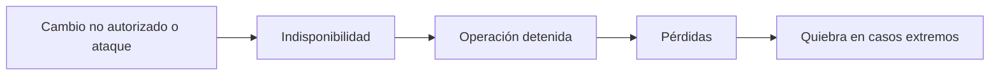
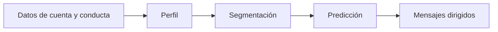
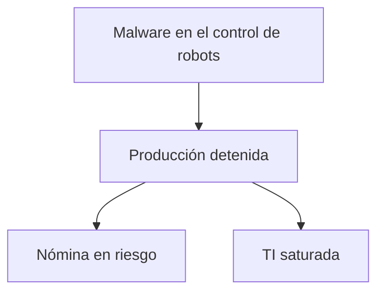

<!-- _class: lead -->

# U5 - Desafíos globales asociados a las TIC

### Introducción a la ciberseguridad

**Rogelio Arriaga - Raptor Dev Services**

<!--
Unidad de 120 minutos. Hilo conductor: la tríada de la seguridad de la información (disponibilidad,
confidencialidad, integridad) vista como desafío global, con un caso real por pilar: NotPetya y Maersk,
el padrón electoral expuesto en un servidor de nube y la investigación de delitos en la nube.
Es la última unidad: cierra con una lámina que recoge toda la materia.
Antes de empezar: pedir que cada quien tenga a la mano su celular para el ejercicio de herencia digital.
-->

---

## El lema de la unidad

> La tecnología es una herramienta: sirve bien a quien la domina y domina a quien la usa sin pensar.

Hoy no aprendemos una técnica nueva: aprendemos a mirar los riesgos que vienen con cada innovación, antes de que lleguen.

<!--
La frase recrea la idea que se atribuye a Christian Lous Lange (Nobel de la Paz 1921): la tecnología
como sirviente útil y amo peligroso. Pregunta para abrir: ¿quién manda en su relación con el celular?
-->

---

## Por qué la seguridad de la información

Los desafíos globales de las TIC son muchos:

- Educación y entretenimiento.
- Brecha digital, alfabetización e inclusión.
- **Protección de la información.**

Elegimos el último porque atraviesa a todos los demás. La pandemia aceleró la conexión de millones de personas, y ni las leyes, ni las herramientas, ni la cooperación internacional han cerrado el hueco.

---

## Objetivo de la unidad

Al terminar, serás capaz de:

1. Explicar los desafíos inmediatos que pueden afectar la **disponibilidad** de la información.
2. Analizar los riesgos para la **confidencialidad**: identidad digital, IA, datos abiertos y redes inalámbricas.
3. Explicar cómo se aplica la **resiliencia** cuando una identidad o una infraestructura digital es vulnerada.

---

## Agenda

| Bloque | Qué vemos |
|---|---|
| 1 | La tríada CID y el modelo de múltiples partes interesadas |
| 2 | Disponibilidad: cambio, IoT, IA y tecnología operativa |
| 3 | Confidencialidad: identidad digital, OSINT, datos abiertos, Wi-Fi |
| 4 | Integridad: nube, cifrado, ciberresiliencia y lo inimaginable |
| 5 | Cierre de la unidad y de la materia |
| 6 | Práctica, tarea y quiz |

---

## La tríada CID

| Pilar | Pregunta | Falla típica |
|---|---|---|
| Disponibilidad | ¿Puedo usarla cuando la necesito? | Ransomware, sitio caído |
| Confidencialidad | ¿Solo la ven quienes deben? | USB perdida sin cifrar |
| Integridad | ¿Es correcta y nadie la alteró? | Precios cambiados en una tienda en línea |

Los tres pesan lo mismo (ISO/IEC 27001). Los separamos solo para estudiarlos.

Fuente: INCIBE (2020).

---

## Un problema de todos

El modelo de **múltiples partes interesadas**:

- Gobiernos, empresas, academia, sociedad civil y personas usuarias comparten el mismo sistema.
- Todos reciben sus beneficios, siguen sus reglas y cargan con sus riesgos.
- Lo que decide uno afecta la defensa de los demás.

Si una empresa grande no logra blindarse, el usuario doméstico está todavía más expuesto.

<!--
Pedir un ejemplo del grupo de una decisión individual que afecta a otros: reusar contraseñas,
no actualizar el router de la casa que luego forma parte de una botnet.
-->

---

<!-- _class: lead -->

# Tema 1
## Disponibilidad de la información: el desafío global

---

## Pasado, presente y futuro

La ciberseguridad se estudia en tres tiempos:

- **Pasado:** los incidentes dejan lecciones.
- **Presente:** se aplican soluciones y controles.
- **Futuro:** se anticipan los riesgos de cada innovación.

El tercero es el más difícil y el más valioso.

---

## La criticidad del cambio

Que la infraestructura siga funcionando es cuestión de supervivencia para un negocio.

---

## Caso: NotPetya y Maersk (2017)

| Dato | Cifra |
|---|---|
| Servidores reinstalados | ~4,000 |
| Computadoras reinstaladas | ~45,000 |
| Aplicaciones | ~2,500 |
| Tiempo | ~10 días |
| Costo estimado | 250 a 300 millones de dólares |

Fuente: SecurityWeek (2018), con datos del presidente de Maersk en Davos.

<!--
Subrayar: no se robó nada para vender. El daño fue quedarse sin herramientas. Cerca de 80 % del volumen
se procesó a mano durante la crisis. Pregunta: ¿cuántos días aguanta su empresa sin sistemas?
-->

---

## La disponibilidad en la industria

- Perder comunicaciones, o que se retrasen, no solo cuesta dinero.
- Los dispositivos pueden comportarse de forma anómala.
- Los operadores enfrentan situaciones que nunca vieron.

El reto es de **dirección**: equilibrar operación y controles para que los activos críticos sigan a plena capacidad.

---

## IoT y otras infraestructuras inteligentes

| Caso | Riesgo |
|---|---|
| IA en las empresas | El proceso se detiene si el sistema falla o se manipula |
| Biometría | La huella o el rostro no se pueden cambiar como una contraseña |
| Ciudades inteligentes | Un ataque afecta servicios públicos completos |
| Dispositivos raros conectados | Objetos que nadie pensaría proteger |

INCIBE-CERT (2017): faltan especialistas en IoT; urge control de acceso, cifrado y privacidad desde el diseño.

---

## El pensamiento de las máquinas

- **McCarthy y Minsky**, a mediados del siglo XX: ¿puede una máquina razonar?
- **Arthur Samuel** (IBM, finales de los cincuenta): un programa de damas que mejora con la experiencia.
- Hoy: máquinas que **deciden solas**.

Lo nuevo no es la idea: es la ciberseguridad que ahora la acompaña.

---

## Aprendizaje automático y profundo

| | Clásico | Profundo |
|---|---|---|
| Datos | Preparados y estructurados | No estructurados y masivos |
| Rasgos | Los elige una persona | Los descubre el modelo |
| Arquitectura | Simple | Capas jerárquicas |
| Ejemplos | Clasificar registros | Visión por computadora, lenguaje natural |

Redes convolucionales para imágenes; *transformers* para texto.

---

## La IA no es infalible

- Fallas de diseño y errores de software.
- Ataques que explotan debilidades específicas.
- Patrones aprendidos que se manipulan o corrompen.
- Decisiones autónomas que nadie previó (los agentes negociadores de Facebook, 2017).

> El peligro de fondo no es que las máquinas piensen como personas, sino que las personas piensen como máquinas. (Idea atribuida a Sydney J. Harris)

---

## Tecnología operativa bajo ataque

Estudio de Ponemon Institute para Tenable (2019), 701 profesionales de infraestructura crítica:

| Hallazgo | % |
|---|---|
| Sufrieron al menos un ataque con daños en dos años | 90 |
| Sufrieron dos o más | 62 |
| Citan falta de visibilidad como causa central | 80 |

---

## IA: escudo y arma

| Defensa | Ataque |
|---|---|
| Anticipar amenazas con muchos datos | *Phishing* personalizado y automático |
| Responder más rápido a incidentes | Buscar vulnerabilidades en automático |
| Liberar al personal de lo repetitivo | Puertas traseras en algoritmos |

Fuente: Lecuit (2019), Real Instituto Elcano. Las herramientas generativas (desde 2022) repiten el dilema: adoptarlas con cautela, ética e información.

---

<!-- _class: lead -->

# Tema 2
## Confidencialidad: elemento vital de la ciberseguridad

---

## La información tiene precio

Precios promedio en la web oscura (Privacy Affairs, índice 2022, en dólares):

| Producto | Precio |
|---|---|
| Tarjeta de crédito con datos (saldo hasta 5,000) | 120 |
| Credenciales de banca en línea | 65 |
| Cuenta de Facebook robada | 45 |

Mientras más datos robados circulan, más bajan los precios. Para la víctima, el daño no baja.

---

## La identidad digital es intemporal

- La identidad es reconocimiento social: reputación, prestigio, trabajo.
- Los datos salen de dos fuentes: lo que registran los servicios y lo que publicamos.
- Se acumulan sin fecha de caducidad.

**Regla práctica:** menos aplicaciones innecesarias, menos datos fuera de nuestro control.

---

## Del dato a la predicción

Cambridge Analytica (2018) mostró su uso político; en 2019 la FTC sancionó a Facebook con 5,000 millones de dólares.

<!--
Recordar los contratos de adhesión: se acepta todo o no se usa el servicio. Preguntar quién leyó
completos los términos de alguna aplicación que tenga instalada.
-->

---

## OSINT y reputación digital

| Concepto | Desafío |
|---|---|
| OSINT: búsqueda estructurada en fuentes públicas | Lo público también sirve para perfilar o atacar |
| Páginas recopilatorias | Verificar veracidad y autoría |
| Búsquedas estructuradas | Etiquetar qué es público y qué es privado |

Tres factores vuelven la reputación un problema de confidencialidad: **precisión**, **visibilidad** y **falta de control**.

Citar las fuentes también es proteger: copiar sin citar puede ser infracción y hasta delito.

---

## Datos abiertos en México

- Hasta 2018: más de 25,000 bases de datos de más de 270 instituciones en el portal nacional.
- 2016: la lista nominal (unos 93.4 millones de registros) apareció en un servidor de nube sin contraseña.
- 2018: el INE multó al partido responsable con unos 34.1 millones de pesos; el Tribunal Electoral lo confirmó.

La regulación tiene que ir al paso de la innovación, o adelante.

---

## Redes inalámbricas

| Ventaja | Desventaja |
|---|---|
| Movilidad | Menos velocidad que el cable |
| Instalación sencilla | Más interferencia |
| | El alcance no se delimita: atacar es más fácil |

*Dragonblood* (2019): fallas en WPA3 que permitían recuperar contraseñas o degradar el protocolo; se corrigieron con software.

---

## Muerte y herencia digital

| Plataforma | Mecanismo |
|---|---|
| Facebook | Contacto de legado o eliminación de la cuenta |
| Google | Administrador de cuentas inactivas |
| México | Testamento ante notario con cuentas y métodos de recuperación |

<!--
Ejercicio de 5 minutos: que cada quien revise en su celular si tiene configurado el administrador de
cuentas inactivas o el contacto de legado. Nadie comparte datos: solo levantan la mano.
-->

---

## Ciudades inteligentes y patrones útiles

- Datos abiertos, ciudad inteligente e IoT: más servicios, más superficie de ataque.
- Una ciudad que no es segura no es inteligente.
- La minería de datos también mejora servicios: un estudio en bibliotecas cubanas (2017) encontró patrones de búsqueda para ofrecer mejor información.

El mecanismo es el mismo; cambian la finalidad y el consentimiento.

---

<!-- _class: lead -->

# Tema 3
## Integridad: trascendencia y escenarios mediatos

---

## Integridad: sin ella no hay decisión correcta

- La información se produce, viaja, se guarda y se genera sin pausa: cada paso es una oportunidad de alterarla.
- En un juicio, la evidencia digital sin integridad demostrable puede desecharse.
- ISO/IEC 27001 da método, pero es voluntaria y no sustituye a la ley.

---

## La nube y los centros de datos

| Servicio | Qué renta el cliente |
|---|---|
| IaaS | Infraestructura |
| PaaS | Plataforma para desarrollar |
| SaaS | Aplicación completa |

Quien contrata sigue siendo responsable de los datos personales que sube (guía del INAI, 2018).

---

## Flujo transfronterizo y seguridad nacional

- Los datos cruzan fronteras por la infraestructura de varias empresas, casi siempre con nuestro permiso distraído.
- Muchas reglas se escribieron antes del correo masivo, las redes y las apps.
- La Ley de Seguridad Nacional (art. 5, fr. XII) considera amenaza destruir o inhabilitar infraestructura estratégica.

El cifrado no es infalible, pero sigue siendo la mejor opción disponible.

---

## Ciberresiliencia: un escenario

Kaspersky (2017): los robots industriales se diseñan para la seguridad física, no para la ciberseguridad.

---

## El cifrado también tiene retos

| Desafío | Riesgo |
|---|---|
| Gestión de llaves | Perderla es perder la información |
| Compatibilidad | Sistemas que no se entienden |
| Implementación | Algoritmos débiles o mal usados |

Seguridad en capas para un centro de datos: **física, lógica y jurídica**, con cifrado en cada una.

---

## Investigar delitos en la nube

- Recursos distribuidos y elásticos: la evidencia se mueve o desaparece.
- Datos en varios servidores y países: ¿qué ley aplica?
- Sin metodología consolidada de análisis forense remoto (Podestá et al., 2014).

Actualización al 2026: la Convención de la ONU contra la Ciberdelincuencia (2024) se abrió a firma en Hanói en octubre de 2025.

---

## Seis prácticas de una organización ciberresiliente

1. Preparación y planificación.
2. Prevención.
3. Detección.
4. Respuesta.
5. Recuperación.
6. Adaptación y mejora continua.

NIST CSF 2.0 (2024): gobernar, identificar, proteger, detectar, responder y recuperar.

---

## Desafíos inimaginables

- El metaverso pasó del juego al trabajo, la escuela y los conciertos.
- 2022: el testimonio de una agresión sexual colectiva a un avatar en una plataforma de realidad virtual.
- ¿Qué norma aplica? ¿Quién responde? ¿Cómo se investiga?

<!--
Dejar la pregunta abierta y conectarla con la práctica: ¿estamos preparados para lo que ni siquiera
imaginamos?
-->

---

## Cierre de la unidad

- **Disponibilidad:** los cambios no autorizados afectan la vida diaria; la gestión de riesgos debe anticiparse, sobre todo en IoT, y la IA necesita ética y supervisión humana.
- **Confidencialidad:** la identidad digital ya es parte de la persona y de su herencia; la IA requiere regulación; en Wi-Fi público y datos abiertos, el conocimiento es la primera defensa.
- **Integridad:** la nube es difícil de proteger e investigar; los centros de datos piden seguridad en capas; la ciberresiliencia es la herramienta para recuperarse.

---

## Cierre de la materia

| Unidad | La idea que se queda |
|---|---|
| 1 | Las TIC son herramientas valiosas y generan dependencia |
| 2 | Ser ciudadano digital implica derechos, deberes y prevención |
| 3 | Riesgo, vulnerabilidad y amenaza no son lo mismo |
| 4 | Una conducta en línea puede ser delito, y se investiga |
| 5 | Disponibilidad, confidencialidad e integridad son un desafío global y permanente |

La ciberseguridad no es solo de infraestructura crítica: es un hábito de todos los días.

---

## Para la próxima

- **Práctica:** debate "¿Ya estamos preparados para hacer ciberseguridad?" ([práctica](practica.md)).
- **Tarea:** presentación "Mi visión actual sobre la ciberseguridad" ([tarea](tarea.md)).
- **Quiz:** en la plataforma.
- **Glosario:** [glosario](glosario.md).
- **Lecturas:** [13 - Disponibilidad](../../../12-seguridad/01-introduccion/13-disponibilidad-de-la-informacion.md), [14 - Confidencialidad](../../../12-seguridad/01-introduccion/14-confidencialidad.md), [15 - Integridad](../../../12-seguridad/01-introduccion/15-integridad.md).
