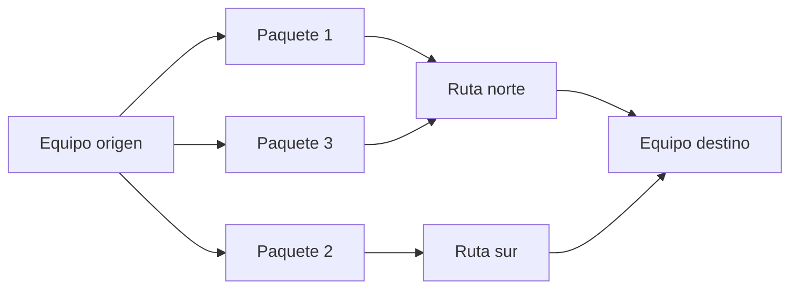
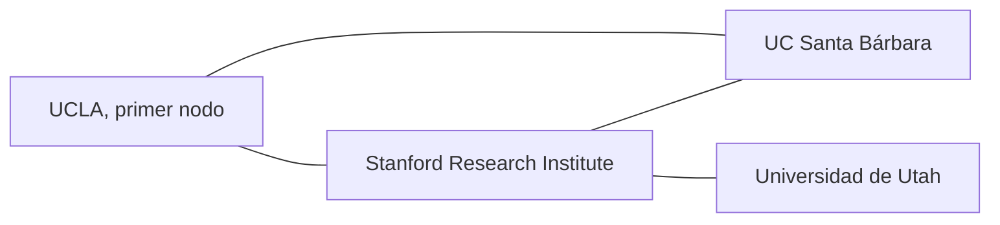
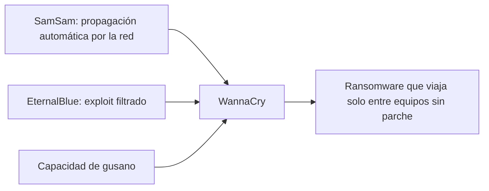
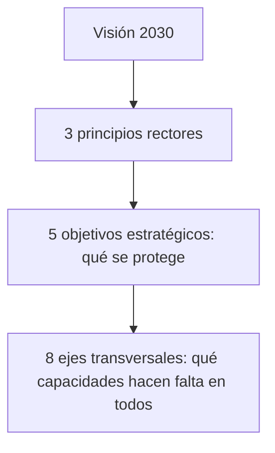

<!-- _class: lead -->

# U1 - Ciberseguridad y actualidad

### Riesgos actuales en ciberseguridad

**Rogelio Arriaga - Raptor Dev Services**

<!--
Clase de 2 horas. Hilo conductor: internet se construyó para un grupo pequeño que confiaba entre sí; cuando
se abrió al mundo, la seguridad tuvo que agregarse después, y todavía estamos pagando esa deuda. Recorremos
el origen (tema 1), los ataques que marcaron el panorama (tema 2) y cómo responde México (tema 3).
Reparto sugerido: apertura 10 min, tema 1 35 min, tema 2 35 min, tema 3 30 min, cierre 10 min.
-->

---

## Por qué importa

- En México hay **104.9 millones** de personas usuarias de internet: el **86.1 %** de la población de seis años y más.
- Casi todo lo que hacemos en un día pasa por la red: estudiar, cobrar, pagar, enterarnos, platicar.
- Usarla a diario no es lo mismo que entenderla.

Lo que no entendemos, no lo sabemos proteger.

Fuente: INEGI, ENDUTIH 2025.

<!--
Pregunta de arranque (2 min): ¿cuántas de las cosas que hicieron hoy antes de llegar a clase habrían sido
imposibles sin internet? Que cuenten en voz alta. La respuesta suele pasar de diez.
-->

---

## Objetivo de la unidad

Ubicar el origen de internet y de las TIC para entender por qué la seguridad se volvió un asunto de todos, y reconocer los riesgos del panorama actual en el mundo y en México.

**Resultados de aprendizaje.** Al terminar la unidad:

1. Cuentas la historia de internet más allá de las aplicaciones que usas a diario.
2. Explicas el peso de las TIC y de la ciberseguridad en la vida cotidiana y profesional.
3. Manejas los conceptos básicos con los que trabaja el resto de la materia.

---

## Agenda

| Bloque | Qué vemos | Tiempo |
|---|---|---|
| Apertura | Por qué importa, objetivo y agenda | 10 min |
| Tema 1 | TIC, internet y seguridad | 35 min |
| Tema 2 | Ciberseguridad: panorama general | 35 min |
| Tema 3 | Actualidad de la ciberseguridad en México | 30 min |
| Cierre | Conclusiones, práctica, tarea y lo que sigue | 10 min |

---

<!-- _class: lead -->

# Parte 1
## TIC, internet y seguridad

---

## La sociedad del conocimiento

En los años sesenta se empezó a hablar de una sociedad **postindustrial**: la riqueza deja de venir de fábricas y materias primas y empieza a venir del saber.

| Rasgo | El cambio |
|---|---|
| Economía | De fabricar bienes a prestar servicios con gente muy preparada |
| Innovación | Las ideas se vuelven la fuente de la tecnología nueva |
| Educación | Sin sistemas educativos de calidad no hay salto económico |
| Valor | El conocimiento pesa más en un producto que el trabajo manual |

Fuentes: Drucker (1994); UNESCO (2005).

<!--
Drucker lo resumió así: el conocimiento desplaza al capital y al trabajo como motor de productividad, y
también como fuente de desigualdad. Preguntar: ¿qué parte de su trabajo es conocimiento y qué parte es
tarea manual?
-->

---

## De novedad a infraestructura

- La globalización llevó la economía de lo nacional a lo mundial, y las TIC fueron su sistema nervioso.
- **TIC**: todo lo que sirve para crear, guardar, procesar y transmitir información (equipos, redes, programas, servicios en línea).
- Hoy no son un lujo: son infraestructura, igual que el agua o la luz.

| Dato de México | Valor |
|---|---|
| Uso de internet en zonas urbanas | 88.9 % |
| Uso de internet en zonas rurales | 75.2 % |
| Razón principal de quien no lo usa | No sabe cómo |

Fuente: INEGI, ENDUTIH 2025 (uso por zona). Desde 2013, el artículo 6.º constitucional reconoce el derecho de acceso a las TIC y a la banda ancha.

---

## Qué es internet

- Una **red de redes** que hablan el mismo idioma: el conjunto de protocolos **TCP/IP**.
- Cada equipo conectado se identifica con una **dirección IP**.
- Los datos viajan partidos en **paquetes** que pueden seguir rutas distintas y se vuelven a armar al llegar.

Esa última idea, la **conmutación de paquetes**, es el centro de toda la historia que sigue.

---

## Circuitos contra paquetes

- **Circuito** (teléfono clásico): una línea reservada de punta a punta mientras dura la llamada.
- **Paquetes**: nadie reserva nada; si una ruta se cae, los paquetes toman otra.

<!--
Analogía que funciona: mandar un libro por paquetería en diez cajas que viajan en camiones distintos.
Si un camión se descompone, las otras cajas llegan igual y se reenvía la que faltó.
-->

---

## Las ideas (1961 a 1967)

| Año | Quién | Aporte |
|---|---|---|
| 1961 | Leonard Kleinrock (MIT) | Primer artículo sobre conmutación de paquetes |
| 1962 | J. C. R. Licklider (MIT, DARPA) | La "Red Galáctica": computadoras conectadas en todo el mundo |
| 1965 | Lawrence Roberts y Thomas Merrill | Unen la TX-2 y la Q-32 por teléfono: primera red de área amplia |
| 1967 | Roberts (DARPA) | Publica el plan de ARPANET |

MIT, RAND y el NPL británico trabajaron en paralelo sin conocerse. Del NPL viene la palabra "paquete".

Fuente: Leiner et al. (1997), Internet Society.

---

## ARPANET nace con cuatro nodos (1969)

- 1968: BBN gana el contrato para construir los **IMP**, los conmutadores de paquetes de la red.
- Septiembre de 1969: primer IMP en el laboratorio de Kleinrock, en UCLA.
- Un mes después sale el primer mensaje entre computadoras, de UCLA al SRI.
- Antes de cerrar el año ya había cuatro nodos.

---

## De ARPANET a internet

| Año | Hito |
|---|---|
| 1972 | Bob Kahn propone la **arquitectura abierta**, nacida en el programa de **radio por paquetes** de DARPA; aparece el correo electrónico |
| 1973 a 1978 | Kahn y Vinton Cerf diseñan TCP/IP |
| 1 de enero de 1983 | ARPANET adopta TCP/IP: la fecha que muchos toman como nacimiento de internet |
| 1989 en adelante | Tim Berners-Lee crea la World Wide Web en el CERN |

Arquitectura abierta: redes distintas se conectan entre sí sin cambiar por dentro.

<!--
Dato para el quiz y para la vida: la arquitectura abierta no salió de la red de cable, sino de la necesidad
de unir una red inalámbrica (radio por paquetes) con ARPANET. Preguntar por qué eso importa hoy: el wifi y
la red celular de su teléfono son exactamente ese problema.
-->

---

## Seguridad: la pieza que llegó tarde

- ARPANET unía a investigadores que se conocían y confiaban entre sí.
- La prioridad era que los paquetes **llegaran**, no quién los mandaba.
- Cuando la red se abrió a millones de desconocidos, esa confianza de fábrica se volvió una debilidad.

**Ciberseguridad**, según la UIT: el conjunto de medios (herramientas, políticas, salvaguardas, gestión de riesgos, formación, buenas prácticas, seguros y tecnologías) que protege los activos de organizaciones y usuarios en el ciberentorno.

Fuente: UIT, Recomendación X.1205 (2008).

<!--
Caso para contar: el correo electrónico nació sin forma de comprobar quién envía un mensaje. Por eso el
phishing sigue funcionando décadas después; los controles se fueron pegando encima.
-->

---

## La tríada CID

| Principio | Qué cuida | Con qué se protege |
|---|---|---|
| Confidencialidad | Que solo vea la información quien debe verla | Control de acceso, autenticación, cifrado |
| Integridad | Que la información sea exacta y nadie la altere sin permiso | Permisos, firmas, sumas de verificación, registros |
| Disponibilidad | Que la información esté ahí cuando se necesita | Mantenimiento, actualizaciones, respaldos, recuperación ante desastres |

<!--
Ejercicio rápido (3 min): un hospital pierde el acceso a sus expedientes por un ataque. ¿Qué principio se
rompió? Disponibilidad. ¿Y si alguien cambia una dosis en el expediente? Integridad. ¿Y si los publican?
Confidencialidad.
-->

---

## Derechos y deberes digitales

- Los derechos digitales extienden al entorno virtual los de siempre: privacidad, libre expresión, acceso a la información, protección de datos.
- Tener derechos en la red no quita las obligaciones en la red.
- Quien construye tecnología carga una responsabilidad extra: entender lo que hace, actuar con ética y no dejar de formarse.

---

<!-- _class: lead -->

# Parte 2
## Ciberseguridad: panorama general

---

## Más allá del antivirus: el ransomware

Un ataque puede destruir equipos, exponer datos o detener un servicio público en minutos, y el delincuente opera con alcance masivo, escondido detrás de un dispositivo. Un antivirus solo ya no alcanza.

**Ransomware:** malware que **cifra** los archivos de la víctima o le **bloquea** el acceso, y luego exige un pago, casi siempre en criptomonedas, a cambio de la llave.

- Se volvió una de las amenazas más grandes para personas y empresas.
- 2017 fue el año en que pasó de casos aislados a epidemia mundial.

<!--
Preguntar si alguien conoce un caso cercano (una escuela, un despacho, un consultorio) que haya perdido sus
archivos así. Casi siempre hay uno. Que cuenten cómo se enteraron y si había respaldo.
-->

---

## De SamSam a WannaCry

| Cuándo | Qué pasó | La lección |
|---|---|---|
| Marzo de 2016 | **SamSam** usa la red para propagar ransomware sin que nadie ejecute nada | El ransomware ya podía moverse solo dentro de una organización |
| Abril de 2017 | Shadow Brokers filtra **EternalBlue**, exploit del protocolo de archivos compartidos de Windows | Un arma para entrar a millones de equipos sin parche, al alcance de cualquiera |
| 12 de mayo de 2017 | **WannaCry**, un *cryptoworm*, usa EternalBlue para saltar de red en red | Más de 200,000 equipos de hospitales, fábricas y gobiernos en al menos 100 países, en horas |

Fuente: Cisco Talos (2017); Cisco (2018); National Audit Office del Reino Unido (2017).

---

## Cómo se armó el cryptoworm

Antes: un equipo infectado a la vez. Después: la red completa en cuestión de horas.

---

## Lo que ganó WannaCry

| Concepto | Cifra |
|---|---|
| Lo que había en sus billeteras al vaciarlas | Poco más de 143,000 dólares |
| Pagos de rescate estimados | Alrededor de 312 |
| Lo que ganaba el kit de exploits Angler | Unos 100 millones de dólares al año |

Fuente: Cisco, Informe anual de ciberseguridad 2018.

Con tan poco dinero, varios gobiernos e investigadores concluyeron que el rescate era una pantalla y que el fin real era **destruir datos**. En diciembre de 2017, Estados Unidos y el Reino Unido culparon a Corea del Norte.

<!--
Ojo: hay materiales que repiten "143,000 millones de dólares". El informe de Cisco dice 143,000 dólares.
Buena ocasión para enseñar a revisar la fuente primaria antes de repetir una cifra.
-->

---

## Exploits: aprovechar una debilidad

Un **exploit** es código o una técnica que aprovecha una **vulnerabilidad** para tomar el control de un sistema.

| Tipo | Qué son | Defensa |
|---|---|---|
| Conocidos | Documentados, con medidas ya publicadas | Actualizar todo; si no hay parche, mitigar |
| Día cero | Atacan un hueco que ni el fabricante conoce | Defensa en profundidad y detección por comportamiento |

La vía favorita para lanzarlos: un correo de phishing con ingeniería social y un adjunto infectado.

---

## Nube e IoT: se borra el perímetro

- Antes había una frontera clara: la red de la empresa adentro, internet afuera.
- Las aplicaciones, los datos y las identidades se mudaron a la **nube**, y los objetos conectados (**IoT**) se multiplicaron.
- El atacante aprovecha que la defensa no alcanza a seguir esa expansión, y la confusión sobre **quién** protege qué.

| Modelo de responsabilidad compartida | Le toca |
|---|---|
| Infraestructura física y plataforma | Al proveedor de nube |
| Datos, identidades, configuraciones y accesos | Al cliente |

La mayoría de los incidentes en la nube vienen del lado del cliente: credenciales robadas y configuraciones abiertas.

---

## 2018: privacidad, dispositivos y elecciones

- **Cambridge Analytica** (marzo de 2018): datos de decenas de millones de perfiles de Facebook usados sin consentimiento para perfilar votantes. El RGPD europeo ya estaba adoptado desde 2016 y empezó a aplicarse en mayo de 2018.
- **Wearables**: un reloj inteligente sabe tu salud, tus rutas y tus lugares; comprometerlo es entrar a tu vida física.
- **Elecciones de EUA 2016**: campaña de influencia en redes y robo y filtración de correos; las investigaciones oficiales no hallaron votos alterados.

Conclusión: la información ya es un arma, y quien controla las plataformas tiene un poder parecido al de controlar un territorio.

<!--
Pregunta para el grupo: ¿qué sabe de ustedes su teléfono que no le contarían a un desconocido? Dejar
que lo piensen en silencio; no hace falta que lo digan.
-->

---

## El panorama hoy

| Tendencia | Qué significa |
|---|---|
| Doble extorsión | Primero roban los datos, luego cifran, y amenazan con publicarlos |
| Ransomware como servicio | Grupos que alquilan su malware a afiliados, como una empresa |
| Cadena de suministro | Se ataca a un proveedor que usan miles de organizaciones |
| Infraestructura crítica | Hospitales, agua, energía y ductos como blanco; hay vidas en juego |
| Gobierno de la ciberseguridad | El Marco del NIST 2.0 (febrero de 2024) agrega la función "Gobernar": la responsabilidad sube a la alta dirección |

---

<!-- _class: lead -->

# Parte 3
## Actualidad de la ciberseguridad en México

---

## Un país muy atacado

- México está entre los países **más atacados de América**, y muchas víctimas ni se enteran a tiempo.
- Primer semestre de 2024: unos **31,000 millones de intentos** de ciberataque, cerca del **55 %** de los de América Latina (intentos automatizados, no ataques exitosos).
- El costo del cibercrimen para el Estado y las empresas se estimaba entre **3,000 y 5,000 millones de dólares al año**.

Fuentes: FortiGuard Labs, Fortinet (2024); OEA y Symantec (2014).

<!--
Aclarar la diferencia entre intento y ataque exitoso: la mayoría son escaneos automáticos. Aun así, el
volumen dice dónde están mirando los atacantes.
-->

---

## La ley va detrás de la tecnología

- Europa tiene un marco más completo y parejo.
- En México hay normas recientes, pero no una homologación federal de las conductas digitales.
- Cada estado tipifica a su manera: lo que es delito en una entidad puede no serlo en la de al lado.

Consecuencia práctica: antes de denunciar, hay que saber en qué estado se cometió la conducta y cómo la describe su código penal.

---

## La Estrategia Nacional de Ciberseguridad

- Presentada el **13 de noviembre de 2017**, con apoyo de la OEA.
- Se construyó en mesas con sociedad civil, academia, empresas y gobierno.
- Fue la **primera** estrategia nacional del país en la materia.

**Objetivo general:** identificar, establecer y fortalecer acciones de ciberseguridad en lo social, lo económico y lo político, para que la población y las organizaciones públicas y privadas usen las TIC de forma responsable y en favor del desarrollo sostenible. Mira hacia 2030.

Fuente: Gobierno de la República, ENCS (2017).

---

## Cómo está armada la ENCS

| Principios rectores | Objetivos estratégicos |
|---|---|
| Derechos humanos | Sociedad y derechos |
| Gestión de riesgos | Economía e innovación |
| Colaboración de múltiples actores | Instituciones públicas, seguridad pública y seguridad nacional |

---

## Los ocho ejes transversales

| Eje | Eje |
|---|---|
| Cultura de ciberseguridad | Estándares y criterios técnicos |
| Desarrollo de capacidades | **Infraestructuras críticas** |
| Coordinación y colaboración | Marco jurídico y autorregulación |
| Investigación, desarrollo e innovación en TIC | Medición y seguimiento |

Un eje cruza todos los objetivos: la cultura de ciberseguridad hace falta tanto para proteger a la sociedad como a la economía o al gobierno.

<!--
Pedir que cada quien elija el eje que más falta le hace a su organización y diga por qué en una frase.
Casi siempre sale "cultura" o "medición".
-->

---

## Lo que quedó pendiente

- La ENCS no se volvió ley, no tuvo presupuesto propio y no se actualizó en el sexenio 2018 a 2024.
- Varias iniciativas de ley de ciberseguridad se quedaron en el Congreso.
- Diciembre de 2025: la ATDT presentó un Plan Nacional de Ciberseguridad y publicó en el DOF la **Política General de Ciberseguridad para la Administración Pública Federal**, obligatoria para las dependencias.
- Al 2026, México **sigue sin una ley federal** de ciberseguridad.

Fuente: DOF, 17 de diciembre de 2025.

---

## Quién hace qué, hoy

| Función | Antes (2017 a 2018) | Hoy (2026) |
|---|---|---|
| Policía y respuesta a incidentes | División Científica de la Policía Federal y CERT-MX | **Guardia Nacional**: su Dirección General Científica aloja el CERT-MX |
| Política digital del gobierno | Coordinación de Estrategia Digital Nacional | ATDT, con rango de Secretaría desde noviembre de 2024 |
| Datos personales (sector privado) | INAI | Secretaría Anticorrupción y Buen Gobierno, desde la ley de marzo de 2025 |
| Usuarios financieros | Condusef | Condusef |

También cuentan las policías cibernéticas estatales y los equipos universitarios como UNAM-CERT.

<!--
La Policía Federal se extinguió con la Ley de la Guardia Nacional de 2019 y sus divisiones pasaron a la
Guardia en 2020. Si alguien les dice "repórtalo a la Policía Federal", el dato tiene años de atraso.
-->

---

## Incidentes que marcaron al país

| Año | Caso | Lección |
|---|---|---|
| 2016 | Lista nominal del INE, más de 90 millones de registros, en un servidor de nube sin contraseña | Una mala configuración pesa tanto como un ataque |
| 2018 | Ataques a participantes del SPEI, unos 300 millones de pesos | Toda la banca tuvo que endurecer su seguridad |
| 2018 | Denegación de servicio a sitios de partidos y desinformación en campañas | La elección también se juega en la red |
| 2019 | Ransomware en Pemex, con rescate en bitcoins | Nadie es demasiado grande |
| 2022 | Hacktivistas filtran terabytes de correos de la Sedena | Un caso de los más grandes de la región |

---

## Las redes sociales como vector

| Uso de internet en México | Porcentaje |
|---|---|
| Para comunicarse | 93.0 % |
| Para entrar a redes sociales | 90.4 % |
| Usuarios de teléfono inteligente con mensajería instantánea | 90.6 % |

Fuente: INEGI, ENDUTIH 2024.

Las redes y la mensajería son el **principal canal de comunicación** de los mexicanos, y por eso también el principal canal de engaño, extorsión y desinformación.

<!--
Puente a la U2: el acoso, el acecho y el sexting viven justo en este canal. Preguntar quién ha recibido un
mensaje sospechoso por mensajería esta semana.
-->

---

## Conclusiones de la unidad

| Tema | Lo que nos llevamos |
|---|---|
| TIC e internet | La red nació para confiar; la seguridad se le añadió después. Conocer su historia explica sus puntos débiles, y los derechos digitales vienen con deberes |
| Panorama general | La protección se arma en capas y entre disciplinas; un solo producto no basta. Una amenaza global puede costar vidas, y prevenir y educar son parte de la defensa |
| México | La ENCS fue un hito que se quedó sin actualizar; el país está muy expuesto y sin ley federal. Entender el riesgo es la mejor forma de no ser estadística |

---

## Al terminar puedes

- Contar cómo pasó internet de una idea teórica (1961) a una red pública (1983 y 1989).
- Explicar por qué la seguridad no venía de origen.
- Usar con precisión ciberseguridad, tríada CID, ransomware, exploit, vulnerabilidad y perímetro.
- Relacionar SamSam, EternalBlue y WannaCry en una sola historia.
- Describir la ENCS: fecha, objetivo, principios, objetivos y ejes.
- Decir a qué institución acudir hoy en México y cuál ya no existe.

---

## Práctica y tarea

**Práctica (discusión en clase):** ¿qué tan grave sería para tu trabajo un día sin internet? Postura individual y tres réplicas argumentadas.

**Tarea:** un **mapa conceptual individual** que conecte los tres temas de la unidad, con conceptos, ejemplos, comparaciones y fuentes.

Instrucciones completas en `practica.md` y `tarea.md` de esta unidad.

---

## Lecturas

- [01 - TIC, internet y seguridad](../../../12-seguridad/02-riesgos/01-tic-internet-y-seguridad.md): de la sociedad del conocimiento a ARPANET, y la tríada CID.
- [02 - Ciberseguridad, panorama general](../../../12-seguridad/02-riesgos/02-ciberseguridad-panorama-general.md): ransomware, exploits, nube y elecciones.
- [03 - Ciberseguridad en México](../../../12-seguridad/02-riesgos/03-ciberseguridad-en-mexico.md): la ENCS, las instituciones y lo que vino después.

---

## Siguiente unidad: U2 - Cyberbullying, cyberstalking y sexting

> El canal que más usamos para comunicarnos también es el que más se usa para dañar.

- Del panorama general pasamos a los riesgos que tocan a las personas una por una.
- Acoso, acecho e intercambio de imágenes íntimas: cómo se reconocen y qué se puede hacer.
- Traigan en mente el dato de hoy: más del 90 % de quienes usan internet en México están en redes y mensajería.
