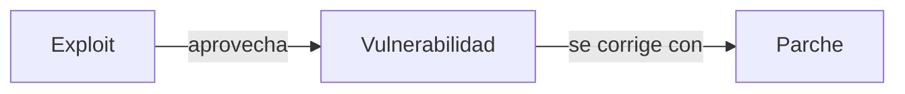

# Tarea - U1 - Mapa conceptual: ciberseguridad y actualidad

**Riesgos actuales en ciberseguridad**
**Tiempo estimado:** 4 horas (1.5 de lecturas y 2.5 del ejercicio), actividad individual.

> **Estudio individual.** Esta actividad se resuelve por tu cuenta: guarda tu trabajo y evalúalo tú mismo con la rúbrica o el checklist del final. No hay foro ni entrega en la plataforma. Si llevas el curso en grupo, el instructor te indica dónde se entrega.

---

## Parte 1 - Lecturas (1.5 horas)

| Recurso | Sección | Tiempo est. |
|---------|---------|-------------|
| [01 - TIC, internet y seguridad](../../../12-seguridad/02-riesgos/01-tic-internet-y-seguridad.md) | Todo el documento; releer "Breve historia de internet" y la tríada CID | 30 min |
| [02 - Ciberseguridad, panorama general](../../../12-seguridad/02-riesgos/02-ciberseguridad-panorama-general.md) | Todo el documento, con atención a "De SamSam a WannaCry", los exploits y la nube | 30 min |
| [03 - Ciberseguridad en México](../../../12-seguridad/02-riesgos/03-ciberseguridad-en-mexico.md) | Todo el documento; releer la estructura de la ENCS y "Quién hace qué en México" | 30 min |

Mientras leen, anoten cada concepto, fecha, caso o institución que les parezca importante: esa lista es la materia prima del ejercicio.

---

## Parte 2 - Ejercicio (2.5 horas)

### Objetivo

Organizar en un solo mapa conceptual los temas, conceptos y puntos de la unidad que cada quien considere más relevantes, mostrando cómo se relacionan entre sí. No es una lista con flechas ni un mapa mental: cada línea entre dos conceptos lleva una palabra de enlace que, leída de corrido, forma una frase.

### Pasos

#### 1. Fijar el concepto central

Una sola idea arriba o al centro que lo englobe todo. Se sugiere **"Ciberseguridad y actualidad"**; pueden elegir otra si la justifican en la nota de lectura del paso 7.

#### 2. Elegir los conceptos

Elijan **entre 18 y 30 conceptos** de los tres temas. Algunos que no deberían faltar:

| Tema | Conceptos de partida |
|---|---|
| TIC, internet y seguridad | Sociedad del conocimiento, TIC, conmutación de paquetes, ARPANET, arquitectura abierta, TCP/IP, ciberseguridad, tríada CID, derechos y deberes digitales |
| Panorama general | Malware, ransomware, gusano, exploit, vulnerabilidad, día cero, ingeniería social, nube, IoT, perímetro, responsabilidad compartida |
| México | ENCS, principios rectores, objetivos estratégicos, ejes transversales, infraestructura crítica, Guardia Nacional y CERT-MX, ATDT, redes sociales como vector |

#### 3. Jerarquizar

De lo general a lo particular: el concepto central, después tres ramas (una por tema) y debajo los conceptos de cada una. Los ejemplos van en los extremos.

#### 4. Unir con palabras de enlace

Cada conexión lleva un verbo o una frase corta. Ejemplo de una sola proposición:

Se lee: "un exploit aprovecha una vulnerabilidad" y "una vulnerabilidad se corrige con un parche". Revisen que **todas** sus líneas se puedan leer así.

#### 5. Agregar comparaciones

Incluyan **al menos tres comparaciones** entre componentes del tema, con sus semejanzas y diferencias. Por ejemplo:

- Conmutación de circuitos contra conmutación de paquetes.
- Exploit conocido contra exploit de día cero.
- Lo que protege el proveedor de nube contra lo que protege el cliente.
- Las instituciones de 2017 contra las de hoy (por ejemplo, Policía Federal y Guardia Nacional).
- Los objetivos estratégicos de la ENCS contra sus ejes transversales.

Pueden ir en un cuadro anexo al mapa.

#### 6. Agregar ejemplos y enlaces cruzados

- Al menos **un caso real por rama**: por ejemplo, WannaCry, el ataque al SPEI de 2018 o la lista nominal expuesta en 2016.
- Al menos **dos enlaces cruzados** entre ramas. Ejemplo: "infraestructura crítica" es eje de la ENCS y también blanco del ransomware actual. Esos cruces son lo más valioso del mapa.

#### 7. Escribir la nota de lectura y las fuentes

Debajo del mapa, o en una segunda página:

- Una nota de **100 a 150 palabras**: cómo se lee el mapa y qué relación les pareció más importante.
- **Referencias en APA 7**: las tres notas y al menos una fuente primaria de sus listas de referencias (la ENCS, la ENDUTIH 2024 o el informe de Cisco de 2018, por ejemplo). Toda cifra lleva su cita.

#### 8. Revisar el documento final

Lee en voz alta cinco proposiciones al azar; si alguna no tiene sentido, corrígela. Revisa ortografía y acentos.

La herramienta es libre (CmapTools, draw.io, Excalidraw, Mermaid o una hoja a mano bien digitalizada), siempre que el mapa se lea completo.

---

## Lo que debes tener al terminar

Un archivo **PDF** (o Markdown con el diagrama incrustado) con nombre `u1-mapa-conceptual-<apellido>.pdf`, de **una a dos páginas**:

1. El mapa conceptual completo, legible, con título y su nombre.
2. El cuadro o la rama de comparaciones.
3. La nota de lectura de 100 a 150 palabras.
4. Las referencias en APA 7.

---

## Rúbrica de autoevaluación (7.5 puntos)

| Criterio | Excelente | Bueno | Regular | Insuficiente | Puntos |
|---|---|---|---|---|---|
| Calidad del contenido | Todos los conceptos se relacionan con el tema central; hay ideas secundarias y un caso real por rama (1.5) | Conceptos pertinentes, pero pocas ideas secundarias o faltan casos en una rama (1) | La relación con el tema es débil y casi no hay ideas secundarias ni casos (0.5) | Los conceptos no tienen que ver con la unidad (0) | 1.5 |
| Organización | Jerarquía clara de lo general a lo particular; todas las líneas llevan palabra de enlace y se leen como frase (1) | Jerarquía clara, con algunas líneas sin enlace o poco claras (0.75) | Hay un orden, pero las relaciones entre conceptos se pierden (0.5) | Sin orden; no se entiende el contenido (0) | 1 |
| Diseño | Colores, formas y tipografía ayudan a distinguir ramas y niveles; se lee sin esfuerzo (1.5) | Buen diseño, con algún elemento que estorba o un descuido de legibilidad (1) | El diseño distrae o dificulta la lectura en varias zonas (0.5) | Ilegible o sin ningún criterio visual (0) | 1.5 |
| Presentación y ortografía | Respeta el formato y la extensión pedidos; sin errores de ortografía ni de redacción (1) | Respeta el formato; de dos a cuatro errores (0.75) | Formato incompleto o de cinco a siete errores (0.5) | No respeta el formato u ocho errores o más (0) | 1 |
| Comparación de componentes | Tres o más comparaciones con semejanzas y diferencias explicadas con detalle (1.5) | Tres comparaciones, pero descritas de forma general (1) | Menos de tres comparaciones, o sin decir en qué se parecen o se distinguen (0.5) | No hay comparaciones (0) | 1.5 |
| Fuentes de información | Las fuentes respaldan el contenido, son actuales, están en APA 7 y cada cifra tiene cita (1) | Fuentes adecuadas en APA 7, alguna poco actual o alguna cifra sin cita (0.75) | Fuentes que aportan poco o con errores de formato (0.5) | Sin fuentes o sin formato de cita (0) | 1 |
| **Total** | | | | | **7.5** |

Suma tus puntos. Con menos de 5.25 (70 %), vuelve a leer la nota indicada y rehaz el apartado más débil.

---

## Criterio de aceptación

- [ ] Concepto central y tres ramas, una por tema.
- [ ] Entre 18 y 30 conceptos; cada línea con palabra de enlace.
- [ ] Tres comparaciones, dos enlaces cruzados y un caso real por rama.
- [ ] Nota de lectura y referencias en APA 7.
