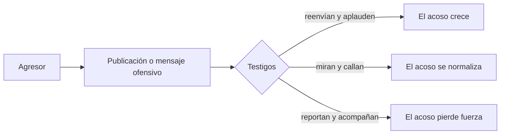
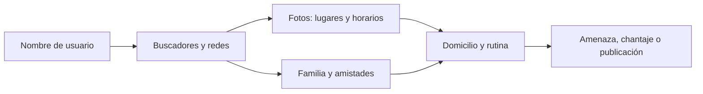
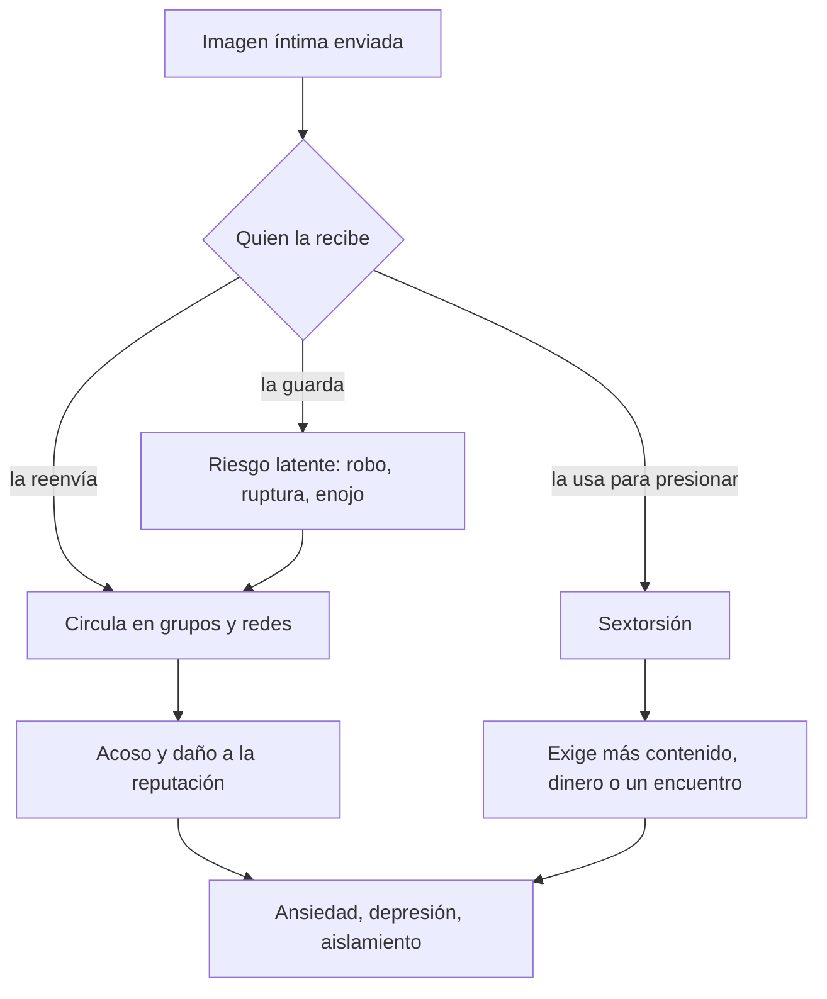

<!-- _class: lead -->

# U2 - Cyberbullying, cyberstalking y sexting

### Riesgos actuales en ciberseguridad

**Rogelio Arriaga - Raptor Dev Services**

<!--
Unidad de 2 horas. Hilo conductor: el mismo teléfono que conecta a una persona con su grupo es el que
deja entrar a quien la humilla, a quien la vigila y a quien hace circular una imagen suya. Las tres
conductas empiezan en una pantalla y terminan fuera de ella. En cada parte la pregunta es la misma:
quién puede cortar la cadena y cómo.
Reparto sugerido: apertura 10 min, cyberbullying 35, cyberstalking 30, sexting 35, cierre 10.
Tema delicado: en el grupo puede haber alguien que lo haya vivido. Nada de detalles gráficos, nada de
pedir experiencias personales en voz alta, y al final de cada parte, a quién se le pide ayuda.
-->

---

## Por qué importa

> Antes el acoso se quedaba en la puerta de la escuela. Hoy viaja en el bolsillo y entra a la casa.

- Una burla se repite a cualquier hora y la ve medio salón en minutos.
- Lo que alguien publicó de sí mismo es lo que otro usa para vigilarlo.
- Una imagen enviada en confianza deja de estar bajo el control de quien la tomó.

Niñas, niños y adolescentes son los más expuestos: comparten mucho y todavía calculan poco.

---

## Una de cada cinco personas conectadas

| Población usuaria de internet de 12 años y más | Vivió ciberacoso en los últimos 12 meses |
|---|---|
| Total | 20.4 %, unos 19.4 millones de personas |
| Mujeres | 21.5 %, 10.8 millones |
| Hombres | 19.2 %, 8.6 millones |
| Un año antes (MOCIBA 2024) | 21.0 %, 18.9 millones |

Fuente: INEGI, MOCIBA 2025 (publicado en julio de 2026).

<!--
Aclarar: el módulo mide el ciberacoso en general, no solo el que ocurre entre compañeros. Sirve para dar
la escala. Pregunta al grupo: de cada cinco que lo viven, ¿cuántos creen que se lo cuentan a alguien?
-->

---

## Resultados de aprendizaje

Al cerrar la unidad podrás:

- **Distinguir** el cyberbullying del cyberstalking por quién participa, qué busca el agresor y cómo se responde a cada uno.
- **Explicar** qué es el sexting, por qué se considera una práctica de riesgo y qué delitos puede detonar.
- **Detectar** las tres conductas en un caso concreto y decir a quién acudir en cada una.

<!--
Se evalúan en la práctica (un caso de sexting entre adolescentes), en la tarea (un tríptico sobre
ciberseguridad y menores) y en el quiz.
-->

---

## Agenda

| Bloque | Tema | La pregunta que responde |
|---|---|---|
| 1 | Cyberbullying | ¿Por qué el acoso entre compañeros crece o se apaga según quién mira? |
| 2 | Cyberstalking y doxing | ¿Cómo arma alguien el expediente de otra persona con lo que ella misma publicó? |
| 3 | Sexting | ¿Qué pasa con una imagen íntima después de enviarla? |
| 4 | Cierre | Conclusiones, práctica, tarea y quiz |

---

<!-- _class: lead -->

# Parte 1
## Cyberbullying

---

## Qué es

**Cyber** (lo digital) + **bullying** (acoso sostenido entre compañeros). En español: ciberacoso entre iguales.

Hostigamiento a través de plataformas digitales para ofender, intimidar, humillar, amenazar o desprestigiar a otra persona, de forma **repetida y deliberada**.

Escenarios: redes sociales, mensajería, correo, foros y videojuegos en línea.

<!--
Pregunta de arranque (5 min): ¿una broma pesada en el grupo del salón ya es cyberbullying? Dejen que
discutan. La respuesta está en dos palabras: repetida y deliberada.
-->

---

## Tres rasgos lo definen

| Rasgo | Qué implica |
|---|---|
| Entre iguales | Agresor y víctima son pares, casi siempre menores y de edades parecidas |
| Sin contenido sexual | Si aparece lo sexual, o si quien agrede es un adulto contra un menor, ya es otra conducta: grooming o sextorsión |
| Por medios digitales | El conflicto puede nacer en el patio, pero la agresión ocurre o se difunde en línea |

El grooming tiene su propio tema en la unidad 3.

---

## Por qué pega más fuerte que el acoso en persona

| | En persona | En línea |
|---|---|---|
| Horario | Se acaba al salir de clases | No se acaba nunca |
| Público | Quienes estaban ahí | Cualquiera con el enlace o dentro del grupo |
| Permanencia | La memoria de los testigos | Capturas y reenvíos que nadie controla |
| Agresor | Tiene cara | Puede esconderse tras un perfil falso |
| Velocidad | De boca en boca | Cientos de personas en minutos |
| Empatía | Ve el dolor que provoca | La pantalla se lo oculta |

<!--
Para contar: borrar la publicación original no borra las copias. Pregunta: ¿quién ha visto circular la
captura de algo que su autor ya había borrado?
-->

---

## Hacen falta al menos tres papeles

| Papel | Quién es |
|---|---|
| Víctima | Recibe las burlas, ofensas u hostigamiento; puede ser una persona o un grupo |
| Agresor | Ejecuta las conductas; también puede ser un grupo |
| Testigos | Miran, comparten o celebran; sin público, la agresión pierde casi toda su fuerza |

El papel decisivo no es el del agresor: es el de quienes miran.

---

## Cuatro maneras de ser testigo

| Testigo | Qué hace |
|---|---|
| Defensor | Apoya a la víctima: desmiente, reporta, acompaña |
| Incitador | Comenta, reacciona y reenvía: mantiene viva la agresión |
| Ayudante | Respalda directamente al agresor, promueve el ataque y participa en él |
| Observador | Mira sin intervenir hacia ningún lado |

<!--
Pregunta: ¿un emoji de risa en una publicación de burla te vuelve incitador? Sí: la reacción es
combustible para el agresor. 5 minutos.
-->

---

## Los testigos deciden el resultado

La intervención que más cambia el desenlace: convertir observadores en defensores.

---

## Cómo se ve en la práctica

- Mensajes crueles o amenazas directas, por chat o por correo.
- Fotos, videos o datos vergonzosos subidos a un perfil o a un grupo.
- Perfiles falsos a nombre de la víctima.
- Entrar a su cuenta sin permiso y publicar como si fuera ella.
- Fotomontajes con su imagen.
- Exhibir sus datos personales para sumar más acosadores.
- Sacarla a propósito de los grupos donde convive su círculo.

Entrar a cuentas ajenas y suplantar identidad también son incidentes de seguridad informática.

---

## El daño alcanza a los tres papeles

| Víctima | Agresor | Espectador |
|---|---|---|
| Autoestima por los suelos | Aprende que la violencia le funciona | Normaliza la violencia |
| Caída del rendimiento escolar | Choques con normas y autoridad | Deja de intervenir por miedo |
| Ansiedad y depresión | Riesgo de conductas delictivas | |
| Ideación suicida en los casos graves | Riesgo de consumo de alcohol y drogas | |

Las huellas pueden durar años: la intervención temprana y el apoyo profesional marcan la diferencia.

<!--
Tono: sin morbo. Si alguien trae a cuento un caso de suicidio, no se dan detalles; se subraya que pedir
ayuda funciona y que hay a quién acudir.
-->

---

## Prevención en casa

1. Usar las mismas apps y juegos que el menor, para entender su mundo.
2. Hablar de cuidados concretos: datos personales, contraseñas, fotos.
3. Enseñarle a no abrir enlaces ni archivos de desconocidos.
4. Cuidar la cámara; el control parental ayuda en edades tempranas.
5. Acordar reglas: horarios, lugares y qué hacer con un mensaje sospechoso.
6. Que pueda contar lo que le pasó **sin miedo a un castigo**.

**No es prevención:** dejarle cualquier app sin acompañamiento, ni quitarle el teléfono cuando cuenta que lo molestan.

---

## Si lo vives o lo ves: a quién acudir

| Situación | Qué hacer |
|---|---|
| Eres la víctima | No respondas; guarda capturas con fecha, enlaces y perfiles; bloquea y reporta en la plataforma |
| Eres testigo | No reenvíes ni reacciones; reporta y acompaña a quien están atacando |
| Necesitas apoyo | Un adulto de confianza o la escuela |
| Hay amenazas, extorsión o imágenes íntimas | Ya es delito: policía cibernética o fiscalía de tu entidad |

En México no existe un delito llamado "cyberbullying": se persiguen sus piezas (amenazas, extorsión, suplantación, violación a la intimidad sexual).

<!--
Si agresor y víctima son menores, el caso va al sistema integral de justicia para adolescentes y a las
procuradurías de protección de niñas, niños y adolescentes. Varias entidades tipifican además el acoso
escolar en sus leyes de educación o de convivencia.
-->

---

<!-- _class: lead -->

# Parte 2
## Cyberstalking y doxing

---

## Qué es el cyberstalking

Vigilar, investigar y perseguir a una persona concreta con medios digitales, de manera **obsesiva y repetida**.

- No busca dinero ni datos bancarios: busca **control**.
- MinTIC (Colombia): persecución por internet que puede incluir investigar a la víctima, amenazarla y dañar su información o sus equipos.
- Norton: uso reiterado de medios electrónicos para hostigar, intimidar o asustar, con acusaciones falsas y monitoreo.

Fuentes: MinTIC, 2022; Norton, 2025.

---

## No es lo mismo que el cyberbullying

| | Cyberbullying | Cyberstalking |
|---|---|---|
| Quiénes | Pares, casi siempre menores | Cualquier edad; no solo entre iguales |
| Qué busca | Humillar, excluir | Vigilar, intimidar, controlar |
| Relación típica | Compañeros de escuela o de grupo | Expareja, examigo, colega |
| Conductas | Insultos, rumores, exclusión | Seguimiento, recopilación de datos, amenazas, daño a equipos |
| Cómo se responde | Trabajando con el grupo y los testigos | Cortando el flujo de información y documentando para denunciar |

<!--
Pregunta: si los dos hacen daño, ¿por qué importa distinguirlos? Porque la respuesta cambia: en uno se
interviene al grupo; en el otro se protege la información y se arma la denuncia.
-->

---

## Quién acecha, a quién y por dónde

- **Quién:** casi siempre alguien conocido (una expareja, una antigua amistad) movido por odio, venganza, obsesión o afán de control.
- **A quién:** sobre todo mujeres, niñas y niños, y personas de grupos minoritarios, que además tropiezan con más obstáculos al denunciar.
- **Por dónde:** correo, mensajería instantánea, llamadas, redes sociales, comentarios, cuentas falsas para seguir después del bloqueo, y apps o aparatos de rastreo.

---

## Dos herramientas que se volvieron centrales

| Herramienta | Cómo se usa | Señal o defensa |
|---|---|---|
| Stalkerware | App de monitoreo instalada a escondidas que reporta ubicación, mensajes y llamadas | Apps desconocidas con permisos de accesibilidad o de administrador; batería o datos que se van sin explicación |
| Rastreador Bluetooth | Localizador de objetos escondido en una bolsa o un auto | Desde 2024, Android e iOS avisan si un rastreador ajeno viaja contigo |

Fuente: Apple y Google, 2024; Coalition Against Stalkerware.

<!--
Advertencia práctica: si se sospecha stalkerware, pedir ayuda especializada antes de desinstalar. Borrarlo
puede alertar al agresor y destruir la evidencia.
-->

---

## Doxing: armar el expediente

De *docs*, documentos: investigar, juntar y publicar sin consentimiento información privada de alguien, casi siempre para dañarlo.

| Fuente | Qué revela |
|---|---|
| Redes propias, de familia y de amistades | Rostro, escuela o trabajo, horarios, círculo cercano |
| Fotos publicadas | Fachadas, placas, uniformes; metadatos con coordenadas |
| Buscadores y archivos de páginas | Perfiles y foros olvidados |
| Registros públicos y filtraciones | Domicilio, teléfono, contraseñas reutilizadas |
| Publicaciones automáticas | Ubicación en tiempo real, rutas de ejercicio |

---

## De un dato suelto al expediente

Cada dato por separado parece inofensivo; juntos dicen dónde vive alguien y a qué hora está solo.

<!--
Demostración opcional (5 min): buscar el nombre de usuario del propio instructor, nunca el de un alumno,
y contar en voz alta cuántas piezas aparecen.
-->

---

## Protegerse: antes y durante

| Antes: reducir lo que se encuentra | Durante: si ya está pasando |
|---|---|
| Privacidad revisada en cada red, correo y app | Documentar todo: capturas con fecha, mensajes, enlaces, números |
| Ubicación apagada; publicar el lugar después de irse | Reportar a la plataforma y denunciar ante la autoridad |
| Sin publicaciones automáticas de las apps | Endurecer la privacidad al máximo |
| Contraseña única por cuenta y verificación en dos pasos | Revisar el teléfono en busca de stalkerware, con ayuda especializada |
| Revisar sesiones abiertas, apps conectadas y ubicación compartida | Apoyarse en personas de confianza; si hay riesgo físico, un plan de seguridad |

Búscate de vez en cuando: lo que tú encuentras de ti, lo encuentra cualquiera.

---

## El marco legal

| País | Cómo lo trata |
|---|---|
| México | Sin delito federal con ese nombre: se persigue como amenazas, acoso u hostigamiento (según el código estatal), suplantación de identidad o violación a la intimidad sexual (CPF, arts. 199 Octies a 199 Decies). La LGAMVLV permite pedir medidas de protección y el retiro del contenido |
| Estados Unidos | 18 U.S.C. § 2261A: acecho con servicios de comunicación electrónica que causa miedo o angustia |
| España | Código Penal, art. 172 ter, desde 2015: acoso insistente y reiterado, también por medios de comunicación |

Fuentes: Código Penal Federal (última reforma, DOF 13 de marzo de 2026); LGAMVLV; U.S. Code; BOE.

---

<!-- _class: lead -->

# Parte 3
## Sexting

---

## Qué es el sexting

*Sex* + *texting*: enviar, recibir o compartir contenido sexual (fotos, videos, audios o textos) con dispositivos electrónicos, sobre todo el teléfono.

- Se fecha en **2005**, cuando una revista dominical australiana lo usó por primera vez en prensa.
- Para is4k (INCIBE, España) no es en sí un problema de seguridad: es una **práctica de riesgo**, mayor cuando participan menores.
- El peligro no está en la foto: está en lo que otra persona puede hacer con ella.

<!--
No moralizar. El objetivo es que entiendan la mecánica del riesgo: quién controla el archivo después del
envío. Una pregunta para abrir: ¿quién es dueño de una foto cuando ya está en el teléfono de otro?
-->

---

## Sus rasgos

| Rasgo | Qué significa |
|---|---|
| Voluntariedad | Quien aparece produce el contenido y es quien lo envía primero |
| Carácter sexual | Desnudez total o parcial, poses o descripciones explícitas |
| Tecnología | Teléfono, tableta o computadora; si es en vivo por videollamada se llama **sexcasting** |

**Si no fue voluntario** (teléfono robado o perdido, uso sin permiso, grabación a escondidas) ya no es sexting, pero la difusión hace el mismo daño y quien difunde suele cargar con más responsabilidad.

Canal principal: la mensajería privada (WhatsApp, Snapchat, mensajes directos de Instagram, Telegram).

---

## El archivo deja de ser tuyo al enviarlo

---

## Los riesgos para menores

| Riesgo | Cómo se ve |
|---|---|
| Privacidad y reputación | La imagen llega a quien no debía; humillación y sensación de traición |
| Daño psicológico | Ansiedad, depresión, aislamiento, miedo a que reaparezca |
| Acoso y extorsión | La imagen se vuelve un arma para exigir más |
| Exposición a depredadores | Uniformes, fachadas u objetos delatan dónde vive o estudia |
| Riesgo legal | El contenido sexual de un menor es material de abuso sexual infantil, aunque lo haya enviado el propio menor |

Conocer el peligro no basta: muchos jóvenes lo conocen y lo practican igual. Hay que hablar de consentimiento y de presión de pareja.

---

## Un caso que cruzó fronteras

- Amanda Todd, adolescente canadiense, fue convencida por un desconocido de mostrarse ante la cámara; él guardó la imagen y la usó durante años para acosarla y extorsionarla.
- Murió por suicidio en octubre de 2012, después de contar su historia en un video.
- **2022:** un tribunal de Canadá condenó al responsable, un ciudadano neerlandés, a 13 años de prisión por extorsión, acoso criminal y delitos de material de abuso sexual infantil.
- **2023 a 2025:** los Países Bajos convirtieron esa pena a seis años, y su Suprema Corte lo confirmó en enero de 2025.

Fuente: CBC News, 2022 y 2023.

<!--
Contarlo sin detalles. Lo que interesa: todo el chantaje se sostuvo con una sola imagen; el agresor operaba
desde otro país, y la justicia tardó una década y necesitó a dos países. Al terminar, recordar que pedir
ayuda funciona y que quien la pide no es culpable. 5 minutos.
-->

---

## Lo que dice la ley en México

| Conducta | Norma | Pena |
|---|---|---|
| Difundir contenido íntimo de un adulto sin su consentimiento, u obtenerlo con engaño | CPF, arts. 199 Octies a 199 Decies (Ley Olimpia, DOF 1 de junio de 2021) | 3 a 6 años y 500 a 1,000 UMA; hasta la mitad más si había relación de pareja |
| Contactar a un menor por medios electrónicos para pedirle contenido sexual o un encuentro | CPF, art. 199 Septies (2018) | 4 a 8 años |
| Producir, ofrecer o difundir contenido sexual de menores de 18 años | CPF, art. 202 | 7 a 12 años |
| Violencia digital | LGAMVLV | El ministerio público o el juez pueden ordenar a las plataformas retirar el contenido |

Fuente: Código Penal Federal (última reforma, DOF 13 de marzo de 2026); LGAMVLV.

<!--
Insistir: el art. 202 aplica aunque sea el propio menor quien envió su imagen. Esa es la línea delgada
entre el sexting adolescente y el material de abuso. El 199 Septies es la puerta de entrada a la unidad 3.
-->

---

## Si la imagen ya circula

1. **No pagar ni mandar más:** la exigencia nunca se detiene ahí.
2. **Guardar evidencia** (capturas, perfiles, enlaces, fechas) antes de bloquear.
3. **Reportar a la plataforma:** las grandes redes priorizan el contenido íntimo no consentido.
4. **Si eres menor: Take It Down** (NCMEC) marca la imagen con una huella para que las plataformas participantes la bloqueen sin que nadie tenga que verla.
5. **Denunciar** ante la policía cibernética o la fiscalía de la entidad.
6. **Pedir apoyo:** un adulto de confianza y acompañamiento psicológico.

<!--
Mensaje para el grupo: quien pide ayuda no está en problemas por haber enviado. A madres, padres y
docentes les toca dejar claro, antes de que pase, que contarlo no trae castigo.
-->

---

<!-- _class: lead -->

# Cierre
## Lo que te llevas

---

## Conclusiones de la unidad

- **Cyberbullying:** lo peor del patio de recreo se muda a la red y se agranda. No reír, no reenviar y no acostumbrarse cambia el ambiente de toda la comunidad, y acompañar a tiempo a la víctima reduce un daño que puede durar años.
- **Cyberstalking:** la curiosidad se brinca la privacidad sin que nadie la detenga. Lo que no se publica no puede usarse en contra. Y no es cyberbullying: uno humilla, el otro vigila y controla.
- **Sexting:** se percibe como algo normal, pero el control del archivo se pierde con el envío y, con menores, la frontera con el material de abuso sexual infantil es mínima.
- **Como profesionales:** informar con datos y sin alarmismo; orientar a tiempo puede salvar una vida.

<!--
Pregunta de cierre (5 min): de las tres conductas, ¿cuál les parece más subestimada por los adultos que
conocen y por qué?
-->

---

## Al terminar puedes

- Reconocer un caso de cyberbullying por sus tres rasgos y sus tres papeles.
- Explicar por qué los testigos deciden si el acoso crece o se apaga.
- Distinguir el cyberbullying del cyberstalking y la respuesta que pide cada uno.
- Describir cómo el doxing arma un expediente con datos públicos, y cómo reducir el rastro.
- Explicar por qué el sexting es una práctica de riesgo y qué delitos puede detonar en México.
- Decir a quién acudir: adulto de confianza, escuela, plataforma, policía cibernética o fiscalía.

---

## Práctica y tarea

**Práctica (discusión):** un caso ficticio de sexting entre adolescentes. Trazas la cadena de riesgos, de lo digital a lo físico, y replicas a tres compañeros con argumentos.

**Tarea: Ciberseguridad y menores.** Individual.

- Investiga una noticia sobre cyberbullying o sobre un ciberataque que afecte a menores.
- Explica sus consecuencias legales y el daño a las víctimas.
- Propón cómo prevenirlo.
- Entrega un tríptico en PDF, hecho con la herramienta de diseño que prefieras.

Instrucciones completas en la tarea de la unidad.

---

## Lecturas

- [04 - Cyberbullying: el acoso entre pares que no se apaga](../../../12-seguridad/02-riesgos/04-cyberbullying.md)
- [05 - Cyberstalking y doxing: cuando alguien te sigue la pista](../../../12-seguridad/02-riesgos/05-cyberstalking.md)
- [06 - Sexting: el contenido íntimo que deja de ser tuyo](../../../12-seguridad/02-riesgos/06-sexting.md)

Cada nota trae su glosario y sus referencias en APA 7.

---

## Siguiente unidad: grooming, phishing y pharming

> El engaño cambia de disfraz, no de objetivo: ganarse la confianza de alguien para sacarle algo.

- **Grooming:** el adulto que finge ser otro menor; hoy vimos la ley que lo alcanza (art. 199 Septies).
- **Phishing:** el mensaje que se hace pasar por alguien de confianza para robar datos.
- **Pharming:** el sitio falso al que te desvían sin que lo notes.

Traigan identificado un mensaje sospechoso que hayan recibido, sin datos personales: es el material de arranque.
