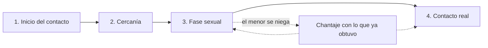
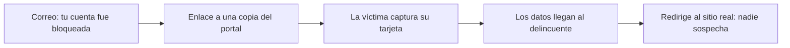
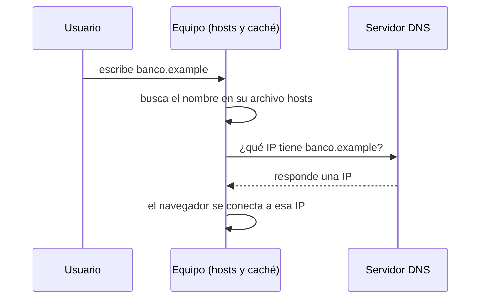

<!-- _class: lead -->

# U3 - Grooming, phishing y pharming

### Riesgos actuales en ciberseguridad

**Rogelio Arriaga - Raptor Dev Services**

<!--
Duración sugerida: 2 horas. Hilo conductor: tres ataques que no rompen ninguna máquina, rompen la confianza.
El grooming abusa de la confianza de un menor en alguien que cree su igual; el phishing, de la confianza en una
marca o una autoridad; el pharming, de la confianza en la propia barra de direcciones. Cada capa (la persona,
el mensaje, la red) pide su propia defensa.
Preparar: un mensaje de phishing ficticio en pantalla para la Parte 2 y, para la lámina de ayuda de la Parte 1,
el teléfono y el sitio de denuncia de la policía cibernética de su estado.
Tema delicado: el grooming se trata con rigor y sin detalles gráficos. Avise al inicio que, si a alguien le toca
de cerca, puede salir un momento o buscarle a usted al final.
-->

---

## Por qué importa

Ninguno de los tres ataques de hoy necesita vulnerar un servidor: le basta con que alguien confíe en quien no debe.

| Ataque | En quién confía la víctima | Qué pierde |
|---|---|---|
| Grooming | En un "amigo" que dice tener su edad | Su seguridad y su integridad sexual |
| Phishing | En su banco, una tienda, su jefe | Contraseñas, tarjetas, acceso a la red de su trabajo |
| Pharming | En la dirección que ella misma escribió | Lo mismo que en el phishing, sin haber dado un solo clic dudoso |

<!--
5 minutos. Pregunta de arranque: ¿quién recibió esta semana un mensaje que le pedía actuar con prisa? Casi
todo el salón levanta la mano. De eso trata la unidad.
-->

---

## Objetivo de la unidad

Reconocer cómo operan tres ataques basados en el engaño y saber qué hacer antes, durante y después.

Al terminar podrás:

- Explicar la forma de operar de quien practica el grooming y el orden de sus etapas.
- Analizar un ataque de phishing: canal, pretexto, variante y daño.
- Identificar el pharming y explicar por qué teclear bien la dirección no basta.

---

## Agenda

| Bloque | Qué vemos | Min |
|---|---|---|
| Apertura | Por qué importa y objetivo | 10 |
| Parte 1 | Grooming: el adulto que se disfraza de amigo | 40 |
| Parte 2 | Phishing: el anzuelo de confianza | 35 |
| Parte 3 | Pharming: la dirección correcta, el sitio equivocado | 25 |
| Cierre | Conclusiones, práctica y tarea | 10 |

---

<!-- _class: lead -->

# Parte 1
## Grooming

<!--
40 minutos. Repita el aviso: tema sensible, sin detalles gráficos. La meta es reconocer el patrón a tiempo y
saber a quién acudir, no conocer los casos con morbo.
-->

---

## Qué es el grooming

Un **tipo de acoso**: un adulto contacta a una niña, niño o adolescente por medios digitales, se gana su confianza y la aprovecha para abusar de él o explotarlo sexualmente.

- Suele empezar en redes sociales, chats o videojuegos, con un perfil falso que aparenta menos edad.
- Busca datos personales, imágenes íntimas y, con frecuencia, un encuentro en persona.
- Es la antesala de delitos todavía más graves: abuso, secuestro, explotación y trata.

Fuente: UNODC, *Mini guía de seguridad informática* (2015).

<!--
Subraye la finalidad: es sexual. No es fraude ni robo de datos, aunque use las mismas técnicas de ingeniería
social que un atacante usa contra una empresa.
-->

---

## No es cyberbullying

| | Cyberbullying | Grooming |
|---|---|---|
| Quién agrede | Un par, de edad parecida | Un adulto |
| Contra quién | Otro menor | Un menor |
| Para qué | Humillar, excluir, hostigar | Abusar o explotar sexualmente |
| Lo sexual | No aparece; si aparece, el caso es otro | Es la meta |

En los dos casos la conducta ocurre en línea y el daño es real, fuera de la pantalla.

<!--
Pregunta al grupo: ¿por qué importa no confundirlos? Porque la diferencia de edad y la finalidad sexual
convierten al grooming en un delito propio, que se denuncia (lo vemos en el marco legal).
-->

---

## Por qué escala: anonimato y accesibilidad

- **Anonimato:** cualquiera puede presentarse como otra persona y nadie ve quién teclea.
- **Accesibilidad:** el agresor entra a los mismos juegos, foros y redes que los niños, y busca víctimas por ubicación o por intereses.
- Juntos permiten algo imposible fuera de línea: acercarse **a muchos menores a la vez**.
- Cada dato suelto (la escuela, el nombre de la mamá, el parque de la colonia) se vuelve una pieza más del rompecabezas.

Más de 175,000 niñas y niños se conectan a internet por primera vez cada día: uno cada medio segundo.
Fuente: UNICEF, comunicado del 6 de febrero de 2018.

---

## Las cuatro etapas, en orden

| Etapa | Qué pasa |
|---|---|
| 1. Inicio del contacto | Una amistad armada con los gustos del menor; el agresor junta datos de él, su familia y su entorno |
| 2. Cercanía o relación estrecha | La plática se vuelve confesión: hábitos, secretos, detalles íntimos |
| 3. Fase sexual | Pide fotos, videos u otro material de carácter sexual |
| 4. Contacto real | Busca un encuentro físico, con riesgo de secuestro y violación |

La confianza siempre llega antes que lo sexual. Hay autores que lo cuentan en cinco pasos; el orden no cambia.

<!--
Pida que lo repitan sin ver la lámina. El error típico es poner el encuentro antes de la fase sexual.
-->

---

## Cuando el menor quiere salir

- El chantaje con las propias imágenes del menor (sextorsión) es lo que le cierra la salida.
- Por eso el mensaje para niñas, niños y adolescentes es claro: aunque te amenacen, cuéntalo. La culpa es del adulto, no tuya.

---

## Las tácticas del agresor

- Escucha problemas e inseguridades, se muestra comprensivo y le da la razón en todo.
- Halaga de más y manda regalos: invierte tiempo, dinero y energía en preparar a su víctima.
- Introduce lo sexual poco a poco, para bajar las defensas.
- Construye una relación romántica y controladora de la que el menor depende.
- Lo aparta de su familia y amigos.
- Amenaza con las imágenes que ya consiguió para asegurar el silencio.

<!--
5 minutos. Caso para contar, sin detalles: fundaciones de prevención difunden la historia de una adolescente
mexicana que conoció a alguien por internet; él insistió hasta que aceptó verlo y terminó secuestrada y
explotada hasta que la rescataron. Hoy da su testimonio para prevenir a otras. Pregunte: ¿en qué etapa
pudo haberse cortado?
-->

---

## Lo que dicen las cifras

De 264 reportes de grooming a la línea canadiense Cybertip.ca (2007 a 2011), en los 166 que incluían la conversación:

| Conducta del agresor | % |
|---|---|
| Pidió imágenes sexuales | 93.4 |
| Mandó imágenes suyas o pidió usar la cámara | 35.5 |
| Amenazó al menor | 24.1 |

El menor llegó a enviar imágenes en el 18.7 % de los reportes.
Fuente: Quayle y Newman (2016), *Crime Science*, 5.

<!--
Precisión: hay materiales que dicen que el 30 % de los menores mandó imágenes; el estudio original reporta
18.7 %. Otro dato útil: Mitchell, Finkelhor, Jones y Wolak (2010), con arrestos de 2006 en Estados Unidos,
encontraron que, en los casos donde el agresor usó la red social de la víctima, en el 82 % la usó para
conocer sus gustos y en el 65 % para saber de su casa o su escuela. Es un subgrupo, no el total de casos.
-->

---

## Señales de alerta en un menor

- Usa más el teléfono, y a escondidas; se vuelve reservado sobre lo que hace en línea.
- Trae regalos, dinero o un teléfono nuevo que no sabe explicar.
- Aparece un "novio" o "amigo" mucho mayor, o muchos amigos nuevos de golpe.
- Cambia de carácter: agresivo y conflictivo, o callado y retraído.
- Falta a clases o a casa; lo recogen o lo dejan adultos desconocidos.

El proceso puede tardar días o meses, y las primeras pláticas suelen parecer inofensivas.

---

## Prevenir: el menor, la familia y el vínculo

| Para niñas, niños y adolescentes | Para la familia y la escuela |
|---|---|
| No compartir imágenes ni datos comprometedores | Hablar abiertamente de los riesgos en línea |
| No prender la cámara con desconocidos | Navegar con ellos y pedirles que enseñen sus sitios favoritos |
| Perfiles privados en redes y juegos | Pantallas en espacios comunes y horarios acordados |
| Contarle a un adulto de confianza | Control parental acorde a la edad |

La defensa más fuerte no es técnica: un menor que se siente escuchado y sabe que no lo van a castigar por contar lo que le pasa.

Fuentes: UNODC (2015); FBI, programa *Safe Online Surfing*.

---

## Si ya está pasando: a quién pedir ayuda

1. **Si eres menor:** cuéntaselo a tu mamá, tu papá, un maestro o cualquier adulto de confianza.
2. **Si eres el adulto:** créele y no lo culpes; suele sentirse responsable y no lo es.
3. **No borrar nada:** guardar conversaciones, perfiles y capturas de pantalla.
4. **No responder ni negociar** con el agresor.
5. **Denunciar** ante la policía cibernética (de la Guardia Nacional o de la entidad) y la fiscalía.
6. **Buscar atención profesional:** la recuperación necesita acompañamiento psicológico.

<!--
Deje la lámina proyectada un minuto. Anote aquí, antes de la clase, el teléfono y el sitio de denuncia de la
policía cibernética de su estado. Si alguien se acerca al final con un caso, escuche, no investigue usted y
canalice.
-->

---

## El marco legal

- **Código Penal Federal, art. 199 Septies** (desde junio de 2018): de 4 a 8 años de prisión a quien, por medios electrónicos, contacte a un menor de 18 años y le pida imágenes sexuales o un encuentro sexual.
- Si el caso llega a abuso, estupro, pornografía de menores (art. 202, de 7 a 12 años) o trata, se persigue también por esos delitos.
- Varias entidades tienen figuras propias, como el art. 178 Bis del código penal de San Luis Potosí.
- **Internacional:** la Convención de la ONU contra la Ciberdelincuencia (adoptada en diciembre de 2024, abierta a firma en Hanói en octubre de 2025) obliga a tipificar el grooming.

<!--
Precisión: circulan materiales que citan un "artículo 259 Quáter" del Código Penal Federal sobre ciberacoso
a menores. Venía en una minuta de 2016 que nunca se publicó como ley; no existe en el código vigente. El tipo
federal es el 199 Septies. Dato histórico: el Reino Unido fue pionero con la Sexual Offences Act 2003, sección 15.
-->

---

<!-- _class: lead -->

# Parte 2
## Phishing

<!--
35 minutos. Abra con el ejercicio: proyecte el mensaje ficticio y pida que, en un minuto, encuentren todo lo
que lo delata. Anote en el pizarrón lo que digan; al final de la parte lo revisan contra lo aprendido.
-->

---

## Un engaño en cinco pasos

Lo que funcionó no fue una técnica sofisticada: fueron **la prisa, la duda y una apariencia convincente**.

---

## Qué es el phishing

Ingeniería social en el entorno digital: el atacante **se hace pasar por alguien de confianza** (banco, tienda, paquetería, gobierno, un compañero) para que la víctima:

- abra un enlace o un archivo adjunto,
- llegue a un sitio que imita al legítimo,
- y ahí entregue credenciales o datos de tarjeta, o instale malware sin saberlo.

El nombre juega con *fishing* (pescar). La *ph* es un guiño a los *phreakers*, que engañaban a las redes telefónicas en los años setenta y ochenta.

---

## Los pretextos de siempre

| Lo que dice el mensaje | La emoción que busca |
|---|---|
| "Detectamos un acceso extraño a tu cuenta" | Miedo |
| "Tu servicio se cancela hoy" | Urgencia |
| "Ganaste un premio" o "tienes un reembolso" | Codicia |
| "Actualiza tus datos por la nueva política de seguridad" | Obediencia a la autoridad |
| "Vacante con sueldo alto, sin experiencia" | Necesidad |
| "Para protegerte del phishing, entra aquí" | Confianza en la propia seguridad |

<!--
Pida que cada quien busque en su teléfono el último mensaje sospechoso que recibió y lo ubique en la tabla.
-->

---

## Por qué las empresas son el blanco principal

- Concentran lo valioso: datos de clientes, secretos comerciales y acceso a sistemas financieros.
- Un solo empleado engañado basta para saltar el perímetro de seguridad.
- Suele ser el **primer paso de un ataque mayor** (una APT): puerta trasera, movimiento por la red interna y extracción de datos durante meses.
- El costo sigue después del robo: reputación, clientes que se van, participación de mercado perdida.

<!--
Pregunta: en una empresa, ¿quién es mejor blanco, la directora general o la persona de cuentas por pagar?
Las dos: el whaling va por la primera; el fraude de correo empresarial (BEC), por quien mueve los pagos.
-->

---

## La economía del phishing

| Hecho | Consecuencia |
|---|---|
| Un sitio falso dura pocas horas en línea: 29 en promedio (APWG, 2014); una campaña típica, unas 21 (Oest y otros, 2020) | Hay que registrar sitios nuevos sin parar |
| Sacar dinero de una cuenta ajena sin dejar rastro es difícil | Se **venden** las tarjetas y credenciales a quien ya tiene un esquema probado para cobrarlas |
| Una cuenta de correo legítima pasa muchos filtros | Las credenciales de correo se venden para repartir malware o armar botnets |

Fuentes: APWG, *Global Phishing Survey 2H2014*; Oest y otros, USENIX Security 2020.

<!--
Precisión: hay materiales que hablan de unos cinco días de vida por sitio; las mediciones publicadas son
mucho menores (la mediana del APWG en 2014 fue de 10 horas).
-->

---

## Variantes según el canal (1 de 2)

| Variante | Canal | Rasgo |
|---|---|---|
| Phishing masivo | Correo | Imita recibos, avisos de pago o tarjetas de regalo |
| Spear phishing | Correo o mensaje | Dirigido a una persona, con datos reales de ella |
| Whaling | Correo | Spear phishing contra altos directivos |
| Compromiso de correo empresarial (BEC) | Correo | Suplanta a un directivo o proveedor para desviar pagos |
| Smishing | SMS y apps de mensajería | Mensaje breve con un enlace |

---

## Variantes según el canal (2 de 2)

| Variante | Canal | Rasgo |
|---|---|---|
| Vishing | Llamada o VoIP | Suena creíble con datos de redes; hoy puede clonar una voz con IA |
| En buscadores | Resultados y anuncios pagados | Una copia idéntica aparece junto a la página real |
| Quishing | Código QR | El enlace va dentro de una imagen y esquiva los filtros de texto |
| Por URL o con malware | Enlaces, descargas, adjuntos | Lleva a un sitio falso o toma el control del equipo |

<!--
Ejemplo de buscador: alguien busca el portal de su banco, da clic en el primer resultado (un anuncio) y llega
a la copia. Guardar el sitio oficial en marcadores ayuda contra esto; contra el pharming, como veremos, ni eso.
-->

---

## El tamaño del problema

- **3.8 millones** de ataques de phishing en 2025, y **1,069,681** solo en el segundo trimestre de 2026, 10 % más que en el primero.
  Fuente: APWG, *Phishing Activity Trends Report*, 2.º trimestre de 2026.
- **1,008,597** denuncias de ciberdelito en Estados Unidos durante 2025, con pérdidas por **20,877 millones de dólares**, 26 % más que en 2024. Phishing y suplantación fue la categoría con más denuncias: **191,561**.
  Fuente: FBI, *2025 IC3 Annual Report* (abril de 2026).

<!--
Haga notar que las pérdidas directas del phishing se ven chicas en el informe del IC3: el daño grande se
registra en los delitos que el phishing abre, como el fraude de inversión o el BEC.
-->

---

## Pistas que ya no sirven

| Pista de antes | Por qué ya no basta |
|---|---|
| Faltas de ortografía | La IA redacta mensajes impecables y personalizados |
| El candado HTTPS | Solo dice que la conexión va cifrada; los atacantes también sacan certificados gratuitos |
| "Me escribe alguien que conozco" | Las cuentas legítimas robadas son justo lo que más se vende |
| "Sabe cosas de mí" | Las saca de tus redes y de filtraciones anteriores |

Lo que sí funciona: revisar el dominio exacto y confirmar por otro canal.

---

## Cómo defenderse

| Persona | Organización |
|---|---|
| No dar datos personales por correo, llamada o mensaje: el banco no los pide así | Publicar SPF, DKIM y DMARC en sus dominios |
| Teclear la dirección o usar la app oficial, nunca el enlace del mensaje | Simulacros periódicos de phishing |
| Mirar la dirección real del remitente, no solo su nombre | Un botón visible para reportar correos sospechosos |
| Llaves de seguridad o *passkeys*: no se pueden capturar en un sitio falso | Confirmar por otro canal todo pago o cambio de cuenta |

Fuentes: UNAM-CERT; guía de la antigua Policía Federal; CISA; FIDO Alliance.

---

## Si caíste

1. Si diste datos financieros, llama de inmediato a tu banco para bloquear tarjetas y cuentas.
2. Cambia la contraseña robada y cualquier otra donde la repetías; activa el segundo factor.
3. Si expusiste datos del trabajo, avisa a tu jefe y al área de seguridad.
4. Denuncia: **Condusef** para asuntos con instituciones financieras; **fiscalía o policía cibernética** para el delito.

Mal uso de tus datos personales por una empresa: hoy la autoridad es la **Secretaría Anticorrupción y Buen Gobierno**, porque el INAI se eliminó con la reforma de diciembre de 2024.

<!--
Precisión: la guía de phishing que más se cita en México es de la Policía Federal, que la ley de 2019 extinguió;
sus funciones cibernéticas pasaron a la Guardia Nacional en 2020. El contenido de la guía sigue vigente.
-->

---

<!-- _class: lead -->

# Parte 3
## Pharming

<!--
25 minutos. Arranque con una provocación: "el consejo de hace rato, escribir la dirección a mano, hoy no les
va a servir de nada".
-->

---

## Qué es el pharming

**Redirigir** el tráfico que iba a un sitio legítimo hacia uno falso, sin que el usuario se dé cuenta.

| | Phishing | Pharming |
|---|---|---|
| Qué pide a la víctima | Que se crea el engaño | Nada: que navegue como siempre |
| Vector | Correo, SMS, llamada, enlace | Archivo hosts, router, servidor DNS, malware |
| Alcance | Quien recibe el mensaje | Todos los que usan el equipo, la red o el DNS alterado |
| ¿Sirve teclear la dirección? | Sí | No |

El nombre mezcla *phishing* y *farming* (cultivar): en vez de pescar de uno en uno, siembra la trampa y cosecha.

---

## Cómo funciona la navegación

---

## Por qué importa el DNS

- La computadora no entiende nombres: necesita la dirección IP del servidor.
- El **DNS** es el directorio que traduce uno en otra; antes de preguntarle, el equipo revisa su archivo **hosts**.
- Si alguien altera cualquiera de esas respuestas, el navegador va, con toda normalidad, a la IP equivocada.

---

## Dónde se altera la respuesta

| Tipo | Qué se modifica | A quién afecta |
|---|---|---|
| Pharming local | Un troyano reescribe el archivo hosts | Solo a ese equipo |
| Drive-by pharming | Cambia el DNS del router que conserva su contraseña de fábrica | A todos los dispositivos de esa red |
| Envenenamiento de caché DNS | Un servidor DNS guarda una respuesta falsa | A todos los que consultan ese servidor |
| Intermediario (MITM) | En una Wi-Fi abierta, alguien responde antes que el DNS legítimo | A quienes comparten esa red |

Con un servidor envenenado, **un equipo totalmente limpio también cae**.

---

## Dos casos de 2008

- **Enero, en México:** el primer drive-by pharming documentado fuera del laboratorio. Un correo disfrazado de tarjeta de felicitación cambiaba el DNS de routers 2Wire que conservaban la contraseña de fábrica; quien entraba desde esa red al sitio de un banco mexicano llegaba a una copia.
  Fuente: Symantec, citado por *Network World* (22 de enero de 2008).
- **Julio:** Dan Kaminsky mostró cómo envenenar en segundos la caché de casi cualquier servidor DNS (CVE-2008-1447). Obligó a una actualización coordinada en todo el mundo y aceleró la adopción de DNSSEC.
  Fuente: CERT/CC, nota VU#800113.

<!--
El ataque de enero se había descrito en teoría apenas un año antes (Stamm, Ramzan y Jakobsson, 2007). De la
teoría a la calle en meses, y en un país donde ese modelo de router era muy común.
-->

---

## Señales de que pudiste caer

- Cargos que no reconoces en tu tarjeta de crédito o débito.
- Te piden confirmar un cambio de contraseña que no pediste.
- Publicaciones o mensajes en tus cuentas que tú no enviaste.
- Aplicaciones que aparecen en tus dispositivos sin que las instalaras.
- Un sitio conocido se ve un poco distinto, pide datos que nunca pedía o el navegador advierte del certificado.

---

## Cómo protegerse

- **Antimalware actualizado**, que impida modificar el archivo hosts.
- **Sistema y aplicaciones al día**; no ejecutar archivos de origen desconocido.
- **El router:** cambiar la contraseña de fábrica, actualizar el firmware y apagar la administración remota.
- **Certificado:** una advertencia en el sitio del banco es para detenerse, nunca para dar clic en "continuar".
- **Redes abiertas:** nada sensible en una Wi-Fi pública; mejor los datos del teléfono o una VPN confiable.
- **DNS de buena reputación**, con DNS sobre HTTPS activado en el navegador.

Organizaciones: firmar sus zonas con **DNSSEC** y publicar **HSTS** en sus sitios.

<!--
Matiz para el grupo técnico: DNSSEC frena el envenenamiento de caché, pero si el router de la víctima ya
apunta a un resolvedor del atacante y el equipo no valida firmas, no la protege. Ningún eslabón basta solo.
-->

---

## Conclusiones de la unidad

- **Grooming:** los menores son los más expuestos por su poca experiencia. El agresor se gana su confianza para explotarlos y el daño, psicológico y físico, ocurre fuera de la pantalla. Como nunca hay certeza de quién escribe, educar en el trato con desconocidos es la primera barrera.
- **Phishing:** su blanco preferido son las empresas, y su mejor antídoto es conocerlo bien. Sigue mutando: del SMS a las apps de mensajería, de la llamada a la VoIP y la voz sintética, de lo artesanal a lo automatizado. Por eso la educación tiene que ser continua.
- **Pharming:** su complejidad técnica juega a favor del atacante, porque la redirección automática engaña a quien no sabe de seguridad. Evitar autoejecutables desconocidos, actualizar, usar antimalware y no conectarse a redes públicas sin protección.

---

## Al terminar puedes

- Explicar qué es el grooming, en qué se distingue del cyberbullying y sus cuatro etapas en orden.
- Reconocer señales de alerta en un menor y saber a quién acudir.
- Desmontar un mensaje de phishing: canal, pretexto, variante y lo que busca.
- Explicar por qué las empresas son el blanco principal y por qué los phishers venden lo robado.
- Explicar cómo el DNS y el archivo hosts hacen posible el pharming, y en qué eslabón actúa cada variante.
- Proponer defensas para una persona, una familia y una organización.

---

## Práctica, tarea y lecturas

- **Práctica:** ocho consejos de ciberprevención que cubran los tres ataques, cada uno con lo que previene, y tres réplicas argumentadas a compañeros.
- **Tarea:** nube con 40 palabras de la unidad, con el tamaño según su importancia y un anexo que defina cada una en una línea.
- **Quiz:** 10 preguntas sobre los tres temas.

Lecturas de la unidad:

- [07 - Grooming: el adulto que se disfraza de amigo](../../../12-seguridad/02-riesgos/07-grooming.md)
- [08 - Phishing: pescar datos con un anzuelo de confianza](../../../12-seguridad/02-riesgos/08-phishing.md)
- [09 - Pharming: cuando la dirección correcta te lleva al sitio equivocado](../../../12-seguridad/02-riesgos/09-pharming.md)

---

## Siguiente unidad: carding, juice jacking y cryptojacking

> Hoy el atacante necesitó que confiaras. En la U4, a veces ni eso.

- **Carding:** el uso de tarjetas robadas o generadas para comprar a nombre de otro.
- **Juice jacking:** un puerto de carga público alterado para sacar datos o meter malware.
- **Cryptojacking:** tu equipo, tu electricidad y tu nube minando criptomonedas para alguien más.

Piensen si alguna vez les apareció un cargo que no reconocían: con esa pregunta abrimos.

<!--
Puente: el phishing y el pharming de hoy son dos de las vías por las que se roban los datos de tarjeta que la
U4 convierte en carding.
-->
