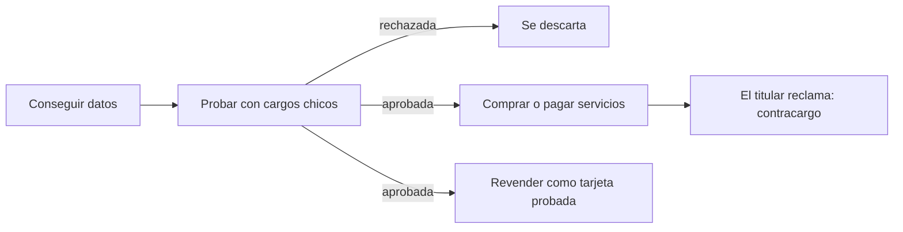
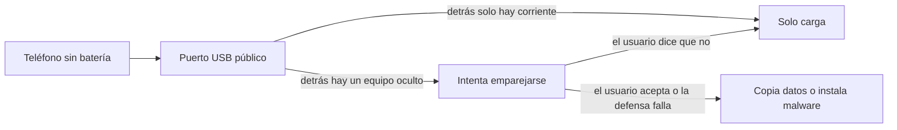
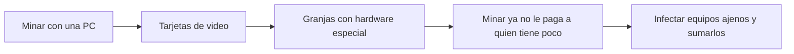

<!-- _class: lead -->

# U4 - Carding, juice jacking y cryptojacking

### Riesgos actuales en ciberseguridad

**Rogelio Arriaga - Raptor Dev Services**

<!--
Unidad de 2 horas. Hilo conductor: un solo día de una persona que viaja por trabajo. Carga el teléfono en
un quiosco del aeropuerto, paga un hotel en línea con su tarjeta y por la noche su laptop va lenta. Cada
parte de la clase explica uno de esos tres momentos; al cierre se vuelven a juntar.
Idea que se repite: los tres ataques cobran con algo que casi nadie vigila (el estado de cuenta, el puerto
USB, el uso del procesador).
Lecturas: notas 10, 11 y 12 de 12-seguridad/02-riesgos.
-->

---

## Por qué importa

| Ataque | Qué se lleva | Lo que casi nadie vigila |
|---|---|---|
| Carding | Los datos de tu tarjeta | El estado de cuenta |
| Juice jacking | Los datos y el control de tu teléfono | El puerto USB donde lo cargas |
| Cryptojacking | Tu procesador y tu electricidad | El monitor de recursos del equipo |

El sector financiero es de los blancos favoritos porque lo que se roba ahí se convierte en dinero muy rápido. Y no siempre se roba dinero: a veces se roba cómputo.

---

## Objetivo y resultados de aprendizaje

**Objetivo:** entender cómo operan tres fraudes que convierten objetos cotidianos (una tarjeta, un cargador, una computadora) en ganancia para otro, y elegir defensas proporcionales al riesgo.

Al terminar la unidad podrás:

- Explicar cómo consigue, prueba y aprovecha el carder los datos de una tarjeta.
- Analizar el juice jacking y las protecciones que el usuario tiene a la mano.
- Identificar el cryptojacking, sus vías de entrada y lo que gana el atacante con él.

<!--
Son los tres resultados de aprendizaje de la unidad. Al final, regresar a esta lámina y preguntar cuál
quedó más claro y cuál menos.
-->

---

## Agenda

| Bloque | Qué vemos | Min |
|---|---|---|
| 0 | Apertura y caso de mesa | 10 |
| 1 | Carding | 40 |
| 2 | Juice jacking | 25 |
| 3 | Cryptojacking | 30 |
| 4 | Cierre, práctica, tarea y quiz | 15 |

---

## El caso que nos acompaña

Una persona viaja por trabajo. En un mismo día:

1. Con el teléfono casi sin batería, lo conecta al cable de un quiosco de carga gratuita en el aeropuerto.
2. Conectada a la Wi-Fi del aeropuerto, paga en línea un hotel con su tarjeta de crédito.
3. Esa noche, su laptop tarda en abrir cualquier cosa y el ventilador no se calla.

**¿Cuál de los tres momentos te preocupa más?**

<!--
Votación a mano alzada, 3 minutos. Anotar el resultado en el pizarrón: se retoma en la lámina
"Las tres, lado a lado". Lo usual es que casi nadie vote por la laptop; el cryptojacking es el que
menos se nota y por eso conviene que llegue al final.
-->

---

<!-- _class: lead -->

# Parte 1
## Carding

---

## Carding: dos maneras de verlo

| Mirada | Qué es |
|---|---|
| Como delito | Usar sin permiso una tarjeta de crédito o débito ajena para comprar o pagar servicios. Quien lo hace es un **carder** |
| Como técnica | Probar en masa listas de tarjetas, robadas o generadas, contra el cobro de una tienda en línea hasta dar con las que pasan |

- Es silencioso: no llega un correo raro ni aparece una pantalla de rescate, solo cargos que se descubren después.
- Es delito en México y en la mayoría de los países.

---

## ¿De dónde saca el carder las tarjetas?

| Canal | Cómo se ve |
|---|---|
| Phishing | Un sitio o mensaje falso que pide "confirmar" la tarjeta |
| Malware y RAT | Un troyano que registra lo que se teclea o lo que guarda el navegador |
| Estafas | Tiendas fantasma, ofertas imposibles, llamadas de un falso banco |
| Skimming | Un lector escondido en un cajero o una terminal, a veces con cámara para el NIP |
| Comercios comprometidos | Código inyectado en la página de pago de una tienda real, o su base de clientes filtrada |
| Mercados ilegales | Listas a la venta en foros de la darknet o en sitios para pegar texto |
| Generación | Números armados a partir del BIN de un banco: el trabajo de los "bineros" |

<!--
Phishing, RAT y estafas son el trío que más se pregunta en el quiz. Pregunta al grupo: ¿cuáles de estos
canales no dependen de que la víctima se equivoque? (skimming, comercio comprometido, generación).
Que noten que la víctima puede hacerlo todo bien y aun así perder sus datos.
-->

---

## Anatomía de una tarjeta

| Elemento | Qué es |
|---|---|
| Número | Casi siempre de 16 dígitos |
| BIN o IIN | Los **primeros** dígitos del número, seis u ocho, no los 16: identifican la red y el banco emisor |
| Dígito verificador | El último del número; sale de una fórmula pública |
| Vencimiento | Mes y año |
| CVV o CVV2 | Código de verificación, por lo general de tres dígitos |

Como la fórmula es pública, se pueden fabricar números con formato válido. Lo que el carder no sabe es si detrás hay una cuenta viva: por eso necesita probarlos.

Fuente: ISO/IEC 7812-1:2017; PCI Security Standards Council, FAQ 1091.

<!--
Hay glosarios en circulación que dicen que el BIN son "los 16 dígitos". Es un error: tradicionalmente
eran seis, la revisión de 2017 de la norma ISO/IEC 7812-1 lo llevó a ocho, las redes lo adoptaron hacia
2022 y desde junio de ese año PCI acepta mostrar los primeros ocho dígitos de una tarjeta enmascarada.
-->

---

## El carder quiere parecerse al titular

Su meta es que la compra luzca como si la hiciera el dueño: misma zona, navegador parecido, hábitos normales. El antifraude busca justo las incoherencias.

| Lo que el carder intenta | Lo que revisa el antifraude |
|---|---|
| Ocultar su IP real detrás de un intermediario (proxy, VPN) | Reputación de la IP y si cuadra con el domicilio del titular |
| Parecer un equipo "nuevo" en cada intento | Muchos intentos desde dispositivos sin historia |
| Borrar su rastro o usar sistemas desechables | Navegadores sin historial e indicios de máquina virtual |
| Operar desde un equipo remoto en la zona del titular | Desfases de zona horaria, idioma y ubicación |

<!--
Enfoque defensivo: estas herramientas no se enseñan a usar. Se ven para entender qué señales arma un
sistema antifraude. Pregunta para quien desarrolla: ¿cuáles de estas señales podrían registrar hoy en
su propia tienda en línea? (10 min para esta lámina y la siguiente).
-->

---

## El ciclo del fraude

- Las pruebas suelen correr de noche y por montos bajos, para no llamar la atención.
- Una tarjeta ya probada, junto con los datos de su titular, vale más en el mercado negro.
- El comercio suele cargar con el costo del contracargo; el titular, con el trámite y el golpe a su historial.

---

## Caso México: 2018, el año de los ataques a la banca

| Fecha | Qué pasó |
|---|---|
| 9 de enero | Intento de desviar unos 110 millones de dólares de Bancomext por su conexión a SWIFT; el banco lo frenó |
| 17 de abril a 8 de mayo | Cinco participantes del SPEI vulnerados; el Banco de México estimó unos 300 millones de pesos sustraídos |
| Agosto | El Banco de México publica su reporte forense en versión pública |
| Octubre | Otro ataque: unos 60 millones de pesos en 160 operaciones |

Fuente: Banco de México (2018), reportes sobre el SPEI; prensa financiera de la época.

<!--
Aclarar que técnicamente no es carding: es fraude contra la infraestructura de transferencias. Se estudia
aquí porque es el gran caso del sector financiero mexicano. Empresas de seguridad atribuyeron lo de
Bancomext al grupo APT38. Ojo con material viejo que habla de "110 millones de pesos": fueron dólares y
fue por SWIFT, no por el SPEI. La prensa llegó a hablar de 400 millones de pesos en el SPEI; la cifra
del Banco de México es de unos 300.
-->

---

## SPEI: cómo entraron y qué enseña

- Entraron por los sistemas propios de cada banco para conectarse al SPEI: servidores internos expuestos a internet, empleados engañados con phishing, redes sin segmentar, cuentas mal validadas.
- Generaban órdenes desde cuentas inexistentes hacia cuentas reales que controlaban, en muchas operaciones chicas, y sacaban el dinero en efectivo.
- En 2019 la prensa informó que la FGR apuntaba a un grupo llamado "Bandidos Revolution Team".

**La lección:** el eslabón débil no fue el SPEI, sino la conexión de cada participante. Segmentar redes, validar cada operación y vigilar patrones raros.

<!--
Pregunta: ¿qué tiene en común con el carding? Las dos cosas viven de operaciones pequeñas y rápidas que
nadie revisa una por una.
-->

---

## El marco legal en México

| Instrumento | Qué cubre |
|---|---|
| Código Penal Federal, arts. 211 bis 1 a 211 bis 7 | Acceso ilícito a sistemas y equipos de informática, con penas mayores si se trata del sistema financiero |
| Código Penal Federal | El fraude |
| Ley de Instituciones de Crédito | Usar, producir o comerciar tarjetas falsas o alteradas, o datos de tarjetas obtenidos sin permiso |
| Condusef | Recibe las reclamaciones por cargos no reconocidos y publica guías de prevención |
| PCI DSS 4.0.1 (norma de la industria) | Obliga a proteger los datos de tarjeta a quien los guarda, procesa o transmite |

Fuente: PCI Security Standards Council (2024).

<!--
Desde el 31 de marzo de 2025 son obligatorios los requisitos de PCI DSS que tenían fecha futura, entre
ellos controlar los scripts de las páginas de pago para frenar el robo de tarjetas en el navegador.
-->

---

## Prevención: lo que hace el titular

- Nunca dar los datos de la tarjeta por teléfono, correo o mensaje: el banco no los pide así.
- Tener la app del banco con aviso de cada cargo y segundo factor.
- Comprar en línea con tarjeta digital, de preferencia con código de seguridad dinámico.
- Fijar límites de compra y apagar la tarjeta desde la app cuando no se usa.
- Revisar el estado de cuenta seguido, sobre todo si compras en línea.
- Mirar el cajero o la terminal antes de usarla: piezas flojas, cámaras, teclados raros.
- Pagar solo desde redes de confianza, nunca en una Wi-Fi pública.

---

## Prevención: el comercio, y si ya te pasó

| Si construyes la tienda | Si eres la víctima |
|---|---|
| No guardes el CVV; deja la captura a un proveedor certificado (tokenización) | Bloquea la tarjeta en la app o por teléfono |
| Pide 3-D Secure en operaciones de riesgo | Presenta la aclaración en tu banco |
| Limita los intentos de pago por cliente, IP y tarjeta | Denuncia ante la autoridad |
| Vigila y fija los scripts de la página de pago | Si el banco no resuelve, acude a la Condusef |

<!--
Para quien programa: limitar los intentos es lo que vuelve caro el ensayo y error del que vive el carder.
Regresar al caso: el pago desde la Wi-Fi del aeropuerto. ¿Qué medida de la lámina anterior habría
ayudado más? Cerrar el bloque a los 40 minutos.
-->

---

<!-- _class: lead -->

# Parte 2
## Juice jacking

---

## Juice jacking: el cargador con sorpresa

- Ataque que usa un puerto o un cable USB de carga **alterado** para copiar datos del dispositivo, instalarle malware, o las dos cosas.
- Alcanza a teléfonos, tabletas y laptops: todo lo que se carga por USB.
- El nombre se difundió en **2011** con un artículo de Brian Krebs sobre un quiosco de demostración del grupo Wall of Sheep en DEF CON 19, que avisaba en pantalla a quien se conectaba que no debió confiar en él.

Fuente: Krebs (2011), *Krebs on Security*.

---

## Un mismo cable para energía y datos

- El teléfono usa el mismo conector para cargarse y para pasar archivos, sin importar marca ni sistema.
- Si hay emparejamiento: fotos, contactos, notas y documentos quedan expuestos, y el malware puede abrir espionaje y acceso remoto hasta que se formatee el equipo.
- Variantes: cables con un implante que por fuera se ven normales, y el *video jacking*, que copia lo que muestra la pantalla.

---

## Análisis de riesgo

| Elemento | En el juice jacking |
|---|---|
| Vector | El puerto USB del dispositivo |
| Exposición | Sube si el usuario no conoce el ataque y su batería dura poco: quien viaja mucho está más expuesto |
| Impacto personal | Robo de identidad y pérdidas económicas |
| Impacto en la empresa | Fuga de datos corporativos desde el teléfono de un directivo, y daño a la reputación |

**Proporción:** hay pocos casos documentados y no todo quiosco es malicioso. Pero la defensa cuesta casi nada, así que conviene.

<!--
Aquí también hay ingeniería social: el atacante cuenta con la urgencia de cargar. Pregunta: ¿cuándo fue
la última vez que conectaron el teléfono a un puerto que no era suyo?
-->

---

## 2023 a 2025: avisos, defensas y un ataque nuevo

| Cuándo | Qué pasó |
|---|---|
| Abril de 2023 | La oficina del FBI en Denver y la FCC recomiendan evitar las estaciones de carga gratuitas |
| Desde hace años | iOS y Android piden permiso antes de intercambiar datos por USB |
| Noviembre de 2024 y marzo de 2025 | Google (Android) y Apple (iOS 18.4) corrigen una falla nueva llamada *ChoiceJacking* |
| 2025 | Investigadores de la Universidad Tecnológica de Graz la presentan en USENIX Security: un cargador malicioso que aprueba por su cuenta ese aviso |

**Moraleja:** el aviso del teléfono ayuda, pero el sistema actualizado es parte de la defensa.

Fuente: FCC (2023); Draschbacher et al. (2025); Google (2024); Apple (2025).

---

## Cable de solo carga contra cable de datos

| | Solo carga | Datos y carga |
|---|---|---|
| Conductores (USB clásico) | Energía y tierra | Energía, tierra y dos de datos |
| ¿Puede pasar información? | No: no hay por dónde | Sí |
| ¿Se distinguen por fuera? | No | No |

- El **bloqueador de datos USB** ("condón USB") corta las líneas de datos y vuelve cualquier cable uno de solo carga.
- Mito: "carga más rápido". Varios protocolos de carga rápida negocian por las líneas de datos o de control; sin ellas puede cargar **más lento**. Lo que sí garantiza es que no hay intercambio de datos.

<!--
Consejo práctico: marquen sus cables de solo carga con cinta o color; por fuera son idénticos.
-->

---

## Cómo protegerse

1. Sal con la batería llena y lleva una batería externa.
2. Tu cargador va a un **contacto de corriente**, no a un puerto USB.
3. Nunca uses un cable que ya esté colgando del quiosco.
4. Usa cable de solo carga o un bloqueador de datos.
5. Si el teléfono pregunta, responde "solo cargar" o "no confiar"; déjalo bloqueado mientras carga.
6. Apaga la depuración USB y la transferencia automática si no las usas.
7. Actualiza el sistema: así llegaron los parches contra ChoiceJacking.

<!--
Regresar al caso: la viajera aceptó el aviso sin leerlo. ¿Qué número de esta lista la habría salvado
aun después de conectar? (el 5). Cerrar el bloque a los 25 minutos.
-->

---

<!-- _class: lead -->

# Parte 3
## Cryptojacking

---

## Cryptojacking: minar con la luz de otro

- También se le llama minería maliciosa de criptomonedas.
- Un programa escondido usa el procesador de tu equipo para fabricar criptomonedas a favor del atacante, sin que lo sepas ni lo autorices.
- Blancos: navegadores, computadoras, teléfonos, servidores y equipos conectados.
- No se lleva tu dinero ni tus archivos: se lleva **cómputo y electricidad**. Y está diseñado para que no lo notes.

---

## Criptomonedas en cinco ideas

| Idea | En breve |
|---|---|
| Qué son | Dinero digital que solo existe en línea, sin forma física, apoyado en criptografía |
| Bitcoin | Lanzada en **2009**; abrió la puerta a miles de monedas parecidas |
| Sin banco central | Ningún gobierno ni banco las respalda: un libro contable público copiado en miles de equipos |
| Billeteras | Guardan las llaves privadas que permiten mover las monedas |
| Minería | Resolver un acertijo costoso para confirmar un bloque y cobrar monedas nuevas; en Bitcoin, un bloque cada diez minutos, más o menos |

Un matiz: no son anónimas, son **seudónimas**. Las direcciones no llevan nombre, pero cada operación queda a la vista.

Fuente: Nakamoto (2008).

---

## Por qué alguien roba cómputo

- Luz y equipo son los grandes gastos de minar; el cryptojacker se los cobra a la víctima.
- Desde *The Merge* (septiembre de 2022), Ethereum ya no se mina. El favorito del cryptojacking es **Monero**: rinde con procesadores comunes y es más privado.

<!--
Pregunta: si mil laptops infectadas minan un poco cada una, ¿quién paga la luz? Esa es la lógica
completa del ataque. 5 minutos.
-->

---

## Cómo llega

| Vía | Qué pasa |
|---|---|
| Correo de phishing | Un enlace o un adjunto baja el minero, que se queda corriendo en segundo plano |
| Navegador | Un script de JavaScript en un sitio o un anuncio mina mientras la pestaña esté abierta; no instala nada |
| Servidores y nube | Parches pendientes, contraseñas débiles o credenciales filtradas sirven para levantar mineros en máquinas y contenedores |
| Apps y extensiones | Software pirata o extensiones con un minero escondido |
| IoT | Cámaras y enrutadores mal protegidos se suman a la red de minería |

---

## El caso Coinhive (2017 a 2019)

| Cuándo | Qué pasó |
|---|---|
| Septiembre de 2017 | Sale Coinhive: un minero en JavaScript que se ofrecía para monetizar un sitio sin anuncios molestos |
| El reparto | 30 % para Coinhive y 70 % para el dueño del sitio |
| Al poco tiempo | Delincuentes lo inyectan en sitios hackeados sin permiso; la versión con consentimiento (AuthedMine) se usó poco |
| Primer semestre de 2018 | Es la amenaza que más detectan los antivirus |
| 8 de marzo de 2019 | Cierra, tras la caída de Monero y un cambio en su algoritmo |

Después, el cryptojacking se mudó del navegador a los servidores y la nube.

Fuente: Krebs (2018), *Krebs on Security*.

---

## Las cifras

| Año | Dato | Fuente |
|---|---|---|
| 2017 | Las detecciones de mineros en equipos crecieron **8,500 %** | Symantec, ISTR vol. 23 (2018) |
| 2023 | **1,060 millones** de intentos de cryptojacking, 659 % más que en 2022 | SonicWall, Cyber Threat Report (2024) |

El cryptojacking sube y baja con el precio de las criptomonedas: unos años cede terreno al ransomware y otros vuelve con fuerza.

---

## Cómo darse cuenta

| Señal | Qué notas |
|---|---|
| Lentitud | Las aplicaciones tardan y el equipo responde mal |
| Calor | El ventilador a todo; en el teléfono, la batería se va rápido |
| Factura | Más consumo de luz en casa; más cómputo cobrado en la nube |
| Desgaste | El equipo dura menos |

En una empresa todo se suma: menos eficiencia, más gasto, servicios caídos y una puerta abierta para otros ataques. Las organizaciones con muchos servidores conectados entre sí, como las universidades, son blancos atractivos.

<!--
Regresar al caso: la laptop lenta. ¿Qué revisarían primero? El uso del procesador con todo cerrado, y
las extensiones instaladas hace poco.
-->

---

## Cómo protegerse

| Dónde | Medida |
|---|---|
| En el equipo | Sistema y aplicaciones al día; software de seguridad confiable |
| En el navegador | Bloqueadores de anuncios y de scripts; cuidado con lo que se ejecuta solo |
| Vigilancia | Revisar el uso del procesador: alto y sin explicación es la señal principal |
| Personas | Capacitación para reconocer el phishing |
| Organización | Políticas de seguridad y de parches |
| Nube | Segundo factor en las credenciales, nada de llaves en el código, límites y alertas de facturación, revisar qué está corriendo |
| Red | Bloquear las conexiones a grupos de minería conocidos |

Usar cómputo ajeno sin permiso es acceso ilícito a sistemas (Código Penal Federal). Para una empresa, un minero es un incidente: hay que averiguar qué más hizo el intruso con ese acceso.

---

<!-- _class: lead -->

# Cierre
## Lo que te llevas

---

## Las tres, lado a lado

| | Carding | Juice jacking | Cryptojacking |
|---|---|---|---|
| Qué roba | Datos de la tarjeta | Datos y control del teléfono | Cómputo y electricidad |
| Cómo llega | Phishing, malware, skimming, comercios comprometidos | Puerto o cable USB alterado | Phishing, scripts web, servidores mal protegidos |
| La señal | Cargos que no reconoces | Un aviso de "confiar en este equipo" | Equipo lento y caliente |
| Defensa clave | Aviso de cada cargo y tarjeta digital | Tu cargador a la corriente, o un bloqueador | Parches, bloqueadores y vigilar el procesador |

<!--
Volver a la votación del inicio. ¿Alguien cambiaría su voto? Lo normal es que la laptop suba: el
ataque que no se nota es el que dura más.
-->

---

## Conclusiones

1. Las finanzas atraen al delincuente porque cada dato robado se cobra rápido. El carding lleva años vigente y se previene con hábitos: vigilar las cuentas, compartir lo mínimo, usar la banca digital y denunciar pronto.
2. Si ya ocurrió: bloquear la tarjeta, avisar al banco y denunciar. La app bancaria con segundo factor es una aliada para detectarlo a tiempo.
3. Contra el juice jacking, la primera defensa es el cable y el cargador propios; si no hay otra opción, un bloqueador de datos y la compartición de archivos apagada.
4. En un lugar público ningún dispositivo está del todo a salvo, y prevenir cuesta muy poco.
5. El cryptojacking se alimenta de la volatilidad de las criptomonedas y de su sigilo; se atrapa vigilando el rendimiento, bloqueando scripts y manteniendo todo al día.

---

## Al terminar puedes

- Explicar de dónde salen los datos de tarjeta, cómo se prueban y quién paga el fraude.
- Corregir la idea de que el BIN son los 16 dígitos.
- Describir cómo un puerto USB alterado roba datos y qué lo detiene.
- Distinguir un cable de solo carga de uno de datos sin creer que carga más rápido.
- Explicar qué es una criptomoneda, qué es minar y por qué eso motiva el cryptojacking.
- Reconocer las señales de un equipo que mina para otro y las defensas en casa, en la empresa y en la nube.

---

## Para la próxima

| Actividad | Qué es |
|---|---|
| Práctica | Discusión en tres secciones sobre el caso de la viajera: cómo afecta cada ataque y cómo protegerse, más réplica a tres compañeros |
| Tarea | Sucesos recientes: una noticia actual por cada ataque, con su fuente en APA 7, un análisis breve y diez recomendaciones de prevención para cada uno |
| Quiz | 10 preguntas sobre la unidad |

<!--
Advertir sobre el error más común en la tarea: elegir como "carding" una noticia de filtración de datos
que no habla de tarjetas. Que verifiquen que la noticia sea de verdad del ataque que dicen.
-->

---

## Lecturas

- [10-carding.md](../../../12-seguridad/02-riesgos/10-carding.md): qué es, de dónde salen los datos, el ciclo del fraude, el caso SPEI y el marco legal.
- [11-juice-jacking.md](../../../12-seguridad/02-riesgos/11-juice-jacking.md): cómo funciona, análisis de riesgo, ChoiceJacking y cómo protegerse.
- [12-cryptojacking.md](../../../12-seguridad/02-riesgos/12-cryptojacking.md): criptomonedas, minería, vectores, Coinhive y las señales.

Cada nota trae sus referencias y los videos de material complementario.

---

## Siguiente unidad: U5 - Prospectivas y ataques futuros

> Cada avance que nos facilita la vida le facilita también el trabajo a quien quiere dañarnos.

- La inteligencia artificial, como defensa y como arma.
- Los drones, como blanco y como plataforma de ataque.
- Los deepfakes y la clonación de voz.

Hoy vimos ataques que ya existen; en la U5 vemos hacia dónde van.
