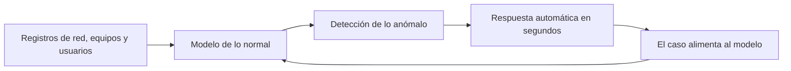
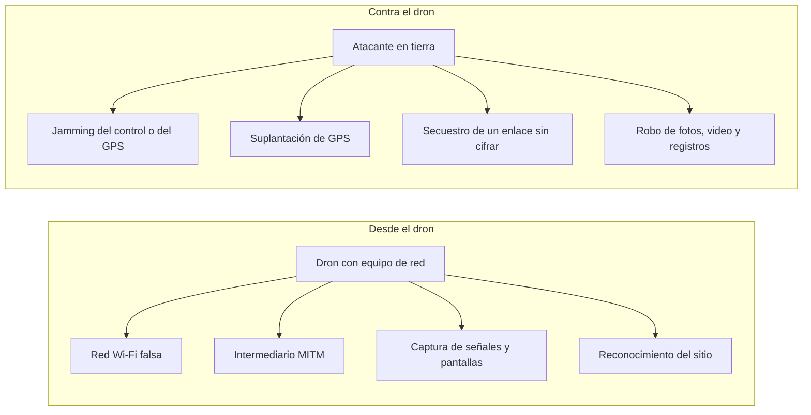
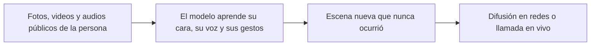

<!-- _class: lead -->

# U5 - Prospectivas y ataques futuros

### Riesgos actuales en ciberseguridad

**Rogelio Arriaga - Raptor Dev Services**

<!--
Unidad de 2 horas. Hilo conductor: cada tecnología que hoy nos asombra ya tiene su versión de ataque.
Tres casos lo sostienen: la IA que abarata los días cero, el dron que cerró Gatwick y la videollamada
falsa de Arup. Es la última unidad: cierra con una lámina que recoge las cinco unidades de la materia.
Reparto sugerido: apertura 10 min, IA 35 min, drones 25 min, deepfakes 30 min, cierre 20 min.
-->

---

## El lema de la unidad

> Toda tecnología nueva llega con su propio ataque. La ventaja es de quien la entiende primero.

Las cuatro unidades anteriores trataron riesgos que ya ocurren todos los días. Esta mira hacia adelante: hacer **prospectiva** es pensar escenarios futuros a partir de las tendencias de hoy, para prepararse antes de que lleguen.

<!--
Pregunta para abrir (2 min): ¿qué tecnología usaron esta semana que hace cinco años no existía?
Casi siempre sale un asistente de IA. Con eso se engancha la Parte 1.
-->

---

## México ya recibió el aviso

| Año | Incidente | Qué mostró |
|---|---|---|
| 2018 | Ataques a participantes del SPEI, unos 300 millones de pesos sustraídos | El sistema de pagos es un blanco, y toda la banca tuvo que endurecerse |
| 2019 | Ransomware en los sistemas administrativos de Pemex, rescate en bitcoins | Una empresa estratégica puede quedar secuestrada |
| 2022 | Hacktivistas filtran varios terabytes de correos de la Sedena | Ni la defensa nacional está a salvo de una fuga masiva |

Fuente: nota 03 de la materia, "Incidentes que marcaron al país".

<!--
Estos tres casos son la materia prima de la práctica. Pregunta: si estos ataques se repitieran hoy,
¿qué herramienta nueva tendría el atacante a la mano? Dejarla abierta hasta el cierre.
-->

---

## Objetivo de la unidad

Analizar cómo la IA, los drones y los deepfakes cambian el mapa de amenazas, y proponer formas de anticiparse.

Al terminar podrás:

1. Argumentar hacia dónde van los ataques digitales, con casos y fuentes.
2. Explicar los riesgos que traen la IA, los drones y los deepfakes.
3. Usar con precisión el vocabulario nuevo: fuzzing, día cero, face swapping, Remote ID.

---

## Agenda

| Bloque | Qué vemos | Tiempo |
|---|---|---|
| 1 | Inteligencia artificial: la misma herramienta para atacar y defender | 35 min |
| 2 | Drones: computadoras que vuelan | 25 min |
| 3 | Deepfakes: cuando ver y oír ya no basta | 30 min |
| 4 | Cierre de la unidad y de la materia | 20 min |

---

<!-- _class: lead -->

# Parte 1
## Inteligencia artificial

---

## Qué es la inteligencia artificial

Máquinas que simulan procesos de la inteligencia humana:

| Proceso | En una máquina |
|---|---|
| Aprendizaje | Adquiere información y las reglas para usarla |
| Razonamiento | Aplica esas reglas para llegar a una conclusión |
| Autocorrección | Mejora con sus propios aciertos y errores |

Sus aplicaciones particulares clásicas: **sistemas expertos**, **reconocimiento de voz** y **visión artificial**.

<!--
Cuidado con la confusión de siempre: aprendizaje, razonamiento y autocorrección son los PROCESOS;
sistemas expertos, voz y visión son APLICACIONES. El quiz lo pregunta.
-->

---

## Las piezas que la componen

| Tecnología | Un ejemplo |
|---|---|
| Automatización (RPA) | Capturar facturas en el sistema contable |
| Aprendizaje automático | Señalar qué transacción parece fraude |
| Visión artificial | Revisar imágenes médicas |
| Procesamiento de lenguaje natural | Filtrar spam, traducir, transcribir voz |
| Robótica | Brazos de una línea de ensamble |
| Vehículos autónomos | Robotaxis y asistentes de manejo |

<!--
Detenerse en la última fila: los vehículos autónomos juntan visión artificial, reconocimiento de imágenes
y aprendizaje profundo. Entran en la tarea, y la investigación sobre ellos corre por cuenta de cada quien.
-->

---

## Tres formas de aprender

1. **Supervisado:** aprende de ejemplos etiquetados con la respuesta correcta y clasifica casos nuevos.
2. **No supervisado:** recibe datos sin etiqueta y encuentra grupos o patrones que nadie le señaló.
3. **Por refuerzo:** un agente actúa, recibe premio o castigo y ajusta su estrategia.

En seguridad: con correos ya marcados como phishing se entrena un filtro supervisado; buscar tráfico que no se parece a ningún grupo conocido es trabajo no supervisado.

---

## De la nube a los modelos generativos

- Crear IA propia es caro: equipo, programas y especialistas.
- Por eso los grandes proveedores la rentan como servicio en la nube, para probar antes de invertir.
- Desde finales de 2022, los **modelos de lenguaje de gran tamaño (LLM)** redactan texto, código e imágenes a partir de una instrucción, y se contratan por API.

Ningún avance cambió tanto el tema de esta unidad.

<!--
Dato para comentar: algunos ejemplos del material de origen ya no existen como tal. Watson Health se
vendió en 2022 y hoy es Merative; la app Mint cerró en marzo de 2024. Las aplicaciones siguen, los
productos cambian.
-->

---

## La cuestión ética

- Un modelo vale lo que valen los datos con que se entrena.
- Si esos datos traen prejuicios, el modelo los repite: **sesgo algorítmico**.
- Hay quien prefiere decir **inteligencia aumentada**: la IA potencia el trabajo de las personas en lugar de reemplazarlas.

<!--
Pregunta (3 min): un detector de fraude que solo aprendió con clientes de una ciudad, ¿qué hará con
los de otra? ¿Quién eligió esos datos y quién responde por el error?
-->

---

## La IA del lado de la defensa

- Revisa volúmenes que ningún equipo humano alcanza a leer.
- Deja a los especialistas los casos difíciles.

---

## La IA del lado del ataque

| Uso | Qué gana el atacante |
|---|---|
| Ataques automatizados | Un DDoS que se ajusta solo y dura más |
| Imitación humana | Una máquina conversa con miles de víctimas a la vez |
| Phishing a la medida | Mensajes personales y sin faltas, armados con datos de redes sociales |
| Malware que cambia | Variantes nuevas que esquivan las firmas |
| Costo menor | El delito se abarata, como cualquier negocio que automatiza |

<!--
Conectar con la U3: la vieja pista de "el correo trae faltas de ortografía" ya no sirve. Pedir un ejemplo
del grupo de un mensaje sospechoso que les llegó bien escrito.
-->

---

## Fuzzing: buscar fallas con datos raros

- Se le mandan a un programa millones de entradas aleatorias o malformadas, hasta que algo truena.
- Cada tronido es una posible vulnerabilidad.
- Durante años fue técnica de laboratorio, en manos de investigadores especializados.
- Es una de las vías para hallar **días cero**: fallas que el fabricante todavía no conoce ni corrige.

---

## Días cero: de rareza a mercancía

Lo que anticipaba Fortinet para 2019, en noviembre de 2018:

| Etapa | Qué cambia |
|---|---|
| Fuzzing con IA | Encontrar fallas se vuelve rápido y barato |
| Días cero como servicio | Los exploits se venden como **mercancía** en la web oscura |
| Peligros combinados | Enjambres de bots que hallan y explotan fallas en tiempo real |
| Sin control | Una respuesta a incidentes casi imposible de coordinar |

Fuente: Fortinet (2018).

<!--
La consecuencia práctica: ninguna herramienta aislada anticipa un día cero. Hace falta defensa en
profundidad, segmentación, monitoreo del comportamiento y capacidad de reaccionar rápido.
-->

---

## Lo que ya pasó, al 2026

- **Octubre de 2024:** el agente Big Sleep de Google halló una vulnerabilidad explotable en SQLite antes de que llegara a una versión publicada.
- **Agosto de 2025:** en la final del AI Cyber Challenge de DARPA, ganada por Team Atlanta, sistemas autónomos encontraron y corrigieron fallas en software real.
- **Los modelos también son blanco:** la inyección de instrucciones encabeza el Top 10 de OWASP para aplicaciones con LLM.

Fuente: Project Zero (2024), DARPA (2025), OWASP (2025).

<!--
La predicción se cumplió primero del lado defensivo. Los atacantes usan los mismos modelos, sobre todo
para phishing, ingeniería social y malware. Pregunta: ¿quién llega primero a una falla, el que la
corrige o el que la vende?
-->

---

## La regulación llega por etapas

| Fecha | Qué se aplica del Reglamento (UE) 2024/1689 |
|---|---|
| 1 de agosto de 2024 | Entra en vigor |
| Febrero de 2025 | Prácticas prohibidas |
| Agosto de 2025 | Modelos de uso general |
| Agosto de 2026 | Transparencia, incluido el etiquetado de deepfakes |
| Diciembre de 2026 | Prohibición de sistemas que generan imágenes íntimas no consentidas o abuso sexual infantil (Ómnibus digital sobre IA, 2026/1744) |
| Diciembre de 2027 y agosto de 2028 | Sistemas de alto riesgo |

En Estados Unidos, el marco de riesgos de IA del NIST (2023) sirve como guía voluntaria.

Fuente: EUR-Lex; NIST AI 100-1.

---

<!-- _class: lead -->

# Parte 2
## Drones

---

## Qué es un dron y para qué se usa

Un vehículo aéreo no tripulado (**VANT**), autónomo o a control remoto; la regulación lo llama **RPAS**.

| Sector | Uso actual |
|---|---|
| Logística y salud | Entrega de paquetes y de suministros médicos en zonas remotas |
| Infraestructura | Inspección de inmuebles, torres, puentes y líneas eléctricas |
| Emergencias | Búsqueda de personas y apoyo en desastres |
| Campo y ambiente | Cultivos, ganado y conteo de especies en peligro |
| Medios y seguridad | Cine, fotografía, transmisiones y vigilancia |

<!--
Pregunta rápida: ¿alguien del grupo tiene o ha volado uno? ¿Le pidieron registro? Sirve para la
lámina de regulación.
-->

---

## Por qué son una amenaza

| Riesgo | En concreto |
|---|---|
| Privacidad | Graban sin permiso, incluso rasgos biométricos del rostro |
| Detección difícil | Son pequeños, vuelan bajo y en un radar común parecen aves |
| Crimen organizado | Trasladan droga y, cada vez más, explosivos |
| Uso militar y terrorismo | Cargas explosivas, misiones suicidas, memoria que se borra si caen |
| Infraestructura crítica | Basta con que aparezcan para detener un aeropuerto o una planta |

Para la ciberseguridad, un dron es **una computadora que vuela** y depende de enlaces inalámbricos.

---

## Dos direcciones de ataque

<!--
Mensaje: el mismo aparato que vigila una instalación puede atacarla, y el que la ataca puede ser
secuestrado. Ninguna de las dos caras se pensaba hace diez años.
-->

---

## Caso: Gatwick, diciembre de 2018

| Dato | Cifra aproximada |
|---|---|
| Pista cerrada | 33 horas |
| Vuelos cancelados o desviados | 1,000 |
| Pasajeros afectados | 140,000 |

Nadie disparó nada: la sola presencia de un aparato barato paralizó una infraestructura crítica en plena temporada navideña.

Fuente: Davis (2018), McAfee; BBC News (2018).

---

## Del juguete al arma

- **Caracas, agosto de 2018:** dos drones con explosivos detonan durante un acto público del presidente de Venezuela.
- **Frontera de San Diego:** desde mediados de la década de 2010 se interceptan drones que cruzan metanfetamina.
- **Ucrania, desde 2022:** drones baratos y modificados, por miles cada mes, como arma central.
- **México, 2023:** el Ejército reportó 260 ataques con drones explosivos, la mayoría en Michoacán.

Fuente: BBC News (2018); CBS News (2023), con datos del Ejército mexicano.

<!--
Aquí la prospectiva ya es presente. Pregunta: si un dron comercial más software modificado da una
capacidad casi militar, ¿qué tendría que vigilar una refinería o un centro de datos?
-->

---

## Qué dice la regulación

| Dónde | Norma | Qué exige |
|---|---|---|
| México | NOM-107-SCT3-2019 | Clasifica por peso y uso; según la categoría, registro, licencia y seguro; respetar zonas restringidas |
| Estados Unidos | Remote ID de la FAA, desde el 16 de septiembre de 2023 | Una placa digital que el dron transmite en vuelo |
| Unión Europea | Reglamentos 2019/947 y 2019/945 | Operaciones por nivel de riesgo y registro de operadores |

Fuente: DOF (14 de noviembre de 2019); FAA; EUR-Lex.

---

## Cómo defenderse

| Si proteges una instalación | Si operas un dron |
|---|---|
| Detección por capas: radar, radiofrecuencia, cámaras y sonido | Firmware del dron y de la app al día |
| Identificar con Remote ID o telemetría | Contraseñas nuevas y enlace cifrado |
| Neutralizar solo en coordinación con la autoridad | Revisar qué se sube a la nube del fabricante |
| Wi-Fi segmentado y cifrado, sin redes abiertas cerca de zonas sensibles | Respetar la privacidad y las zonas restringidas |

<!--
Por qué la mitigación activa es de autoridades: interferir o suplantar el GPS afecta también las
comunicaciones de terceros. Y las geocercas de fábrica se desactivan con firmware modificado.
-->

---

<!-- _class: lead -->

# Parte 3
## Deepfakes

---

## Qué es un deepfake

*Deep learning* (aprendizaje profundo) más *fake* (falso): video, audio o imagen sintéticos hechos con redes neuronales profundas.

Ya no hace falta un estudio de efectos especiales: la herramienta hace el trabajo.

---

## De dónde salió el nombre

- **Finales de 2017:** en un foro de Reddit, un usuario que firmaba "deepfakes" publicó videos con rostros de celebridades cambiados con aprendizaje profundo. FakeApp, una aplicación para facilitarlo, salió hasta enero de 2018 y la hicieron otras personas.
- **Diciembre de 2017:** la prensa tecnológica lo documenta. **7 de febrero de 2018:** Reddit cierra esas comunidades.
- Algunas comunidades de la industria para adultos ofrecieron contenido explícito **a la medida**, con el rostro elegido de una base de datos.

Fuente: Robertson (2018), The Verge; Cole (2018), VICE.

<!--
Subrayar: el primer uso masivo fue sin consentimiento. Los usos dañinos aparecen en cuanto una
herramienta queda al alcance de cualquiera. Tratar el tema con seriedad y sin morbo.
-->

---

## Face swapping no es lo mismo

| | Face swapping | Deepfake |
|---|---|---|
| Qué hace | Cambia una cara por otra | La IA genera rostro, voz o cuerpo que encajan en la escena |
| Calidad | Casi siempre amateur: bordes y luz delatan | A simple vista, casi igual al original |
| Ejemplo | El filtro de intercambio de caras de una app de mensajería | Un discurso falso de un político, con su voz y sus gestos |

El face swapping es un derivado de la misma tecnología, con resultados mucho más evidentes.

---

## Para qué se usan

| Nivel | Uso |
|---|---|
| Individual | Ciberacoso, difamación, chantaje y pornografía no consentida |
| Fraude y crimen organizado | Estafas con voz o video falsos |
| Corporativo | Un video falso del director de la competencia para dañar su reputación o mover sus acciones |
| Social y político | Desinformación y manipulación de una elección |

<!--
Pregunta: ¿qué nivel les parece más cercano a su vida diaria? Casi siempre responden "político" y la
respuesta incómoda es "individual": cualquier persona con fotos en redes puede ser blanco.
-->

---

## La voz: la amenaza que casi nadie ve venir

- La IA imita acento, entonación y manera de hablar.
- **Secuestro virtual:** una llamada con la voz de un familiar que pide ayuda, y un rescate urgente.
- **Arup, Hong Kong, enero de 2024:** un empleado hizo 15 transferencias por 200 millones de dólares de Hong Kong (unos 25.6 millones de dólares estadounidenses) tras una videollamada en la que todos los demás, incluido el supuesto director financiero, eran recreaciones con IA.

Fuente: Magramo (2024), CNN.

<!--
Este caso conecta con el SPEI de la práctica: el fraude ya no necesita entrar al sistema, le basta con
convencer a la persona que tiene permiso de mover el dinero. Dejarlo sembrado para el foro.
-->

---

## El dividendo del mentiroso

- Si cualquier cosa puede ser falsa, también es fácil **negar lo verdadero**.
- Ante una prueba incómoda, la salida cómoda es decir "es un deepfake".
- Chesney y Citron (2019) bautizaron así esa ventaja.
- La defensa de fondo son las fuentes confiables: no basta con detectar lo falso, hay que saber reconocer lo auténtico.

---

## Cómo se responde, al 2026

| Frente | Qué existe |
|---|---|
| Educación | No compartir sin verificar el origen y el respaldo oficial |
| Origen del contenido | Content Credentials de la C2PA: un registro firmado de cómo se creó y editó el archivo |
| Detección | Modelos que buscan fallas en píxeles, luz y audio, siempre un paso detrás de los generadores |
| Ley | UE: etiquetar lo sintético desde agosto de 2026. EE. UU.: ley TAKE IT DOWN (2025), retiro en 48 horas desde mayo de 2026. México: la violencia digital incluye contenido íntimo real o simulado (Ley Olimpia) |

Fuente: C2PA; Reglamento (UE) 2024/1689, art. 50; Pub. L. 119-12; LGAMVLV, art. 20 Quáter.

---

## Cómo detectar uno

- **Contexto primero:** ¿quién lo publicó?, ¿lo confirma un medio confiable?, ¿llega demasiado a tiempo?
- **Rostro:** bordes borrosos, piel muy lisa, parpadeo extraño.
- **Sincronía:** labios desfasados, voz plana y sin respiraciones.
- **Luz y detalle:** sombras que no cuadran, manos y orejas deformes.
- **Búsqueda inversa** de la imagen o de cuadros del video.
- **Otro canal:** si piden dinero, colgar y llamar al número de siempre; acordar una palabra clave en familia.

<!--
Ejercicio de 5 minutos: proyectar un video viral reciente (elegido por el instructor) y que el grupo
aplique la lista en voz alta. Lo importante es el orden: contexto antes que píxeles.
-->

---

## Conclusiones de la unidad

- **IA:** sus beneficios no borran su uso dañino. La única protección real es conocerla y ponerla a trabajar a favor de la seguridad, porque cada avance también amplía el riesgo.
- **Drones:** no son juguetes. Necesitan reglas técnicas y legales, y entender cómo se modifican es lo que permite anticipar su abuso.
- **Deepfakes:** son el salto multimedia de las noticias falsas; engañan a la vista y al oído. La respuesta empieza por no compartir sin verificar y por educar.

---

## Al terminar puedes

- Distinguir los procesos de la IA de sus aplicaciones.
- Explicar por qué la IA y el fuzzing abaratan los días cero.
- Enumerar los usos legítimos de los drones, sus riesgos y las dos direcciones de ataque.
- Diferenciar un deepfake de un face swapping y revisar uno con método.
- Proponer medidas de prevención para empresas, gobierno y particulares.

---

## Cierre de la materia

| Unidad | Tema | La idea que se queda |
|---|---|---|
| 1 | Ciberseguridad y actualidad | México es de los países más atacados y su marco legal va detrás de la tecnología |
| 2 | Cyberbullying, cyberstalking y sexting | El acoso digital no se apaga al cerrar la sesión |
| 3 | Grooming, phishing y pharming | El engaño explota la confianza antes que la técnica |
| 4 | Carding, juice jacking y cryptojacking | El fraude silencioso usa tu tarjeta, tu puerto USB y tu electricidad |
| 5 | Prospectivas y ataques futuros | Cada tecnología nueva amplía la defensa y el ataque al mismo tiempo |

<!--
Pedir a tres personas que digan cuál unidad les cambió un hábito concreto. Cerrar con el lema: la
ventaja es de quien entiende primero.
-->

---

## Práctica y tarea

- **Práctica:** foro "México en prospectiva": cómo funcionaron el SPEI 2018, Pemex 2019 y la Sedena 2022, y hacia dónde van con IA, drones y deepfakes ([práctica](practica.md)).
- **Tarea:** ensayo "Prospectivas digitales", máximo cinco cuartillas, con pautas de prevención para empresas, gobierno y particulares, en APA 7 ([tarea](tarea.md)).
- **Quiz:** 10 preguntas de la unidad.
- **Glosario:** [glosario](glosario.md).

---

## Lecturas

- [13 - Inteligencia artificial: la misma herramienta para atacar y defender](../../../12-seguridad/02-riesgos/13-inteligencia-artificial.md)
- [14 - Drones: el juguete que también es plataforma de ataque](../../../12-seguridad/02-riesgos/14-drones.md)
- [15 - Deepfakes: cuando ver y oír ya no basta para creer](../../../12-seguridad/02-riesgos/15-deepfakes.md)
- Para la práctica: [03 - Actualidad de la ciberseguridad en México](../../../12-seguridad/02-riesgos/03-ciberseguridad-en-mexico.md), sección "Incidentes que marcaron al país".
