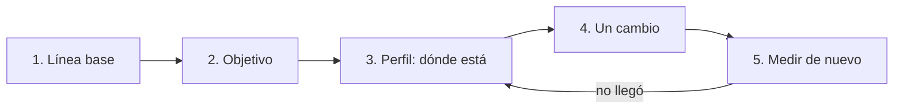

<!-- _class: lead -->

# Módulo 1 - Medir antes de tocar

### .NET de alto rendimiento

**Rogelio Arriaga - Raptor Dev Services**

---

## Hoy

> Una optimización sin medición antes y después es una opinión.

- **Parte 1:** el problema: optimizar a ojo
- **Parte 2:** el método: línea base, objetivo, perfil, cambio, nueva medición
- **Parte 3:** por qué un `Stopwatch` suelto engaña
- **Parte 4:** BenchmarkDotNet
- **Parte 5:** leer una tabla real, con su ruido
- **Parte 6:** qué herramienta contesta qué pregunta
- **Práctica:** un benchmark de dos implementaciones, y verlo fallar dos veces

Lecturas: [19 - Performance](../../../04-backend/19-performance.md) y [47 - Benchmarking](../../../04-backend/47-benchmarking.md)

---

## Cómo se sostienen las cifras de este curso

Cada cifra propia sale de una medición hecha para el curso y el código está en [`referencia/`](https://github.com/Raptor-Dev-Services/dev-notes/blob/main/cursos/dotnet-performance/referencia/README.md):

- .NET 10 (SDK 10.0.403, runtime 10.0.14), BenchmarkDotNet 0.15.8.
- Procesador Intel Core i5-11500 de 12 hilos lógicos, dentro de un contenedor limitado a 4 CPU.
- Un servidor **compartido y con carga**, y el trabajo `ShortRun` de BenchmarkDotNet (pocas iteraciones).

**Consecuencia:** los **tiempos son ruidosos**; se citan como "en esa corrida". Las **asignaciones de memoria** (columna `Allocated`) no dependen de la carga, y son las que sostienen las conclusiones.

Versiones y datos a noviembre de 2026.

---

<!-- _class: lead -->

# Parte 1
## El problema: optimizar a ojo

---

## "¿Por qué está lenta?"

Alguien pregunta eso un lunes. Hay tres respuestas posibles:

1. **La que suena razonable:** "debe ser LINQ", "seguro es la base de datos", "las strings son lentas".
2. **La que se copió de un blog:** "usa `Span<T>`", "pon un caché".
3. **La que se midió.**

Las dos primeras pueden acertar. Solo la tercera te dice **cuánto** mejoró, y si lo que cambiaste era el problema.

---

## Los tres errores típicos

| Error | Cómo se ve | Qué pasa |
|---|---|---|
| Optimizar sin medir | "Reescribí el método, ahora es más limpio y seguro más rápido" | No sabes si mejoró, empeoró o no cambió nada |
| Medir una vez, con un cronómetro | `Stopwatch` alrededor de una llamada | Mides el compilador JIT y el ruido, no tu código |
| Optimizar lo que no es el cuello de botella | Cinco horas en un método que corre 0.1 % del tiempo | Código más difícil de leer y la API sigue igual de lenta |

> En este curso la regla es una: **cada afirmación de rendimiento viene con su medición.** Incluidas las del instructor.

---

## Dos preguntas distintas

- **¿Cuánto cuesta esta función?** Es una pregunta de *microbenchmark*: aislas el código y lo repites muchas veces. Herramienta: BenchmarkDotNet.
- **¿Dónde se va el tiempo de mi aplicación?** Es una pregunta de *perfil*: observas el programa completo mientras trabaja. Herramientas: contadores, trazas, pruebas de carga (módulo 6).

Un microbenchmark **no** te dice si una función importa. Un perfil **no** te dice con precisión cuánto cuesta una función. Se usan en ese orden: perfil para encontrar, benchmark para comparar.

---

<!-- _class: lead -->

# Parte 2
## El método

---

## Cinco pasos



1. **Línea base:** cuánto tarda y cuánto asigna hoy, con la misma herramienta que usarás después.
2. **Objetivo:** cuánto necesita mejorar para que importe. Sin objetivo no sabes cuándo parar.
3. **Perfil:** dónde está el costo.
4. **Un cambio:** uno solo. Si cambias tres cosas no sabes cuál funcionó.
5. **Nueva medición:** mismas condiciones. Compara contra la línea base.

---

## El objetivo viene del negocio, no del código

Ejemplos de objetivos bien formulados (Ejemplo ilustrativo):

- "El endpoint de reportes debe responder en menos de un segundo para el 95 % de las peticiones."
- "El servicio no debe crecer en memoria de forma sostenida durante una jornada."
- "El proceso nocturno debe terminar antes de que abra la sucursal."

Un objetivo así se puede **comprobar**. "Que sea más rápido" no.

Y si ya cumple el objetivo, **se detiene**: cada optimización cuesta legibilidad y mantenimiento.

---

## El mismo método en una sola imagen

| Paso | Pregunta | Artefacto que guardas |
|---|---|---|
| Línea base | ¿Cuánto cuesta hoy? | La salida completa de la herramienta |
| Objetivo | ¿Hasta dónde? | Una frase con un número |
| Perfil | ¿Dónde está? | La evidencia que apunta al método |
| Cambio | ¿Qué toqué? | Un commit pequeño |
| Nueva medición | ¿Funcionó? | La salida completa, junto a la anterior |

La tarea del módulo te pide ese expediente.

---

<!-- _class: lead -->

# Parte 3
## Por qué un Stopwatch suelto engaña

---

## El experimento más simple

Medir una función con `Stopwatch`, **varias veces seguidas**, en modo Release:

```csharp {1-4|6-12|*}
static long SumarCuadrados(int n)
{
    long s = 0;
    for (int i = 0; i < n; i++) s += (long)i * i;
    return s;
}

for (int i = 1; i <= 8; i++)
{
    var t = Stopwatch.StartNew();
    long r = SumarCuadrados(100_000);
    t.Stop();
    Console.WriteLine($"llamada {i}: {t.Elapsed.TotalMicroseconds,9:F1} us");
}
```

Es el demo `jit` de [`referencia/Demos`](https://github.com/Raptor-Dev-Services/dev-notes/blob/main/cursos/dotnet-performance/referencia/Demos/Program.cs). Lo corres tú en la práctica.

---

## Lo que salió

Medido en .NET 10 (runtime 10.0.14), Release, en el servidor del curso:

```text
llamada 1:    1003.9 us
llamada 2:      94.9 us
llamada 3:      85.7 us
llamada 4:      82.7 us
llamada 5:      85.7 us
llamada 6:      90.7 us
llamada 7:      83.3 us
llamada 8:      78.5 us
```

El **resultado** es el mismo en las ocho llamadas (`333328333350000`). Lo que cambió es el **tiempo**: la primera llamada tardó ≈ 1,004 µs; las demás, entre 78 y 95 µs.

Si hubieras medido solo la primera llamada habrías concluido que la función cuesta más de diez veces lo que cuesta.

---

## ¿Por qué la primera llamada es distinta?

.NET compila el código IL a código de máquina **la primera vez** que se usa un método (compilación JIT). Con la **compilación por niveles** (tiered compilation), que viene activada desde .NET Core 3.0:

- el **primer nivel** genera código rápido de producir, o carga código ya precompilado;
- el **segundo nivel** genera código optimizado, en segundo plano.

Fuente: [Compilation config settings](https://learn.microsoft.com/en-us/dotnet/core/runtime-config/compilation), Microsoft Learn.

> Esa es la razón documentada de que una función "se caliente". En esa corrida no medimos **cuál** de las causas pesó en la llamada 1; lo que sí medimos es que la primera llamada es distinta de las demás.

---

## Otras fuentes de ruido

- **Otros procesos** en la misma máquina: el servidor del curso corre con carga.
- **Frecuencia del procesador.** Una de las corridas de este módulo reporta `11th Gen Intel Core i5-11500 2.70GHz (Max: 0.80GHz)`; otras, `Max: 3.30GHz`. Es lo que imprime BenchmarkDotNet: la máquina no tuvo siempre la misma velocidad.
- **El orden:** el primer método que mides paga el calentamiento.
- **El recolector de basura:** una pausa cae dentro de tu cronómetro.
- **Un compilador optimizador demasiado listo:** si el resultado no se usa, puede eliminar el código.

Un `Stopwatch` no controla nada de esto. Por eso existe una herramienta.

---

## Error típico: confiar en un solo número

> "Probé en mi laptop y bajó de 12 a 9 ms. Subo el cambio."

Preguntas que quedaron sin contestar:

- ¿Cuántas veces lo corriste?
- ¿Calentó antes?
- ¿Release o Debug?
- ¿Cuánto varía una corrida de otra?
- ¿Y cuánta memoria asigna?

Con esas preguntas contestadas, se llama **método**. Sin ellas, es una anécdota.

---

<!-- _class: lead -->

# Parte 4
## BenchmarkDotNet

---

## Qué hace por ti

BenchmarkDotNet es una librería de microbenchmarks de la comunidad .NET. En lugar de un cronómetro:

- ejecuta la medición en **un proceso aparte** (según su documentación, *How it works*);
- hace una etapa de **calentamiento** (Warmup) y otra de mediciones reales (Actual), después de una etapa piloto (Pilot) que elige cuántas operaciones por iteración;
- calcula **media, error y desviación**;
- puede medir **asignaciones y colecciones del GC** (`[MemoryDiagnoser]`);
- **se niega a medir** si el ensamblado no está compilado en Release.

Es un paquete NuGet y se ejecuta como una aplicación de consola.

---

## El primer benchmark

Dos implementaciones de **la misma función**: contar palabras de un texto.

```csharp {1-2|4-8|10-11|13-22|*}
[MemoryDiagnoser]
public class ContarPalabras
{
    private string _texto = "";

    [Params(100, 10_000)]
    public int Palabras;

    [GlobalSetup]
    public void Preparar() { /* arma _texto con N palabras; ver el archivo completo */ }

    [Benchmark(Baseline = true)]
    public int ConSplit() => _texto.Split(' ', StringSplitOptions.RemoveEmptyEntries).Length;

    [Benchmark]
    public int ConCiclo()
    {
        int palabras = 0;
        bool dentro = false;
        foreach (char c in _texto)
        {
            if (char.IsWhiteSpace(c)) dentro = false;
            else if (!dentro) { dentro = true; palabras++; }
        }
        return palabras;
    }
}
```

Fragmento resumido de [`M1_Medir.cs`](https://github.com/Raptor-Dev-Services/dev-notes/blob/main/cursos/dotnet-performance/referencia/Bench/M1_Medir.cs) (el archivo completo se compiló y corrió).

---

## Las piezas

| Pieza | Para qué |
|---|---|
| `[Benchmark]` | Marca el método que se mide. |
| `Baseline = true` | La línea base: la columna `Ratio` compara contra ella. |
| `[Params(...)]` | Corre el mismo benchmark con distintos tamaños. |
| `[GlobalSetup]` | Prepara los datos **una vez**, fuera de lo que se mide. |
| `[MemoryDiagnoser]` | Agrega las columnas de colecciones del GC y de memoria asignada. |
| `return ...` | Devolver el resultado evita que el JIT elimine el código por inútil. |

Ejecutar: `dotnet run -c Release -- --filter "*ContarPalabras*"`.

---

## Regla 1: comprobar que las dos versiones dan lo mismo

Un benchmark que compara dos métodos con resultados distintos no mide nada útil. En el `[GlobalSetup]` del archivo de referencia:

```csharp
// Un benchmark que compara dos metodos que dan resultados distintos no mide nada util.
if (ConSplit() != ConCiclo())
    throw new InvalidOperationException("Las dos implementaciones no coinciden.");
```

Si una "optimización" cambia el resultado, **es un bug rápido**.

---

## Regla 2: Release, siempre

La guía de buenas prácticas de BenchmarkDotNet es tajante: "Never use the Debug build for benchmarking. _Never_." (benchmarkdotnet.org, *Good practices*).

Y la librería lo hace cumplir. Medido al correr el proyecto del curso en Debug:

```text
// Validating benchmarks:
//    * Assembly Bench which defines benchmarks is non-optimized
Benchmark was built without optimization enabled (most probably a DEBUG configuration). Please, build it in RELEASE.
```

Lo vas a provocar en la práctica. Léelo tú: el error dice exactamente qué corregir.

---

## Regla 3: devolver el resultado

La misma guía advierte que el JIT puede eliminar un cálculo cuyo resultado no se usa, y recomienda devolver el valor para que la llamada no se optimice a nada.

```csharp
// Mal: el resultado se descarta; el JIT podría eliminar el calculo
[Benchmark] public void Mal() { _ = Math.Exp(1); }

// Bien: se devuelve
[Benchmark] public double Bien() => Math.Exp(1);
```

Fragmento ilustrativo de la guía oficial de BenchmarkDotNet, no compilado aquí.

---

## Regla 4: el entorno cuenta

Dos advertencias de la misma guía:

- "Please, don't extrapolate your results. Or do it very carefully." Cambian entre versiones de .NET, JIT y sistemas operativos.
- "Turn off all of the applications except the benchmark process and the standard OS processes."

Tu máquina de desarrollo no es producción. Una cifra se comparte **junto con su entorno**: versión de .NET, procesador, sistema operativo y configuración del benchmark.

---

<!-- _class: lead -->

# Parte 5
## Leer una tabla real

---

## La salida de ContarPalabras

Medido: BenchmarkDotNet 0.15.8, .NET 10.0.14, trabajo `ShortRun`, i5-11500, contenedor con 4 CPU.

```text
| Method   | Palabras | Mean           | Error        | StdDev       | Ratio | Gen0    | Gen1    | Gen2    | Allocated | Alloc Ratio |
|--------- |--------- |---------------:|-------------:|-------------:|------:|--------:|--------:|--------:|----------:|------------:|
| ConSplit | 100      |     2,893.4 ns |   1,623.5 ns |     88.99 ns |  1.00 |  0.8430 |  0.0076 |       - |    5304 B |        1.00 |
| ConCiclo | 100      |       694.0 ns |     338.4 ns |     18.55 ns |  0.24 |       - |       - |       - |         - |        0.00 |
|          |          |                |              |              |       |         |         |         |           |             |
| ConSplit | 10000    | 1,156,494.0 ns | 842,878.4 ns | 46,201.01 ns |  1.00 | 89.8438 | 50.7813 | 25.3906 |  526039 B |        1.00 |
| ConCiclo | 10000    |   179,276.8 ns |  42,735.7 ns |  2,342.49 ns |  0.16 |       - |       - |       - |         - |        0.00 |
```

(Se omitió la columna `RatioSD`.) Vamos columna por columna.

---

## Columna por columna

```text {1|2-3|4|5|6-7}
Mean         media aritmética de todas las mediciones
Error        la mitad del intervalo de confianza de 99.9 %
StdDev       desviación estándar de todas las mediciones
Ratio        Mean de este método entre Mean de la línea base
Gen0/1/2     colecciones del GC por cada 1000 operaciones
Allocated    memoria asignada por operación (solo la administrada)
Alloc Ratio  lo mismo que Ratio, pero para Allocated
```

Estas definiciones son la leyenda que BenchmarkDotNet imprime al final de cada corrida (aparece en la salida real de las mediciones del curso). La documentación de los diagnosers confirma lo de `Gen`: "number of GC collections per 1000 operations for that generation", y que `Allocated` se obtiene con `GC.GetAllocatedBytesForCurrentThread` (benchmarkdotnet.org, *Diagnosers*).

---

## Qué dice la tabla

Con 100 palabras:

- `ConSplit` asigna **5304 B** por llamada; `ConCiclo` asigna **0 B** (`-` en las columnas del GC).
- En esa corrida, `ConCiclo` tardó 694.0 ns contra 2,893.4 ns (ratio 0.24).

Con 10,000 palabras:

- `ConSplit` asigna **526,039 B** por llamada y provoca colecciones en las tres generaciones (Gen0 89.8438, Gen1 50.7813, Gen2 25.3906 por 1000 operaciones).
- `ConCiclo` sigue en **0 B** y no provoca ninguna.

> Conclusión que se sostiene: la versión con ciclo **no asigna memoria** y la de `Split` crece con el tamaño del texto. Es una conclusión sobre `Allocated`, que no cambia con la carga.

---

## Y el Error: la advertencia de la propia tabla

Mira `Error` en la fila de 100 palabras: **1,623.5 ns** sobre una media de 2,893.4 ns. Es más de la mitad de la media.

Eso significa que el **tiempo** de esa fila es muy poco preciso: el trabajo `ShortRun` hace pocas iteraciones y el servidor estaba cargado.

- Del **tiempo** se puede decir "en esa corrida el ciclo fue más rápido".
- Del tiempo **no** se puede decir "es 4.2 veces más rápido" con confianza.
- De `Allocated` sí se puede decir "5304 B contra 0 B".

Para publicar un tiempo se usa un trabajo más largo, en una máquina quieta y se repite.

---

## Otro ejemplo: unir textos

Tres formas de unir N textos con comas. Los tres métodos devuelven la **misma cadena** (se comprueba en el `GlobalSetup`).

```text
| Method           | N    | Mean            | Gen0      | Allocated  |
|----------------- |----- |----------------:|----------:|-----------:|
| Concatenar       | 10   |       532.48 ns |    0.2890 |     1816 B |
| ConStringBuilder | 10   |       281.12 ns |    0.1121 |      704 B |
| ConJoin          | 10   |        96.04 ns |    0.0254 |      160 B |
| Concatenar       | 1000 | 1,860,980.26 ns | 2804.6875 | 17628136 B |
| ConStringBuilder | 1000 |    15,357.08 ns |    8.1177 |    50976 B |
| ConJoin          | 1000 |     9,016.79 ns |    2.8229 |    17800 B |
```

Medido con el mismo entorno. Se omitieron columnas.

Con 1000 textos, concatenar con `+=` asignó **17,628,136 B** (unos 17.6 millones de bytes, que son unas 346 veces los 50,976 B de `StringBuilder` según la división de las dos cifras de la tabla). La razón se ve en el módulo 2.

---

## Una cifra sola no basta: el "con qué tamaño"

Con N = 10, la diferencia entre `Concatenar` (1816 B) y `StringBuilder` (704 B) es de 1,112 B. Con N = 1000, es de 17.5 MB.

> Un benchmark con un solo tamaño puede esconder que dos implementaciones se cruzan o se separan. **Usa `[Params]`** con el tamaño pequeño, el típico y el grande de **tu** dato real.

---

## Error típico: optimizar el código que el benchmark no ejecuta

- Datos de prueba demasiado perfectos (todo en caché, ya ordenados).
- Un tamaño que no se parece al de producción.
- Un método que en producción corre una vez al día y en el benchmark un millón de veces.

Un benchmark responde **la pregunta que le hiciste**. Si la pregunta es incorrecta, la respuesta exacta no sirve.

---

<!-- _class: lead -->

# Parte 6
## ¿Qué herramienta contesta qué?

---

## Del síntoma a la herramienta

| Pregunta | Herramienta | Módulo |
|---|---|---|
| ¿Cuánto cuesta esta función, y cuánto asigna? | BenchmarkDotNet con `[MemoryDiagnoser]` | 1 |
| ¿Cuánto asigna este endpoint? | Medición dentro del endpoint y BenchmarkDotNet | 2 |
| ¿Qué colección o construcción es más barata para mi dato? | BenchmarkDotNet con `[Params]` | 3 |
| ¿Mi API aguanta N usuarios a la vez? | Prueba de carga | 4 |
| ¿Es el código, la red o la base? | Mediciones por capa | 5 |
| ¿Por qué crece la memoria en producción? | `dotnet-counters`, `dotnet-dump` | 6 |
| ¿Dónde se va el tiempo de CPU? | `dotnet-trace` | 6 |

*Tools and Skills for .NET 10* trata el benchmarking, la carga y el estrés en el cap. 13 y la depuración y la memoria en el cap. 4.

---

## Perfil, traza y carga: qué es cada una

- **Perfil (profiling):** observar un programa en marcha para ver dónde gasta tiempo o memoria. Dice *dónde*.
- **Traza (tracing):** registro de eventos durante la ejecución. Permite reconstruir qué pasó y en qué orden.
- **Prueba de carga:** generar tráfico controlado contra un servicio para ver cómo se comporta con N usuarios. Dice *cuánto aguanta*.

Una prueba de carga **solo** se corre contra un entorno propio y de prueba, nunca contra un servicio real que otras personas usan. En este curso, contra la API de ejemplo en tu máquina.

---

## Orden de trabajo en una API lenta

1. **Medir desde fuera:** ¿cuánto tarda la petición y en qué percentil?
2. **Dividir por capas:** código, red, base de datos.
3. **Perfil de la capa culpable.**
4. **Microbenchmark** de las alternativas de ese punto concreto.
5. **Un cambio. Medir de nuevo** en las mismas condiciones.

Un benchmark no reemplaza al perfil: sirve **después** de saber qué función importa.

---

<!-- _class: lead -->

# Práctica
## Medir, y verlo fallar

---

## Qué vas a hacer

1. Correr el benchmark `ContarPalabras` y leer su tabla.
2. **Verlo fallar (a):** compilarlo en Debug y leer el rechazo de BenchmarkDotNet.
3. **Verlo fallar (b):** medir una función con un `Stopwatch` de una sola llamada y ver el costo del JIT.
4. Escribir la conclusión con **tu** tabla, tu entorno y su ruido.

Todo en un contenedor desechable con el SDK de .NET 10. Guía: [`practica.md`](practica.md).

---

## Error típico final

> "Medí en mi máquina, en Debug, una sola vez, mientras compilaba otra cosa."

Cada parte de esa frase invalida la medición. Corregida:

> "Medí en Release, con BenchmarkDotNet y `MemoryDiagnoser`, con tres tamaños, comprobé que las dos versiones dan el mismo resultado, y reporto el entorno y el `Error`."

---

## Para llevarte

- Una optimización sin medición antes y después es una opinión.
- El método: línea base, objetivo, perfil, **un** cambio, nueva medición.
- Un `Stopwatch` suelto mide, en parte, el JIT.
- BenchmarkDotNet: Release, `Baseline`, `Params`, `MemoryDiagnoser`, resultado devuelto, resultados comprobados.
- Del **tiempo** desconfía de una corrida ruidosa; de **`Allocated`** puedes fiarte.
- Cada cifra viaja con su entorno.

**Tarea:** medir una función propia y entregar el antes y después con la salida completa. [`tarea.md`](tarea.md)

---

## Referencias

**Documentación oficial** (consultada en noviembre de 2026):

- BenchmarkDotNet, *Good practices*: https://benchmarkdotnet.org/articles/guides/good-practices.html
- BenchmarkDotNet, *Diagnosers*: https://benchmarkdotnet.org/articles/configs/diagnosers.html
- Microsoft Learn, *Compilation config settings*: https://learn.microsoft.com/en-us/dotnet/core/runtime-config/compilation

**Libros** (se citan por capítulo; no se copia su texto):

- *High-Performance Programming in C# and .NET* (Alls, 2022), cap. 5, Application Profiling and Tracing. Está escrito para .NET 6: cada técnica del curso se verificó en .NET 10.
- *Tools and Skills for .NET 10* (Price, 2025), cap. 4, Debugging and Memory Troubleshooting, y cap. 13, Benchmarking Performance, Load, and Stress Testing.

**Mediciones propias:** [`referencia/`](https://github.com/Raptor-Dev-Services/dev-notes/blob/main/cursos/dotnet-performance/referencia/README.md), proyectos `Bench` y `Demos`.
