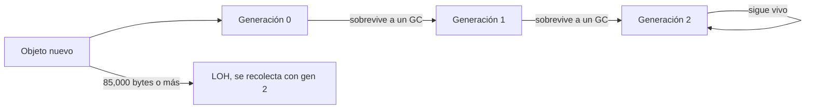

<!-- _class: lead -->

# Módulo 2 - Memoria y recolector de basura

### .NET de alto rendimiento

**Rogelio Arriaga - Raptor Dev Services**

---

## Hoy

> El GC no es gratis: cada asignación se paga después.

- **Parte 1:** dónde viven los datos: stack, heap y tipos por valor
- **Parte 2:** el recolector: raíces, generaciones y por qué funcionan
- **Parte 3:** el Large Object Heap
- **Parte 4:** medir asignaciones sin engañarte
- **Parte 5:** los tres culpables de siempre: strings, boxing y objetos que sobreviven
- **Práctica:** medir un endpoint y bajar sus asignaciones a la mitad

Lectura: [20 - Memoria y GC](../../../04-backend/20-memoria-gc.md)

Este módulo sigue al 1 (medir): aquí se usa la columna `Allocated`, las columnas `Gen0/1/2` y `GC.GetAllocatedBytesForCurrentThread`.

---

## Cómo se leen las cifras de esta clase

- Entorno de **todas** las mediciones: .NET 10 (SDK 10.0.403, runtime 10.0.14), BenchmarkDotNet 0.15.8, trabajo `ShortRun`, CPU i5-11500, contenedor con 4 CPU, en un servidor compartido y con carga, modo de GC de estación de trabajo (workstation) concurrente.
- **Los tiempos son ruidosos.** Aquí las conclusiones se apoyan en **bytes asignados**, que no dependen de la carga.
- Las demos de consola y el endpoint salen del [código de referencia](../referencia/README.md).
- Lo que no se midió se cita de la documentación oficial de Microsoft, con su dirección en la última lámina.

> A noviembre de 2026. Los umbrales y el comportamiento del GC pueden cambiar entre versiones: la documentación lo dice así.

---

<!-- _class: lead -->

# Parte 1
## Dónde viven los datos

---

## El problema

Tu API responde en 40 ms en tu máquina y, en producción, cada cierto tiempo hay una petición que tarda 400. El código no cambió. Lo que cambió es **cuántos objetos se crearon** y **cuándo decidió el recolector limpiar**.

Para razonar sobre eso hay que saber dónde nace cada dato.

---

## Valor y referencia

| | Tipo por valor (`int`, `bool`, `struct`) | Tipo por referencia (`class`, `string`, arreglos) |
|---|---|---|
| Qué guarda la variable | El valor mismo | Una referencia a un objeto |
| Dónde suele vivir | En el lugar donde se declara: un local, un campo de otro objeto, un elemento de un arreglo | El objeto, en el heap administrado |
| Quién lo libera | Se acaba con su contenedor | El recolector de basura |

- La documentación de .NET dice que **todos los tipos por referencia se asignan en el heap administrado** ([Fundamentals of garbage collection](https://learn.microsoft.com/en-us/dotnet/standard/garbage-collection/fundamentals)).
- "Los structs viven en el stack" es una simplificación: un `struct` dentro de una `class` vive dentro de ese objeto, en el heap, y un `int[]` es un objeto aunque guarde enteros. Lo que cuenta es **qué lo contiene**.
- Un arreglo de `struct` es **un solo** objeto con los valores seguidos; un arreglo de `class` es un objeto con referencias y **un objeto más por elemento**.

---

## Asignar es barato; recolectar es lo caro

La documentación explica por qué asignar es rápido: el runtime mantiene un puntero al siguiente lugar libre y "asigna sumando un valor a un puntero", casi tan rápido como asignar en el stack, y los objetos asignados juntos quedan juntos.

Entonces, ¿dónde está el costo?

- En la **recolección**: marcar lo que sigue vivo, reubicar y compactar.
- Para recolectar, el GC **suspende los hilos administrados** (excepto el que la disparó, según la documentación).
- La frecuencia y la duración de las recolecciones "son el resultado del volumen de asignaciones y de la cantidad de memoria que sobrevive" (documentación).

> Consecuencia práctica: menos asignaciones, menos recolecciones. No hay que "ayudar" al GC; hay que darle menos trabajo.

---

<!-- _class: lead -->

# Parte 2
## El recolector

---

## Cómo sabe qué está muerto

El GC parte de las **raíces** y marca lo alcanzable. Según la documentación, las raíces incluyen:

- campos estáticos,
- variables locales en el stack de un hilo,
- registros de la CPU,
- GC handles,
- la cola de finalización.

Lo que no se alcanza desde una raíz es basura. Dos consecuencias que se verán en la práctica:

1. Un objeto **referenciado desde un campo estático** no muere mientras viva el proceso.
2. Un objeto que ya no usas **puede morir antes** de que termine su método: la documentación avisa que las optimizaciones del JIT "pueden alargar o acortar" las regiones en que una variable se reporta como viva.

---

## Tres generaciones

La documentación da tres razones de diseño: es más rápido compactar una parte del heap que todo; los objetos nuevos tienden a vivir poco y los viejos mucho; los objetos nuevos se relacionan entre sí.



- **Gen 0:** lo más joven; es donde más seguido se recolecta. "La mayoría de los objetos se recolectan en gen 0 y no sobreviven."
- **Gen 1:** amortiguador entre lo de vida corta y lo de vida larga.
- **Gen 2:** lo de larga vida (por ejemplo, datos estáticos de un servidor). Una recolección de gen 2 es una recolección completa.
- Recolectar una generación incluye todas las más jóvenes.

---

## Verlo en vivo: las generaciones

Demo de [`Demos/Program.cs`](../referencia/Demos/Program.cs), opción `gc` (solo para enseñar; **no** se llama a `GC.Collect` en código de producción):

```csharp
var viejo = new byte[1_000];
Console.WriteLine($"recien creado:      generacion {GC.GetGeneration(viejo)}");
GC.Collect(0);
Console.WriteLine($"tras un GC de gen0: generacion {GC.GetGeneration(viejo)}");
GC.Collect(1);
Console.WriteLine($"tras un GC de gen1: generacion {GC.GetGeneration(viejo)}");
```

Salida medida:

```
recien creado:         generacion 0
tras un GC de gen0:    generacion 1
tras un GC de gen1:    generacion 2
```

El objeto fue **promovido** una generación cada vez que sobrevivió. Eso es lo que la documentación llama "supervivencia y promoción".

> La documentación dice de `GC.Collect`: "en casi todos los casos no tienes que llamarlo porque el GC corre continuamente; se usa para situaciones únicas y pruebas". Aquí es una prueba.

---

## Por qué importa la generación

- Un objeto que muere joven cuesta poco: se descarta en una recolección de gen 0.
- Un objeto que sobrevive se **copia** (compactación) y sube de generación; el que llega a gen 2 solo se libera en una recolección de gen 2, que es la más cara porque recorre todo el heap.
- Cuando el GC detecta que la supervivencia en una generación es alta, "aumenta el umbral de asignaciones" de esa generación (documentación): la memoria crece antes de limpiar.

**La regla de diseño que sale de aquí:** que lo temporal sea realmente temporal. Un objeto de vida corta que se guarda "por si acaso" en una caché, una lista estática o un evento se promueve a gen 2 y se paga más caro.

---

## Workstation, server y concurrente

La documentación de .NET distingue el GC de **estación de trabajo** y el de **servidor** (`workstation-server-gc`), y un modo **concurrente** que reduce las pausas. El curso **midió en workstation concurrente** (BenchmarkDotNet lo imprime: `GC = Concurrent Workstation`).

- Qué modo usa tu aplicación se configura; la elección entre ellos y sus parámetros están en la documentación de configuración del GC: [Garbage collector config settings](https://learn.microsoft.com/en-us/dotnet/core/runtime-config/garbage-collector).
- Antes de cambiar de modo, mide: sin cifras propias no se afirma cuál conviene. El curso no hace una comparación medida entre modos.

---

<!-- _class: lead -->

# Parte 3
## El Large Object Heap

---

## Qué es

La documentación define: "si un objeto es mayor o igual a **85,000 bytes**, se considera un objeto grande" y va al **LOH**, que se recolecta **junto con gen 2**. El LOH normalmente **no se compacta** (copiar objetos grandes es caro), aunque se puede pedir con `GCSettings.LargeObjectHeapCompactionMode`.

> Aviso de la propia documentación: la página del LOH describe .NET en Windows. Por eso el curso lo **midió en Linux**.

La documentación enumera los costos de los objetos grandes: asignarlos es caro (la memoria se limpia), recolectarlos dispara recolecciones de gen 2, y "si se asignan muchos objetos grandes de forma temporal [...] puedes pasar demasiado tiempo en GC". Su recomendación: **reutilizar** objetos grandes con un pool en vez de crear temporales.

---

## Medir el umbral en Linux

Demo `loh` de [`Demos/Program.cs`](../referencia/Demos/Program.cs): busca el tamaño en que un `byte[]` deja de nacer en gen 0.

```
byte[84975] nace en gen0; byte[84976] nace directo en gen2 (LOH)
byte[85000]: generacion 2
double[10600]: generacion 0  |  double[10700]: generacion 2
```

- `byte[84976]` ya cae en el LOH: 84,976 bytes de datos más el encabezado del objeto suman los 85,000 de la documentación. Eso es una **deducción** de esta medición, no una afirmación de la documentación.
- `GC.GetGeneration` devuelve 2 para objetos del LOH (no existe "generación 3" visible).
- Un arreglo de `double` se pasa a LOH con menos elementos porque cada uno pesa 8 bytes: **cuenta bytes, no elementos**.

---

## El LOH en una tabla de BenchmarkDotNet

Benchmark `Buffers` ([`M3_Colecciones.cs`](../referencia/Bench/M3_Colecciones.cs)): crear `new byte[n]` en cada operación contra rentarlo de `ArrayPool<byte>.Shared`.

| Método | Tamaño | Gen0 | Gen1 | Gen2 | Allocated |
|---|---|---:|---:|---:|---:|
| `ArregloNuevo` | 4096 | 0.6561 | - | - | 4120 B |
| `ArrayPoolRentar` | 4096 | - | - | - | 0 |
| `ArregloNuevo` | 100000 | 31.2195 | 31.2195 | 31.2195 | 100034 B |
| `ArrayPoolRentar` | 100000 | - | - | - | 0 |

Con 4096 bytes, la recolección ocurre solo en gen 0. Con 100,000 (LOH), cada recolección cuenta en **las tres** columnas: el LOH se recolecta con gen 2. Las columnas son colecciones por cada 1000 operaciones (documentación de BenchmarkDotNet).

---

<!-- _class: lead -->

# Parte 4
## Medir asignaciones

---

## Tres instrumentos

| Instrumento | Qué responde | Cuándo |
|---|---|---|
| `[MemoryDiagnoser]` | Bytes y recolecciones **por operación** de un método | Comparar dos implementaciones |
| `GC.GetAllocatedBytesForCurrentThread()` | Bytes asignados **por este hilo** hasta ahora; la diferencia entre dos puntos es el costo de lo de en medio | Dentro de un endpoint o una prueba |
| `GC.CollectionCount(n)` | Cuántas recolecciones de la generación `n` ha habido en el proceso | Ver el efecto total de un ciclo |

- `MemoryDiagnoser` obtiene sus bytes de `GC.GetAllocatedBytesForCurrentThread` (documentación de BenchmarkDotNet): por eso las dos medidas son consistentes.
- **Limitación:** la segunda solo ve el hilo actual. Si el trabajo se reparte en hilos, se subestima.

---

## Cuando el JIT te quita la asignación

Demo `gc`, segunda parte: asignar 1,000,000 de `byte[100]` que no se usan.

**Primera corrida** (el arreglo se asigna y se descarta, sin guardarlo):

```
1 000 000 de byte[100]: 1.3 MB asignados
colecciones durante el ciclo: gen0 +0, gen1 +0, gen2 +0
```

**Después de guardar cada arreglo en un campo estático** (`Estado.Destino = new byte[100]`):

```
1 000 000 de byte[100]: 128.0 MB asignados
colecciones durante el ciclo: gen0 +20, gen1 +0, gen2 +0
```

Lo medido: **la misma línea de C# asignó 1.3 MB o 128.0 MB según si el arreglo "escapaba"**. La documentación de rendimiento de .NET 10 explica que el JIT amplió el *escape analysis* para asignar en el stack objetos y arreglos que "nunca salen del marco" ([Performance Improvements in .NET 10](https://devblogs.microsoft.com/dotnet/performance-improvements-in-net-10/)).

> Lección de método: un benchmark o una demo de asignaciones **tiene que usar el resultado**, o mides otra cosa. Es el mismo error del módulo 1 (código eliminado), ahora en memoria. Y: no todo `new` termina en el heap.

---

<!-- _class: lead -->

# Parte 5
## Los culpables de siempre

---

## 1. Strings: concatenar en un ciclo

El `string` es inmutable: cada `+=` crea una cadena nueva y copia la anterior. El trabajo crece de forma **cuadrática** con el número de piezas. Benchmark `UnirTextos` ([`M1_Medir.cs`](../referencia/Bench/M1_Medir.cs)), N piezas:

| Método | N | Allocated | Gen0 |
|---|---:|---:|---:|
| `Concatenar` (`+=`) | 10 | 1816 B | 0.2890 |
| `ConStringBuilder` | 10 | 704 B | 0.1121 |
| `ConJoin` | 10 | 160 B | 0.0254 |
| `Concatenar` (`+=`) | 1000 | 17 628 136 B | 2804.6875 |
| `ConStringBuilder` | 1000 | 50 976 B | 8.1177 |
| `ConJoin` | 1000 | 17 800 B | 2.8229 |

De 10 a 1000 piezas (100 veces más), la concatenación pasó de 1816 B a 17.6 millones de bytes: unas **9,700 veces más**. Es el crecimiento cuadrático, medido. `string.Join` hace una sola asignación para el resultado cuando ya tienes la colección.

---

## 2. El reporte CSV: lo que pasa en un endpoint

Benchmark `ReporteCsv` ([`M2_Memoria.cs`](../referencia/Bench/M2_Memoria.cs)): un CSV con N pedidos, tres versiones.

| Método | Pedidos | Allocated | Gen0 | Gen1 |
|---|---:|---:|---:|---:|
| `Concatenando` | 100 | 339.35 KB | 55.3589 | 0.9155 |
| `ConStringBuilder` | 100 | 15.18 KB | 2.4719 | 0.0610 |
| `ConCapacidad` | 100 | 14.43 KB | 2.3499 | 0.0610 |
| `Concatenando` | 1000 | 33665.39 KB | 5460.9375 | 859.3750 |
| `ConStringBuilder` | 1000 | 146.73 KB | 23.4375 | 4.3945 |
| `ConCapacidad` | 1000 | 145.45 KB | 23.4375 | 2.9297 |

- Con 1000 pedidos, `+=` asigna unos **33 MB** (33,665 KB) para producir un texto de unos 145 KB: casi todo es basura intermedia.
- Pasar de `+=` a `StringBuilder` bajó la asignación de 339.35 KB a 15.18 KB (con 100) y de 33,665 KB a 146.73 KB (con 1000).
- **Dar capacidad inicial** al `StringBuilder` ahorró poco aquí (146.73 KB contra 145.45 KB): el primer cambio importa mucho más que el segundo. No se afirma ganancia de tiempo: en esa corrida el tiempo fue ruidoso.

---

## El mismo cambio, visto desde el endpoint

La API de ejemplo ([`ApiEjemplo/Program.cs`](../referencia/ApiEjemplo/Program.cs)) expone `GET /reporte?pedidos=N&version=V` y devuelve la cabecera `X-Bytes-Asignados`, calculada con `GC.GetAllocatedBytesForCurrentThread` dentro del endpoint (el código es síncrono, así que mide un solo hilo con fiabilidad).

| Versión | Pedidos | `X-Bytes-Asignados` |
|---|---:|---:|
| 1 (`+=`) | 100 | 214 968 |
| 1 (`+=`) | 1000 | 23 055 296 |
| 2 (`StringBuilder` con capacidad) | 100 | 14 600 |
| 2 (`StringBuilder` con capacidad) | 1000 | 150 760 |

Con 1000 pedidos, de 23.06 MB a 150.8 KB por petición. La versión 2 llega a **menos de una centésima** de lo que asignaba la 1 en este endpoint. En la práctica el objetivo es solo "la mitad": el cambio correcto cuesta poco y rebasa la meta.

> La cabecera es una herramienta de **laboratorio**. No la dejes en producción: expone detalles internos y el cálculo no es válido si el trabajo salta de hilo.

---

## 3. Boxing y objetos por todos lados

*Boxing* es meter un tipo por valor en un objeto (`object o = 5;`). Cada boxing asigna. Benchmark `BoxingYValores` ([`M2_Memoria.cs`](../referencia/Bench/M2_Memoria.cs)), 10,000 elementos:

| Método | Allocated |
|---|---:|
| `ListaDeObject` (`int` en `List<object>`) | 312.55 KB |
| `ListaDeInt` (`List<int>`) | 39.12 KB |
| `ArregloDeClases` (10,000 `class`) | 312.52 KB |
| `ArregloDeStructs` (10,000 `struct`) | 78.15 KB |

- `List<object>` con enteros asignó unas 8 veces más que `List<int>`: un objeto por cada entero.
- El arreglo de 10,000 `class` asignó 312.52 KB; el de `struct`, 78.15 KB (el arreglo mismo, 80,000 bytes de datos). Una `class` pequeña cuesta su encabezado y una referencia más por elemento.
- **No** significa "usa struct para todo": copiar structs grandes también cuesta. Se verá en el módulo 3.

---

## 4. Lo que sobrevive sin que lo notes

Un objeto sigue vivo mientras haya un camino desde una raíz. Los tres caminos más comunes en una API:

1. **Campo estático** (una caché, un diccionario, una lista "global") que nunca elimina.
2. **Evento** al que te suscribes y no te des-suscribes: el publicador guarda una referencia a tu objeto.
3. **Captura en una lambda** que vive más que la petición (un `Task` guardado, un temporizador).

Ninguno es un "leak de .NET": es el GC haciendo su trabajo. La práctica del módulo 6 siembra el primero y lo encuentra con un volcado; la nota [20 - Memoria y GC](../../../04-backend/20-memoria-gc.md) trae el de los eventos.

```csharp
// Fragmento (no compilado aquí): el patrón que mantiene vivo todo
static readonly Dictionary<int, byte[]> _cache = new();   // nunca se limpia
```

---

## IDisposable no es memoria

`Dispose` libera **recursos no administrados** (archivos, conexiones, sockets); el GC no sabe cómo limpiarlos (documentación). No sirve para "liberar memoria administrada" ni la acelera. Usa `using` para lo que implementa `IDisposable`, no para bajar las asignaciones.

---

## Error típico: "optimizar" llamando a GC.Collect

| Intuición | Qué dice la documentación |
|---|---|
| "Si fuerzo el GC, libero memoria" | "En casi todos los casos no tienes que llamarlo porque el GC corre continuamente" |
| "Más memoria libre = mejor" | El GC equilibra no dejar crecer el working set y no correr demasiado seguido |

Forzar una recolección completa dispara el costo que querías evitar. Se arregla **asignando menos**, no recolectando más.

---

## El método para este módulo

1. **Medir** las asignaciones de la operación (`MemoryDiagnoser` o la diferencia de `GetAllocatedBytesForCurrentThread`).
2. **Ubicar** de dónde salen: cadenas intermedias, boxing, objetos por elemento, arreglos grandes.
3. **Cambiar una cosa** (la más grande).
4. **Volver a medir** y comprobar que el resultado es el mismo.
5. Decir el entorno y qué es ruido y qué no.

Ya tienes lo necesario para la práctica.

---

## Práctica

Ver [`practica.md`](practica.md): medir `GET /reporte` de la API de ejemplo, llevar sus asignaciones **a la mitad o menos**, y verlo fallar con `+=` y con una demo que el JIT optimiza.

Tarea: [`tarea.md`](tarea.md). Glosario: [`glosario.md`](glosario.md).

---

## Qué llevarte

- El costo de la memoria está en la **recolección**, y depende de cuánto **sobrevive**.
- Un objeto pasa por gen 0, 1 y 2; el LOH (desde 85,000 bytes) se recolecta con gen 2.
- Mide con **bytes asignados**: no dependen de la carga.
- El primer cambio (`+=` a `StringBuilder`) trajo casi todo el ahorro; el segundo (capacidad) casi nada.
- Una demo de asignaciones debe **usar** lo que asigna.

---

## Referencias

- Microsoft Learn, *Fundamentals of garbage collection*: https://learn.microsoft.com/en-us/dotnet/standard/garbage-collection/fundamentals
- Microsoft Learn, *Large object heap* (describe Windows): https://learn.microsoft.com/en-us/dotnet/standard/garbage-collection/large-object-heap
- Microsoft Learn, *Garbage collector config settings*: https://learn.microsoft.com/en-us/dotnet/core/runtime-config/garbage-collector
- .NET Blog, *Performance Improvements in .NET 10* (escape analysis): https://devblogs.microsoft.com/dotnet/performance-improvements-in-net-10/
- BenchmarkDotNet, *Diagnosers*: https://benchmarkdotnet.org/articles/configs/diagnosers.html
- *Effective .NET Memory Management* (Williams, 2024), caps. 1 a 4.
- *High-Performance Programming in C# and .NET* (Alls, 2022), cap. 4.
- Mediciones propias: [`referencia/`](../referencia/README.md), .NET 10, a noviembre de 2026.
