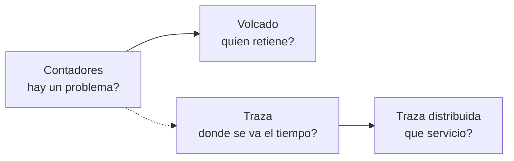
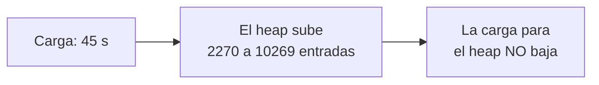

<!-- _class: lead -->

# Módulo 6 - Diagnóstico en producción

### .NET de alto rendimiento

**Rogelio Arriaga - Raptor Dev Services**

---

## Hoy

> En producción no hay depurador: hay contadores, volcados y trazas.

- **Parte 1:** qué pregunta contesta cada herramienta
- **Parte 2:** `dotnet-counters`: ver crecer la memoria sin parar la API
- **Parte 3:** cómo se lee una fuga (heap contra working set)
- **Parte 4:** `dotnet-dump`: quién retiene los objetos
- **Parte 5:** `dotnet-trace`: dónde se va el tiempo
- **Parte 6:** trazas distribuidas y un runbook
- **Práctica:** una fuga sembrada, encontrada con contadores y un volcado

Lecturas: [10 - Tracing distribuido](../../../10-cloud/17-tracing-distribuido.md) y la nota nueva [48 - Diagnóstico en producción](../../../04-backend/48-diagnostico-en-produccion.md)

Esta clase continúa los módulos 1 y 2: ahí se mide con BenchmarkDotNet y se aprende el recolector; aquí se mide **un proceso vivo**.

---

## Cómo se leen las cifras de esta clase

- Entorno: .NET 10 (SDK 10.0.403, runtime 10.0.14), `dotnet-counters`, `dotnet-dump` y `dotnet-trace` versión 10.0.750501, Intel Core i5-11500, **un contenedor de Docker con 4 CPU**, en un servidor compartido y con carga, a noviembre de 2026.
- No hay BenchmarkDotNet aquí: son **corridas únicas** de la API de ejemplo con carga local de 45 segundos. Los números son de esa corrida; lo que importa es la **forma** (sube y no baja), no la cifra exacta.
- Todo está en [`referencia/mediciones/`](../referencia/mediciones/README.md) y el código en [`referencia/ApiEjemplo/`](../referencia/ApiEjemplo/Program.cs) y [`referencia/Carga/`](../referencia/Carga/Program.cs).

> **Solo la API de ejemplo, en tu máquina.** Nunca apuntes estas herramientas ni la carga a un servicio ajeno. En un servicio propio, pide permiso: un volcado contiene toda la memoria del proceso y escribirlo cuesta recursos (la documentación de `dotnet-dump` advierte del consumo de memoria).

---

<!-- _class: lead -->

# Parte 1
## Qué pregunta contesta cada herramienta

---

## Cuatro preguntas, cuatro herramientas

| Pregunta | Herramienta | Qué entrega |
|---|---|---|
| ¿Qué está pasando **ahora** (memoria, GC, hilos)? | `dotnet-counters` | Números que se actualizan cada pocos segundos |
| ¿Qué objetos ocupan la memoria y **quién los retiene**? | `dotnet-dump` | Una foto completa de la memoria del proceso |
| ¿Dónde se va el **tiempo** del proceso? | `dotnet-trace` | Un registro de eventos y muestras de pilas |
| ¿Por qué **esta petición** tardó, a través de varios servicios? | Trazas distribuidas | Un árbol de operaciones con duración |



- Se empieza por lo barato: los contadores no detienen nada.
- Cada paso baja un nivel de detalle y sube el costo.

---

## Lo que dice la documentación de cada una

- `dotnet-counters`: "a performance monitoring tool for ad-hoc health monitoring and first-level performance investigation". Observa valores publicados con la API de `EventCounter` o la de `Meter`.
- `dotnet-dump`: recolecta y analiza volcados "without any native debugger involved"; permite correr comandos SOS para analizar fallas y el recolector.
- `dotnet-trace`: recolecta trazas de un proceso en ejecución "without a native profiler", sobre `EventPipe` del runtime.

Fuentes: documentación de las tres herramientas en learn.microsoft.com (en Referencias).

---

## La trampa de empezar por el volcado

Un volcado completo es lo más detallado y lo más caro. En la medición de este módulo el volcado de una API que tenía unos 240 MB en el heap pesó **553 492 480 bytes** (`ls -la` en [`tools-D.log`](../referencia/mediciones/tools-D.log)).

- Antes de tomarlo, los **contadores** dicen si de verdad hay un problema y de qué tipo.
- Si el problema es tiempo y no memoria, un volcado no ayuda: se necesita una traza.
- Si el problema cruza servicios, ninguna herramienta de un solo proceso alcanza.

---

<!-- _class: lead -->

# Parte 2
## `dotnet-counters`

---

## Instalar y encontrar el proceso

```bash
dotnet tool install --global dotnet-counters
dotnet-counters ps
```

Fragmento. En la medición, `dotnet-counters ps` listó el proceso de la API:

```
 121  dotnet  /usr/share/dotnet/dotnet  dotnet ApiEjemplo/bin/Release/net10.0/ApiEjemplo.dll
```

Condiciones que la documentación pide en Linux:

- La herramienta y el proceso **comparten la variable `TMPDIR`** (hablan por un socket en ese directorio); si no, el comando se agota.
- Se corre **como el mismo usuario** del proceso, o como root.

---

## monitor y collect

```bash {1-2|4-8|*}
# Ver en vivo (se refresca cada 3 s)
dotnet-counters monitor -p <PID> --refresh-interval 3 --counters System.Runtime

# Guardar a un archivo para revisarlo después
dotnet-counters collect -p <PID> --refresh-interval 5 --format csv \
  -o contadores.csv \
  --counters "System.Runtime[dotnet.gc.last_collection.heap.size,dotnet.process.memory.working_set],ApiEjemplo"
```

- `--counters` acepta `proveedor[:contador]`: el proveedor de un `Meter` es el nombre del `Meter`.
- Desde .NET 9 hay un `Meter` llamado `System.Runtime` con métricas del runtime (versiones anteriores caen a los `EventCounters` viejos).
- `collect` escribe `csv` o `json`.

Fuente: documentación de `dotnet-counters` y de las métricas integradas.

---

## Qué muestra System.Runtime

Según la documentación, entre otras:

| Métrica | Qué es |
|---|---|
| `dotnet.gc.collections` | Recolecciones, por generación |
| `dotnet.gc.heap.total_allocated` | Bytes asignados en total |
| `dotnet.gc.last_collection.heap.size` | Tamaño del heap por generación **en la última recolección** |
| `dotnet.process.memory.working_set` | Memoria física del proceso |
| `dotnet.thread_pool.thread.count` | Hilos del pool |
| `dotnet.thread_pool.queue.length` | Trabajos en cola |

> Fíjate en la palabra "last collection": el tamaño del heap se **actualiza cuando el recolector corre**, no a cada asignación.

---

## Un Meter propio

La API de ejemplo publica dos métricas suyas, con `System.Diagnostics.Metrics`:

```csharp {1|2|3-4|*}
var meter = new Meter("ApiEjemplo");
var peticiones = meter.CreateCounter<long>("ejemplo.peticiones", "peticion", "Peticiones atendidas por /pedido/{id}");
var fuga = new ConcurrentDictionary<int, byte[]>();
meter.CreateObservableGauge("ejemplo.cache.entradas", () => fuga.Count, "entrada", "Entradas en la cache sin limite");
```

- Un **contador** (`Counter`) solo sube; un **medidor observable** (`ObservableGauge`) se consulta en cada lectura.
- Esa métrica de negocio ("cuántas entradas tiene mi caché") es la que une la memoria con una causa.
- `dotnet-counters` la ve por el nombre del `Meter`: `--counters ApiEjemplo`.

---

## Detener `collect` en un script

Lección medida: `dotnet-counters collect` lanzado **en segundo plano desde un script** ignoró `SIGINT` y el script se quedó esperando. La documentación dice que la herramienta se detiene con Ctrl+C o con `SIGTERM`; con `kill -TERM <pid>` terminó y dejó el `.csv`.

```bash
dotnet-counters collect -p $PID --format csv -o c.csv ... &
CNT=$!
sleep 30
kill -TERM $CNT; wait $CNT
```

Fragmento. Cada herramienta tiene su manera de terminar: léela antes de automatizar.

---

<!-- _class: lead -->

# Parte 3
## Cómo se lee una fuga

---

## El experimento

La API de ejemplo tiene `/pedido/{id}`: arma un arreglo de 20 000 bytes por cada `id` y lo guarda en un diccionario **sin límite** (`CACHE=fuga`). Con 4 clientes y 10 ms de pausa, 45 segundos de carga.

| Momento | Entradas | Heap (suma de generaciones) | Working set |
|---|---|---|---|
| 15:04:53 | 2 270 | 51.8 MB | 147.2 MB |
| 15:05:18 | 6 215 | 87.5 MB | 226.4 MB |
| 15:05:28 | 9 613 | 221.6 MB | 313.0 MB |
| 15:05:33 | 10 269 | 221.6 MB | 330.0 MB |

Fuente: [`resumen-D-contadores.txt`](../referencia/mediciones/resumen-D-contadores.txt) (suma de gen0, gen1, gen2, LOH y POH de `dotnet.gc.last_collection.heap.size`).

---

## Lo que la gráfica dice



- Cuando la carga terminó, el heap siguió en **221.6 MB** durante más de siete minutos de contadores (hasta las 15:12:53).
- Memoria que **sube con la carga y no baja cuando la carga para** es la firma de algo que sigue referenciado.
- Una subida que luego baja tras una recolección de gen 2 es otra cosa: es trabajo normal del recolector.

---

## Heap no es working set

En la misma corrida:

- El working set llegó a **330 MB** y después bajó a unos **209 MB**.
- El heap siguió en **221.6 MB**.

Son dos medidas distintas: el working set es memoria física del proceso (la decide el sistema operativo también) y el heap es lo que el recolector administra. Un working set que baja **no** prueba que la fuga se haya ido.

> Regla: para decidir si hay una fuga, mira el heap por generación y el contador de recolecciones; usa el working set para saber cuánta RAM ocupa el proceso.

---

## La versión corregida, medida igual

Con `CACHE=acotada` el endpoint usa `IMemoryCache` con límite de 100 entradas y expiración por inactividad.

| | Fuga | Acotada |
|---|---|---|
| Peticiones en 45 s | 10 269 | 15 275 |
| Heap al final (`/diag`) | 214 MB | 4 MB |
| Heap en contadores | 51.8 a 221.6 MB | ~3.0 a 3.1 MB, plano |
| Working set | 147 a 330 MB | ~103 a 106 MB, plano |
| gen0 / gen1 / gen2 | 7 / 2 / 1 | 30 / 27 / 1 |

Fuentes: [`tools-D.log`](../referencia/mediciones/tools-D.log) y [`resumen-D-contadores.txt`](../referencia/mediciones/resumen-D-contadores.txt). La versión acotada recolecta más veces gen0 y gen1 porque sus objetos mueren rápido; ese es el costo normal de no retener.

---

## Dos cosas que no se explicaron

- La **primera petición** de la API tardó más de 11 s en frío (la latencia máxima de la carga con fuga fue 14 185.7 ms; con la acotada, 130.4 ms). **No se investigó la causa**: se dice porque aparece en la medición y por eso la práctica calienta antes de medir.
- Las cifras de una sola corrida no son un promedio. Para una conclusión firme se repite la corrida.

---

<!-- _class: lead -->

# Parte 4
## `dotnet-dump`

---

## Tomar el volcado

```bash
dotnet tool install --global dotnet-dump
dotnet-dump collect -p <PID> --type Full -o fuga.dmp
```

Fragmento. Tipos, según la documentación: `Full` (todo, incluidas las imágenes de módulos), `Heap`, `Mini` y `Triage` ("PII removed"). Si no se indica, `Full`.

En la medición (`Full`):

```
Writing full to /work/resultados/fuga.dmp
Complete
-rw------- ... 553492480 ... fuga.dmp
```

- El archivo quedó con permisos `-rw-------`: solo su dueño lo lee. Un volcado es **memoria del proceso en un archivo**.

---

## Un volcado es un secreto

Lo que estaba en memoria está en el archivo: tokens, contraseñas de conexión, datos de personas. Criterio de trabajo:

- Se trata como **dato sensible**: se guarda donde solo lo lea quien investiga, se comparte lo mínimo y se **borra** al terminar.
- La documentación ofrece `--type Triage` ("a small dump... with PII removed") cuando basta con pilas y excepciones.
- En un contenedor con límite de memoria, la documentación advierte que un volcado `Full` o `Heap` puede hacer que el sistema pagine mucha memoria y **mate el contenedor** si se pasa del límite: pruébalo antes de necesitarlo.

---

## Condiciones en un contenedor

La documentación de `dotnet-dump` indica que en un contenedor se necesita `ptrace`; una forma común es iniciarlo con `--cap-add=SYS_PTRACE`, y a veces ajustar el perfil de seccomp.

En la medición, la API, los contadores y el volcado corrieron **dentro del mismo contenedor y con el mismo usuario**, y el volcado funcionó sin agregar capacidades. No es una garantía para tu entorno: si falla, empieza por `ptrace` y por `TMPDIR`.

---

## Analizar: ¿qué ocupa la memoria?

```bash
dotnet-dump analyze fuga.dmp -c "dumpheap -stat" -c "exit"
```

Fragmento; salida medida (últimas filas, ordenadas por tamaño total):

```
            MT    Count    TotalSize Class Name
...      18,462      738,480 ...ConcurrentDictionary<Int32, Byte[]>+Node
...      27,284    3,249,704 System.String
...      10,892   29,235,088 Free
...      11,001  205,757,768 System.Byte[]
Total 138,845 objects, 243,393,926 bytes
```

- **11 001 `Byte[]` suman 205 757 768 bytes** de los 243 393 926 del heap: alrededor del 85 %, calculado de esas dos cifras.
- El tipo dice **qué** ocupa la memoria. No dice **por qué sigue ahí**.

---

## Analizar: ¿quién lo retiene?

`gcroot` muestra la cadena de referencias desde una raíz hasta un objeto. Se toma la dirección de un `Byte[]` de 20 000 elementos (20 024 bytes con su encabezado) y se pregunta:

```bash
dotnet-dump analyze fuga.dmp -c "gcroot <direccion>" -c "exit"
```

Salida medida (recortada):

```
-> RouteEndpointDataSource+RouteEntry[]
-> System.Func<Int32, IMemoryCache, IResult>
-> Program+<>c__DisplayClass0_0
-> ConcurrentDictionary<Int32, Byte[]>
-> ConcurrentDictionary<Int32, Byte[]>+Tables
-> ...+VolatileNode[]
-> ...+Node
-> System.Byte[]
```

Fuente: [`tools-D3.log`](../referencia/mediciones/tools-D3.log).

---

## Leer la cadena

1. La raíz es el **enrutamiento** de ASP.NET: mientras la aplicación viva, vive el delegado de `/pedido/{id}`.
2. Ese delegado captura (`DisplayClass`) una variable local: **el diccionario**.
3. El diccionario guarda cada `Byte[]` en sus nodos.

La causa no es un tipo raro: es un **diccionario estático sin límite ni expiración**, que es el patrón de la caché que nadie vació. La corrección está en la política (tamaño máximo y expiración), no en el recolector.

> El recolector no libera lo que alcanzas desde una raíz. "Fuga" en .NET casi siempre significa "todavía lo referencias".

---

## Otros comandos de `analyze` que se usan

| Comando | Para qué (según la documentación) |
|---|---|
| `dumpheap -stat` | Estadística de objetos del heap por tipo |
| `dumpheap -type X -min N` | Objetos de un tipo, con un tamaño mínimo |
| `gcroot <dir>` | Raíces que retienen un objeto |
| `eeheap -gc` | Tamaño del heap por segmento |
| `clrstack -all` | Pilas de todos los hilos |
| `threadpool` | Estado del pool de hilos |

También se usa para bloqueos (`syncblk`) y comparar dos volcados tomados con tiempo entre uno y otro.

---

<!-- _class: lead -->

# Parte 5
## `dotnet-trace`

---

## Cuándo usarlo

Cuando el problema no es memoria sino **tiempo**: una petición tarda y quieres saber qué métodos estaban en la pila durante la medición.

```bash
dotnet-trace collect -p <PID> --duration 00:00:00:12 -o cpu.nettrace
dotnet-trace report cpu.nettrace topN -n 12
```

- `--duration` usa el formato `dd:hh:mm:ss`.
- Sin `--profile`, la documentación dice que se activan `dotnet-common` y `dotnet-sampled-thread-time`: muestreo de pilas de hilos para estimar el tiempo que usa el código. (La documentación aclara que el perfil viejo `cpu-sampling` se quitó porque muestreaba todos los hilos sin importar si usaban CPU.)
- Detener la traza puede tardar: la herramienta avisa que "may take several minutes" en aplicaciones grandes.

---

## Una traza real, leída con honestidad

Carga: `/reporte?pedidos=3000&version=1` (concatenación con `+=`, módulo 2) con 2 clientes; traza de 12 s. `report topN` (exclusivo):

```
 1. Monitor.Wait                              15.43%
 2. WaitHandle.WaitOneNoCheck                 15.43%
 3. LowLevelLifoSemaphore.WaitNative          12.28%
 4. LowLevelLifoSemaphore.WaitForSignal        9.7%
 5. Missing Symbol                             7.74%
 6. __Canon].Resize                            7.68%
 7. ApiEjemplo!Program+<>c.<<Main>$>b__0_6     7%   (inclusivo 15.1%)
 8. Buffer.MemmoveInternal                     6.98%
 ...
12. String.Concat                              0.87%
```

---

## Cómo se lee esa tabla

- Las primeras posiciones son **hilos esperando** (`Monitor.Wait`, semáforos del pool): hilos ociosos del pool, no trabajo. En una traza real hay que **saltarlas** y buscar los marcos propios.
- Entre ellos aparecen los tuyos: el lambda del endpoint (`ApiEjemplo!Program+<>c...`) con **15.1 % inclusivo**, `String.Concat`, `Buffer.MemmoveInternal` (copiar memoria) y `Resize`.
- "Missing Symbol" (7.74 %) son marcos sin nombre: no se pueden atribuir.
- `topN` usa tiempo **exclusivo** por omisión; con `--inclusive` ordena por tiempo inclusivo.

> Una traza no dice "arregla esto": dice dónde mirar. La conclusión "la concatenación es el costo" ya la mostraron los benchmarks del módulo 2; la traza lo confirma en un proceso vivo.

---

## Dónde se abre una traza

Según la documentación de `dotnet-trace`: los `.nettrace` se abren en Visual Studio o en PerfView (Windows). En Linux se puede pedir `--format speedscope` y abrir el archivo en https://www.speedscope.app. Convertir a `speedscope` o `chromium` es irreversible: se conserva el `.nettrace` original.

Para el curso basta `report topN`, que corre en la misma terminal.

---

<!-- _class: lead -->

# Parte 6
## Trazas distribuidas y el runbook

---

## Cuando el problema no cabe en un proceso

Una petición pasa por varios servicios. Cada servicio ve su pedazo; ninguno ve el total. Un **trace** une los pedazos bajo un identificador.

Según la documentación de .NET:

- Cada unidad de trabajo es una `System.Diagnostics.Activity`, y el trace es un árbol de actividades que puede cruzar procesos. ("Span" es el nombre común en la industria; .NET adoptó "Activity" antes.)
- Con el estándar W3C TraceContext (predeterminado desde .NET 5), cada trace tiene un `trace-id` de 16 bytes y cada actividad un `span-id` de 8 bytes.
- ASP.NET y `System.Net.Http` leen y escriben ese identificador en HTTP **sin código especial**.

La nota [10 - Tracing distribuido](../../../10-cloud/17-tracing-distribuido.md) muestra cómo montarlo.

---

## Recolectar y muestrear

- Las actividades hay que **enviarlas a un almacén**: la documentación menciona Application Insights, OpenTelemetry o una librería de un proveedor.
- Para alto volumen hay **muestreo**: registrar solo una parte de los traces. La documentación dice que una actividad no registrada puede costar menos de 100 nanosegundos, y una completa alrededor de un microsegundo con un colector eficiente (cifras de la documentación, "on modern hardware"; no se midieron aquí).

---

## Un runbook de memoria

1. **Confirmar:** `dotnet-counters monitor` de `System.Runtime`: ¿el heap sube y no baja tras gen 2? ¿cuántas recolecciones?
2. **Separar:** heap contra working set. ¿Es memoria administrada?
3. **Cuánto y desde cuándo:** `collect` a csv durante unos minutos.
4. **Foto:** `dotnet-dump collect` (con permiso, sabiendo que es sensible y que puede pausar el proceso).
5. **Qué:** `dumpheap -stat`: tipo con mayor total.
6. **Quién:** `gcroot` de una instancia.
7. **Corregir en la política** (límite, expiración, desuscribir) y **volver a medir** con los mismos contadores.
8. **Borrar** el volcado.

---

## Errores típicos

| Error | Por qué falla |
|---|---|
| Llamar "fuga" a toda subida de memoria | Una subida que baja tras gen 2 es normal |
| Mirar solo el working set | No es el heap |
| Tomar un volcado sin mirar contadores | Costoso y quizá innecesario |
| Dejar el volcado en una carpeta compartida | Contiene la memoria del proceso |
| Corregir sin volver a medir | No sabes si arreglaste algo |
| Usar un volcado para un problema de tiempo | Una traza lo contesta; un volcado no |
| Probar contra el servicio de otro | No lo hagas |

---

## Práctica

[Práctica: una fuga sembrada, encontrada con contadores y un volcado](practica.md)

1. Levantar la API de ejemplo con `CACHE=fuga` en un contenedor, con las tres herramientas.
2. **Verlo fallar:** la memoria sube con la carga y **no baja** al detenerla.
3. Contadores, volcado, `dumpheap -stat` y `gcroot`.
4. Corregir con `CACHE=acotada` y volver a medir. Borrar el volcado.

Tarea: [su runbook de diagnóstico](tarea.md). Glosario: [términos del módulo](glosario.md).

---

## Cierre del curso y proyecto final

> Medir antes de optimizar. Lo que no se mide es una opinión.

Recorrido: medir (M1), memoria (M2), colecciones y Span (M3), concurrencia (M4), I/O y datos (M5) y diagnóstico en vivo (M6).

**Proyecto final:** tomar una API real, medirla bajo carga **local**, encontrar los tres cuellos de botella principales, corregirlos y entregar el antes y después con números, con el entorno dicho. Está descrito en el [README del curso](../README.md).

Criterio: cada mejora lleva su medición antes y después, con `Allocated` o con contadores, y una frase de por qué ese cuello y no otro.

---

## Referencias

**Documentación oficial (a noviembre de 2026)**

- [dotnet-counters](https://learn.microsoft.com/en-us/dotnet/core/diagnostics/dotnet-counters)
- [dotnet-dump](https://learn.microsoft.com/en-us/dotnet/core/diagnostics/dotnet-dump)
- [dotnet-trace](https://learn.microsoft.com/en-us/dotnet/core/diagnostics/dotnet-trace)
- [Distributed tracing concepts](https://learn.microsoft.com/en-us/dotnet/core/diagnostics/distributed-tracing-concepts)

**Libros (cada quien consigue su copia)**

- *Effective .NET Memory Management* (Williams, 2024), cap. 6 (profiling y optimización de memoria).
- *Systems Programming with C# and .NET* (Vroegop, 2024), cap. 10 (chequeos del sistema) y cap. 11 (depuración).
- *Tools and Skills for .NET 10* (Price, 2025), cap. 5 (logging, trazas y métricas).

**Notas de este repositorio:** [10 - Tracing distribuido](../../../10-cloud/17-tracing-distribuido.md), [48 - Diagnóstico en producción](../../../04-backend/48-diagnostico-en-produccion.md), [20 - Memoria y GC](../../../04-backend/20-memoria-gc.md).

*Versiones de las herramientas: 10.0.750501, a noviembre de 2026. Cambian; verifica con `--version`.*
