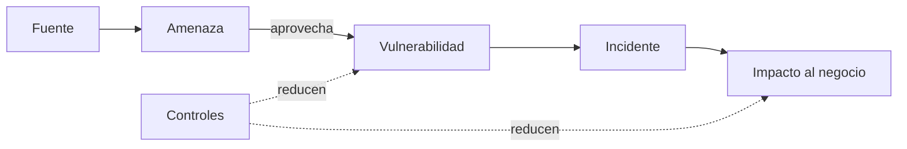
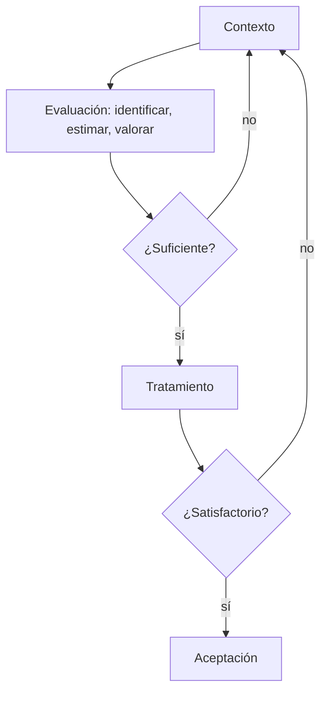

<!-- _class: lead -->

# U1 - Introducción a la seguridad de la información

### Seguridad de la información

**Rogelio Arriaga - Raptor Dev Services**

<!--
Unidad de 5 horas. Hilo conductor: antes de proteger, nombrar bien las cosas. Se abre con la historia
(la información siempre fue poder), se fija el vocabulario, se comparan NIST e ISO y se cierra con el
proceso de gestión de riesgos de ISO/IEC 27005. Lecturas: notas 01, 02 y 03 de 12-seguridad/04.
-->

---

## El lema de la unidad

> Antes de proteger hay que saber qué vale, contra qué y cuánto cuesta no hacerlo.

Hoy no compramos nada ni escribimos políticas: aprendemos a hacer las tres preguntas con las palabras correctas.

---

## Objetivos de la unidad

- Describir los principios y conceptos fundamentales de la seguridad de la información a partir de la normatividad internacional.
- Analizar la propuesta de gestión de riesgos del NIST, enfocada en tecnologías de la información.
- Analizar la propuesta de gestión de riesgos de ISO, aplicable a cualquier organización.

---

## Agenda

| Bloque | Tema |
|---|---|
| 1 | La información siempre ha sido poder |
| 2 | Activo, tríada, amenaza, vulnerabilidad |
| 3 | Incidente, impacto, control y riesgo |
| 4 | NIST: la SP 800-30 |
| 5 | ISO: el SGSI y la familia 27000 |
| 6 | Gestión de riesgos con ISO/IEC 27005 |
| 7 | Cierre, práctica y tarea |

---

<!-- _class: lead -->

# Parte 1
## La información siempre ha sido poder

---

## Tres casos antes de internet

- **Delfos:** el oráculo se apoyaba en una red de informantes humanos.
- **El Porfiriato:** vigilancia de opositores como herramienta de control político.
- **El Telegrama Zimmermann (1917):** un mensaje cifrado de Alemania a su embajador en México, interceptado y descifrado por los británicos. Ayudó a que Estados Unidos entrara a la guerra.

<!--
Pregunta al grupo: en el caso Zimmermann, ¿qué falló, el cifrado o la gestión? Respuesta esperada:
el cifrado existía pero no resistió al adversario; el valor de la información dependía del bando.
-->

---

## De administrar un firewall a gestionar riesgos

Antes: herramientas en el perímetro.

Hoy, además:

- planeación estratégica y gobierno;
- leyes, normas, auditorías y análisis de brechas;
- análisis de comportamiento con ciencia de datos;
- canales protegidos para compartir con quien está autorizado.

Tanta variedad necesita un **sistema**: eso es lo que construye esta materia.

---

<!-- _class: lead -->

# Parte 2
## El vocabulario

---

## Dato, información, activo

| Concepto | Ejemplo |
|---|---|
| Dato | 4,500 |
| Información | El saldo de la cuenta de nómina de la persona X es de 4,500 pesos |
| Activo | La información, más el servidor donde vive, la red por donde viaja y quien la produce y la recibe |

La pregunta que ordena todo: **¿qué es lo que realmente queremos proteger?**

---

## Qué es seguridad de la información

- **ISO/IEC 27000:** conservar la confidencialidad, la integridad y la disponibilidad.
- **Harkins (2016):** proteger para habilitar al negocio.
- **Lundgren y Möller (2019):** la tríada se queda corta; proponen garantizar el acceso apropiado.

Comparar definiciones es parte del oficio: construyan la suya.

---

## La tríada con casos

| Propiedad | Se rompe cuando... |
|---|---|
| Confidencialidad | La lista de precios de un portal interno aparece en un sitio extranjero |
| Integridad | La página pública muestra la foto de una celebridad en lugar del contenido |
| Disponibilidad | Una denegación de servicio tumba la banca en línea |

Otras propiedades: autenticidad, no repudio, responsabilidad y confiabilidad.

<!--
Los dos primeros casos vienen de preguntas del quiz: úsalos para que identifiquen la propiedad antes
de mostrar la columna.
-->

---

## Vulnerabilidad, amenaza y fuente

- **Vulnerabilidad:** debilidad de un activo o de un control que una amenaza puede aprovechar.
- **Amenaza:** causa potencial de un incidente no deseado.
- **Fuente de amenaza:** quién o qué la origina; se valora por **capacidad** y **motivación**.

"Hackers" no es una amenaza: es una fuente. La amenaza es lo que podrían hacer contra un activo concreto.

---

## Los activos también son personales

En redes sociales el activo es la identidad, la reputación, la ubicación, la rutina.

Las fuentes de amenaza van desde un acosador hasta una red de fraude que arma perfiles con lo que publicamos.

<!--
Liga con la práctica de la unidad (censura y control de contenidos): quien vigila también es una
fuente posible.
-->

---

<!-- _class: lead -->

# Parte 3
## Incidente, impacto, control y riesgo

---

## Incidente e impacto

- **Incidente:** una amenaza aprovecha una vulnerabilidad.
- La definición de ISO mira la operación del negocio; se queda corta con daños a personas o a la reputación.
- **Impacto:** depende de la organización. La alteración del sitio del Senado en 2008 fue un golpe de imagen; en un banco sería un golpe económico.

---

## Control y riesgo

- **Control:** medida que modifica el riesgo (proceso, política, dispositivo, práctica).
- Un control **no siempre** produce el efecto esperado.
- Los controles también tienen vulnerabilidades.
- Conclusión: **el riesgo nunca es cero**.

---

## Cómo se relacionan

---

## Cinco estrategias frente al riesgo

| Estrategia | Ejemplo |
|---|---|
| Transferir | Seguro de ciberriesgos |
| Aceptar | Equipo de pruebas sin datos reales, sin cifrado |
| Evitar | Dejar de guardar tarjetas que no se necesitan |
| Compartir | Sitio alterno en consorcio |
| Mitigar | Autenticación multifactor y parches |

La gestión del riesgo ofrece más que mitigar.

---

<!-- _class: lead -->

# Parte 4
## NIST: la SP 800-30

---

## Dos escuelas

| | NIST | ISO |
|---|---|---|
| Entrega | Procedimiento paso a paso | Marco de requisitos |
| Activos | Ligados a TI | Todo lo que tiene valor |
| Costo | Gratuito | De pago |
| Enfoque | Claridad y aplicación directa | Procesos y mejora continua |

<!--
Antes de la tabla, la provocación de Stallman: ¿puede confiar en su ordenador? Toda norma refleja a
quien la escribió. Todo depende del cristal con que se mire.
-->

---

## Los nueve pasos de la evaluación (SP 800-30)

1. Caracterizar el sistema
2. Identificar amenazas
3. Identificar vulnerabilidades
4. Analizar controles
5. Determinar la probabilidad
6. Analizar el impacto
7. Determinar el riesgo
8. Recomendar controles
9. Documentar resultados

---

## La matriz de riesgo

| Probabilidad \ Impacto | Bajo (10) | Medio (50) | Alto (100) |
|---|---|---|---|
| Alta (1.0) | 10 | 50 | 100 |
| Media (0.5) | 5 | 25 | 50 |
| Baja (0.1) | 1 | 5 | 10 |

Alto: corregir ya. Medio: plan en plazo razonable. Bajo: corregir o aceptar.

Actualización: la guía de 2002 se retiró; hoy rige la SP 800-30 Rev. 1 (2012).

---

<!-- _class: lead -->

# Parte 5
## ISO: el SGSI

---

## El SGSI y la familia 27000

- **SGSI:** sistema construido alrededor de la evaluación de riesgos del negocio para establecer, implantar, operar, vigilar, revisar, mantener y mejorar la seguridad.
- **27001:** requisitos (la única certificable para una organización).
- **27002:** controles. **27003:** guía. **27004:** medición. **27005:** riesgos. **27006:** certificadoras.

Actualización: 27001 y 27002 vigentes en su edición 2022; 27000 en su edición 2026.

---

## El ciclo PDCA

| Fase | SGSI | Gestión del riesgo |
|---|---|---|
| Planear | Establecer | Contexto, evaluación, plan de tratamiento, aceptación |
| Hacer | Implantar y operar | Ejecutar el plan |
| Verificar | Vigilar y revisar | Seguimiento de los riesgos |
| Actuar | Mantener y mejorar | Mejorar el proceso |

---

## Establecer el SGSI en diez pasos

Alcance, política aprobada, enfoque de evaluación, identificar riesgos, analizarlos, opciones de tratamiento, objetivos de control y controles, aprobación del riesgo residual, autorización para operar y **declaración de aplicabilidad**.

La dirección firma tres veces: la política, el riesgo residual y la implantación.

---

<!-- _class: lead -->

# Parte 6
## Gestión de riesgos con ISO/IEC 27005

---

## El proceso

Comunicación y seguimiento corren en paralelo.

---

## El contexto: tres criterios

- **Evaluación:** valor estratégico, criticidad, ley, contratos, expectativas.
- **Impacto:** grado de daño o costo de un incidente.
- **Aceptación:** umbrales que la organización tolera.

Más alcance y límites, y quién hace qué.

---

## Identificar, estimar, valorar

| Paso | Entrega |
|---|---|
| Identificar activos, amenazas, controles, vulnerabilidades y consecuencias | Escenarios de incidente |
| Estimar consecuencias y probabilidad | Lista de riesgos con nivel |
| Valorar contra los criterios | Lista de riesgos priorizados |

Cualitativa: fácil pero subjetiva. Cuantitativa: comparable, depende de los datos.

<!--
Actualización para comentar: la 27005 vigente es la de 2022, con diez cláusulas, alineada a la
27001:2022 y a ISO 31000; admite identificar riesgos por eventos o por activos.
-->

---

## ISO/IEC 27001:2022 en una lámina

| Cláusula | Tema |
|---|---|
| 4 | Contexto |
| 5 | Liderazgo |
| 6 | Planificación |
| 7 | Soporte |
| 8 | Operación |
| 9 | Evaluación del desempeño |
| 10 | Mejora |

Anexo A: 93 controles en cuatro temas. La transición desde la edición 2013 terminó el 31 de octubre de 2025.

---

<!-- _class: lead -->

# Cierre
## Lo que te llevas

---

## Conclusiones

- La información es un activo crucial para cualquier organización.
- La seguridad de la información tiene muchas definiciones y combina aspectos de distinta naturaleza.
- Distinguir amenaza y fuente de amenaza evita análisis de riesgo confusos.
- Una vulnerabilidad puede estar en el activo o en el esfuerzo por protegerlo.
- La gestión del riesgo ofrece más caminos que la mitigación.
- El SGSI es el término de ISO; otros autores hablan de plan de seguridad.

---

## Práctica y tarea

- **Práctica:** censura y control de contenidos en internet. ¿Deben gobiernos y empresas vigilar lo que hacemos en línea?
- **Tarea:** mapa conceptual que conecte la tríada, amenazas y controles con procesos y activos de una organización.

Instrucciones completas en los archivos de la unidad.

---

## Siguiente unidad

> Si un proyecto no contribuye a los objetivos más altos de la organización, no debería ejecutarse.

Seguridad en las organizaciones: ¿gasto o inversión?, complejidad y marcos de referencia.
