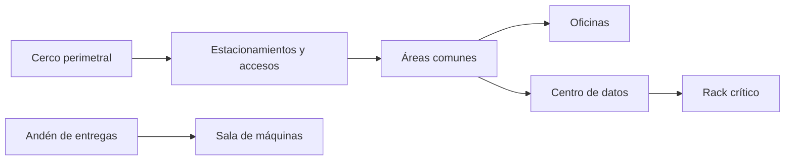
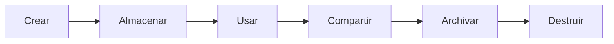

<!-- _class: lead -->

# U3 - Seguridad física y lógica

### Seguridad de la información

**Rogelio Arriaga - Raptor Dev Services**

<!--
Unidad de 5 horas. Hilo conductor: de afuera hacia adentro. Se parte del contexto global de riesgos,
se recorren las capas de la defensa en profundidad (física primero, lógica después) y se termina en el
dato y su ciclo de vida. Lecturas: notas 07, 08 y 09 de 12-seguridad/04.
-->

---

## El lema de la unidad

> Los controles lógicos más avanzados no sirven si alguien puede llegar al hardware.

---

## De qué trata

- Las TIC transformaron cómo se gestionan los recursos, cómo nos relacionamos con los grupos de interés y cómo se genera valor.
- Los usuarios de una sociedad de la información imponen reglas de facto a la forma de hacer negocios.
- El aseguramiento debe integrar el entorno físico y el ciberespacio.
- Seguridad y privacidad **por diseño** y **por defecto**: cada vez más presentes en leyes y estándares.

---

## Objetivos de la unidad

- Describir las amenazas y los riesgos de la sociedad de la información a partir del contexto internacional.
- Examinar los controles de seguridad física según las necesidades de cada sector.
- Examinar los controles de seguridad lógica según las necesidades de cada sector.

---

## Agenda

| Bloque | Tema |
|---|---|
| 1 | El valor de los datos y la sociedad de la información |
| 2 | Riesgos globales y panorama de amenazas |
| 3 | Tipos de control |
| 4 | Defensa en profundidad y zonas seguras |
| 5 | Controles físicos y ambientales |
| 6 | Seguridad lógica, cadena de intrusión y ciclo de vida del dato |
| 7 | Cierre |

---

<!-- _class: lead -->

# Parte 1
## Riesgo en la sociedad de la información

---

## El valor de los datos

| Ángulo | Pregunta |
|---|---|
| Cumplimiento | ¿Se gestiona según la ley? |
| Seguridad | ¿Está protegido contra acceso, pérdida o corrupción? |
| Gobierno | ¿Se administra con eficiencia y responsabilidad? |

El valor decide dónde se guarda y dónde se procesa un dato.

---

## La Cumbre Mundial sobre la Sociedad de la Información

- Ginebra 2003 y Túnez 2005, con gobiernos, organismos, empresas y sociedad civil.
- Once principios; el quinto: **confianza y seguridad en el uso de las TIC**.
- La Agenda de Túnez creó el Foro para la Gobernanza de Internet.

---

## Riesgos globales

- El Foro Económico Mundial publica su *Global Risks Report* cada año.
- En 2019, el fraude o robo de datos y los ciberataques estaban entre los cinco más probables.
- En 2026, la inseguridad cibernética sigue entre los diez primeros a dos años.

Nuevos paradigmas: cómputo cuántico, nanotecnología, tecnologías alimentarias.

---

## El panorama de amenazas

ENISA 2021: ransomware, malware, criptominado, correo, amenazas a los datos, a la disponibilidad e integridad, desinformación, errores no maliciosos y cadena de suministro.

Actualización: el informe 2025 analizó 4,875 incidentes; el phishing sigue como principal vía de entrada y el ransomware como el más dañino.

---

## Cinco tipos de control

| Tipo | Función |
|---|---|
| Preventivo | Evitar el evento |
| Detectivo | Encontrarlo y avisar |
| Correctivo | Reparar el daño |
| Disuasivo | Convencer de no actuar |
| Compensatorio | Sustituir temporalmente un control que no se puede cumplir aún |

<!--
Pregunta para el grupo: ¿una cámara visible es detectiva o disuasiva? Las dos. Un mismo control
puede cumplir varias funciones.
-->

---

<!-- _class: lead -->

# Parte 2
## Seguridad física

---

## Defensa en profundidad

| Capa | Ejemplo |
|---|---|
| Políticas y procedimientos | Clasificación, capacitación |
| Física | Cercas, guardias, acceso |
| Perímetro | Firewall, VPN |
| Red interna | Segmentación |
| Dispositivo | Parches, cifrado de disco |
| Aplicación | Desarrollo seguro |
| Datos | Cifrado, respaldos |

---

## Áreas seguras

- **Zona segura:** donde se procesa información y ocurren los procesos críticos.
- **Zona de carga y descarga:** transición de mercancías y activos; vigilarla para que no entre ni salga nada no previsto.
- ISO/IEC 27001:2013 dominio A.11; en la edición 2022, controles 7.1 a 7.14.

---

## Clasificar las zonas

Cada anillo tiene su propio control de entrada.

---

## La política: tres preguntas

1. ¿Qué personas pueden entrar a qué áreas?
2. ¿Qué motivo tienen para estar ahí?
3. ¿Lo justifica su necesidad de conocer?

---

## Cuatro posturas

| Postura | Regla |
|---|---|
| Paranoica | Nada está permitido |
| Prudente | Lo no permitido está prohibido |
| Permisiva | Lo no prohibido está permitido |
| Promiscua | Todo está permitido |

---

## Controles técnicos

- **Perímetro:** cercas (el control perimetral más común) e iluminación.
- **Acceso:** cerraduras con llave (el más común y barato), credenciales, biometría, esclusas.
- **Vigilancia:** guardias, perros, CCTV, reconocimiento facial.
- **Ambiente:** energía, humedad, temperatura.

---

## El manual del NIST: siete áreas

1. Control de acceso físico
2. Incendios
3. Falla de servicios de soporte (MTBF y MTTR)
4. Colapso estructural
5. Fugas de agua
6. Intercepción de datos (observación, líneas, emisiones)
7. Equipos móviles y portátiles

<!--
Tensión que vale la pena discutir: la seguridad de las personas pide salidas fáciles; la seguridad
física quiere controlar entradas. La vida va primero; las puertas con alarma y retardo equilibran.
-->

---

## Cómo se justifica un control físico

- Lo exige la ley.
- Cuesta casi nada y protege mucho.
- Atiende una exposición fatal a costo razonable (respaldos).
- Un análisis muestra que reduce pérdidas más de lo que cuesta.

Actualización: el manual de 1995 se sustituyó por la SP 800-12 Rev. 1 (2017); los controles físicos detallados están en la familia PE de la SP 800-53.

---

## Resiliencia e infraestructura crítica

- Resiliencia: recuperarse de un evento adverso y seguir operando.
- Metodología europea: sectores críticos, servicios críticos, activos y dependencias.
- En una empresa: áreas de negocio, procesos críticos, activos.

---

<!-- _class: lead -->

# Parte 3
## Seguridad lógica

---

## Cinco dominios de protección

| Dominio | Contra qué |
|---|---|
| Operaciones | Alterar procedimientos y flujos |
| Nacional | Ataques con fin político o militar |
| Información | Robo, borrado o alteración de datos |
| Comunicaciones | Abuso de la infraestructura técnica |
| Físico | Acceso a servidores, hardware malicioso, coerción |

---

## Roles frente a la política

| Rol | Responsabilidad |
|---|---|
| Alta dirección | Última responsable; debida diligencia |
| Profesional de seguridad | Redacta y aplica políticas |
| Dueño del dato | Clasifica |
| Custodio | Implanta los controles |
| Usuario | Cumple la política |
| Auditor | Verifica |

---

## La cadena de intrusión

Reconocimiento, armamento, entrega, explotación, instalación, comando y control, acciones sobre el objetivo.

Romper un eslabón detiene el ataque.

La cadena unificada (2017) añade lo que pasa dentro de la red: entrada, propagación y salida, en 18 fases.

---

## El ciclo de vida del dato

---

## Controles por fase y estado

| Fase | En tránsito | En uso | En reposo |
|---|---|---|---|
| Almacenar | | SED | Cifrado, tokenización |
| Usar | DLP | IRM/DRM | |
| Compartir | TLS, VPN | IRM/DRM | |
| Destruir | | Borrar caché | Borrado criptográfico |

---

## Proteger datos e identidad

- Conocer, evaluar, organizar, asegurar.
- Equipos: cifrado, parches, firewall personal, cuentas separadas, borrado seguro.
- Móviles: cifrado, bloqueo, localización, MDM, plan ante robo.
- Identidad: inventario propio y preguntas antes de entregar datos.

---

## CIS Controls

- v7.1: 20 controles en básicos, fundamentales y organizacionales.
- v8.1 (2024): 18 controles y 153 salvaguardas, con grupos de implementación IG1 a IG3.
- IG1 es la higiene cibernética mínima.

---

<!-- _class: lead -->

# Cierre
## Lo que te llevas

---

## Conclusiones

- El valor de algo combina su importancia con lo que cuesta mantenerlo.
- Los controles compensatorios cubren mientras llega el principal.
- Las zonas seguras y las de carga necesitan resguardo especial; el ambiente, controles propios.
- La cadena de intrusión, vista desde la defensa, dice dónde cortar.
- El ciclo de vida del dato permite poner el control adecuado en cada fase.
- Todo fraude busca dañar la esfera personal, jurídica, económica, social o reputacional.

---

## Práctica y tarea

- **Práctica:** mecanismos de seguridad para el teletrabajo a partir de la Ley Federal del Trabajo.
- **Tarea:** mapa de instalaciones con cinco puntos de riesgo físico y sus controles.

---

## Siguiente unidad

> La certificación prueba que el sistema de gestión cumple la norma, no que la empresa sea segura.

Gestión de la seguridad de la información.
