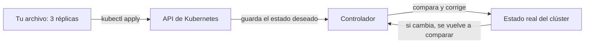
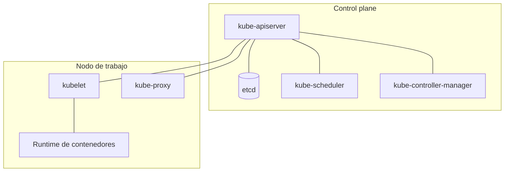

<!-- _class: lead -->

# S01 - Del contenedor al pod, y cuándo no

### Kubernetes: del Compose al clúster

**Rogelio Arriaga - Raptor Dev Services**

<!--
Sesión de 5 horas. Hilo conductor: el compose.yaml de un proyecto (una API y una base) se traduce a pods, línea
por línea, y al final se decide con argumentos si el proyecto necesita Kubernetes. La respuesta honesta puede ser "no".
Antes de empezar: cada equipo con Docker funcionando (curso devops-essentials o la nota 08-contenedores/03-compose.md).
Versión de referencia de la sesión: el clúster de laboratorio corrió con K3s v1.34.1+k3s1 el 11 de noviembre de 2026.
Aviso que se dice en voz alta: según kubernetes.io/releases (consultado ese día), la rama 1.34 de Kubernetes tiene fin de vida el 2026-10-27; el laboratorio la usa porque es la que se probó, y en producción se usa una rama mantenida.
-->

---

## El lema de hoy

> Kubernetes resuelve problemas de escala. Sin esos problemas, solo agrega piezas.

Hoy no se instala Kubernetes por moda: se instala para entender qué problema resuelve y para poder decir "no hace falta" con razones.

---

## Agenda

| Bloque | Qué hacemos |
|---|---|
| 1 | El punto de partida: un compose.yaml que funciona |
| 2 | Qué resuelve un orquestador |
| 3 | Las piezas de un clúster |
| 4 | Un clúster local: kind o K3s, y `kubectl` |
| 5 | Pods y etiquetas |
| 6 | Del compose.yaml a los pods, línea por línea |
| 7 | Compose o Kubernetes: la decisión, escrita como ADR |
| 8 | Práctica guiada, tarea y lo que sigue |

---

## Dónde estamos

Ejemplo ilustrativo: el `compose.yaml` de una API con su base de datos. Es el punto de partida de todo el curso.

```yaml
services:
  api:
    image: traefik/whoami:v1.10.3     # hace de API: responde con datos de la petición
    ports:
      - "8080:80"
    environment:
      WHOAMI_NAME: api-lab
    depends_on:
      - db
    restart: unless-stopped
  db:
    image: postgres:17
    environment:
      POSTGRES_PASSWORD: clave-de-laboratorio
      POSTGRES_DB: titulacion
    volumes:
      - datos:/var/lib/postgresql/data
volumes:
  datos:
```

- `docker compose up -d` y listo: dos contenedores, una red, un volumen.
- Para un servidor, un equipo pequeño y una aplicación, esto es **suficiente** y se entiende completo.

<!--
La imagen traefik/whoami es una API de juguete que devuelve nombre de host, IP y cabeceras. La usamos porque deja ver
qué réplica contestó. En el proyecto final cada equipo usa su propia API.
-->

---

## Lo que Compose no promete

| Situación | Con Compose en un servidor |
|---|---|
| El servidor se apaga | Todo se cae: hay un solo anfitrión |
| Necesitas 3 copias de la API | `docker compose up --scale api=3` las crea, pero en la misma máquina |
| Publicas una versión nueva | Se reemplaza el contenedor y hay un corte, salvo que lo orquestes tú |
| Un contenedor se cuelga sin morir | `restart:` solo mira si el proceso terminó, no si responde |
| Hay 40 servicios en 8 servidores | Cada servidor es una isla con su propio compose |

Kubernetes existe para esas filas. Si ninguna te duele hoy, esta sesión te sirve para saber qué te espera, no para migrar.

---

<!-- _class: lead -->

# Parte 1
## Qué resuelve un orquestador

---

## Cinco ideas, no cien comandos

Burns y colaboradores abren *Kubernetes: Up and Running* (2022), cap. 1, con las razones por las que existe la plataforma. Las que sostienen el curso:

<!-- _pasos: lista -->

- **Velocidad:** publicar cambios pequeños y seguido, sin cortes.
- **Inmutabilidad:** no se parcha un contenedor en marcha; se reemplaza por otro construido de la imagen nueva.
- **Configuración declarativa:** escribes el estado que quieres, no los pasos para llegar.
- **Autorreparación:** si el estado real se aleja del declarado, el sistema lo corrige solo.
- **Escalar:** más copias, o más máquinas, cambiando un número.

Fuente: Burns et al., *Kubernetes: Up and Running* (2022), cap. 1.

---

## Declarativo: la idea central



- Tú no dices "arranca un contenedor"; dices "quiero 3".
- Un **controlador** compara lo declarado con lo real, una y otra vez, y actúa en la diferencia.
- Esa comparación permanente es lo que Compose no hace: Compose ejecuta tu orden una vez.

Fuente: kubernetes.io, "Controllers" (documentación de conceptos).

---

## Demostración de autorreparación

Con un Deployment (lo vemos a fondo en la sesión 2) de 3 réplicas:

```console
$ kubectl delete pod web-7d4b9c6f5-abcde
pod "web-7d4b9c6f5-abcde" deleted
$ kubectl get pods
NAME                   READY   STATUS    RESTARTS   AGE
web-7d4b9c6f5-fghij    1/1     Running   0          2m
web-7d4b9c6f5-klmno    1/1     Running   0          2m
web-7d4b9c6f5-pqrst    1/1     Running   0          3s
```

Borraste un pod y apareció otro: el estado deseado decía 3. Los nombres de este bloque son ilustrativos; en la práctica verás los tuyos.

<!--
Aquí un pod suelto NO se recrea: eso lo enseñamos en la parte 5. La diferencia es justo el punto de la sesión.
-->

---

<!-- _class: lead -->

# Parte 2
## Las piezas de un clúster

---

## Control plane y nodos



| Componente | Qué hace según la documentación |
|---|---|
| kube-apiserver | Expone la API HTTP de Kubernetes |
| etcd | Almacén clave-valor consistente con todos los datos de la API |
| kube-scheduler | Asigna a cada pod sin nodo un nodo adecuado |
| kube-controller-manager | Corre los controladores |
| kubelet | Asegura que los pods y sus contenedores estén corriendo |
| kube-proxy | Mantiene reglas de red en el nodo para implementar Services |

Fuente: kubernetes.io, "Kubernetes Components"; Sachdeva, *CKA Study Companion* (2025), cap. 2.

---

## Todo pasa por la API

- `kubectl` no habla con los nodos: habla con el **kube-apiserver**.
- El scheduler y el kubelet tampoco se hablan entre sí: cada uno consulta y escribe en la API.
- Por eso se puede reemplazar una pieza sin que las demás lo noten, y por eso todo queda como objeto con su `spec` (lo que quieres) y su `status` (lo que hay).

```console
$ kubectl get pod web -o yaml | grep -E '^(spec|status):'
spec:
status:
```

Cada objeto trae esas dos secciones: `spec` lo escribes tú, `status` lo escribe el sistema.

---

<!-- _class: lead -->

# Parte 3
## Un clúster local y kubectl

---

## Dos formas de tener un clúster en tu equipo

| | kind | K3s |
|---|---|---|
| Qué es | Clústeres locales con "nodos" que son contenedores de Docker | Distribución de Kubernetes ligera, empaquetada en un solo binario |
| Pensado para | Probar Kubernetes mismo, desarrollo local y CI | Borde, IoT, CI y laboratorios caseros |
| Viene con | Lo mínimo; lo demás lo instalas | Traefik (ingress), CoreDNS, ServiceLB, kube-router (políticas de red) y local-path-provisioner (volúmenes) |
| En este curso | Alternativa | **El de las prácticas**, por traer políticas de red y almacenamiento |

Fuentes: kind.sigs.k8s.io; docs.k3s.io (a noviembre de 2026).

- En el laboratorio también viene el servidor de métricas (`kubectl top`): lo comprobamos en la práctica, no lo damos por hecho.
- Un clúster local pide recursos: cuenta unos 2 GB de memoria por equipo.

---

## Levantar K3s en una VM del laboratorio

```bash
curl -sfL https://get.k3s.io | sh -
sudo k3s kubectl get nodes
```

Es el comando de instalación de la documentación de K3s. Instala un servicio de systemd (`k3s`) con el servidor y el nodo en la misma máquina.

- Su kubeconfig queda en `/etc/rancher/k3s/k3s.yaml`.
- Para usar `kubectl` sin `sudo`, copia ese archivo a `~/.kube/config` y ajusta su dueño.
- En la práctica verás también la variante en contenedor, para quien no tenga una VM libre.

Fuente: docs.k3s.io, "Quick-Start Guide".

<!--
Mostrar el script en pantalla pero no pedir que lo corran "a ciegas": curl | sh se lee antes. Es buena ocasión para
recordar S02 de Linux (qué corre un script con sudo).
-->

---

## kubectl: cuatro verbos para empezar

| Verbo | Para qué |
|---|---|
| `get` | Listar objetos: `kubectl get pods`, `-o wide`, `-o yaml` |
| `describe` | Detalle de un objeto y **sus eventos** (lo primero que se lee cuando algo falla) |
| `apply -f` | Llevar el clúster a lo que dice el archivo |
| `delete` | Borrar objetos |

Y tres que usarás todo el curso: `logs`, `exec` y `explain`.

```console
$ kubectl explain pod.spec.containers.imagePullPolicy
KIND:       Pod
VERSION:    v1

FIELD: imagePullPolicy <string>
ENUM:
    Always
    IfNotPresent
    Never
```

`kubectl explain` es la documentación de cada campo, **de tu versión**, sin salir de la terminal.

---

## Contextos y namespaces

```bash
kubectl config get-contexts           # a qué clústeres puedes hablar y cuál está activo
kubectl config use-context <nombre>   # cambiar de clúster
kubectl get ns                        # los namespaces
kubectl get pods -n kube-system       # los pods de otro namespace
```

- Un **contexto** une clúster, usuario y namespace. Equivocarse de contexto es la forma clásica de tocar producción creyendo que era el laboratorio.
- Un **namespace** agrupa objetos de un clúster. Un clúster nuevo trae `default`, `kube-system`, `kube-public` y `kube-node-lease`.
- Hábito de la sesión: antes de un comando que cambia algo, `kubectl config current-context`.

Fuente: Burns et al. (2022), cap. 4.

---

<!-- _class: lead -->

# Parte 4
## Pods y etiquetas

---

## El pod

El pod es la unidad mínima que Kubernetes despliega y programa: uno o más contenedores que **comparten red y almacenamiento** y viven y mueren juntos.

```yaml {1-2|3-6|7-11|*}
apiVersion: v1
kind: Pod
metadata:
  name: web
  labels:
    app: web
spec:
  containers:
    - name: web
      image: traefik/whoami:v1.10.3
      ports:
        - containerPort: 80
```

- Cada pod tiene **su propia IP** dentro del clúster.
- Lo normal es un contenedor por pod. Varios contenedores en un pod son para ayudantes muy pegados al principal (sidecars).
- `ports` es informativo: no publica nada hacia afuera.

Fuente: kubernetes.io, "Pods"; Burns et al. (2022), cap. 5.

---

## Un pod suelto no se recrea

```console
$ kubectl run web --image=traefik/whoami:v1.10.3 --labels=app=web
pod/web created
$ kubectl delete pod web
pod "web" deleted from default namespace
$ kubectl get pods
No resources found in default namespace.
```

- Nadie declaró "quiero un pod llamado web siempre": declaraste un pod, y se acabó.
- Para que se reponga hace falta un **controlador** encima (ReplicaSet, Deployment): sesión 2.
- Lo mismo con un nodo caído: el pod suelto que corría en él no se muda a otro.

<!--
Este es el error típico #1 de quien viene de Compose, donde restart: unless-stopped parece hacer lo mismo.
restart: de Compose reinicia el contenedor; Kubernetes, con un pod suelto, reinicia el contenedor dentro del pod
(restartPolicy), pero si borras el pod no existe quien lo reponga.
-->

---

## Etiquetas y selectores

Una **etiqueta** es un par clave-valor en `metadata.labels`. Un **selector** elige objetos por sus etiquetas.

```console
$ kubectl get pods -l app=web --show-labels
NAME   READY   STATUS    RESTARTS   AGE   LABELS
web    1/1     Running   0          4s    app=web,entorno=lab
$ kubectl get pods -l 'entorno in (lab,dev)'
$ kubectl get pods -l app=web,entorno=lab
```

- Así se conecta todo en Kubernetes: un Service elige pods por etiqueta, un Deployment también. No hay referencias por nombre.
- Una **anotación** es parecida pero no sirve para seleccionar; guarda metadatos para herramientas (URL del repo, quién lo desplegó).
- Una etiqueta mal escrita no da error: simplemente el selector no encuentra nada. Será la falla 2 de la sesión 6.

Fuente: Burns et al. (2022), cap. 6; kubernetes.io, "Labels and Selectors".

---

## Los pods no se conocen por nombre

En Compose, `db` es un nombre de host: la API conecta a `db:5432`. Con dos pods sueltos:

```console
$ kubectl exec cliente -- nslookup db
Server:		10.43.0.10
Address:	10.43.0.10:53

** server can't find db.cluster.local: NXDOMAIN
```

- El nombre de un pod **no** es un nombre de DNS.
- Sí se puede llegar por IP (`10.42.0.12:5432` abrió), pero esa IP cambia cada vez que el pod se recrea.
- Lo que da un nombre estable es un **Service**: sesión 2.

Los nombres e IP de este ejemplo son los de una corrida de laboratorio; los tuyos serán otros.

---

## Qué mira `kubectl describe`

```console
$ kubectl describe pod roto | tail -8
  Normal   Scheduled  25s  default-scheduler  Successfully assigned default/roto to 913899f8ce8a
  Normal   BackOff    23s  kubelet            Back-off pulling image "traefik/whoami:v9.9.9"
  Warning  Failed     23s  kubelet            Error: ImagePullBackOff
  Warning  Failed     10s  kubelet            Failed to pull image "traefik/whoami:v9.9.9": ... not found
```

- La sección **Events** al final cuenta la historia: quién hizo qué y cuándo.
- `ImagePullBackOff` es el síntoma; "not found" en el evento es la causa: la etiqueta de imagen no existe.
- Regla de la sesión 6, adelantada: **el estado es el síntoma; el evento es la causa**.

---

<!-- _class: lead -->

# Parte 5
## Del compose.yaml a los pods

---

## La tabla de traducción

| En Compose | En Kubernetes | Nota |
|---|---|---|
| `services.<nombre>` | Un Pod (o, mejor, un Deployment que crea pods) | El nombre del servicio deja de ser un nombre de host |
| `image` | `spec.containers[].image` | Igual; la etiqueta importa más: evita `latest` |
| `ports: "8080:80"` | `containerPort: 80` y, para entrar, un Service o `port-forward` | `ports` solo informa |
| `environment` | `env` (valor suelto) | Las claves van a ConfigMap o Secret: sesión 3 |
| `volumes` | `volumes` + `volumeMounts` y un PersistentVolumeClaim | Sesión 3 |
| `depends_on` | No existe | Se resuelve con probes y reintentos de la aplicación |
| `restart: unless-stopped` | `restartPolicy` del pod y, sobre todo, un controlador | Sesión 2 |
| `healthcheck` | `livenessProbe` / `readinessProbe` | Sesión 2 |
| La red por omisión | Red plana del clúster y Services con DNS | Sesión 2 |

---

## Línea por línea: la base de datos

```yaml {1-5|6-8|9-14}
apiVersion: v1
kind: Pod
metadata:
  name: db
  labels:
    app: db
spec:
  containers:
    - name: postgres
      image: postgres:17
      env:
        - name: POSTGRES_PASSWORD
          value: clave-de-laboratorio
        - name: POSTGRES_DB
          value: titulacion
      ports:
        - containerPort: 5432
```

- `image`, `environment` y `ports` pasaron casi tal cual.
- **Falta** el volumen: si este pod muere, los datos mueren con él. Lo corregimos en la sesión 3, no hoy.
- La contraseña va en claro en el archivo: aceptable en un laboratorio, una falta grave fuera de él.

---

## Qué no se traduce y por qué importa

- **`depends_on`:** Kubernetes no ordena el arranque. Si la API arranca antes que la base, falla y se reinicia; con paciencia, termina funcionando. La aplicación debe reintentar su conexión.
- **`ports: "8080:80"`:** en Compose publicas hacia el anfitrión. En Kubernetes los pods hablan entre sí por IP interna; para entrar desde fuera hay un Service o un Ingress (sesión 2). Para mirar desde tu equipo: `kubectl port-forward`.
- **El volumen con nombre:** un volumen de Compose es una carpeta del anfitrión. En el clúster el pod puede correr en otro nodo, así que el almacenamiento se pide como recurso aparte.

```bash
kubectl port-forward pod/web 8080:80      # sirve para probar, no para publicar
curl -s http://127.0.0.1:8080/
```

---

<!-- _class: lead -->

# Parte 6
## Compose o Kubernetes

---

## Las preguntas de la decisión

| Pregunta | Si la respuesta es sí, Kubernetes pesa más |
|---|---|
| ¿Necesito más de un servidor para que no se caiga el servicio? | Sí: alta disponibilidad entre nodos |
| ¿Publico varias veces al día sin cortes? | Sí: actualización gradual y regreso |
| ¿La carga varía y debe escalar sola? | Sí: autoescalado |
| ¿Tengo varios equipos desplegando en la misma infraestructura? | Sí: namespaces, RBAC, políticas |
| ¿Hay alguien que sepa operar el clúster? | Sin eso, el costo supera el beneficio |

Si casi todo es no, Compose y un servidor bien administrado (Linux para desarrolladores) cubren la necesidad con menos piezas.

Fuente: Sachdeva, *CKA Study Companion* (2025), cap. 1, incluye la sección "When Not to Use Kubernetes".

---

## Lo que sí cuesta

- **Más piezas que entender:** control plane, red, almacenamiento, RBAC, ingress.
- **Más superficie de ataque:** una API con muchos permisos, secretos y políticas (sesión 4).
- **Más operación:** actualizar el clúster, vigilar nodos, certificados.
- **Más cuentas en la nube**, si lo contratas administrado.
- **Un ADR** o decisión escrita, para que alguien nuevo sepa por qué se eligió así.

La opción intermedia existe: un servicio administrado (el de tu nube) pasa la operación del control plane al proveedor, pero no la de tus aplicaciones.

---

## Caso real: el instructor y Compose

El instructor despliega sus productos con Docker Compose en servidores propios, y todavía no cambia a Kubernetes. Este curso no se lo oculta: enseña la herramienta y también cuándo no conviene.

- En clase, él cuenta sus razones con su propia voz; aquí no se escriben por él.
- Lo que sí está en la tabla de decisión: lo que lo haría cambiar serían los mismos puntos, por ejemplo un servicio que no pueda depender de un solo anfitrión.
- Tu tarea es hacer **tu** versión de esa decisión, con tus respuestas.

Esta es su decisión, no una regla.

<!--
Lo único que se afirma por escrito: usa Compose y todavía no cambia. Las razones las cuenta el instructor en clase.
-->

---

## Un ADR corto

Un **ADR** (Architecture Decision Record) es una nota breve: qué decidiste, por qué, y qué descartaste.

```markdown
# ADR-001: Cómo desplegamos la API de Titulación

- Estado: aceptada (2026-11-11)
- Contexto: una API, una base, un equipo de tres, un servidor.
- Opciones: (A) Docker Compose en un servidor; (B) Kubernetes administrado.
- Decisión: A.
- Consecuencias: un solo anfitrión es un punto único de falla;
  lo mitigamos con respaldos y con la meta de revisar esta decisión
  cuando haya más de un servidor.
```

El ADR no promete eterno: termina con **cuándo se revisa**.

---

<!-- _class: lead -->

# Parte 7
## Práctica guiada

---

## Lo que haces en la práctica

1. Levantar un clúster local y comprobar que responde.
2. Traducir el `compose.yaml` a dos pods y desplegarlos.
3. **Verlo fallar:** borrar un pod y ver que no vuelve; escribir mal una imagen y leer el evento; resolver `db` por nombre y ver que no existe.
4. Comparar línea por línea y anotar qué quedó sin traducir.

El detalle, con los comandos exactos, está en `practica.md`.

---

## Errores típicos de la sesión

| Error | Cómo se ve | Qué hacer |
|---|---|---|
| Esperar que un pod suelto se reponga | `No resources found` tras borrarlo | Un controlador encima (sesión 2) |
| Imagen con etiqueta inexistente | `ImagePullBackOff`; evento "not found" | `describe` y corregir el tag |
| Usar `latest` y creer que es reproducible | Hoy anda; mañana es otra imagen | Etiquetar con una versión |
| Llamar a un pod por su nombre | `NXDOMAIN` | Un Service |
| Contexto equivocado | Cambios en otro clúster | `kubectl config current-context` antes |
| `ports:` como si publicara | No hay acceso desde fuera | Service, Ingress o `port-forward` |

---

## Cierre: lo que se llevan

- Un orquestador compara lo declarado con lo real y corrige.
- El pod es la unidad; sin controlador no se repone, y sin Service no tiene nombre estable.
- `describe` y los eventos cuentan por qué algo falla.
- Compose **sigue siendo una respuesta válida**: se cambia cuando la tabla de decisión lo pide.

**Tarea:** el ADR de su proyecto, Compose o Kubernetes, con dos opciones reales.

**Siguiente sesión:** Deployments, Services e Ingress.

Libros de la sesión: Burns et al., *Kubernetes: Up and Running* (2022), caps. 1 a 6. Sachdeva, *CKA Study Companion* (2025), caps. 1 a 4.
