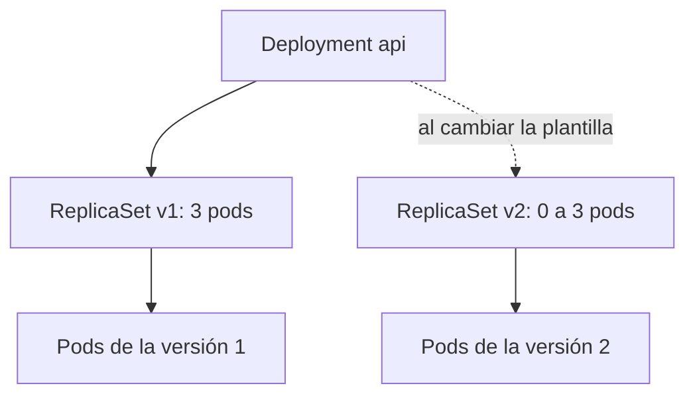

<!-- _class: lead -->

# S02 - Deployments, Services e Ingress

### Kubernetes: del Compose al clúster

**Rogelio Arriaga - Raptor Dev Services**

<!--
Sesión de 5 horas. Hilo conductor: los pods sueltos de la sesión 1 se convierten en una API y un front que se
publican, se actualizan sin corte y se regresan si fallan. Versión de referencia: K3s v1.34.1+k3s1 (probado el 11 de
noviembre de 2026). Los nombres de pods con sus hashes son de esa corrida: los de cada equipo serán otros.
-->

---

## El lema de hoy

> Un despliegue sin readiness probe manda tráfico a una aplicación que todavía no puede contestar.

Hoy aprenden a publicar una versión nueva sin cortar el servicio y a **regresar** si sale mal. Y a escribir lo que dicen "listo" y "vivo" de forma que Kubernetes lo crea.

---

## Agenda

| Bloque | Qué hacemos |
|---|---|
| 1 | Del pod suelto al Deployment: ReplicaSets |
| 2 | Actualización gradual y regreso |
| 3 | Probes: liveness, readiness y startup |
| 4 | Services: un nombre estable para pods que cambian |
| 5 | Ingress: la puerta de entrada |
| 6 | Manifiestos en el repositorio, sin `kubectl` a mano |
| 7 | Práctica guiada: publicar, actualizar, romper y regresar |
| 8 | Cierre, tarea y lo que sigue |

---

## Dónde estamos

De la sesión 1 quedaron tres problemas que hoy se resuelven:

| Problema | Pieza que lo resuelve |
|---|---|
| Un pod suelto no se repone | **Deployment** (y su ReplicaSet) |
| Una IP de pod cambia cada vez | **Service**: nombre y IP estables |
| Nadie de fuera puede entrar | **Ingress** |

Y uno que ni se había visto: cómo saber que una copia nueva **ya puede** atender gente.

---

<!-- _class: lead -->

# Parte 1
## Del pod suelto al Deployment

---

## ReplicaSet: mantener N copias

Un **ReplicaSet** asegura que haya, en todo momento, un número estable de pods idénticos corriendo. Si hay menos, crea; si hay más, borra.

- Elige sus pods por **etiqueta** (`selector`), no por nombre.
- Tiene una **plantilla de pod** (`template`) para crear los que falten.
- Lo normal es **no** crearlo a mano: lo crea un Deployment.

Fuente: kubernetes.io, "ReplicaSet"; Burns et al., *Kubernetes: Up and Running* (2022), cap. 9.

---

## Deployment: el que se usa de verdad

Un **Deployment** administra ReplicaSets para que actualizar una versión sea una operación declarativa:



- Cambias la plantilla del pod (imagen, variables) y el Deployment crea un ReplicaSet nuevo.
- Mueve las réplicas del viejo al nuevo **poco a poco**.
- El ReplicaSet viejo se queda con 0 pods: es lo que permite regresar.

Fuente: kubernetes.io, "Deployments"; Burns et al. (2022), cap. 10; Sachdeva, *CKA Study Companion* (2025), cap. 5.

---

## El manifiesto, parte por parte

```yaml {1-2|3-5|6-10|11-17|*}
apiVersion: apps/v1
kind: Deployment
metadata:
  name: api
spec:
  replicas: 3
  selector:
    matchLabels:
      app: api
  template:
    metadata:
      labels:
        app: api
    spec:
      containers:
        - name: api
          image: traefik/whoami:v1.10.3
```

- `selector.matchLabels` y `template.metadata.labels` **deben coincidir**: si no, el API rechaza el Deployment.
- El `selector` no se puede cambiar después de creado.
- Solo un cambio en `spec.template` provoca una actualización. Cambiar `replicas` escala, no actualiza.

---

## Lo que se ve al aplicarlo

```console
$ kubectl apply -f api.yaml
deployment.apps/api created
$ kubectl get deploy,rs,pods -l app=api
NAME                  READY   UP-TO-DATE   AVAILABLE   AGE
deployment.apps/api   3/3     3            3           3s

NAME                             DESIRED   CURRENT   READY   AGE
replicaset.apps/api-8697d45896   3         3         3       3s

NAME                       READY   STATUS    RESTARTS   AGE
pod/api-8697d45896-bs8sk   1/1     Running   0          3s
```

El nombre del pod se arma así: `<deployment>-<hash de la plantilla>-<sufijo>`. El hash cambia cuando cambia la plantilla; por eso cada versión tiene su ReplicaSet.

<!--
Mostrar la lectura de izquierda a derecha: api (deployment) - 8697d45896 (ReplicaSet, hash de la plantilla) - bs8sk (el pod).
-->

---

## Ahora sí se repone

```console
$ kubectl delete pod api-8697d45896-bs8sk
pod "api-8697d45896-bs8sk" deleted from default namespace
$ kubectl get pods -l app=api
```

Aparece otro con distinto sufijo: el ReplicaSet vio 2 de 3 y creó uno.

- Es la autorreparación de la sesión 1, ahora con un controlador que la hace.
- Si el nodo se cae, los pods que corrían ahí se reprograman en otros nodos; en un clúster de un solo nodo (nuestro laboratorio) no hay adónde moverlos.

---

<!-- _class: lead -->

# Parte 2
## Actualización gradual y regreso

---

## RollingUpdate

La estrategia por omisión de un Deployment reemplaza los pods **en tandas**, no todos a la vez. Dos números la controlan:

| Campo | Significa |
|---|---|
| `maxSurge` | Cuántos pods de **más** se permiten durante la actualización |
| `maxUnavailable` | Cuántos pods se pueden quedar **sin servicio** durante la actualización |

- Por omisión, los dos valen `25%`: `maxUnavailable` se redondea hacia abajo y `maxSurge` hacia arriba.
- Con 3 réplicas, `maxUnavailable: 0` y `maxSurge: 1` significa: sube uno nuevo, espera a que esté listo, baja uno viejo, y así.
- El alumno lo puede comprobar: `kubectl get deploy api -o jsonpath='{.spec.strategy}'`.

Fuente: kubernetes.io, "Deployments", sección de estrategia.

---

## Una actualización, vista paso a paso

```bash
kubectl set image deployment/api api=traefik/whoami:v1.10.3
kubectl rollout status deployment/api
```

```console
Waiting for deployment "api" rollout to finish: 1 out of 3 new replicas have been updated...
Waiting for deployment "api" rollout to finish: 2 out of 3 new replicas have been updated...
Waiting for deployment "api" rollout to finish: 1 old replicas are pending termination...
deployment "api" successfully rolled out
```

```console
$ kubectl get rs
NAME             DESIRED   CURRENT   READY   AGE
api-855dbdd68f   3         3         3       6s
api-8697d45896   0         0         0       57s
```

El ReplicaSet viejo quedó en 0, conservado por si hay que volver.

---

## Cómo se regresa

```bash
kubectl rollout history deployment/api
kubectl rollout undo deployment/api
kubectl rollout undo deployment/api --to-revision=1
```

```console
$ kubectl rollout history deploy/api
REVISION  CHANGE-CAUSE
1         <none>
3         <none>
4         <none>
```

- `undo` vuelve a la revisión anterior **con otra actualización gradual**, no con un salto.
- Cuántas revisiones se conservan lo decide `revisionHistoryLimit` (10 por omisión).
- `kubectl rollout restart` hace una actualización gradual sin cambiar nada de la plantilla: sirve para recrear los pods.

<!--
Detalle de la salida: al regresar, la revisión 2 desaparece de la lista y la que se reactiva toma el número siguiente
(aquí 4). No es un error: la revisión reactivada se renombra.
-->

---

## Estado de la actualización

```bash
kubectl rollout status deployment/api --timeout=60s
echo $?          # 0 si terminó bien, distinto de 0 si se agotó el tiempo
```

- Un Deployment que no avanza no falla de golpe: espera. A los **600 segundos** sin progreso (`progressDeadlineSeconds`, valor por omisión) la condición `Progressing` pasa a `False`.
- Para un pipeline de despliegue, `rollout status --timeout=...` es la puerta que dice si salió bien.

---

<!-- _class: lead -->

# Parte 3
## Probes

---

## Tres preguntas distintas

| Probe | Pregunta | Si falla |
|---|---|---|
| **startup** | ¿Ya terminó de arrancar? | Se reinicia el contenedor; las otras dos esperan a que pase |
| **liveness** | ¿Sigue vivo o se quedó trabado? | El kubelet **reinicia** el contenedor |
| **readiness** | ¿Puede atender tráfico ahora? | Se **saca del Service**; no se reinicia |

- **Readiness** es la que protege a los usuarios: mientras no pase, el pod no recibe peticiones.
- **Liveness** es la que se hace mal con más frecuencia: una liveness que depende de la base de datos reinicia a toda la API cuando la base se cae.
- Una probe HTTP cuenta como correcta con cualquier código de 200 a 399.

Fuente: kubernetes.io, "Configure Liveness, Readiness and Startup Probes".

---

## Escribir una probe

```yaml {1-5|6-11|*}
readinessProbe:
  httpGet:
    path: /health
    port: http
  periodSeconds: 3
livenessProbe:
  httpGet:
    path: /health
    port: http
  initialDelaySeconds: 5
  periodSeconds: 10
```

- `port: http` usa el **nombre** del puerto declarado en el contenedor.
- `periodSeconds` es cada cuánto se pregunta; `initialDelaySeconds`, cuánto esperar antes de la primera.
- Cuando `/health` solo contesta "el proceso está", sirve para liveness; la readiness debe comprobar lo que el pod necesita para atender (por ejemplo, que la conexión a su base ya esté abierta).

---

## Demostración: la probe que no pasa

La misma plantilla del front, con la readiness apuntando a una ruta que nginx no sirve:

```console
$ kubectl rollout status deploy/front --timeout=15s
Waiting for deployment "front" rollout to finish: 1 out of 2 new replicas have been updated...
error: timed out waiting for the condition
$ kubectl get pods -l app=front
NAME                     READY   STATUS    RESTARTS   AGE
front-5fcc468f4b-nxs97   0/1     Running   0          41s
front-7744f6974f-cbxj9   1/1     Running   0          109s
front-7744f6974f-hmkf2   1/1     Running   0          109s
$ kubectl describe pod front-5fcc468f4b-nxs97 | grep Unhealthy
  Warning  Unhealthy  ...  Readiness probe failed: HTTP probe failed with statuscode: 404
```

- El pod nuevo está `Running` pero **no Ready** (`0/1`).
- Los dos viejos **siguen atendiendo**: el despliegue se detiene sin cortar el servicio.
- Eso es lo que debe pasar. La probe hizo su trabajo: protegió a los usuarios de una versión mala.

---

## Qué falla cuando falta la probe

Sin readiness, Kubernetes considera listo a un pod en cuanto su contenedor **arranca**.

- Un API que tarda 20 segundos en abrir sus conexiones recibe tráfico desde el segundo 1 y responde 502.
- En una actualización gradual, el Deployment baja pods viejos cuando cree que los nuevos están listos: sin readiness, baja los buenos y los nuevos aún no contestan.
- Lo contrario también pasa: una readiness demasiado estricta (que depende de un tercero) deja al Service **sin ningún pod** cuando ese tercero se cae.

La regla: la probe dice si **este pod** puede atender; no si el mundo entero está bien.

---

<!-- _class: lead -->

# Parte 4
## Services

---

## El problema de la IP que cambia

Cada pod nuevo trae una IP nueva. Los clientes necesitan algo **estable**.

Un **Service** es un nombre y una IP virtuales delante de un conjunto de pods, elegidos por etiqueta:

```yaml
apiVersion: v1
kind: Service
metadata:
  name: api
spec:
  selector:
    app: api
  ports:
    - name: http
      port: 80
      targetPort: http
```

- `selector`: a qué pods apunta.
- `port`: el puerto del Service. `targetPort`: el del contenedor (aquí, por nombre).
- El Service reparte las peticiones entre los pods que estén **Ready**.

Fuente: kubernetes.io, "Service"; Burns et al. (2022), cap. 7.

---

## Un nombre de DNS

```console
$ kubectl exec cliente -- wget -qO- http://api/
Name: api-lab
Hostname: api-8697d45896-trm4j
$ kubectl exec cliente -- wget -qO- http://api.default.svc.cluster.local/
```

- Dentro del mismo namespace basta el nombre del Service: `api`.
- El nombre completo es `<servicio>.<namespace>.svc.cluster.local`; sirve desde cualquier namespace.
- Es el reemplazo del nombre de host de Compose (`db`), con una diferencia: aquí hay un DNS de clúster que lo resuelve.

```console
$ kubectl exec cliente -- cat /etc/resolv.conf
search default.svc.cluster.local svc.cluster.local cluster.local
nameserver <IP-del-DNS>
options ndots:5
```

La IP del servidor DNS se muestra como marcador (`<IP-del-DNS>`); la tuya depende de tu clúster.

---

## Quién contesta

```console
$ for i in 1 2 3 4 5 6; do kubectl exec cliente -- wget -qO- http://api/ | grep Hostname; done
Hostname: api-8697d45896-trm4j
Hostname: api-8697d45896-trm4j
Hostname: api-8697d45896-jbd6r
Hostname: api-8697d45896-trm4j
Hostname: api-8697d45896-bs8sk
Hostname: api-8697d45896-jbd6r
```

- Las tres réplicas contestan; el reparto **no** es una rotación exacta.
- Así se demuestra que el Service reparte: variar el valor de `Hostname` en la respuesta.
- Un pod que no está Ready **no aparece** entre los destinos.

---

## EndpointSlices: la lista de destinos

```console
$ kubectl get endpointslices -l kubernetes.io/service-name=api
NAME        ADDRESSTYPE   PORTS   ENDPOINTS                         AGE
api-qxqr8   IPv4          80      <IP-pod-1>,<IP-pod-2>,<IP-pod-3>   20s
```

- El controlador del Service revisa los pods que empatan con el `selector` y mantiene sus EndpointSlices al día.
- Si `ENDPOINTS` aparece vacío, el Service no encontró ningún pod Ready: o la etiqueta no empata o la readiness falla. **Es lo primero que se mira cuando "el Service no responde".**
- Aviso real de la corrida: `kubectl get endpoints` ya muestra *"v1 Endpoints is deprecated in v1.33+; use discovery.k8s.io/v1 EndpointSlice"*.

---

## Tipos de Service

| Tipo | Para qué |
|---|---|
| `ClusterIP` (por omisión) | Solo accesible dentro del clúster |
| `NodePort` | Además, un puerto en cada nodo |
| `LoadBalancer` | Pide un balanceador al proveedor de nube (K3s trae ServiceLB para esto en el laboratorio) |
| `ExternalName` | Un alias DNS hacia un nombre de fuera |

- En producción lo normal es `ClusterIP` detrás de un Ingress.
- `NodePort` y `LoadBalancer` publican **por Service**; un Ingress publica varios Services por una sola entrada.

Fuente: kubernetes.io, "Service"; Sachdeva, *CKA Study Companion* (2025), cap. 6.

---

<!-- _class: lead -->

# Parte 5
## Ingress

---

## La puerta de entrada HTTP

Un **Ingress** es un objeto que describe cómo entra el tráfico HTTP desde fuera hacia los Services: por nombre de host y por ruta.

> Un Ingress por sí solo no hace nada: hace falta un **ingress controller** que lo cumpla.

En K3s, el controlador es **Traefik**, ya instalado; su clase se llama `traefik`:

```console
$ kubectl get ingressclass
NAME      CONTROLLER                      PARAMETERS   AGE
traefik   traefik.io/ingress-controller   <none>       35s
```

Fuente: kubernetes.io, "Ingress" ("Only creating an Ingress resource has no effect"); docs.k3s.io.

---

## Un Ingress para API y front

```yaml {1-4|5-7|8-14|15-22}
apiVersion: networking.k8s.io/v1
kind: Ingress
metadata:
  name: titulacion
spec:
  ingressClassName: traefik
  rules:
    - host: titulacion.lab.local
      http:
        paths:
          - path: /api
            pathType: Prefix
            backend:
              service:
                name: api
                port:
                  name: http
          - path: /
            pathType: Prefix
            backend:
              service:
                name: front
                port:
                  name: http
```

- Gana la ruta más específica: `/api` va a la API; todo lo demás, al front.
- `host` por nombre; sin él, la regla vale para cualquier nombre.

---

## Probarlo sin DNS

En el laboratorio no hay un dominio. Se manda la cabecera `Host` a mano:

```console
$ curl -s -o /dev/null -w "%{http_code}\n" -H 'Host: titulacion.lab.local' http://127.0.0.1:18081/
200
$ curl -s -H 'Host: titulacion.lab.local' http://127.0.0.1:18081/api/hola | head -3
Name: api-lab
Hostname: api-8697d45896-trm4j
IP: 127.0.0.1
$ curl -s -o /dev/null -w "%{http_code}\n" http://127.0.0.1:18081/
404
```

- Con el `Host` correcto: front y API contestan.
- **Sin** él, la petición no encuentra ninguna regla y Traefik devuelve 404: es lo esperado, no un error.
- El puerto 18081 es el que la práctica mapea al 80 del clúster.

---

## Ingress hoy, Gateway API mañana

La documentación de Kubernetes dice que el proyecto recomienda usar Gateway en lugar de Ingress y que el API de Ingress está congelado (*frozen*); también dice que no hay planes de quitarlo. Es la situación a noviembre de 2026.

- Ingress sigue funcionando y es lo que se enseña como base.
- **Gateway API** (`GatewayClass`, `Gateway`, `HTTPRoute`) separa los roles: quien administra la infraestructura y quien publica rutas.
- Sachdeva lo trata en el cap. 16 de su *CKA Study Companion* (2025).

Fuente: kubernetes.io, "Ingress" (nota al inicio de la página).

---

<!-- _class: lead -->

# Parte 6
## Manifiestos en el repositorio

---

## Sin kubectl a mano

La regla de la tarea: **todo cambio al clúster sale de un archivo en el repositorio**.

```text
k8s/
  api.yaml          # Deployment + Service
  front.yaml        # Deployment + Service
  ingress.yaml
```

- Un cambio es un commit y se revisa como cualquier código.
- Quien llegue después lee la carpeta y sabe qué corre, sin entrar al clúster.
- Los cambios a mano (`kubectl edit`, `kubectl scale` en caliente) **se pierden o se contradicen** con lo que dice el repo.

---

## Antes de aplicar: dos preguntas al clúster

```bash
kubectl diff -f k8s/                      # qué cambiaría, sin aplicar
kubectl apply --dry-run=server -f k8s/    # el API valida el archivo como si lo aplicara
kubectl apply -f k8s/
kubectl rollout status deployment/api --timeout=120s
```

- `diff` sale con 0 si no hay cambios y con 1 si los hay.
- `--dry-run=server` atrapa lo que el cliente no ve: un campo que no existe, un selector que no coincide.
- Un pipeline de despliegue (curso devops-essentials) corre exactamente estos pasos.

---

## Etiqueta con versión, no `latest`

```yaml
image: traefik/whoami:v1.10.3        # reproducible
image: traefik/whoami:latest         # cambia sin avisar
```

- Con `latest` el Deployment no ve ningún cambio de plantilla cuando sale una imagen nueva: no se actualiza.
- Con una versión, cambiar la etiqueta **es** el cambio de plantilla que dispara la actualización gradual.
- El `imagePullPolicy` por omisión depende de la etiqueta: `Always` si es `latest` (o no hay etiqueta), `IfNotPresent` en los demás casos. Se comprueba con `kubectl explain`.

---

<!-- _class: lead -->

# Parte 7
## Práctica guiada

---

## Lo que haces en la práctica

1. Desplegar API y front como Deployments, con Services y un Ingress.
2. Probar la entrada por el Ingress y ver cómo reparte el Service.
3. Actualizar la API sin corte y mirar los dos ReplicaSets.
4. **Verlo fallar:** una readiness probe mal escrita detiene el despliegue; leer el motivo en los eventos.
5. Regresar con `rollout undo` y comprobar el estado final.

Todo desde archivos en `k8s/`, con `kubectl diff` antes de cada `apply`.

---

## Errores típicos de la sesión

| Error | Cómo se ve | Qué hacer |
|---|---|---|
| `selector` y etiquetas del `template` distintos | El API rechaza el Deployment | Alinearlos |
| Readiness con ruta o puerto equivocado | `0/1 Running`; evento `Readiness probe failed` | Leer el evento y corregir la ruta |
| Liveness que depende de la base | Reinicios en cadena cuando la base cae | Liveness solo del proceso |
| Service con `selector` que no empata | `ENDPOINTS` vacío | Comparar `selector` con las etiquetas del pod |
| `targetPort` equivocado | Conexión rechazada desde el Service | Usar el nombre del puerto |
| Ingress sin `ingressClassName` ni controlador | No pasa nada | Revisar `kubectl get ingressclass` |
| Imagen `latest` | La actualización no se dispara | Versión explícita |

---

## Cierre: lo que se llevan

- Un Deployment mantiene N pods y actualiza por tandas, conservando el ReplicaSet viejo para regresar.
- Una readiness probe decide quién recibe tráfico; una liveness decide quién se reinicia. No son lo mismo.
- Un Service da nombre estable y reparte entre los pods Ready; sus EndpointSlices muestran quiénes son.
- Un Ingress publica por host y ruta, si hay controlador.
- Todo vive en archivos del repositorio.

**Tarea:** manifiestos versionados en su repositorio, sin `kubectl` a mano.

**Siguiente sesión:** configuración, secretos y datos con estado.

Libros de la sesión: Burns et al., *Kubernetes: Up and Running* (2022), caps. 7 a 10. Stencel, *Kubernetes Recipes*, cap. 2. Sachdeva, *CKA Study Companion* (2025), caps. 5 y 6.
