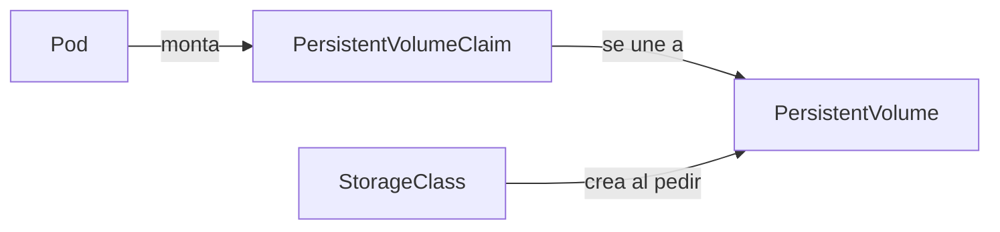
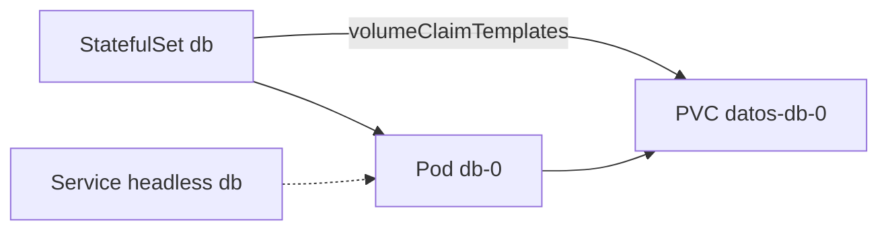

<!-- _class: lead -->

# S03 - Configuración, secretos y datos con estado

### Kubernetes: del Compose al clúster

**Rogelio Arriaga - Raptor Dev Services**

<!--
Sesión de 5 horas. Hilo conductor: la API de la sesión 2 deja de llevar su configuración pegada en la imagen y su
contraseña en el YAML, y la base de datos ya no pierde sus datos cuando se borra su pod. Versión de referencia:
K3s v1.37.2+k3s1 (probado el 11 de noviembre de 2026). Ejemplo ilustrativo: la base, la contraseña y la tabla de
alumnos son de laboratorio.
-->

---

## El lema de hoy

> Un Secret de Kubernetes está en base64, no cifrado: cualquiera que lo lea lo tiene.

Hoy se separa lo que cambia de lo que se despliega: la **configuración** sale de la imagen, el **secreto** sale del repositorio, y los **datos** salen del pod.

---

## Agenda

| Bloque | Qué hacemos |
|---|---|
| 1 | El problema: un YAML con la contraseña y una base que olvida |
| 2 | ConfigMaps: configuración fuera de la imagen |
| 3 | Secrets: qué protegen y qué no |
| 4 | Volúmenes, PersistentVolumeClaims y StorageClass |
| 5 | StatefulSets: identidad estable para datos con estado |
| 6 | ¿Base de datos en el clúster? La decisión |
| 7 | Práctica guiada: PostgreSQL con volumen, y decodificar un Secret |
| 8 | Cierre, tarea y lo que sigue |

---

## Dónde estamos

```yaml
env:
  - name: POSTGRES_PASSWORD
    value: clave-de-laboratorio       # en el repositorio, a la vista de todos
```

| Problema de la sesión 1 y 2 | Consecuencia |
|---|---|
| La configuración va dentro del YAML del Deployment | Cambiar un valor es cambiar y revisar el despliegue completo |
| La contraseña está en claro en un archivo versionado | Todo el que lea el repo la tiene, para siempre en el historial |
| La base vive en el sistema de archivos del contenedor | Borrar el pod borra los datos |

---

<!-- _class: lead -->

# Parte 1
## ConfigMaps

---

## Configuración fuera de la imagen

Un **ConfigMap** es un objeto con pares clave-valor (texto) que un pod consume como variables de entorno o como archivos.

```yaml
apiVersion: v1
kind: ConfigMap
metadata:
  name: api-config
data:
  NIVEL_DE_LOG: informacion
  appsettings.json: |
    {
      "Titulacion": { "MaxIntentos": 3 }
    }
```

- Misma imagen en desarrollo, pruebas y producción; cambia el ConfigMap.
- Cada clave puede ser un valor simple o el contenido de un archivo entero.
- Un ConfigMap **no puede pasar de 1 MiB**; para algo mayor se usa un volumen o un servicio de archivos.

Fuente: kubernetes.io, "ConfigMaps"; Burns et al., *Kubernetes: Up and Running* (2022), cap. 13.

---

## Tres formas de consumirlo

```yaml {1-4|5-12|13-21}
envFrom:                          # todas las claves como variables
  - configMapRef:
      name: api-config
env:                              # una clave, con otro nombre
  - name: LOG
    valueFrom:
      configMapKeyRef:
        name: api-config
        key: NIVEL_DE_LOG
volumes:                          # una clave como archivo
  - name: config
    configMap:
      name: api-config
      items:
        - key: appsettings.json
          path: appsettings.json
# y en el contenedor:
volumeMounts:
  - name: config
    mountPath: /etc/api
    readOnly: true
```

El archivo queda en `/etc/api/appsettings.json`. Una clave que no es un nombre de variable válido (con punto, por ejemplo) solo sirve como archivo.

---

## Cuándo se entera el pod de un cambio

| Cómo se consume | Qué pasa al cambiar el ConfigMap |
|---|---|
| Variable de entorno | No cambia: las variables se fijan al crear el contenedor; hay que reiniciarlo |
| Archivo en un volumen | Se actualiza solo, con un retraso (la documentación lo titula "Mounted ConfigMaps are updated automatically") |

- Una aplicación que lee el archivo una sola vez al arrancar tampoco se entera aunque el archivo cambie.
- Lo habitual y más claro: cambiar el ConfigMap y hacer `kubectl rollout restart deployment/api`.
- Un ConfigMap puede ser `immutable: true` (desde v1.19): no se puede modificar, solo reemplazar, y el clúster deja de vigilarlo.

<!--
En la práctica ellos lo comprueban: cambian el ConfigMap, leen la variable y el archivo, y anotan qué vieron y cuánto tardó el archivo.
-->

---

<!-- _class: lead -->

# Parte 2
## Secrets

---

## Qué es un Secret y qué no es

Un **Secret** es como un ConfigMap pensado para datos sensibles (contraseñas, tokens, llaves): se consume igual, pero el API lo trata con más cuidado (no se imprime en `describe`, se puede restringir con RBAC).

```console
$ kubectl get secret db-credenciales -o jsonpath='{.data.POSTGRES_PASSWORD}'
Y2xhdmUtZGUtbGFib3JhdG9yaW8=
$ kubectl get secret db-credenciales -o jsonpath='{.data.POSTGRES_PASSWORD}' | base64 -d
clave-de-laboratorio
```

- **base64 no es cifrado.** Es una codificación: cualquiera la revierte con un comando.
- La documentación lo dice sin rodeos: *por omisión, los Secrets se guardan sin cifrar en etcd; cualquiera con acceso al API puede leerlos o modificarlos, y también quien tenga acceso a etcd.*
- Quien puede **crear un pod** en un namespace puede leer **cualquier** Secret de ese namespace, también de forma indirecta (por ejemplo, creando un Deployment).

Fuente: kubernetes.io, "Secrets" (recuadro de advertencia, consultado el 11 de noviembre de 2026).

---

## Qué hacer, según la propia documentación

| Medida | Para qué |
|---|---|
| Habilitar el cifrado en reposo de los Secrets | Que etcd no guarde el texto tal cual |
| RBAC con el mínimo privilegio | Quién puede leer Secrets |
| Restringir el acceso a contenedores concretos | No montar el Secret donde no hace falta |
| Considerar un almacén externo de secretos | Que el secreto no viva en el clúster |

Fuente: kubernetes.io, "Secrets".

- Cifrar en reposo protege **el disco de etcd**, no a quien tiene permiso de lectura en la API.
- K3s lo trae como opción: al arrancar el servidor por primera vez, la bandera `--secrets-encryption` genera una llave AES-CBC y la configuración de cifrado (docs.k3s.io, "Secrets Encryption"). No se puede activar en un servidor ya existente sin reiniciarlo.
- El tema se amplía en la sesión 4 (RBAC) y en la nota `10-cloud/05-secretos-produccion.md`.

---

## Crear un Secret sin dejarlo en el repo

```bash
kubectl create secret generic db-credenciales \
  --from-literal=POSTGRES_USER=titulacion \
  --from-literal=POSTGRES_PASSWORD='<la-clave>'
```

- El valor **no** se escribe en ningún archivo versionado.
- En producción, `<la-clave>` sale de un gestor (el de tu nube, o uno propio), no de tu cabeza ni de tu historial de comandos.
- Un Secret en YAML versionado **es** un secreto filtrado: lo que se versiona, si acaso, es el *nombre* del Secret que el Deployment espera.

---

## Trampa: `kubectl apply` y la anotación

Un Secret creado desde un YAML con `stringData` y aplicado con `kubectl apply`:

```console
$ kubectl get secret db-credenciales -o yaml | sed -n 5,9p
metadata:
  annotations:
    kubectl.kubernetes.io/last-applied-configuration: |
      {"apiVersion":"v1","kind":"Secret", ... "stringData":{"POSTGRES_PASSWORD":"clave-de-laboratorio", ...
```

- `apply` guarda una copia del manifiesto en una **anotación**, y esa copia lleva el valor **en texto claro**.
- Nadie la ve en `get secret` normal, pero está ahí para cualquiera que lea el objeto completo.
- Otra razón para crear secretos con `kubectl create secret` o con una herramienta de secretos, y no con `apply` de un YAML con valores.

<!--
Esto se verificó en el clúster de laboratorio (K3s v1.37.2). Hacer que lo vean en la práctica es el "verlo fallar" más claro de la sesión.
-->

---

## Consumir un Secret

```yaml
env:
  - name: DB_PASSWORD
    valueFrom:
      secretKeyRef:
        name: db-credenciales
        key: POSTGRES_PASSWORD
```

- Variables de entorno: fáciles, pero quedan en el entorno del proceso y pueden aparecer en un volcado de errores o en `/proc`.
- Montado como archivo: los permisos del archivo se controlan y el valor no queda en el entorno.
- Si el Secret **no existe**, el pod no arranca:

```console
$ kubectl get pods -l app=api2
NAME                  READY   STATUS                       RESTARTS   AGE
api2-698f5747-7jhtc   0/1     CreateContainerConfigError   0          13s
$ kubectl describe pod -l app=api2 | tail -1
  Warning  Failed  ...  Error: secret "db-credencial" not found
```

El nombre mal escrito (`db-credencial` en vez de `db-credenciales`) es la causa; el evento lo dice.

---

<!-- _class: lead -->

# Parte 3
## Volúmenes y datos

---

## El contenedor es desechable

El sistema de archivos de un contenedor vive y muere con él. Para la base:

| Concepto | Qué es |
|---|---|
| **Volume** | Un directorio montado dentro del pod |
| **PersistentVolume (PV)** | Un trozo de almacenamiento del clúster |
| **PersistentVolumeClaim (PVC)** | La **petición** de almacenamiento de un pod: tamaño y modo de acceso |
| **StorageClass** | Cómo se crea el almacenamiento cuando alguien lo pide (aprovisionamiento dinámico) |



Fuente: Burns et al. (2022), cap. 16; Sachdeva, *CKA Study Companion* (2025), cap. 15.

---

## Lo que trae K3s

```console
$ kubectl get storageclass
NAME                   PROVISIONER             RECLAIMPOLICY   VOLUMEBINDINGMODE      ALLOWVOLUMEEXPANSION
local-path (default)   rancher.io/local-path   Delete          WaitForFirstConsumer   false
```

- **`local-path`** crea carpetas en el disco **del nodo**: sirve en un laboratorio. Si el nodo se pierde, el volumen también.
- **`RECLAIMPOLICY: Delete`**: al borrar la PVC, se borra el volumen **y sus datos**.
- **`WaitForFirstConsumer`**: el volumen no se crea hasta que un pod lo usa; una PVC `Pending` sin pod es normal con este modo.
- En una nube, la StorageClass por omisión crea discos de la nube, que sobreviven al nodo.

---

## Modos de acceso y qué piden

| Modo | Significa |
|---|---|
| `ReadWriteOnce` (RWO) | Lo monta en lectura y escritura **un** nodo a la vez |
| `ReadOnlyMany` | Muchos nodos, solo lectura |
| `ReadWriteMany` | Muchos nodos, lectura y escritura (necesita almacenamiento compartido) |

- Una base de datos de una sola réplica usa RWO.
- Tamaño y modo van en la PVC; el aprovisionador decide si puede cumplirlos.

Fuente: kubernetes.io, "Persistent Volumes"; Sachdeva (2025), cap. 15.

---

<!-- _class: lead -->

# Parte 4
## StatefulSets

---

## Cuando la identidad importa

Un Deployment trata a sus pods como intercambiables (`api-8697d45896-bs8sk`). Una base de datos no lo es. Un **StatefulSet** da a cada pod:

- Un **nombre estable y ordinal**: `db-0`, `db-1`.
- Su **propio volumen**, creado a partir de una plantilla (`volumeClaimTemplates`) y que le sigue aunque el pod se recree.
- Un nombre de DNS estable, con un Service sin IP (headless) que lo respalda.
- Arranque y cierre **en orden**.



Fuente: kubernetes.io, "StatefulSets"; Burns et al. (2022), cap. 16; Sachdeva (2025), caps. 15 y 17.

---

## El manifiesto

```yaml {1-9|10-22|23-34|35-43}
apiVersion: v1
kind: Service
metadata:
  name: db
spec:
  clusterIP: None
  selector:
    app: db
  ports:
    - name: pg
      port: 5432
---
apiVersion: apps/v1
kind: StatefulSet
metadata:
  name: db
spec:
  serviceName: db
  replicas: 1
  selector:
    matchLabels:
      app: db
  template:
    metadata:
      labels:
        app: db
    spec:
      containers:
        - name: postgres
          image: postgres:17
          env:
            - name: POSTGRES_DB
              value: titulacion
            - name: PGDATA
              value: /var/lib/postgresql/data/pgdata
          envFrom:
            - secretRef:
                name: db-credenciales
          volumeMounts:
            - name: datos
              mountPath: /var/lib/postgresql/data
  volumeClaimTemplates:
    - metadata:
        name: datos
      spec:
        accessModes: ["ReadWriteOnce"]
        resources:
          requests:
            storage: 1Gi
```

(Se omiten la readiness probe y el puerto para caber; el archivo de la práctica los trae.)

---

## Por qué `PGDATA` en un subdirectorio

- La documentación de PostgreSQL ("Use of Secondary File Systems") dice que **no es aconsejable** usar el directorio superior del punto de montaje como directorio de datos; la mejor práctica es crear un directorio dentro del punto de montaje y poner ahí los datos. Evita problemas de permisos y da fallos limpios si el volumen se desconecta.
- Por eso el manifiesto apunta `PGDATA` a `/var/lib/postgresql/data/pgdata`.
- **Versión de la imagen:** la página de la imagen oficial indica que, hasta PostgreSQL 17, el volumen se monta en `/var/lib/postgresql/data` (y no en `/var/lib/postgresql`); desde PostgreSQL 18 la ruta de `PGDATA` y el `VOLUME` cambiaron. Este curso usa `postgres:17`; si subes a 18 o más, lee esa página antes de reutilizar el manifiesto.

Fuentes: postgresql.org, "Creating a Database Cluster"; hub.docker.com/_/postgres (a noviembre de 2026).

<!--
Si preguntan por lost+found: es un caso típico de volúmenes ext4 recién formateados, pero NO está en la documentación citada; no lo afirmes como regla de ellos.
-->

---

## Lo que se ve

```console
$ kubectl get pods,pvc
NAME       READY   STATUS    RESTARTS   AGE
pod/db-0   1/1     Running   0          21s

NAME                               STATUS   VOLUME                                     CAPACITY   ACCESS MODES   STORAGECLASS
persistentvolumeclaim/datos-db-0   Bound    pvc-4820e842-bc01-479c-a288-4ba82feaf91d   1Gi        RWO            local-path
```

Los identificadores del volumen son de la corrida de laboratorio.

- La PVC se llama `<plantilla>-<statefulset>-<ordinal>`: `datos-db-0`.
- Al crearse, pasó un instante en `Pending` (`WaitForFirstConsumer`) y luego a `Bound`.

---

## La prueba que importa

```console
$ kubectl exec db-0 -- psql -U titulacion -d titulacion \
    -c "create table alumnos(id int primary key, nombre text); insert into alumnos values (1,'Ana');"
CREATE TABLE
INSERT 0 1
$ kubectl delete pod db-0
pod "db-0" deleted from default namespace
$ kubectl wait --for=condition=Ready pod/db-0 --timeout=120s
$ kubectl exec db-0 -- psql -U titulacion -d titulacion -c "select * from alumnos;"
 id | nombre
----+--------
  1 | Ana
(1 row)
```

El pod nuevo se llamó igual y encontró el volumen del anterior.

---

## Qué NO protege un volumen

- **Borrar la PVC** con `RECLAIMPOLICY: Delete` borra los datos.
- Un volumen no es un **respaldo**: si la base se corrompe o alguien hace `DROP TABLE`, el volumen lo conserva tal cual.
- Con `local-path`, si el **nodo** muere, el volumen muere con él.
- Borrar un StatefulSet, o reducir sus réplicas, **no** borra los volúmenes asociados: la documentación lo hace para proteger los datos. En la práctica lo comprobamos.

Una base en el clúster sin respaldo probado es una base sin protección.

---

<!-- _class: lead -->

# Parte 5
## ¿Base de datos dentro del clúster?

---

## La decisión

| A favor | En contra |
|---|---|
| Un solo lugar de despliegue; mismo flujo para todo | Operar una base es un trabajo aparte: respaldos, actualizaciones mayores, réplicas |
| Barata en laboratorios y pruebas | Un fallo de almacenamiento o de nodo toca el dato más importante |
| Desarrollo y producción iguales | Los servicios administrados de las nubes ya resuelven respaldos y alta disponibilidad |

- Para **desarrollo y pruebas**, una base en el clúster es razonable.
- Para **producción**, la pregunta es quién hace el respaldo, quién lo restaura y quién actualiza. Si la respuesta es "nadie todavía", la base no debe vivir ahí.
- Existen *operadores* que automatizan esas tareas para PostgreSQL; son otro componente que operar (sesión 6).

Esta es una postura del curso, no una regla: tu ADR de la sesión 1 se revisa aquí.

---

## Dónde vivirían los secretos en producción

Opciones reales, de menos a más separadas del clúster:

| Opción | Qué es | Costo |
|---|---|---|
| Secret de Kubernetes con cifrado en reposo y RBAC | Lo mínimo que recomienda la documentación | Barato; el secreto sigue en el clúster |
| Un gestor de secretos del proveedor de nube | La aplicación o un componente lo lee de ahí (nota `10-cloud/05-secretos-produccion.md`) | Otra dependencia y su cobro |
| Un almacén externo conectado con un proveedor de CSI (la documentación lo menciona) | Se monta en el pod sin dejar un Secret en el clúster | Instalar y operar el componente |

La tarea te pide elegir una y justificar.

---

<!-- _class: lead -->

# Parte 6
## Práctica guiada

---

## Lo que haces en la práctica

1. Un ConfigMap y un Secret, consumidos por un pod; cambiar el ConfigMap y ver qué se entera.
2. **Verlo fallar:** decodificar un Secret con un comando; ver el valor en la anotación `last-applied-configuration`; apuntar a un Secret que no existe y leer el evento.
3. PostgreSQL como StatefulSet con volumen: crear datos, **borrar el pod** y comprobar que siguen.
4. Borrar el StatefulSet y la PVC y ver qué se conserva y qué se pierde.

---

## Errores típicos de la sesión

| Error | Cómo se ve | Qué hacer |
|---|---|---|
| Contraseña en el YAML versionado | `value: clave...` en el repo | `kubectl create secret` o un gestor |
| Creer que base64 protege | `base64 -d` la devuelve | Cifrado en reposo y RBAC |
| Secret creado con `apply` de un YAML con valores | El valor queda en `last-applied-configuration` | Crear con `kubectl create secret` |
| Nombre del Secret mal escrito | `CreateContainerConfigError` | Leer el evento |
| Esperar que una variable cambie sola | Sigue con el valor viejo | `rollout restart` |
| Datos en el sistema de archivos del contenedor | Se pierden al borrar el pod | PVC |
| Creer que el volumen es respaldo | `DROP TABLE` se conserva | Respaldo probado |
| Borrar la PVC | Los datos se van con `Delete` | Revisar la política antes |

---

## Cierre: lo que se llevan

- ConfigMap para lo que cambia, Secret para lo sensible, volumen para los datos.
- Un Secret está en base64: cuida quién lo lee y cómo lo creas.
- Un StatefulSet da identidad y volumen propios; un volumen no es un respaldo.
- Una base en el clúster pide una respuesta honesta a "¿quién respalda y restaura?".

**Tarea:** dónde vivirían sus secretos en producción, y por qué.

**Siguiente sesión:** seguridad del clúster.

Libros de la sesión: Burns et al., *Kubernetes: Up and Running* (2022), caps. 13 y 16. Stencel, *Kubernetes Recipes*, caps. 3 y 7. Sachdeva (2025), caps. 15 y 17.
