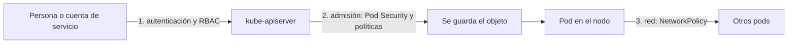

<!-- _class: lead -->

# S04 - Seguridad del clúster

### Kubernetes: del Compose al clúster

**Rogelio Arriaga - Raptor Dev Services**

<!--
Sesión de 5 horas. Hilo conductor: el clúster de las sesiones anteriores acepta todo. Hoy se le ponen cuatro
barreras (quién puede qué, qué pods se admiten, qué políticas se exigen, qué tráfico pasa) y, de cada una,
se ve el rechazo con los propios ojos. Versión de referencia: K3s v1.37.2+k3s1 (probado el 11 de noviembre de 2026).
Todo se hace en un laboratorio propio. No hay objetivos reales.
-->

---

## El lema de hoy

> Una política que nunca rechazó nada no se ha probado.

Cada barrera de hoy tiene su **prueba de rechazo**: una acción que debe fallar, y la salida que lo demuestra. Si no se ve fallar, no se sabe si funciona.

---

## Agenda

| Bloque | Qué hacemos |
|---|---|
| 1 | Qué se protege en un clúster |
| 2 | RBAC y cuentas de servicio |
| 3 | Pod Security: qué pods se admiten |
| 4 | Políticas como código |
| 5 | NetworkPolicies: quién habla con quién |
| 6 | La matriz de quién puede hacer qué |
| 7 | Práctica guiada: ver rechazar |
| 8 | Cierre, tarea y lo que sigue |

---

## Dónde estamos

Un clúster recién instalado, tal como lo dejó la sesión 3:

| Cosa | Lo que acepta hoy |
|---|---|
| Un pod que corre como root, con `privileged: true` | Se crea |
| Una imagen `nginx:latest` | Se crea |
| Cualquier pod llamando a la base | Entra |
| La cuenta que despliega | Puede, probablemente, todo |

Una buena parte de lo que sigue se resume en: **cerrar por defecto y abrir lo necesario**.

---

<!-- _class: lead -->

# Parte 1
## Qué se protege

---

## Cuatro puertas



| Puerta | Pregunta | Herramienta |
|---|---|---|
| Acceso al API | ¿Quién eres y qué puedes hacer? | RBAC |
| Admisión | ¿Este objeto cumple lo que exigimos? | Pod Security, Validating Admission Policy, Gatekeeper o Kyverno |
| Ejecución | ¿Con qué privilegios corre? | `securityContext` |
| Red | ¿Quién puede hablar con quién? | NetworkPolicy |

Fuente: Burns et al., *Kubernetes: Up and Running* (2022), caps. 14, 19 y 20; Ray, *Policy as Code* (2024), cap. 4.

---

<!-- _class: lead -->

# Parte 2
## RBAC y cuentas de servicio

---

## Quién, qué, dónde

**RBAC** (control de acceso basado en roles) decide qué puede hacer una identidad sobre qué recursos.

| Objeto | Qué es |
|---|---|
| **Role** | Un conjunto de permisos **dentro de un namespace** |
| **ClusterRole** | Permisos a nivel de clúster, o reutilizables por varios namespaces |
| **RoleBinding** | Une un Role con quienes lo reciben (personas, grupos o cuentas de servicio) |
| **ClusterRoleBinding** | Lo mismo, en todo el clúster |
| **ServiceAccount** | Identidad de un **programa** que corre en un pod |

- RBAC **solo permite**: no hay reglas de "denegar". Sin regla que lo permita, está prohibido.
- Los permisos **se suman**: si dos bindings aplican, vale la unión.

Fuente: kubernetes.io, "Using RBAC Authorization"; Burns et al. (2022), cap. 14; Sachdeva, *CKA Study Companion* (2025), cap. 12.

---

## Un Role de solo lectura

```yaml {1-6|7-12|13-24}
apiVersion: v1
kind: ServiceAccount
metadata:
  name: lector-pods
  namespace: app
---
apiVersion: rbac.authorization.k8s.io/v1
kind: Role
metadata:
  name: lector-pods
  namespace: app
rules:
  - apiGroups: [""]
    resources: ["pods", "pods/log"]
    verbs: ["get", "list", "watch"]
---
apiVersion: rbac.authorization.k8s.io/v1
kind: RoleBinding
metadata:
  name: lector-pods
  namespace: app
subjects:
  - kind: ServiceAccount
    name: lector-pods
    namespace: app
roleRef:
  apiGroup: rbac.authorization.k8s.io
  kind: Role
  name: lector-pods
```

- `apiGroups: [""]` es el grupo "core" (pods, services, secrets, configmaps).
- Un recurso y su verbo, de uno en uno: lo que no está escrito, no se puede.

---

## Preguntar antes de confiar: `auth can-i`

```console
$ SA=system:serviceaccount:app:lector-pods
$ kubectl auth can-i list pods -n app --as=$SA
yes
$ kubectl auth can-i delete pods -n app --as=$SA
no
$ kubectl auth can-i list secrets -n app --as=$SA
no
$ kubectl auth can-i list pods -n default --as=$SA
no
```

- `--as` hace que el API conteste **como** esa identidad.
- El Role es de un namespace: en `default` no vale.
- `kubectl auth can-i --list --as=$SA -n app` lista **todo** lo que puede, incluidos los permisos básicos que todo cliente recibe (por ejemplo, revisar sus propios permisos).
- Esta es la prueba de rechazo de RBAC: lo que no se pidió, **no** se puede.

---

## Lo que de verdad es peligroso

Según la documentación de Kubernetes, quien puede **crear un pod** en un namespace puede leer **cualquier Secret** de ese namespace, también de forma indirecta (con un Deployment, por ejemplo).

| Permiso | Por qué pesa |
|---|---|
| `list` o `get` sobre `secrets` | Lee todas las contraseñas del namespace |
| `create` sobre `pods` o `deployments` | Monta cualquier Secret en un pod propio |
| `*` en `resources` o en `verbs` | Todo, incluido lo que se agregue mañana |
| `ClusterRoleBinding` a `cluster-admin` | Control total del clúster |
| `exec` en pods | Un shell dentro de la aplicación, con sus secretos |

Regla: el menor permiso que permita la tarea, en el menor alcance (Role, no ClusterRole, cuando se pueda).

Fuente: kubernetes.io, "Secrets" (recuadro de advertencia).

---

## Cuentas de servicio

- Cada namespace trae una `default`. Un pod sin `serviceAccountName` usa esa.
- Un pod recibe, por omisión, un **token** de su cuenta de servicio para hablar con el API.
- Una aplicación que **no** habla con el API no lo necesita: se apaga con `automountServiceAccountToken: false` en el pod o en la cuenta.
- Crear una cuenta por aplicación, con su Role mínimo, permite saber **quién** hizo qué.

```yaml
spec:
  serviceAccountName: lector-pods
  automountServiceAccountToken: true     # false si no habla con el API
```

```console
$ kubectl create token lector-pods -n app | cut -c1-20
eyJhbGciOiJSUzI1NiIs
```

`kubectl create token` pide un token **de corta vida** para esa cuenta. Es un JWT: lo que se aprendió de JWT en el curso de .NET aplica.

<!--
El valor del token NO se imprime completo en clase: solo el comienzo, como arriba.
-->

---

<!-- _class: lead -->

# Parte 3
## Pod Security

---

## Tres perfiles estándar

Los **Pod Security Standards** son tres perfiles de qué puede pedir un pod:

| Perfil | Descripción de la documentación |
|---|---|
| **Privileged** | Sin restricciones: el nivel más amplio de permisos |
| **Baseline** | Mínimamente restrictivo: evita escaladas de privilegio conocidas |
| **Restricted** | Muy restrictivo: sigue las mejores prácticas actuales de endurecimiento de pods |

El **Pod Security Admission** los aplica por **namespace**, con etiquetas, en tres modos:

| Modo | Qué hace con un pod que viola el perfil |
|---|---|
| `enforce` | Lo **rechaza** |
| `warn` | Lo admite, pero avisa al usuario |
| `audit` | Lo admite y lo anota en el registro de auditoría |

Fuente: kubernetes.io, "Pod Security Standards" y "Pod Security Admission".

---

## Ver rechazar: restricted

```console
$ kubectl create ns prod
$ kubectl label ns prod pod-security.kubernetes.io/enforce=restricted
$ kubectl -n prod apply -f root.yaml
Error from server (Forbidden): error when creating "root.yaml": pods "root" is forbidden:
violates PodSecurity "restricted:latest":
  allowPrivilegeEscalation != false (container "c" must set securityContext.allowPrivilegeEscalation=false),
  unrestricted capabilities (container "c" must set securityContext.capabilities.drop=["ALL"]),
  runAsNonRoot != true (pod or container "c" must set securityContext.runAsNonRoot=true),
  seccompProfile (pod or container "c" must set securityContext.seccompProfile.type to "RuntimeDefault" or "Localhost")
```

- El mensaje **dice qué corregir**, campo por campo.
- Con el pod mínimo (`busybox` y `sleep`) fallan **cuatro** cosas a la vez.
- Esta es la prueba de rechazo: un pod que corre como root es rechazado en `prod`.

---

## El pod que sí pasa

```yaml {1-7|8-14|*}
spec:
  securityContext:
    runAsNonRoot: true
    runAsUser: 10001
    seccompProfile:
      type: RuntimeDefault
  containers:
    - name: c
      image: busybox:1.37
      command: ["sleep","3600"]
      securityContext:
        allowPrivilegeEscalation: false
        capabilities:
          drop: ["ALL"]
```

```console
$ kubectl -n prod exec seguro -- id
uid=10001 gid=0(root) groups=0(root)
```

- Corre con un usuario que **no es root** (uid 10001).
- Ojo con la salida: el **grupo** sigue siendo 0. El perfil `restricted` exige `runAsNonRoot` y las otras tres cosas; no exige un grupo distinto de 0.
- La imagen de tu aplicación debe poder correr así: sin pedir privilegios y escribiendo solo en las carpetas a las que su usuario tiene acceso. Se prueba, no se supone.

---

## Los otros modos y el perfil baseline

```console
$ kubectl label ns lab2 pod-security.kubernetes.io/warn=restricted
$ kubectl -n lab2 apply -f root.yaml
pod/root created
Warning: would violate PodSecurity "restricted:latest": allowPrivilegeEscalation != false ...

$ kubectl label ns base pod-security.kubernetes.io/enforce=baseline
$ kubectl -n base apply -f priv.yaml            # privileged: true
Error from server (Forbidden): ... violates PodSecurity "baseline:latest": privileged (container "c" must not set securityContext.privileged=true)
$ kubectl -n base apply -f root.yaml            # root, sin privileged
pod/root created
```

- `warn`: se crea y avisa. Es la forma de **medir antes de hacer cumplir**.
- `baseline` bloquea lo peligroso conocido (por ejemplo `privileged`) pero **deja** correr como root.
- Estrategia de adopción: `warn` y `audit` en `restricted` primero, corregir lo que avisa, y luego `enforce`.

---

## Contra qué defiende

- Un contenedor con `privileged: true` tiene casi los privilegios del nodo: si se compromete, el nodo también.
- `runAsNonRoot` y quitar capacidades reducen lo que un atacante dentro del contenedor puede hacer.
- `allowPrivilegeEscalation: false` impide ganar más privilegios que el proceso padre.
- Nada de esto reemplaza **actualizar imágenes** ni **no meter secretos** en ellas.

Es el principio de siempre: menor privilegio.

---

<!-- _class: lead -->

# Parte 4
## Políticas como código

---

## Admisión: la puerta de las reglas propias

Antes de guardar un objeto, el API pasa por **controladores de admisión**. Pod Security es uno. Para reglas propias de tu organización:

- "Toda imagen con versión, nunca `latest`".
- "Todo pod con `requests` y `limits`".
- "Todo namespace con la etiqueta del equipo".

| Herramienta | Qué es |
|---|---|
| **ValidatingAdmissionPolicy** | Viene en Kubernetes; las reglas se escriben en CEL, dentro de objetos del API |
| **OPA Gatekeeper** | Controlador de admisión que aplica políticas escritas con el marco de restricciones de OPA |
| **Kyverno** | Motor de políticas nativo de Kubernetes: valida, muta, genera recursos y verifica imágenes |

Fuente: Ray, *Policy as Code* (2024), cap. 4 (Policy as Code and Kubernetes), cap. 7 (OPA/Gatekeeper) y cap. 8 (Kyverno).

---

## Una política sin instalar nada

```yaml {1-7|8-13|14-20}
apiVersion: admissionregistration.k8s.io/v1
kind: ValidatingAdmissionPolicy
metadata:
  name: sin-latest
spec:
  failurePolicy: Fail
  matchConstraints:
    resourceRules:
      - apiGroups: [""]
        apiVersions: ["v1"]
        operations: ["CREATE", "UPDATE"]
        resources: ["pods"]
  validations:
    - expression: "object.spec.containers.all(c, c.image.contains(':') && !c.image.endsWith(':latest'))"
      message: "Toda imagen debe llevar una etiqueta de versión distinta de latest."
---
apiVersion: admissionregistration.k8s.io/v1
kind: ValidatingAdmissionPolicyBinding
metadata:
  name: sin-latest
spec:
  policyName: sin-latest
  validationActions: ["Deny"]
  matchResources:
    namespaceSelector:
      matchLabels:
        politica: sin-latest
```

- La política define **qué se valida**; el binding, **dónde** y **con qué acción** (`Deny`, `Warn` o `Audit`).
- La expresión es CEL: `all(...)` recorre los contenedores.
- Se probó en K3s v1.37.2: no hizo falta instalar nada.

---

## Verla rechazar

```console
$ kubectl label ns pol politica=sin-latest
$ kubectl -n pol run malo --image=nginx:latest
The pods "malo" is invalid: : ValidatingAdmissionPolicy 'sin-latest' with binding 'sin-latest'
  denied request: Toda imagen debe llevar una etiqueta de versión distinta de latest.
$ kubectl -n pol run malo2 --image=nginx
The pods "malo2" is invalid: ... denied request: ...
$ kubectl -n pol run bueno --image=nginx:1.27-alpine
pod/bueno created
$ kubectl -n default run libre --image=nginx:latest
pod/libre created
```

- `nginx:latest` y `nginx` (sin etiqueta) se rechazan; `nginx:1.27-alpine` pasa.
- En `default`, **sin** la etiqueta del namespace, la política no aplica: `libre` se crea. Saber **dónde** aplica una política es parte de probarla.
- Una política que nunca rechazó nada no se ha probado: esta sí rechazó.

---

## Gatekeeper y Kyverno: cuándo conviene cada uno

| | Gatekeeper | Kyverno |
|---|---|---|
| Lenguaje | Rego (de OPA) | YAML de Kubernetes |
| Qué hace | Validar y mutar | Validar, mutar, generar recursos, limpiar y verificar imágenes |
| Reportes | Modo de auditoría de lo existente | Escaneo de fondo e informes de política |
| Curva | Rego es otro lenguaje que aprender | Más cercano a lo que ya escribes |

Fuente: Ray, *Policy as Code* (2024), cap. 7 y cap. 8: cada uno trae su capítulo con instalación, tipos de política, modos de aplicación y pruebas.

- En este curso **no** se instalan: se explican y se citan. Una política escrita sin correrla rompe la regla de la clase (nada sin probar).
- Si tu equipo elige uno, el criterio es la prueba de rechazo de esta sesión.
- Adopta como con Pod Security: primero **auditar**, luego hacer cumplir.

---

## Política de política

1. Escribe la política.
2. Ponla en modo que **solo avise** o **solo audite**.
3. Ve qué objetos que ya existen la violarían.
4. Corrige o excluye lo justificado (con una razón escrita).
5. Cámbiala a hacer cumplir.
6. Escribe la **prueba de rechazo** y guárdala en el repositorio.

En el ValidatingAdmissionPolicyBinding el cambio es la acción: `Warn` o `Audit` primero, `Deny` al final.

---

<!-- _class: lead -->

# Parte 5
## NetworkPolicies

---

## Por omisión, todo habla con todo

Según la documentación, un pod **no está aislado** por omisión: acepta y abre conexiones de cualquier lado. Un pod se aísla en una dirección cuando existe una **NetworkPolicy** que lo selecciona e incluye esa dirección en `policyTypes`.

- Las políticas **se suman**: la conexión permitida es la unión de lo que permiten todas las que aplican.
- Para que una conexión pase, deben permitirla **los dos lados**: la salida del origen y la entrada del destino.
- Son **implementadas por el complemento de red**: sin uno que las soporte, crear una NetworkPolicy **no tiene ningún efecto**. K3s trae kube-router para esto.

Fuente: kubernetes.io, "Network Policies"; docs.k3s.io.

---

## Aislar la base

```yaml {1-7|8-17}
apiVersion: networking.k8s.io/v1
kind: NetworkPolicy
metadata:
  name: db-solo-api
  namespace: app
spec:
  podSelector:
    matchLabels:
      app: db
  policyTypes:
    - Ingress
  ingress:
    - from:
        - podSelector:
            matchLabels:
              app: api
      ports:
        - protocol: TCP
          port: 80
```

- `podSelector` dice **a quién protege** (los pods con `app=db`).
- `from` dice **quién puede entrar** (los pods con `app=api`, en el mismo namespace).
- En el laboratorio el "puerto de la base" es el 80 porque la prueba usa nginx; con PostgreSQL sería el 5432.

---

## Verla rechazar

```console
$ kubectl -n app exec api -- wget -qO- -T 3 http://db/ | head -c 30     # antes: pasaba
<!DOCTYPE html> <html> <head>
$ kubectl apply -f netpol.yaml
networkpolicy.networking.k8s.io/db-solo-api created
$ kubectl -n app exec api -- wget -qO- -T 3 http://db/ | head -c 30      # api: sigue pasando
<!DOCTYPE html> <html> <head>
$ kubectl -n app exec intruso -- wget -qO- -T 3 http://db/
wget: can't connect to remote host (<IP-del-Service>): Connection refused
```

- Antes de la política, `api` e `intruso` llegaban a `db`.
- Después, solo `api`. `intruso` recibe **Connection refused**.
- La IP se muestra como marcador (`<IP-del-Service>`). El mensaje exacto (`refused` o un tiempo agotado) depende del complemento de red; lo importante es que **no conecta**.

---

## Negar todo por omisión

La documentación presenta como patrón una política que selecciona **todos** los pods de un namespace y no permite nada de entrada:

```yaml
apiVersion: networking.k8s.io/v1
kind: NetworkPolicy
metadata:
  name: negar-todo-entrada
spec:
  podSelector: {}
  policyTypes:
    - Ingress
```

- Después se **abre** lo necesario con políticas aditivas (como la de la base).
- Aislar la **salida** (`Egress`) también bloquea el DNS: sin permitir el tráfico al DNS del clúster, ningún nombre resuelve. Se prueba con un pod de pruebas antes de ponerlo en producción.
- Es el mismo principio de la sesión 5 de Linux: lo que no se necesita, cerrado.

---

<!-- _class: lead -->

# Parte 6
## La matriz

---

## Quién puede hacer qué

La tarea te pide esta tabla de **tu** clúster. Un ejemplo ilustrativo con tres identidades:

| Identidad | Pods | Deployments | Secrets | Namespaces | Dónde |
|---|---|---|---|---|---|
| `lector-pods` (cuenta de servicio) | leer | no | no | no | `app` |
| Equipo de desarrollo (grupo) | leer, crear | crear, actualizar | leer solo los suyos | no | `app` |
| Administrador (persona) | todo | todo | todo | todo | clúster |

Para cada celda, la prueba: `kubectl auth can-i <verbo> <recurso> --as=<identidad>`. Una celda que no se probó es una suposición.

---

## Errores típicos de la sesión

| Error | Cómo se ve | Qué hacer |
|---|---|---|
| Role con `*` | `can-i` responde sí a todo | Verbos y recursos explícitos |
| Dar `get secrets` "por si acaso" | Cualquier cuenta lee las contraseñas | Quitarlo; justificar el que quede |
| Cuenta `default` para todo | No se sabe quién hizo qué | Una cuenta por aplicación |
| `enforce` sin haber usado `warn` | Fallan despliegues que ya funcionaban | `warn` primero |
| Pod Security solo en `baseline` creyendo que es `restricted` | Corre como root | Leer el perfil |
| NetworkPolicy sin complemento que la soporte | Nada se aísla | Comprobar el complemento de red |
| Política que nadie probó | No se sabe si rechaza | Prueba de rechazo en el repo |
| Políticas escritas en un namespace y probadas en otro | "No rechaza" | Ver el `namespaceSelector` |

---

## Cierre: lo que se llevan

- Cuatro barreras: RBAC, admisión, `securityContext` y red. Cada una con su prueba de rechazo.
- RBAC solo permite y suma: **crear pods** equivale a leer secretos del namespace.
- Pod Security se adopta con `warn` y se hace cumplir con `enforce`.
- Una política nueva se mide, se corrige y solo luego se aplica.
- Una NetworkPolicy aísla solo si el complemento de red la implementa.

**Tarea:** la matriz de quién puede hacer qué en su clúster.

**Siguiente sesión:** escalar y observar.

Libros de la sesión: Burns et al. (2022), caps. 14, 19 y 20. Stencel, *Kubernetes Recipes*, cap. 11. Ray, *Policy as Code* (2024), caps. 4, 7 y 8.
