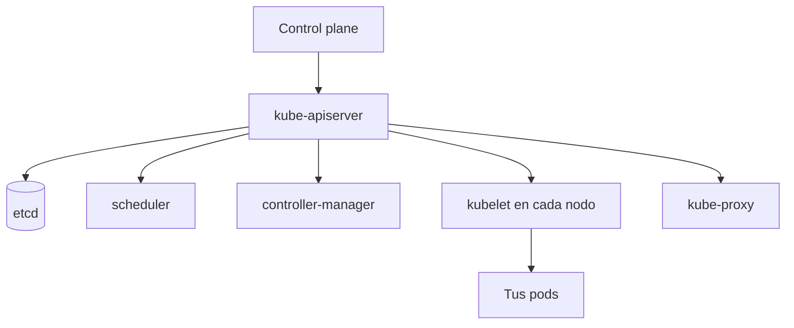
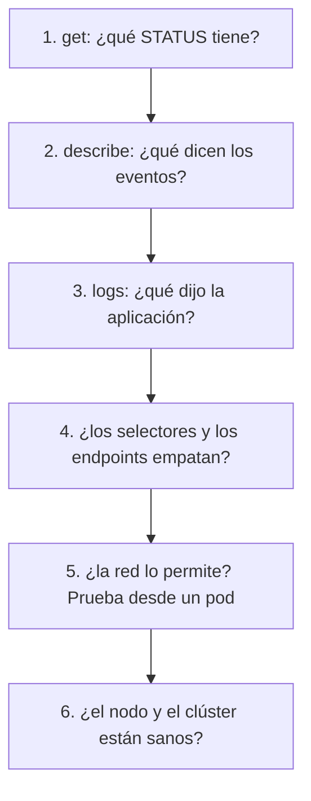

<!-- _class: lead -->

# S06 - Operar y diagnosticar

### Kubernetes: del Compose al clúster

**Rogelio Arriaga - Raptor Dev Services**

<!--
Sesión de 5 horas. Hilo conductor: ya se sabe desplegar, asegurar y escalar. Hoy se opera: mantener el clúster al día,
organizar los manifiestos y, sobre todo, encontrar por qué algo no arranca sin adivinar. Se siembran cinco fallas.
Versión de referencia: K3s v1.34.1+k3s1 (probado el 11 de noviembre de 2026).
Aviso que se dice en voz alta: según kubernetes.io/releases (consultado el 11 de noviembre de 2026), la rama 1.34 de
Kubernetes ya salió de mantenimiento el 2026-10-27; el laboratorio la usa porque es la que se probó, no porque se
recomiende para producción.
-->

---

## El lema de hoy

> CrashLoopBackOff es un síntoma. La causa está en los eventos y en los logs.

Hoy no se memorizan errores: se aprende un **método** que sirve para el error que nadie ha visto antes.

---

## Agenda

| Bloque | Qué hacemos |
|---|---|
| 1 | Arquitectura del clúster, repasada para operar |
| 2 | Mantener al día: versiones y actualización |
| 3 | Organizar manifiestos: Kustomize y Helm |
| 4 | El método de diagnóstico |
| 5 | Las cinco fallas sembradas, y dos más |
| 6 | El runbook |
| 7 | Práctica guiada |
| 8 | Cierre y proyecto final |

---

## Dónde estamos

| Sesión | Qué se construyó |
|---|---|
| 1 | Un clúster local, pods y la decisión Compose o Kubernetes |
| 2 | Deployments, Services, Ingress y probes |
| 3 | ConfigMaps, Secrets y datos con estado |
| 4 | RBAC, Pod Security, políticas y NetworkPolicies |
| 5 | Peticiones, límites, autoescalado y carga |
| **6** | **Operar y encontrar lo que falla** |

---

<!-- _class: lead -->

# Parte 1
## Arquitectura, para operar

---

## Qué se rompe y qué se nota



| Si falla... | Se nota... |
|---|---|
| El API | `kubectl` no contesta; **los pods que ya corren siguen corriendo** |
| El scheduler | Los pods nuevos se quedan `Pending` |
| El controller-manager | Los controladores dejan de actuar (no se reponen pods, no escala el HPA) |
| El kubelet de un nodo | Ese nodo pasa a `NotReady` y sus pods se reprograman, si hay adónde |
| etcd | El clúster pierde su estado; por eso se respalda |

Fuente: kubernetes.io, "Kubernetes Components"; Sachdeva, *CKA Study Companion* (2025), caps. 2 y 22.

---

## Preguntarle al clúster cómo está

```console
$ kubectl get nodes
NAME           STATUS   ROLES           AGE     VERSION
7bb2c67833c5   Ready    control-plane   2m36s   v1.34.1+k3s1
$ kubectl get --raw='/readyz?verbose' | tail -3
[+]poststarthook/apiservice-openapiv3-controller ok
[+]shutdown ok
readyz check passed
$ kubectl get pods -A | grep -v Running
```

- `get nodes`: ¿todos `Ready`?
- `/readyz?verbose`: el API lista sus comprobaciones una por una, con `[+]` si pasan.
- `get pods -A` filtrando lo que **no** está en `Running` es la lista de pendientes del clúster.
- La versión se ve en `VERSION`: la del kubelet de cada nodo.

---

<!-- _class: lead -->

# Parte 2
## Mantener al día

---

## Versiones: lo que dice el proyecto

A noviembre de 2026, según kubernetes.io:

- El proyecto mantiene ramas de las **tres versiones menores más recientes**: 1.37, 1.36 y 1.35.
- La rama 1.34 figura con fin de vida el 2026-10-27.
- Desde 1.19 cada versión recibe unos **12 meses** de parches.

Consecuencia: un clúster que no se actualiza **se queda sin parches de seguridad** en poco más de un año.

Fuente: kubernetes.io/releases y "Version Skew Policy" (consultadas el 11 de noviembre de 2026). **Estas fechas cambian:** se verifican de nuevo antes de usarlas en una decisión.

---

## Qué versiones pueden convivir

| Componente | Regla de la política de versiones |
|---|---|
| `kubelet` | No puede ser más nuevo que el `kube-apiserver`; puede estar hasta **tres** versiones menores atrás |
| `kubectl` | Dentro de **una** versión menor (más vieja o más nueva) del API |
| `kube-apiserver` en alta disponibilidad | Entre el más nuevo y el más viejo, una versión menor |

- Por eso se actualiza **primero el control plane**, y después los nodos.
- Tu `kubectl` también cuenta: uno muy viejo puede fallar con un clúster nuevo.

Fuente: kubernetes.io, "Version Skew Policy".

---

## Actualizar con kubeadm: el orden

La documentación de kubeadm dice, sobre el proceso:

1. Actualizar un nodo del control plane principal.
2. Actualizar los demás nodos del control plane.
3. Actualizar los nodos de trabajo.

Y dos advertencias textuales: **saltarse versiones menores no está soportado**, y antes de actualizar el kubelet de un nodo hay que **drenarlo** (*drain*).

```bash
kubectl cordon <nodo>      # que no reciba pods nuevos
kubectl drain <nodo> --ignore-daemonsets   # sacar sus pods con orden
# ... actualizar ...
kubectl uncordon <nodo>    # que vuelva a recibir pods
```

Fuente: kubernetes.io, "Upgrading kubeadm clusters"; Sachdeva (2025), caps. 18 y 19. Los comandos de `drain` son de la nota; en clase se practica solo `cordon` y `uncordon`.

---

## `cordon` en vivo

```console
$ kubectl cordon 7bb2c67833c5
node/7bb2c67833c5 cordoned
$ kubectl get nodes
7bb2c67833c5   Ready,SchedulingDisabled   control-plane   ...
$ kubectl run nuevo --image=nginx:1.27-alpine
$ kubectl get pod nuevo
NAME    READY   STATUS    RESTARTS   AGE
nuevo   0/1     Pending   0          4s
$ kubectl describe pod nuevo | tail -1
  Warning  FailedScheduling  ...  0/1 nodes are available: 1 node(s) were unschedulable.
$ kubectl uncordon 7bb2c67833c5
```

- Con un solo nodo, `cordon` deja **sin donde programar** los pods nuevos: quedan `Pending`.
- Los pods que ya corrían **siguen corriendo**.
- Con varios nodos, los pods nuevos van a los demás: esa es la idea.

<!--
En K3s de un solo nodo no se practica drain completo: no hay adónde mover los pods.
-->

---

## Y con K3s

En K3s, la actualización se documenta aparte (su propio instalador y su propio orden); **no** es kubeadm. Lo que sí sirve en cualquier distribución: la política de versiones, no saltar versiones menores y probar primero en un clúster que no sea el de producción.

- Una copia de lo que importa **antes** de actualizar: los datos de la aplicación (respaldos probados, sesión 3) y los manifiestos (ya están en el repositorio, sesión 2).
- Después de actualizar, repetir la **prueba de la aplicación** (la de la sesión 2) y las **pruebas de rechazo** (sesión 4): una actualización puede cambiar un comportamiento.

---

<!-- _class: lead -->

# Parte 3
## Organizar manifiestos

---

## Kustomize: una base y variantes

**Kustomize** viene dentro de `kubectl` (`kubectl kustomize`, `kubectl apply -k`). Una **base** con los manifiestos comunes y **overlays** con lo que cambia por entorno.

```text
k/
  base/
    kustomization.yaml
    deployment.yaml
  overlays/
    produccion/
      kustomization.yaml
```

```yaml
# k/overlays/produccion/kustomization.yaml
resources:
  - ../../base
namePrefix: prod-
replicas:
  - name: web
    count: 3
images:
  - name: nginx
    newTag: 1.27.5-alpine
```

---

## Ver lo que va a aplicar

```console
$ kubectl kustomize k/overlays/produccion | grep -E 'name:|replicas|image:'
  name: prod-web
  replicas: 3
      - image: nginx:1.27.5-alpine
        name: web
$ kubectl apply -k k/overlays/produccion
deployment.apps/prod-web created
```

- `kubectl kustomize` **solo muestra** el resultado: es el `diff` mental antes de aplicar.
- Se cambian el nombre (prefijo), las réplicas y la etiqueta de imagen **sin tocar la base**.
- Sin plantillas ni lenguaje nuevo: son parches sobre el YAML.

Fuente: Sachdeva, *CKA Study Companion* (2025), cap. 11 (Manifest Management Tools: Kustomize); probado en K3s v1.34.1.

---

## Helm

**Helm** es el gestor de paquetes de Kubernetes. Un paquete se llama **chart**, y **instalar un chart crea un release** (según la propia documentación de Helm).

- Útil para instalar software de terceros (una base de datos, un controlador de Ingress) con una sola orden y sus valores configurables.
- Los charts se descargan de un **repositorio**.
- Cada release tiene su historial y se puede revertir.

| Cuándo | Herramienta |
|---|---|
| Tu propia aplicación, pocos entornos | Manifiestos y Kustomize |
| Software de terceros con muchas piezas | Helm |
| Muchos entornos con muchas diferencias | Helm o Kustomize, según el equipo |

Fuente: helm.sh, documentación; Sachdeva (2025), cap. 11. En este curso **no** se instala Helm: se explica y se cita.

---

<!-- _class: lead -->

# Parte 4
## El método de diagnóstico

---

## Seis preguntas, en este orden



| Paso | Comando |
|---|---|
| 1 | `kubectl get pods -o wide` |
| 2 | `kubectl describe pod <pod>`, sección **Events** |
| 3 | `kubectl logs <pod>` y `kubectl logs <pod> --previous` |
| 4 | `kubectl get endpointslices -l kubernetes.io/service-name=<svc>` |
| 5 | Un pod de pruebas: `kubectl run cli --image=busybox:1.37 --command -- sleep 3600` y `wget` desde él |
| 6 | `kubectl get nodes`, `kubectl top nodes`, `/readyz` |

Fuente: Sachdeva, *CKA Study Companion* (2025), cap. 21 (Troubleshooting Application Failure); Stencel, *Kubernetes Recipes*, cap. 13.

---

## Estado como pista, evento como causa

| STATUS | Qué significa | Dónde buscar la causa |
|---|---|---|
| `Pending` | Nadie lo programó en un nodo | Eventos: `FailedScheduling` |
| `ContainerCreating` (largo) | Descargando imagen o montando volumen | Eventos |
| `ErrImagePull` / `ImagePullBackOff` | No pudo bajar la imagen | Eventos: el mensaje del registry |
| `CreateContainerConfigError` | Falta un Secret o ConfigMap | Eventos |
| `CrashLoopBackOff` | El contenedor arranca y muere, una y otra vez | **Logs** y código de salida |
| `Running` pero `0/1` | No pasa la readiness | Eventos: `Readiness probe failed` |
| `Running` y `1/1`, pero nadie responde | Selector, puerto o red | Endpoints y NetworkPolicy |
| `OOMKilled` | Se pasó de memoria | `describe`: código 137 |

---

<!-- _class: lead -->

# Parte 5
## Cinco fallas sembradas

---

## Falla 1: imagen mal escrita

```console
$ kubectl set image deploy/api api=nginx:1.27-alpne
$ kubectl get pods -l app=api
NAME                   READY   STATUS             RESTARTS   AGE
api-5b57696d67-26xn4   1/1     Running            0          23s
api-5b57696d67-6jzjh   1/1     Running            0          23s
api-7fdf8754b4-h4rfm   0/1     ImagePullBackOff   0          20s
$ kubectl describe pod api-7fdf8754b4-h4rfm | grep 'Failed to pull'
  Warning  Failed  ...  Failed to pull image "nginx:1.27-alpne": ... not found
```

- La causa: `alpne`, una letra de menos. El evento lo dice con el nombre completo.
- **Los dos pods viejos siguen atendiendo**: la actualización gradual protegió el servicio (sesión 2).
- Arreglo: corregir el manifiesto, o regresar: `kubectl rollout undo deploy/api`.

---

## Falla 2: el selector que no empata

```console
$ kubectl patch svc api --type merge -p '{"spec":{"selector":{"app":"apii"}}}'
$ kubectl get endpointslices -l kubernetes.io/service-name=api
NAME        ADDRESSTYPE   PORTS     ENDPOINTS   AGE
api-wcvxd   IPv4          <unset>   <unset>     34s
$ kubectl exec cli -- wget -qO- -T 3 http://api/
wget: can't connect to remote host (<IP-del-Service>): Connection refused
$ kubectl get pods --show-labels -l app=api | head -2
api-5b57696d67-26xn4   1/1   Running   0   38s   app=api,pod-template-hash=5b57696d67
```

- Los pods están `Running` y `1/1`: **todo se ve bien**, y nada responde.
- La pista: `ENDPOINTS` en `<unset>`, y la comparación entre el `selector` del Service (`app: apii`) y las etiquetas del pod (`app=api`).
- Una etiqueta mal escrita **no produce error**: el selector simplemente no encuentra nada.

---

## Falla 3: el volumen que no se une

```console
$ kubectl get pod usa-pvc
NAME      READY   STATUS    RESTARTS   AGE
usa-pvc   0/1     Pending   0          8s
$ kubectl describe pvc datos | tail -2
  Warning  ProvisioningFailed  ...  persistentvolume-controller  storageclass.storage.k8s.io "rapida" not found
$ kubectl describe pod usa-pvc | tail -1
  Warning  FailedScheduling  ...  0/1 nodes are available: pod has unbound immediate PersistentVolumeClaims.
```

- Dos objetos cuentan la misma historia: el **pod** dice "mi PVC no está unida"; la **PVC** dice por qué: no existe la StorageClass `rapida`.
- Un pod `Pending` no siempre es culpa del pod: **mira también a lo que pide**.
- Arreglo: usar una StorageClass que exista (`kubectl get storageclass`).

---

## Falla 4: CrashLoopBackOff

```console
$ kubectl run crash --image=busybox:1.37 --command -- sh -c 'echo "no encuentro la variable DB_HOST"; exit 1'
$ kubectl get pod crash
NAME    READY   STATUS             RESTARTS      AGE
crash   0/1     CrashLoopBackOff   2 (26s ago)   40s
$ kubectl logs crash
no encuentro la variable DB_HOST
$ kubectl describe pod crash | grep -E 'Exit Code|Restart Count'
    Exit Code:    1
    Restart Count:  2
```

- `CrashLoopBackOff` es el **síntoma**: el contenedor arranca, muere, y el kubelet espera cada vez más antes de reintentar.
- La **causa** está en los **logs** (la aplicación lo dice) y en el **código de salida** (1: un error de la aplicación; 137: lo mataron, con `OOMKilled` en el estado).
- Tras un reinicio, el log del intento anterior se pide con `kubectl logs --previous`.

---

## Falla 5: la NetworkPolicy que corta

```console
$ kubectl exec cli -- wget -qO- -T 3 http://api/ | head -c 20
<!DOCTYPE html>
<htm
$ kubectl apply -f deny.yaml                 # podSelector: {}  y  policyTypes: [Ingress]
$ kubectl exec cli -- wget -qO- -T 3 http://api/
wget: can't connect to remote host (<IP-del-Service>): Connection refused
$ kubectl get endpointslices -l kubernetes.io/service-name=api
NAME        ADDRESSTYPE   PORTS   ENDPOINTS              AGE
api-wcvxd   IPv4          80      <IP-pod-1>,<IP-pod-2>   103s
$ kubectl get pods
NAME     READY   STATUS    RESTARTS   AGE
api-...  1/1     Running   0          103s
```

- Aquí **todo se ve sano**: pods `1/1`, endpoints presentes, probes pasando. Solo la **prueba desde un pod** lo revela.
- El síntoma "Connection refused" se parece al de la falla 2; los endpoints los distinguen: en la 2 están vacíos, aquí no.
- La causa: `kubectl get networkpolicy -A`. Si hay políticas, leerlas con `describe`.

---

## Dos más que aparecen seguido

**Pending por recursos.** Un pod que pide más CPU de la que el nodo tiene:

```console
$ kubectl get pod grande
grande   0/1   Pending   0   5s
$ kubectl describe pod grande | tail -1
  Warning  FailedScheduling  ...  0/1 nodes are available: 1 Insufficient cpu. ...
```

**Nodo sin programación (`cordon`).** Los pods nuevos quedan `Pending` con `1 node(s) were unschedulable`.

Los dos son `Pending` y los dos se resuelven leyendo el **evento del scheduler**: cada uno dice una causa distinta.

---

## Un contenedor sin shell: `kubectl debug`

La imagen de la aplicación a veces no trae ni `sh`. `kubectl debug` agrega un **contenedor efímero** de depuración **al pod en marcha**, que comparte su red y, con `--target`, sus procesos:

```console
$ kubectl debug -it pod/api-5b57696d67-26xn4 --image=busybox:1.37 --target=api -- sh
Targeting container "api". If you don't see processes from this container...
/ # wget -qO- http://127.0.0.1/ | head -c 25
<!DOCTYPE html>
<html>
<h
```

- Comparte la **red** del pod: `127.0.0.1` es el pod.
- No toca la imagen de la aplicación ni su manifiesto.
- Se usa para mirar desde dentro, no para parchar.

Fuente: kubernetes.io, "Debug Running Pods"; probado en K3s v1.34.1.

---

<!-- _class: lead -->

# Parte 6
## El runbook

---

## Qué lleva un runbook

Un **runbook** es el documento que otra persona sigue **sin ti** cuando algo falla a las tres de la mañana.

| Sección | Contenido |
|---|---|
| Síntoma | Lo que se ve ("la API responde 502") |
| Primera lectura | El comando que se corre primero y qué buscar en su salida |
| Árbol de decisión | Si dice A, ve a ...; si dice B, ve a ... |
| Causas conocidas | Las de esta aplicación, con su arreglo |
| Cuándo escalar | A quién avisar y con qué datos |
| Cómo regresar | `rollout undo` y qué se pierde |
| Última revisión | Fecha y quién lo probó |

Un runbook sin **probar** es una suposición: se prueba sembrándole una falla a otro equipo.

---

## Errores típicos de la sesión

| Error | Cómo se ve | Qué hacer |
|---|---|---|
| Leer solo `STATUS` | "Está en CrashLoopBackOff" y nada más | Eventos y logs |
| Reiniciar para ver si se arregla | Se pierden los logs y la pista | Leer antes de tocar |
| Borrar el pod que falla | Vuelve igual de roto | Corregir el Deployment |
| Culpar al pod `Pending` | La causa es el volumen o el nodo | Leer también lo que el pod pide |
| Confundir selector con red | Dos "Connection refused" iguales | Endpoints vacíos o no |
| Parchar con `kubectl edit` y no actualizar el repo | El repo contradice al clúster | Corregir el archivo |
| Actualizar el clúster sin leer la política de versiones | Un nodo más nuevo que el API | Control plane primero; una versión menor a la vez |
| No probar el runbook | Falla cuando hace falta | Siembra una falla y síguelo |

---

## Cierre: lo que se llevan

- Se opera con un método: `get`, `describe`, `logs`, selectores, red, nodo.
- El estado es el síntoma; el evento y el log son la causa.
- Cada falla tiene una **pista que la distingue** de su parecida (selector contra NetworkPolicy, Pending por PVC contra Pending por CPU).
- Un clúster se mantiene al día con una política de versiones, no con prisa.
- Un runbook se prueba con una falla sembrada.

**Tarea:** el runbook de diagnóstico de su aplicación.

**Proyecto final:** la API de Titulación desplegada en el clúster, con manifiestos versionados, políticas que se vieron rechazar, autoescalado medido y runbook.

Libros de la sesión: Sachdeva, *CKA Study Companion* (2025), partes V y VI. Stencel, *Kubernetes Recipes*, caps. 10 y 13.
