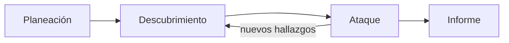

<!-- _class: lead -->

# Módulo 1 - Metodología, alcance y autorización

### Ciberseguridad II: pentest con Kali

**Rogelio Arriaga - Raptor Dev Services**

<!--
Bienvenida. Este curso continúa el de Ciberseguridad: allá se aprendieron herramientas sueltas (Nmap, Sherlock, Hydra); aquí se aprende a hacer una prueba completa con principio y fin.
Antes de empezar, cada quien confirma que tiene su laboratorio de Ciberseguridad (Kali y una víctima) y su carta de autorización del módulo 1 de aquel curso.
-->

---

## Agenda del módulo

| Bloque | Qué hacemos | Tiempo aprox. |
|---|---|---|
| Apertura | Lema, objetivos, alcance del curso | 10 min |
| Parte 1 | Qué es un pentest y en qué se distingue de un escaneo | 20 min |
| Parte 2 | La metodología: fases y estándares | 20 min |
| Parte 3 | Autorización, alcance y reglas de enfrentamiento | 30 min |
| Parte 4 | El marco legal mexicano y el límite del alcance | 15 min |
| Práctica | La carta de autorización y el alcance de tu laboratorio | 20 min en clase, el resto es la práctica |
| Cierre | Errores típicos y quiz | 5 min |

<!-- Total de clase: unos 120 minutos con la práctica. Si el grupo ya trae su carta del curso anterior, la práctica se acorta. -->

---

## El lema del módulo

> Sin alcance escrito no hay pentest, hay intrusión.

- La técnica es idéntica en los dos casos. Lo único que cambia es un documento.
- Un pentest es un **servicio con entregable**: el cliente paga por el informe, no por las sesiones que se obtuvieron.
- Este módulo no usa ninguna herramienta de Kali. Es el módulo que decide si los demás se pueden usar.

---

## Alcance de este curso (decisión del instructor)

Este curso cubre **metodología y defensa**:

- Alcance, autorización y reglas de enfrentamiento.
- Reconocimiento y análisis de vulnerabilidades con las herramientas de Kali.
- Priorización: CVSS 4.0, EPSS, KEV y contexto del negocio.
- **La corrección y la detección de cada clase de hallazgo**, y la verificación de que la corrección funciona.
- El informe ejecutivo y el técnico.

La explotación, las contraseñas y el escalamiento de privilegios se explican **a nivel conceptual**: qué son, por qué funcionan, cómo se detectan y cómo se cierran. No hay procedimientos de ataque paso a paso. Las prácticas se apoyan en laboratorios hechos para practicar, y se centran en documentar, priorizar, corregir y verificar.

---

## Al terminar puedes

- Explicar en qué se distingue un pentest de un escaneo de vulnerabilidades y de un ejercicio de red team.
- Nombrar las fases de una prueba de penetración y qué pasa en cada una.
- Redactar una carta de autorización con alcance, exclusiones, ventana, contactos y firma.
- Listar las secciones de unas reglas de enfrentamiento y para qué sirve cada una.
- Explicar por qué salirse del alcance cambia la situación legal, con el artículo del Código Penal Federal.
- Delimitar un pentest de forma que nadie dude qué está permitido.

---

## Cómo trabajamos en este curso

- **Un laboratorio aislado** de red solo anfitrión: `192.168.56.0/24`, con `kali` en 192.168.56.10, `victima` (Ubuntu Server propio) en 192.168.56.20 y Metasploitable 2 en 192.168.56.40. Es el mismo patrón del curso Blue Team (`/blue-team/`).
- Todo se practica **contra tu laboratorio**. Nunca contra una dirección que no controlas, con o sin "permiso verbal".
- Cada práctica tiene un paso **"Verlo fallar"**: rompes algo a propósito y lees el error o el resultado.
- Cada unidad cierra con una evidencia que entregas: ese conjunto es tu proyecto final.

> Metasploitable 2 es una máquina vulnerable a propósito. Su guía oficial dice que no debe exponerse a una red hostil. En el laboratorio queda solo en la red solo anfitrión.

Fuente: Rapid7, *Metasploitable 2 Exploitability Guide*, docs.rapid7.com/metasploit/metasploitable-2-exploitability-guide/.

---

<!-- _class: lead -->

# Parte 1
## Qué es un pentest

---

## Tres cosas que se confunden

| | Qué hace | Qué entrega |
|---|---|---|
| **Escaneo de vulnerabilidades** | Compara servicios y versiones contra bases de vulnerabilidades, casi siempre con herramientas automáticas | Una lista de posibles fallas |
| **Prueba de penetración** | Además, **verifica** que algunas de esas fallas se pueden aprovechar, imitando a un atacante | Fallas demostradas, su impacto y cómo cerrarlas |
| **Ejercicio de red team** | Persigue un objetivo del negocio (por ejemplo, llegar a cierto dato) y puede probar también a las personas y la detección | Qué tan lejos llegó un adversario y si alguien lo vio |

- Lo que decide el nombre no es la herramienta sino el **objetivo** y lo que se pactó.
- Este curso hace lo primero y lo segundo, con el segundo en nivel conceptual.

Fuente: clasificación didáctica de este curso. NIST SP 800-115 trata el escaneo de vulnerabilidades en la sec. 4.3 y las pruebas de penetración en la sec. 5.2; Velu, *Mastering Kali Linux for Advanced Penetration Testing* (2022), cap. 1, discute los errores comunes al confundir evaluación de vulnerabilidades, prueba de penetración y ejercicios de red team.

<!-- No hay una definición normativa única de red team. Esta tabla es una forma de ordenarlo para el curso. -->

---

## Dos familias de técnicas, según NIST

El glosario de NIST SP 800-115 separa las técnicas en dos grupos:

- **Identificación y análisis de objetivos:** técnicas en su mayoría activas y casi siempre con herramientas automáticas, para identificar sistemas, puertos, servicios y posibles vulnerabilidades (descubrimiento de red, escaneo de puertos, escaneo de vulnerabilidades, pruebas de seguridad de aplicaciones).
- **Validación de vulnerabilidades:** técnicas activas que corroboran que la vulnerabilidad existe (revisión de contraseñas, pruebas de acceso remoto, pruebas de penetración, ingeniería social, pruebas físicas).

Es la misma división de este curso: los módulos 2 y 5 **encuentran**; el módulo 3 explica cómo se **valida**, sin practicarlo; los módulos 1, 4 y 6 lo **rodean** con alcance, corrección e informe.

Fuente: NIST SP 800-115 (septiembre de 2008), glosario del apéndice.

---

## Para qué sirve un pentest

- **Demostrar el riesgo** con evidencia, para que alguien con presupuesto decida.
- **Priorizar:** de cien hallazgos posibles, saber cuáles tres importan en este negocio.
- **Probar que los controles funcionan:** un cortafuegos o una alerta que nadie ha probado es una suposición.
- **Verificar el cumplimiento** de una política, que es el otro uso que NIST le da a este tipo de pruebas.

Y lo que **no** es: certificar que un sistema es seguro. Una prueba solo dice lo que encontró en la ventana y el alcance pactados (conclusión del curso, no una cita).

Fuente: NIST SP 800-115, resumen: sirve para "encontrar vulnerabilidades o verificar el cumplimiento de una política", csrc.nist.gov/pubs/sp/800/115/final.

---

<!-- _class: lead -->

# Parte 2
## La metodología

---

## Las cuatro fases de NIST

- **Planeación:** se identifican las reglas, se documenta la aprobación de la dirección y se fijan los objetivos. **No se hace ninguna prueba.**
- **Descubrimiento:** recopilar información y analizar vulnerabilidades.
- **Ataque:** verificar las posibles vulnerabilidades intentando aprovecharlas. Si funciona, se identifican las salvaguardas que lo cierran.
- **Informe:** corre en paralelo a las otras tres; al final describe las vulnerabilidades, su riesgo y cómo mitigarlas.

Fuente: NIST SP 800-115, sec. 5.2.1. El propio documento aclara que es **un** ejemplo de cómo dividir el proceso: hay otras formas aceptables de agruparlo.

<!-- Observa el ciclo ataque -> descubrimiento: un acceso nuevo abre información nueva. Pregunta: ¿en qué fase se firma la carta? En la primera. -->

---

## PTES: siete secciones

El *Penetration Testing Execution Standard* organiza el trabajo en siete secciones:

<!-- _pasos: lista -->

1. Interacciones previas al compromiso (*Pre-engagement Interactions*)
2. Recopilación de inteligencia (*Intelligence Gathering*)
3. Modelado de amenazas (*Threat Modeling*)
4. Análisis de vulnerabilidades (*Vulnerability Analysis*)
5. Explotación (*Exploitation*)
6. Post-explotación (*Post Exploitation*)
7. Informe (*Reporting*)

Fuente: PTES, pentest-standard.readthedocs.io. Cuidado: el sitio original, pentest-standard.org, no respondió al preparar este curso (noviembre de 2026); la lista se tomó de la documentación en Read the Docs.

---

## Cómo se alinean las dos

| NIST SP 800-115 | PTES | Módulo del curso |
|---|---|---|
| Planeación | Interacciones previas | **1** |
| Descubrimiento | Inteligencia, modelado de amenazas, análisis de vulnerabilidades | **2** y **5** |
| Ataque | Explotación, post-explotación | **3** y **4** (conceptual) |
| Informe | Informe | **6** |

Otras referencias que vas a encontrar: la guía de pruebas web de OWASP (WSTG, v4.2 como última versión publicada y la 5.0 en desarrollo a noviembre de 2026) para aplicaciones web; el curso la usa en el módulo 5.

Fuente: PTES y NIST SP 800-115 como arriba; OWASP, owasp.org/www-project-web-security-testing-guide/ (consultado en noviembre de 2026).

---

## Pruebas por objetivos, no por herramientas

Una prueba por objetivos empieza con una pregunta del negocio y de ahí se deduce qué hacer:

| Pregunta del negocio | Objetivo de la prueba | Qué se prueba |
|---|---|---|
| ¿Pueden entrar a la tienda en línea por internet? | Acceso desde el exterior a la aplicación | Superficie expuesta y la aplicación web |
| ¿Un empleado con una laptop robada compromete la red? | Movimiento desde un equipo interno | Segmentación y configuración |
| ¿Nos enteraríamos de un ataque? | Calidad de la detección | Alertas y respuesta (con el curso Blue Team) |

El error que este formato evita: empezar por "tengo Nmap, voy a correr Nmap". Se empieza por la pregunta y se elige lo que la contesta.

Fuente: Velu, *Mastering Kali Linux for Advanced Penetration Testing* (2022), cap. 1, "Goal-Based Penetration Testing". Los tres ejemplos de la tabla son ilustrativos.

---

<!-- _class: lead -->

# Parte 3
## Autorización, alcance y reglas de enfrentamiento

---

## La autorización mínima

Una carta de autorización dice, por escrito:

- **Quién autoriza** y que tiene autoridad real sobre los sistemas.
- **Quién prueba** (persona o empresa) y su responsable.
- **Qué sistemas**: direcciones, dominios o aplicaciones **incluidas**.
- **Qué queda excluido**, aunque esté cerca de lo incluido.
- **Cuándo**: fechas y horas permitidas.
- **Qué técnicas** se permiten y cuáles no.
- **A quién llamar** si algo sale mal, con teléfono.
- **Firmas** de ambas partes.

> Un permiso verbal no es una autorización. Si no está firmado, no existe para efectos legales.

Fuente: NIST SP 800-115, apéndice B (plantilla de reglas de enfrentamiento); Singh, *The Ultimate Kali Linux Book* (2022), cap. 1.

---

## Reglas de enfrentamiento (ROE) según NIST

Las ROE son las pautas y límites detallados sobre cómo se ejecuta la prueba. Se establecen **antes** de empezar y dan al equipo la autoridad de hacer las actividades definidas **sin pedir permisos adicionales**. La plantilla de NIST tiene siete secciones:

<!-- _pasos: filas -->

| # | Sección | Para qué sirve |
|---|---|---|
| 1 | Introducción | Propósito, alcance, supuestos, riesgos |
| 2 | Logística | Personal, calendario, sitio y equipo de prueba |
| 3 | Estrategia de comunicación | Cómo se habla, y qué hacer si ocurre un incidente durante la prueba |
| 4 | Sistema o red objetivo | Direcciones autorizadas y la **lista de exclusión** |
| 5 | Ejecución de la prueba | Actividades permitidas y no permitidas; manejo de datos |
| 6 | Informe | Qué se entrega y cada cuánto |
| 7 | Hoja de firmas | Quién responde; como mínimo, quien dirige la prueba y la alta dirección |

Fuente: NIST SP 800-115, apéndice B. La plantilla es **ilustrativa**: cada organización la adapta.

---

## Lo que casi nadie escribe y luego duele

- **Criterio para detener la prueba.** NIST lo marca como crítico: qué hacer si una prueba daña la red o si ocurre un ataque real mientras se prueba.
- **Manejo de datos:** cómo se reúnen, guardan, transmiten y destruyen los datos de la prueba. NIST recuerda que los resultados identifican fallas aprovechables y deben tratarse como **sensibles**.
- **Archivos que se instalan o modifican** para probar, y qué se hace con ellos al terminar.
- **El árbol de llamadas** del equipo de respuesta del cliente, para saber a quién avisar a las 2 de la mañana.

Fuente: NIST SP 800-115, apéndice B, secciones 3.2, 5.2 y 5.3.

---

## Terceros: el sistema no siempre es del cliente

Muchos sistemas viven en infraestructura de otro: nube, hosting, SaaS, un proveedor de correo. La autorización del cliente **no** autoriza a probar la infraestructura del proveedor.

Ejemplo real: la política de pruebas de seguridad de AWS (consultada en noviembre de 2026) permite a los clientes probar sin aprobación previa una lista de servicios propios, **prohíbe** las pruebas de denegación de servicio (y la simulación de denegación de servicio, los desbordamientos de puertos, protocolo o peticiones) y pide aprobación previa para cualquier prueba que incluya mando y control. Los clientes tampoco pueden evaluar la infraestructura de AWS ni sus servicios.

La política de cada proveedor **cambia**: se lee en el momento de firmar el alcance, no de memoria.

Fuente: AWS, *Penetration Testing*, aws.amazon.com/security/penetration-testing/ (consultada en noviembre de 2026; la página no trae fecha de actualización).

---

## Contrato, confidencialidad y legal

Además de la carta, un servicio profesional lleva:

- **Contrato** que fija precio, entregables, limitación de responsabilidad y quién responde si una prueba intrusiva tumba un sistema.
- **Acuerdo de confidencialidad:** el informe es un mapa de cómo entrar. NIST recomienda que el área legal participe siempre en pruebas intrusivas como las de penetración, y cuida la **privacidad**: una captura de tráfico puede contener datos personales que no son de la organización.
- **Datos personales:** en México, la Ley Federal de Protección de Datos Personales en Posesión de los Particulares vigente es la publicada en el DOF el 20 de marzo de 2025. Si el alcance toca datos personales, el responsable y el equipo deben acordar cómo se tratan en la prueba.

Fuente: NIST SP 800-115, sec. 6.6 (consideraciones legales); DOF 20-03-2025; nota `12-seguridad/05-legislacion/12-proteccion-datos-personales.md` de este repositorio.

<!-- Esto no es asesoría legal. Cada proyecto real necesita a su abogado. -->

---

<!-- _class: lead -->

# Parte 4
## El marco legal y el límite del alcance

---

## El Código Penal Federal y la palabra "autorización"

Los artículos 211 bis 1 a 211 bis 7 castigan el acceso ilícito a sistemas de informática **protegidos por algún mecanismo de seguridad**. Lo que cambia la pena es de quién es el sistema y si el autor tenía autorización:

| Artículo | Sistema | ¿Autorizado? | Modificar, destruir o provocar pérdida | Conocer o copiar |
|---|---|---|---|---|
| 211 bis 1 | Cualquiera protegido | No | 6 meses a 2 años | 3 meses a 1 año |
| 211 bis 2 | Del Estado | No | 1 a 4 años | 6 meses a 2 años |
| 211 bis 3 | Del Estado | Sí, y lo hace "indebidamente" | 2 a 8 años | 1 a 4 años (copiar) |
| 211 bis 4 | Sistema financiero | No | 6 meses a 4 años | 3 meses a 2 años |
| 211 bis 5 | Sistema financiero | Sí, y lo hace "indebidamente" | 6 meses a 4 años | 3 meses a 2 años |

Fuente: Código Penal Federal (última reforma DOF 13-03-2026), arts. 211 bis 1 a 211 bis 5. Resumen didáctico que omite los días multa y los párrafos de seguridad pública. No es asesoría legal.

---

## Por qué importa en un pentest

Dos ideas del texto que cambian cómo se escribe el alcance:

1. **"Sin autorización" se mide sistema por sistema.** Tener permiso para una dirección no lo da para la de al lado. Un sistema fuera de la lista no está autorizado, aunque esté en la misma red.
2. **Los artículos 211 bis 3 y 211 bis 5 castigan al que sí estaba autorizado** y modifica, destruye o copia información "indebidamente". La autorización tiene **límites de qué se puede hacer**, no solo de dónde: por eso la carta lista técnicas permitidas y prohibidas.

Además, el artículo 211 bis 7 sube las penas **hasta en una mitad** cuando la información obtenida se usa en provecho propio o ajeno. Lo que se ve en una prueba no sale de la prueba.

Fuente: Código Penal Federal, arts. 211 bis 3, 211 bis 5 y 211 bis 7. Leer la nota `12-seguridad/03-forense/09-codigo-penal-federal.md`.

<!-- Aclarar que los dos primeros puntos son lectura didáctica del curso sobre el texto de los artículos; el delito, el fuero y la interpretación los define la autoridad. -->

---

## También hay leyes estatales

No hay una sola ley de ciberdelitos. Los estados tienen su propio código penal, y una conducta puede encuadrar en más de una norma.

Por eso la carta debe decir **dónde** están los sistemas y quién es la persona moral dueña de ellos. Si el cliente tiene sistemas en otra entidad o país, el equipo legal revisa cada jurisdicción antes de firmar.

Fuente: nota `12-seguridad/05-legislacion/11-derecho-penal.md` y `12-seguridad/03-forense/09-codigo-penal-federal.md` de este repositorio.

---

## Ética profesional

- Respetas el alcance acordado, aunque descubras algo "más interesante" fuera de él.
- Lo que encuentras es **confidencial**: del cliente, no tuyo.
- Si encuentras algo grave que no estaba previsto (datos de terceros, un ataque real en curso), **detienes la prueba y avisas** por el canal de las ROE.
- Si un dato sensible entra a tus manos por accidente, lo reportas y lo destruyes como indiquen las ROE.
- Divulgación responsable: una falla real en un producto ajeno se reporta en privado al fabricante y se le da tiempo razonable para corregirla.

---

<!-- _class: lead -->

# Cierre

---

## Errores típicos

| Error | Consecuencia |
|---|---|
| Alcance de "toda la empresa" | Nadie sabe qué incluye; se prueba un sistema que el cliente quería fuera |
| Un rango de red completo sin exclusiones | Se alcanza un sistema crítico o de un tercero |
| Sin ventana de horario | Una prueba tumba el servicio en horario de ventas |
| Sin contacto de emergencia | Un incidente real a las 2 a.m. y nadie a quién llamar |
| Permiso por WhatsApp o verbal | No hay documento: no hay autorización |
| Firma de alguien sin autoridad sobre el sistema | La carta no vale |
| Datos de la prueba en una laptop sin cifrar | El informe se vuelve el robo |

---

## Lo que te llevas

- Un pentest es un servicio con alcance, objetivos y entregable. Sin carta, es intrusión.
- NIST lo divide en planeación, descubrimiento, ataque e informe; PTES en siete secciones. Los dos empiezan por el **acuerdo previo**.
- Las ROE dan autoridad para lo escrito y **ninguna** para lo no escrito. La exclusión gana siempre.
- La ley mexicana mide "sin autorización" sistema por sistema y castiga también el uso indebido de una autorización.

**Práctica:** la carta de autorización y el alcance de tu laboratorio, y un verificador de alcance que ves fallar.

**Siguiente módulo:** reconocimiento activo y vulnerabilidades: escanear solo lo que está en la carta.
