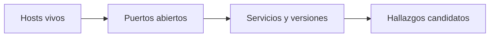

<!-- _class: lead -->

# M02 - Reconocimiento activo y vulnerabilidades

### Ciberseguridad II: pentest con Kali

**Rogelio Arriaga - Raptor Dev Services**

<!--
Antes de empezar: cada quien tiene su laboratorio arriba (Kali en 192.168.56.10 y Metasploitable 2 en 192.168.56.40, red host-only) y su carta de autorización del módulo 1 a la vista. Si alguien no tiene la carta, no escanea: la hace primero.
-->

---

## Agenda

| Bloque | Qué hacemos | Tiempo aprox. |
|---|---|---|
| Apertura | Lema, objetivos y la carta | 10 min |
| Parte 1 | Reconocimiento: pasivo, activo y dentro del alcance | 15 min |
| Parte 2 | Nmap: descubrir, enumerar y guardar la evidencia | 30 min |
| Parte 3 | Un escáner de vulnerabilidades y sus falsos positivos | 20 min |
| Parte 4 | Priorizar: CVSS 4.0, EPSS, KEV y contexto | 30 min |
| Cierre | Los hallazgos del laboratorio y la práctica | 15 min |

---

## El lema del módulo

> Un escáner encuentra cien cosas; el trabajo es saber cuáles tres importan.

- Un escaneo sin priorizar es un PDF de 300 páginas que nadie lee.
- Un hallazgo sin corrección es una queja, no un servicio.
- Hoy aprendemos a descubrir, a **desconfiar de lo que el escáner dice** y a ordenar lo que queda.

---

## Al terminar puedes

- Distinguir el reconocimiento pasivo del activo y mantenerte dentro del alcance escrito.
- Descubrir hosts y servicios del laboratorio con Nmap y guardar la salida en formatos reutilizables.
- Elegir scripts NSE por categoría y explicar por qué unas piden autorización explícita.
- Leer un reporte de un escáner de vulnerabilidades y separar lo confirmado de lo dudoso.
- Priorizar con CVSS 4.0, EPSS, el catálogo KEV y el contexto del negocio.
- Escribir, para cada hallazgo, su corrección y la huella que dejaría en las bitácoras.

---

## Regla del módulo: la carta va primero

Todo lo de hoy toca la red. Antes de cada comando:

1. El objetivo está **escrito** en el alcance de tu carta (módulo 1).
2. El objetivo es del laboratorio: `192.168.56.40`, red host-only `192.168.56.0/24`.
3. Sabes qué técnicas permite la carta y cuáles no.

> Nunca una IP que no controlas. Un permiso verbal no es una autorización.

Fuente: Código Penal Federal, arts. 211 bis 1 a 211 bis 7, que vimos en Ciberseguridad, módulo 1.

<!-- Si la carta no menciona escaneo de vulnerabilidades con scripts, hoy sólo se hace descubrimiento. -->

---

<!-- _class: lead -->

# Parte 1
## Reconocimiento dentro del alcance

---

## Pasivo y activo

| | Pasivo | Activo |
|---|---|---|
| Qué es | Reunir información sin enviar tráfico al objetivo | Enviar paquetes al objetivo y mirar la respuesta |
| Ejemplos | Registros públicos, DNS público, buscadores, OSINT (módulo 5 de Ciberseguridad) | Barrido de hosts, escaneo de puertos, detección de versiones |
| Lo ve el objetivo | No (normalmente) | Sí: queda en sus bitácoras y en su IDS |
| Dentro de la carta | Casi siempre | Sólo lo que la carta nombra |

Fuente: *The Ultimate Kali Linux Book* (Singh, 2022), cap. 4 (Reconnaissance and Footprinting) y cap. 5 (Exploring Active Information Gathering).

<!-- Pregunta: ¿escanear tiene riesgo? Sí: puede tumbar un servicio frágil. Por eso la carta incluye ventanas y contactos. -->

---

## Lo que el reconocimiento tiene que producir

El reconocimiento no es un fin: produce una **lista de superficie** que el resto del pentest usa.



- Cada flecha es un paso que puede **equivocarse** (falsos negativos al inicio, falsos positivos al final).
- Lo que no entra a la lista no se revisa después.

---

## Dentro de alcance es también "fuera de alcance"

Un buen barrido sabe qué **no** tocar:

- `-iL archivo.txt` lee los objetivos de un archivo: el alcance vive en un archivo versionado, no en tu memoria.
- `--exclude <host1>,<host2>` excluye hosts o redes.
- Un rango amplio (`192.168.56.0/24`) incluye a tu propio Kali y al anfitrión: exclúyelos.

```bash
nmap -sn -iL alcance.txt --exclude 192.168.56.10
```

Sintaxis de la documentación oficial (nmap.org/book/man-briefoptions.html), no ejecutada en la construcción del curso.

---

<!-- _class: lead -->

# Parte 2
## Nmap: descubrir, enumerar y guardar

---

## Primero: quién está vivo

```bash
nmap -sn 192.168.56.0/24
```

- `-sn` es "Ping Scan - disable port scan": sólo descubre hosts.
- `-Pn` hace lo contrario: "Treat all hosts as online -- skip host discovery". Sirve si un firewall oculta el host, pero con un rango grande gasta horas probando direcciones vacías.

Fuente: nmap.org/book/man-briefoptions.html, consulta del 2026-11-11.

---

## Los seis estados de un puerto

| Estado | Significa |
|---|---|
| `open` | Una aplicación acepta conexiones |
| `closed` | Responde, pero no hay aplicación escuchando |
| `filtered` | Nmap no puede saber: algo bloquea los paquetes |
| `unfiltered` | Responde, pero no sabe si está abierto o cerrado |
| `open\|filtered` | No puede decidir entre abierto y filtrado |
| `closed\|filtered` | No puede decidir entre cerrado y filtrado |

Fuente: Nmap Network Scanning, cap. 4, *Port Scanning Overview*, nmap.org/book/port-scanning.html.

`--reason` muestra por qué Nmap llegó a cada estado: úsalo cuando un resultado te extrañe.

---

## Qué escanea Nmap si no le dices nada

"By default, Nmap scans the 1,000 most popular ports of each protocol it is asked to scan." La lista viene de `nmap-services`, que guarda datos empíricos de con qué frecuencia aparece abierto cada puerto.

```bash
nmap 192.168.56.40          # los 1000 puertos más populares
nmap -F 192.168.56.40       # menos puertos: más rápido, ve menos
nmap -p- 192.168.56.40      # todos: -p1-65535
```

- Un servicio en un puerto raro **no sale** en el escaneo por omisión.
- Ése es el primer falso negativo del curso: lo vas a ver en la práctica.

Fuente: nmap.org/book/port-scanning.html y nmap.org/book/man-briefoptions.html, consulta del 2026-11-11.

---

## El nombre del puerto no es el servicio

Sin `-sV`, Nmap sólo dice qué suele correr en ese número de puerto. Con `-sV` pregunta al servicio.

```bash
nmap -sV 192.168.56.40
```

`-sV`: "Probe open ports to determine service/version info".

| Sin `-sV` | Con `-sV` |
|---|---|
| `21/tcp open ftp` | `21/tcp open ftp  vsftpd 2.3.4` |

**La versión es lo que se cruza con una base de vulnerabilidades.** Sin ella sólo tienes un nombre.

<!-- El ejemplo de la columna derecha es ilustrativo en su formato; la práctica pide que anotes lo que sale de verdad. -->

---

## Guardar siempre en los tres formatos

```bash
nmap -sV -oA evidencia/m02-base 192.168.56.40
```

`-oA <basename>`: "Output in the three major formats at once": normal (`.nmap`), XML (`.xml`) y *grepable* (`.gnmap`).

- El `.xml` lo leen otras herramientas (importar a un reporte, a una base de hallazgos).
- El `.nmap` es la evidencia legible para el informe del módulo 6.
- Un escaneo que no guardaste no pasó.

Fuente: nmap.org/book/man-briefoptions.html, consulta del 2026-11-11.

---

## Timing: más rápido no es mejor

`-T<0-5>` fija la plantilla de tiempo: "higher is faster". Las rápidas saturan redes y servicios frágiles; las lentas alargan la ventana de la carta.

- En el laboratorio sirve cualquier valor.
- En un cliente, el valor lo acuerdas con él **por escrito**: es parte de las reglas de enfrentamiento.

Fuente: nmap.org/book/man-briefoptions.html.

---

## NSE: el motor de scripts

El Nmap Scripting Engine ejecuta scripts en Lua. Se piden por nombre, por **categoría** o con una expresión:

```bash
nmap -sC 192.168.56.40                          # = --script=default
nmap --script default,safe 192.168.56.40
nmap --script "not intrusive" 192.168.56.40
```

Fuente: nmap.org/book/nse-usage.html, consulta del 2026-11-11. Sintaxis de la documentación, no ejecutada en la construcción del curso.

---

## Las categorías, y cuáles piden permiso

| Categoría | Qué hace | Autorización |
|---|---|---|
| `default` | Lo que corre `-sC`: rápido, poco ruidoso | La del escaneo |
| `safe` | No está diseñada para tumbar servicios ni explotar | La del escaneo |
| `discovery` | Aprende más de la red (registros, SNMP, directorios) | La del escaneo |
| `version` | Extiende `-sV`; no se elige a mano | La del escaneo |
| `vuln` | Comprueba vulnerabilidades concretas y reporta si existe | Nómbrala en la carta |
| `intrusive` | Puede tumbar el objetivo o consumir muchos recursos | **Explícita** |
| `brute` | Adivina credenciales | **Explícita** |
| `dos` | Puede causar denegación de servicio | **Explícita** (casi siempre prohibida) |
| `exploit` | Explota de verdad una vulnerabilidad | **Explícita** |
| `external` | Manda datos a un tercero | Revisa qué sale de tu red |
| `fuzzer`, `malware`, `auth`, `broadcast` | Casos particulares | Léela antes de usarla |

Fuente: nmap.org/book/nse-usage.html (descripción de cada categoría, condensada), consulta del 2026-11-11. La columna "Autorización" es la regla de este curso, no de Nmap.

---

## Las expresiones: pedir sólo lo seguro

```bash
nmap -sV --script "default and safe" 192.168.56.40
nmap -sV --script "vuln and safe" 192.168.56.40
```

- La documentación permite expresiones booleanas (`and`, `or`, `not`) y pide comillas si llevan espacios.
- `vuln and safe` deja fuera cualquier script de `vuln` que también sea `intrusive`: ese es justo el que necesita permiso.
- `--script-help` muestra, por cada script, su nombre, sus categorías y su descripción: léelo antes de correr uno.

Fuente: nmap.org/book/nse-usage.html, consulta del 2026-11-11.

<!-- Aquí se puede pedir al grupo que adivine cuántos scripts caen en "vuln and safe". Nadie sabe: se mide en la práctica con --script-help. No des un número de memoria. -->

---

## Los scripts de terceros no están en una jaula

La documentación de Nmap avisa: los scripts no corren en un *sandbox*, pueden dañar tu sistema o invadir tu privacidad, y

> "Never run scripts from third parties unless you trust the authors or have carefully audited the scripts yourself."

Un script que bajaste de un repositorio al azar corre con tus permisos, en tu Kali, con tu red.

Fuente: nmap.org/book/nse-usage.html, consulta del 2026-11-11.

---

<!-- _class: lead -->

# Parte 3
## El escáner de vulnerabilidades

---

## Qué hace un escáner de vulnerabilidades

Compara lo que encuentra (servicios, versiones, configuraciones) con una base de **pruebas de detección** y reporta lo que coincide.

- No sabe lo que no le enseñaron: un servicio propio, una mala configuración local o un error lógico de tu aplicación no están en su base.
- Una coincidencia de versión **no** prueba que seas vulnerable: Debian, por ejemplo, aplica los arreglos de seguridad (*backports*) a la versión que publicó en lugar de subirla, así que el número puede seguir viéndose viejo con el arreglo ya puesto (Debian Security FAQ, debian.org/security/faq, consulta del 2026-11-11).
- Tampoco entiende tu negocio: un 9.8 en un servidor de pruebas y un 5.3 en la base de clientes pesan distinto.

Fuente: *Learning Kali Linux* (Messier, 2024), cap. 4 (Looking for Vulnerabilities); *Mastering Kali Linux for Advanced Penetration Testing* (Velu, 2022), cap. 4 (Vulnerability Assessment).

---

## Greenbone (OpenVAS) en Kali

Kali lo empaqueta como el metapaquete `gvm`: "Remote network security auditor - metapackage and useful scripts". Antes se llamaba OpenVAS. A noviembre de 2026, la página de Kali muestra la versión 25.04.3.

```bash
sudo apt install gvm
sudo gvm-setup          # crea la base, certificados y actualiza los feeds
sudo gvm-check-setup    # reporta si falta algo
```

La interfaz web queda en `https://127.0.0.1:9392`.

Fuente: kali.org/tools/gvm, consulta del 2026-11-11. Comandos de esa página y de `apt`, no ejecutados en la construcción del curso. `gvm-setup` tarda: baja los feeds de pruebas.

<!-- Aquí se arranca el setup en cada Kali antes de seguir con la clase: se deja trabajando mientras se explica lo demás. -->

---

## Qué tan confiable es cada resultado

Greenbone califica cada detección con su **calidad de detección** (QoD), de 0 a 100 %.

| QoD | Cómo se detectó (ejemplos de la documentación) |
|---|---|
| 100 % | Verificada con un exploit |
| 97 % | Revisión autenticada de paquetes |
| 70 % | Análisis remoto |
| 50 % | Sondeo remoto: un firewall intermedio podría fingir la respuesta |

- Por omisión, los reportes **ocultan** resultados bajo 70 %.
- La documentación advierte que una prueba con QoD baja es propensa a falsos positivos y que decidirlo es responsabilidad tuya.
- Con varios métodos aplica el QoD más bajo.

Fuente: manual de Greenbone, *Reports and Vulnerability Management* y glosario (docs.greenbone.net), consulta del 2026-11-11. Las tablas de QoD cambian entre versiones del manual: revisa la de tu versión.

---

## Falso positivo y falso negativo

| | Qué pasó | Cómo lo reconoces |
|---|---|---|
| Falso positivo | El escáner reporta algo que no es cierto | Verificas con otra fuente (la versión real del paquete, la configuración) y no se confirma |
| Falso negativo | El escáner no reporta algo que sí existe | Más difícil: otro escaneo, revisión manual o un escaneo autenticado |

- Un falso positivo cuesta tiempo al cliente: pierde confianza en tu informe.
- Un falso negativo cuesta lo más caro: seguridad falsa.
- **Todo hallazgo que entre al informe se verifica por un segundo camino.** Para los que no, se marca "sin verificar".

---

## Con y sin credenciales

| | Sin credenciales | Autenticado |
|---|---|---|
| Ve | Lo que ofrece la red | Paquetes instalados, configuración local |
| Falsos positivos | Más (adivina por la versión anunciada) | Menos (lee la versión real del paquete) |
| Pide a la carta | Alcance de red | Una cuenta de prueba y permiso para usarla |

El escaneo autenticado de Greenbone sube su QoD (revisión de paquetes: 97 % en el ejemplo anterior). En el laboratorio, Metasploitable 2 tiene credenciales conocidas (`msfadmin`), pero **este módulo no las usa**: el escaneo es sin credenciales.

Fuente: manual de Greenbone (QoD); Rapid7, *Metasploitable 2 Exploitability Guide*.

---

<!-- _class: lead -->

# Parte 4
## Priorizar

---

## Tres señales distintas

| Señal | Responde | Fuente |
|---|---|---|
| **CVSS** | ¿Qué tan grave es si ocurre? (severidad) | FIRST |
| **EPSS** | ¿Qué tan probable es que la exploten pronto? | FIRST |
| **KEV** | ¿Ya la están explotando? | CISA |

Y una cuarta que ninguna base trae: **tu contexto** (qué activo es, qué datos tiene, quién llega a él).

Ninguna señal sola decide. Se cruzan.

---

## CVSS 4.0: qué mide y qué no

La guía de usuario de FIRST: las puntuaciones Base "are designed to measure the severity of a vulnerability and should not be used alone to assess risk". Deben complementarse con análisis del entorno y con atributos de amenaza que cambian con el tiempo.

- CVSS v4.0 se publicó el **2023-11-01**. La especificación vigente que consulté es la versión 1.2, del 2024-06-18.
- Cuatro grupos de métricas: **Base**, **Threat**, **Environmental** y **Supplemental**.
- Nomenclatura: CVSS-B, CVSS-BT, CVSS-BE y CVSS-BTE según los grupos que se usaron.

Fuente: first.org/cvss/v4.0/specification-document y first.org/cvss/v4.0/user-guide, consulta del 2026-11-11.

---

## Las métricas Base de CVSS 4.0

| Métrica | Abrev. |
|---|---|
| Attack Vector | AV |
| Attack Complexity | AC |
| **Attack Requirements** (nueva en v4) | AT |
| Privileges Required | PR |
| User Interaction | UI |
| Impacto en el sistema vulnerable: confidencialidad, integridad, disponibilidad | VC, VI, VA |
| Impacto en sistemas subsecuentes: confidencialidad, integridad, disponibilidad | SC, SI, SA |

La puntuación va en la escala cualitativa: None 0.0, Low 0.1-3.9, Medium 4.0-6.9, High 7.0-8.9, Critical 9.0-10.0.

Fuente: first.org/cvss/v4.0/specification-document, consulta del 2026-11-11.

---

## Threat y Environmental: donde entra tu contexto

- **Exploit Maturity (E)**, del grupo Threat: *Attacked* (se reportan ataques), *Proof-of-Concept* (hay código público, sin ataques conocidos), *Unreported*, y *Not Defined* (que se calcula como *Attacked*).
- **Security Requirements (CR, IR, AR)**, del grupo Environmental: qué tanto le duele a **tu** organización perder confidencialidad, integridad o disponibilidad de ese activo (High, Medium, Low).

Un mismo CVE tiene un CVSS-B único y un CVSS-BTE distinto en cada organización.

Fuente: first.org/cvss/v4.0/specification-document, consulta del 2026-11-11.

---

## El vector: se lee, no se memoriza

Un vector CVSS 4.0 empieza con `CVSS:4.0/` y sigue con las métricas separadas por `/`:

```text
CVSS:4.0/AV:N/AC:L/AT:N/PR:N/UI:N/VC:H/VI:H/VA:H/SC:N/SI:N/SA:N
```

Ejemplo ilustrativo: un servicio de red, sin credenciales ni interacción, con impacto alto en el propio sistema. El número lo da la **calculadora oficial** de FIRST: no se calcula a mano ni se copia de memoria.

Fuente: first.org/cvss/v4.0/specification-document (formato del vector).

<!-- Los valores de las métricas del vector de ejemplo son una lectura del curso, no la evaluación de un proveedor. En la práctica cada quien arma el suyo y compara con NVD. -->

---

## Ojo con la versión del puntaje

La base de datos que más se consulta (NVD) todavía muestra, para vulnerabilidades viejas, puntajes **CVSS 3.1** y hasta **2.0**.

Ejemplo real: CVE-2011-2523 en NVD, consulta del 2026-11-11.

| Versión | Puntaje | Vector |
|---|---|---|
| CVSS v3.1 | 9.8 (Critical) | `AV:N/AC:L/PR:N/UI:N/S:U/C:H/I:H/A:H` |
| CVSS v2.0 | 10.0 | `AV:N/AC:L/Au:N/C:C/I:C/A:C` |

Un 9.8 de v3.1 y un puntaje de v4.0 **no se comparan** como si fueran la misma escala. Escribe siempre la versión.

Fuente: NVD, services.nvd.nist.gov, CVE-2011-2523.

---

## EPSS: probabilidad de explotación

"A data-driven machine-learning model that estimates the probability that a published CVE will be exploited in the wild."

- Cada CVE recibe un valor de 0 a 1 y un percentil.
- La ventana es "exploited in the wild in the next 30 days".
- Se republica a diario para cada CVE.

Ejemplo real, consulta del 2026-11-11 a la API de FIRST: CVE-2011-2523 tiene `epss` 0.96184 y percentil 0.99878 (fecha del dato: 2026-11-10).

Fuente: first.org/epss; api.first.org/data/v1/epss?cve=CVE-2011-2523. El valor cambia cada día.

---

## KEV: lo que ya se explota

El catálogo de vulnerabilidades explotadas conocidas (KEV) de CISA exige tres cosas para incluir una: un **CVE ID**, **evidencia fiable de explotación activa** y **una acción de remediación clara**.

- Es una lista de lo que **consta**, no de todo lo que se explota.
- Ejemplo real: al 2026-11-10 (versión de catálogo 2026.11.10, 1779 entradas), CVE-2011-2523 **no** está en KEV, aunque su EPSS es altísimo. Ausencia de KEV no significa seguridad.
- La directiva BOD 22-01 (2021-11-03) que creó los plazos de KEV figura hoy como reemplazada por la BOD 26-04 (10 de junio de 2026), según CISA. Los plazos se aplican a agencias federales de EU: tu cliente en México no los tiene, pero sirven de referencia.

Fuente: cisa.gov/known-exploited-vulnerabilities; BOD 22-01 y BOD 26-04 en cisa.gov/news-events/directives; catálogo JSON del 2026-11-10.

---

## Cruzar las señales

| Si... | Entonces |
|---|---|
| Está en KEV y el activo es alcanzable | Primero. Es lo que ya usan contra otros |
| EPSS alto, activo expuesto, sin KEV | Alta: prioridad por probabilidad |
| CVSS alto, EPSS bajo, activo interno aislado | Programar, no apagar fuegos |
| CVSS medio, pero toca datos personales o dinero | Súbele por contexto |
| Falso positivo confirmado | Fuera del informe, con la prueba de por qué |

Una regla de desempate honesta: **qué activo, qué datos y quién llega hasta ahí**.

---

## Una matriz declarada (simulación simplificada)

Probabilidad × impacto con escalas que declaramos **nosotros**, no un estándar. Hallazgos de un servidor de laboratorio, a modo de ejemplo.

```sim riesgo
probabilidad: Baja, Media, Alta
impacto: Bajo, Medio, Alto
nivel: Bajo | 1 | 2
nivel: Medio | 3 | 4
nivel: Alto | 5 | 9
riesgo: Puerto en 1524 con un shell | 3 | 3
riesgo: NFS con la raíz exportada | 3 | 3
riesgo: Versión vieja detrás de un firewall | 1 | 2
riesgo: Cabecera sin endurecer | 2 | 1
```

<!-- Pide al grupo mover un hallazgo y justificar por qué cambia: el contexto cambia la probabilidad, no la lista de vulnerabilidades. -->

---

<!-- _class: lead -->

# Cierre
## El laboratorio, hallazgo por hallazgo

---

## La guía oficial del laboratorio

Metasploitable 2 es "an intentionally vulnerable Ubuntu Linux virtual machine". La guía de Rapid7 dice que la imagen "should never be exposed to a hostile network" y que por omisión sus interfaces van en NAT y host-only.

La misma guía lista, entre otros:

| Puerto | Servicio | Lo que la guía documenta |
|---|---|---|
| 21 | vsftpd 2.3.4 | Una puerta trasera |
| 6667 | UnrealIRCd | Una puerta trasera |
| 1524 | ingreslock | Un acceso directo, tratado como puerta trasera |
| 3632 | distccd | Ejecución arbitraria de comandos |
| 2049 | NFS | La raíz del sistema exportada con escritura |
| 512 a 514 | Servicios "r" | Acceso remoto desde cualquier host |
| 139 y 445 | Samba 3.0.20 | Recurso compartido anónimo con escritura y `wide links` |
| 3306, 5900 | MySQL, VNC | Contraseñas débiles o vacías |

Fuente: Rapid7, *Metasploitable 2* (docs.rapid7.com/metasploit/metasploitable-2/) y *Metasploitable 2 Exploitability Guide* (docs.rapid7.com/metasploit/metasploitable-2-exploitability-guide/), consulta del 2026-11-11.

---

## Para cada hallazgo, cuatro cosas

1. **Qué es** (una frase, sin jerga).
2. **Qué tan prioritario** y por qué (señales y contexto).
3. **Cómo se corrige** (la acción concreta).
4. **Cómo se vería en las bitácoras** (para que Blue Team lo detecte).

El curso Blue Team (`/blue-team/`) cubre la detección y la respuesta a fondo; aquí sólo anotamos la huella.

---

## Ejemplo trabajado: puerta trasera de vsftpd 2.3.4

| | |
|---|---|
| Qué es | Una copia de vsftpd 2.3.4 distribuida entre el 2011-06-30 y el 2011-07-03 con código que abre un shell en el puerto 6200/tcp |
| Prioridad | Máxima en el laboratorio: puntaje v3.1 de 9.8, EPSS alto, activo con servicio expuesto. No está en KEV: no la bajes por eso |
| Corrección | Quitar el servicio o instalar una versión del proveedor con firma verificada. Si FTP no es indispensable, reemplazarlo por SFTP |
| Bitácoras | Un puerto **nuevo** escuchando (6200), conexiones a ese puerto, un proceso inesperado hijo de vsftpd |

Fuente: NVD, CVE-2011-2523 (descripción literal: "vsftpd 2.3.4 downloaded between 20110630 and 20110703 contains a backdoor which opens a shell on port 6200/tcp"). La corrección y las bitácoras son criterio del curso.

<!-- La historia completa de esta puerta trasera es del módulo 3. -->

---

## Lo que llevas hoy

- El reconocimiento activo es dentro de la carta y se guarda en `-oA`.
- Sin `-sV` sólo tienes nombres de puerto; sin `-p-` sólo tienes los 1000 más populares.
- El escáner propone; tú verificas por un segundo camino.
- CVSS dice qué tan grave, EPSS qué tan probable, KEV qué ya pasó, **tu contexto** qué tan caro.
- Cada hallazgo se entrega con su corrección y su huella en bitácoras.

**Siguiente módulo:** explotación, a nivel conceptual: por qué funciona, cómo se detecta y cómo se cierra.

---

## Práctica de hoy

`practica.md`: escaneo del laboratorio, tabla de hallazgos, los cinco que importan con su corrección y cómo se verían en bitácoras.

**Tarea:** el informe corto de reconocimiento del laboratorio, con tabla priorizada.

**Quiz:** doce preguntas en la plataforma.
