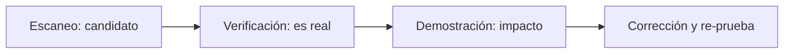
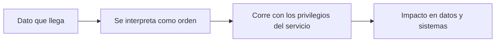

<!-- _class: lead -->

# M03 - Explotación (conceptual) y detección

### Ciberseguridad II: pentest con Kali

**Rogelio Arriaga - Raptor Dev Services**

<!--
Aviso de alcance antes de empezar: este curso tiene alcance de metodología y defensa. Hoy se explica qué es explotar, por qué funciona, cómo se detecta y cómo se cierra. No hay práctica de explotación ni comandos de ataque: lo que entregas es evidencia, corrección y verificación.
-->

---

## Agenda

| Bloque | Qué hacemos | Tiempo aprox. |
|---|---|---|
| Apertura | Lema, alcance del módulo | 10 min |
| Parte 1 | Para qué se explota en un pentest, y bajo qué reglas | 20 min |
| Parte 2 | Por qué funcionan las fallas: cinco clases y su corrección | 25 min |
| Parte 3 | El framework Metasploit, descrito | 15 min |
| Parte 4 | Un caso real: vsftpd 2.3.4 | 15 min |
| Parte 5 | Cómo se detecta y cómo se cierra | 25 min |
| Cierre | Evidencia mínima y práctica | 10 min |

---

## El lema del módulo

> Explotar sirve para demostrar el riesgo, no para coleccionar sesiones.

- Un hallazgo sin demostrar es una opinión; uno demostrado de más es un incidente que causaste tú.
- El valor de la prueba está en que el cliente **lo crea, lo corrija y lo pueda comprobar**.
- Hoy aprendemos el *por qué* de cada falla, porque el *por qué* es lo que se corrige y lo que se detecta.

---

## Al terminar puedes

- Explicar para qué se explota una vulnerabilidad en un pentest y cuándo se debe parar.
- Redactar las reglas de enfrentamiento de una explotación autorizada.
- Clasificar una falla en una de cinco clases y decir cómo se corrige.
- Describir qué es Metasploit, sus tipos de módulo y qué es una sesión, sin usarlo.
- Contar el caso de la puerta trasera de vsftpd 2.3.4 y verificar la procedencia de un paquete.
- Nombrar la señal que cada clase deja y dónde se ve.
- Definir la **evidencia mínima suficiente** de un hallazgo.

---

## Lo que este módulo no hace

| Sí | No |
|---|---|
| Qué es una falla y por qué funciona | Procedimientos paso a paso |
| Cómo se detecta y cómo se cierra | Cargas útiles o comandos de ataque |
| Cómo se documenta y se verifica la corrección | Prácticas de explotación |
| Qué es una herramienta y qué hace en el proceso | Evasión de antivirus, desarrollo de malware o comando y control (quedan fuera del curso) |

Las prácticas de este curso se apoyan en laboratorios hechos para practicar y en su guía oficial, y se centran en **documentar, priorizar, corregir y verificar**.

---

<!-- _class: lead -->

# Parte 1
## Para qué se explota

---

## Del escaneo a la demostración



- El escáner da **candidatos**. La verificación los separa de los falsos positivos.
- La demostración sólo se hace cuando la carta la permite y sólo hasta donde convence.
- Sin corrección y re-prueba, el ciclo no se cerró.

Fuente: *Mastering Kali Linux for Advanced Penetration Testing* (Velu, 2022), cap. 1 y cap. 10; *The Penetration Testing Execution Standard*, secciones Vulnerability Analysis, Exploitation y Reporting (pentest-standard.readthedocs.io).

---

## Por qué demostrar

Una vulnerabilidad abstracta ("versión vieja de un servicio") se pospone. Una demostración acotada ("con esta versión, quien llega a este puerto obtiene este acceso a estos datos") cambia la prioridad.

- La demostración responde: ¿**qué** podría hacer alguien y **con qué** impacto al negocio?
- No responde: ¿cuántos equipos pude abrir?
- Un pentest que cuenta sesiones mide al pentester. Uno que cuenta riesgo reducido mide el servicio.

---

## La explotación tiene su propia autorización

Que la carta permita escanear no significa que permita explotar. Antes de cualquier demostración, la carta (módulo 1) debe responder por escrito:

- ¿Se permite **demostrar** explotación, en qué sistemas y con qué técnicas?
- ¿Qué ventanas de tiempo? ¿Con quién se avisa antes y durante?
- ¿Se permiten técnicas que puedan **degradar** el servicio? (Por omisión, no: sin denegación de servicio.)
- ¿Con qué datos se puede tener contacto? ¿Se copian, se muestran o sólo se prueba que se podrían ver?

> Sin respuesta escrita a esas cuatro preguntas, se queda en verificación: no se demuestra.

Fuente: nmap.org/book/nse-usage.html (la categoría `dos` "may cause a denial of service" y `exploit` "actively exploits a vulnerability"); Código Penal Federal, arts. 211 bis 1 a 211 bis 7.

---

## Reglas de enfrentamiento para explotar

| Regla | Qué dice |
|---|---|
| **Detenerse al lograr la prueba** | Demostrada la falla, se para. No se explora más "ya que estoy" |
| **Tocar lo mínimo** | Nada de modificar ni copiar datos reales. Evidencia = que se pudo, no el contenido |
| **Sin persistencia no pedida** | No se deja nada instalado que sobreviva a la prueba |
| **Sin salir del alcance** | Un hallazgo que lleva a un sistema fuera de la carta se anota y no se sigue |
| **Registrar la hora y lo que se hizo** | Para que el cliente separe tu actividad de la de un atacante real |
| **Plan de reversión** | Qué se restaura y quién lo confirma |
| **Contacto de emergencia** | Si algo se cae, a quién se llama a la primera |

Fuente: criterio del curso, construido sobre los elementos mínimos de una autorización del módulo 1 de Ciberseguridad.

---

## Si ves que alguien ya entró

Mientras pruebas puedes encontrar señales de que **otra persona** ya compromete el sistema (un puerto inesperado que da acceso, procesos que no reconoces).

> Se detiene la prueba y se avisa por el contacto de emergencia. Eso ya no es un hallazgo: es un incidente.

El curso Blue Team (`/blue-team/`) cubre la respuesta a incidentes. Aquí sólo importa la regla: **no sigas probando sobre un sistema comprometido ni borres rastro**.

<!-- Ejemplo del laboratorio: según la guía de Metasploitable 2, el puerto 1524 (ingreslock) da una shell directa. En un cliente real, un servicio así es señal de compromiso previo, no una vulnerabilidad de diseño. -->

---

<!-- _class: lead -->

# Parte 2
## Por qué funcionan las fallas

---

## Cinco clases de falla

| Clase | La idea |
|---|---|
| Corrupción de memoria | El programa trata datos como si fueran su propio código o escribe donde no debe |
| Inyección | Datos del usuario se interpretan como una orden |
| Software con puerta trasera | Alguien metió un acceso oculto en lo que instalaste |
| Credenciales por omisión o débiles | La puerta tiene llave, pero todos la conocen |
| Mala configuración expuesta | El servicio hace lo que se le configuró, y se configuró de más |

Fuente: clasificación del curso. Lecturas de contexto: *Learning Kali Linux* (Messier, 2024), cap. 5 (Automated Exploits) y cap. 6 (Owning Metasploit); *Metasploit* (Kennedy et al.), cap. 5.

---

## Una cadena que se repite



Cada eslabón es un lugar donde **cerrar**:

- Validar el dato (no dejar que llegue).
- No interpretar (parametrizar, no mezclar datos y órdenes).
- Recortar los privilegios (que el servicio pueda poco).
- Aislar (que alcance poco).

---

## Inyección: el dato que se vuelve orden

Cuando un programa arma una orden para el sistema operativo con texto que viene de fuera, ese texto puede traer partes que el programa nunca pensó.

- La debilidad se registra como **CWE-78**: *Improper Neutralization of Special Elements used in an OS Command ('OS Command Injection')*.
- En el laboratorio, la guía de Rapid7 documenta distccd (puerto 3632) como un servicio que permite ejecución arbitraria de comandos.

**Cómo se cierra** (OWASP, *OS Command Injection Defense Cheat Sheet*): "the primary defense is to avoid calling OS commands directly", usar las funciones de la biblioteca del lenguaje; como defensa secundaria, parametrizar y validar los argumentos contra una lista de permitidos.

Fuente: cwe.mitre.org/data/definitions/78.html; cheatsheetseries.owasp.org; Rapid7, *Metasploitable 2 Exploitability Guide*; consultas del 2026-11-11.

---

## Corrupción de memoria

El programa escribe o lee fuera de donde debía y eso altera lo que ejecuta.

- Es la clase más difícil de **detectar** a ojo y de **demostrar** sin riesgo: puede tumbar el servicio.
- Por eso Metasploit califica cada módulo con un *rank* de confiabilidad: *Excellent* es "very unlikely to crash the service" y *Manual* es "unstable" y "mostly amounts to a denial of service".

**Cómo se cierra:** actualizar el software; reducir la superficie (quitar lo que no se usa); y, para quien desarrolla, usar prácticas y lenguajes que cuidan la memoria. La demostración de esta clase **requiere ventana, plan de reversión y aprobación explícita**.

Fuente: docs de Metasploit sobre *exploit ranking*, docs.metasploit.com, consulta del 2026-11-11; *Mastering Kali Linux* (Velu, 2022), cap. 10 como lectura de contexto.

---

## Software con puerta trasera

Aquí no hay "error" de programación: alguien añadió un acceso a propósito. Se distribuye como si fuera el software legítimo.

- En el laboratorio, la guía de Rapid7 documenta puertas traseras en **vsftpd 2.3.4** (puerto 21) y en **UnrealIRCd** (puerto 6667).
- Es un problema de **cadena de suministro**: lo que instalas no es lo que el autor publicó.

**Cómo se cierra:** verificar firma y suma de verificación antes de instalar; instalar desde el gestor de paquetes del proveedor; quitar el servicio si no es necesario. El caso real, en la parte 4.

---

## Credenciales por omisión o débiles

Muchos servicios traen una cuenta de fábrica, o el administrador pone una contraseña que se adivina.

- La guía de Rapid7 lista varias en el laboratorio: cuentas del sistema con contraseñas triviales, MySQL con la cuenta `root` sin contraseña y VNC con la contraseña "password".
- Se explica a fondo en el módulo 4 (contraseñas).

**Cómo se cierra:** cambiar la credencial de fábrica; contraseñas largas y no repetidas, validadas contra una lista de contraseñas comprometidas; segundo factor donde se pueda; no exponer el servicio.

Fuente: Rapid7, *Metasploitable 2 Exploitability Guide*; NIST SP 800-63B-4 (pages.nist.gov/800-63-4/sp800-63b.html), consulta del 2026-11-11.

---

## Mala configuración expuesta

El software hace exactamente lo que se le pidió. El error es lo que se le pidió.

| En el laboratorio (según la guía) | La configuración que no debía estar |
|---|---|
| NFS, puerto 2049 | La raíz del sistema exportada y con escritura |
| Servicios "r", puertos 512 a 514 | Acceso remoto desde cualquier host |
| Samba, puertos 139 y 445 | Recurso anónimo con escritura y `wide links` activado |
| ingreslock, puerto 1524 | Un servicio que entrega una shell directa |

**Cómo se cierra:** quitar el servicio si no hace falta; restringir **quién** llega (por host y por red); exportar lo mínimo y en lectura; sin acceso anónimo; mínimo privilegio del servicio.

Fuente: Rapid7, *Metasploitable 2 Exploitability Guide*, consulta del 2026-11-11. Las correcciones son criterio del curso.

---

## Mínimo privilegio del servicio

Definición de NIST: cada entidad recibe "the minimum system resources and authorizations that the entity needs to perform its function".

Si el servicio se compromete, el atacante hereda **lo que ese servicio podía**:

| Servicio sin recortar | Servicio recortado |
|---|---|
| Corre como `root` | Corre como usuario propio sin shell |
| Ve todo el sistema de archivos | Ve sólo su carpeta |
| Escucha en todas las interfaces | Escucha donde hace falta |
| Puede salir a cualquier destino | Sólo a los destinos que necesita |

Fuente: NIST CSRC, glosario, *least privilege* (SP 800-53 Rev. 5), consulta del 2026-11-11. Ver también la sesión 2 de Linux para desarrolladores.

---

<!-- _class: lead -->

# Parte 3
## El framework Metasploit, descrito

---

## Qué es

Metasploit es un framework de pruebas de seguridad que Rapid7 mantiene y que viene en Kali. Reúne módulos de distintos tipos con una interfaz común, para repetir pruebas de forma consistente.

Aquí **no se usa**. Se describe para que entiendas lo que aparece en un informe, un registro de red o una conversación con quien lo usa.

Fuente: *Metasploit* (Kennedy et al., 2.ª ed.), cap. 1 y cap. 2; *Learning Kali Linux* (Messier, 2024), cap. 6.

---

## Los tipos de módulo

| Tipo | Según la documentación |
|---|---|
| `exploit` | Aprovecha una vulnerabilidad para que el framework ejecute código |
| `auxiliary` | No explota: tareas útiles como escanear o reunir datos |
| `payload` | El código que corre cuando una explotación tiene éxito |
| `encoder` | Transforma los bytes de un *payload* |
| `nop` | Genera instrucciones "No Operation" sin efectos |
| `post` | Se usa cuando una máquina ya fue comprometida y hay una sesión abierta |
| `evasion` | Genera *payloads* que buscan evadir el antivirus |

Fuente: documentación de Metasploit Framework (*Modules*), repositorio rapid7/metasploit-framework, consulta del 2026-11-11. Los módulos `encoder`, `nop` y `evasion` quedan **fuera** del alcance del curso.

---

## El rank: un dato de riesgo operativo

Cada módulo de explotación trae un *rank* que refleja su impacto potencial y su fiabilidad:

| Rank | Qué indica la documentación |
|---|---|
| Excellent | Muy poco probable que tumbe el servicio |
| Great | Detecta el objetivo solo o verifica la versión |
| Good | Cubre el caso más común, sin detectar el objetivo |
| Normal | Fiable, pero para una versión concreta que no es la más común |
| Average | Poco fiable o difícil de explotar |
| Low | Acierta menos de la mitad de las veces |
| Manual | Inestable; casi siempre equivale a una denegación de servicio |

**Para el pentest:** un rank bajo es una razón para pedir ventana y plan de reversión, o para no demostrarlo.

Fuente: docs.metasploit.com, *Exploit ranking*, consulta del 2026-11-11 (descripciones traducidas y condensadas).

---

## Payloads: qué es cada pieza

- **Single** (de una pieza): "fire-and-forget"; se envía completo.
- **Staged** (por etapas): "a small stub loader and the final stage payload". El cargador pequeño pide a quien lo controla la etapa final, más grande.
- **Meterpreter** es, según Rapid7, "the most popular payload type for Metasploit".

Para la defensa importa esto: un payload por etapas **genera tráfico en dos tiempos** (primero poco, luego una transferencia mayor), y casi siempre implica que el equipo comprometido **inicia** una conexión hacia fuera.

Fuente: docs.rapid7.com/metasploit/working-with-payloads/, consulta del 2026-11-11.

---

## Qué es una sesión, y por qué importa

Una **sesión** es el control remoto que queda abierto después de una explotación exitosa: quien la tiene opera con los **privilegios del proceso** que se comprometió.

- Para el cliente, una sesión es "alguien está dentro".
- Para el informe, basta decir que **se pudo obtener** y con qué privilegios. No hace falta explorar el sistema.
- Para la detección, una sesión se ve: una conexión que no estaba, procesos hijos inesperados, comandos que ese servicio nunca corre.

---

<!-- _class: lead -->

# Parte 4
## Un caso real: vsftpd 2.3.4

---

## Qué pasó

- El **3 de julio de 2011**, el autor de vsftpd publicó una alerta: la descarga de `vsftpd-2.3.4.tar.gz` desde el sitio maestro contenía una puerta trasera.
- Según el aviso, un "smiley" `:)` en el nombre de usuario de FTP hacía que el servidor intentara una conexión de regreso con una shell. "There is no obfuscation" y no se notificaba la instalación.
- Mathias Kresin fue el primero en notarlo.
- NVD describe el alcance: "vsftpd 2.3.4 downloaded between 20110630 and 20110703 contains a backdoor which opens a shell on port 6200/tcp".

Fuente: scarybeastsecurity.blogspot.com, entrada del 2011-07-03; NVD, CVE-2011-2523. Consultas del 2026-11-11.

---

## Cómo se podía descubrir

El autor publicó dos pruebas de que el archivo no era el suyo:

| Prueba | Resultado |
|---|---|
| Firma GPG del archivo, contra su llave | `BAD signature` |
| Suma SHA-256 del archivo malo | Publicada en el aviso, para comparar |

Su recomendación: "Check your signatures :)".

> Quien verificó la firma, lo supo. Quien sólo descargó e instaló, no.

Fuente: scarybeastsecurity.blogspot.com, entrada del 2011-07-03, consulta del 2026-11-11.

---

## La lección para quien defiende

| Pregunta | Respuesta |
|---|---|
| ¿Qué falla? | La cadena de suministro: el archivo no era el del autor |
| ¿Cómo se previene? | Verificar firma y suma antes de instalar; instalar desde el proveedor; fijar versiones y revisar los cambios |
| ¿Cómo se detecta? | Un puerto nuevo escuchando que ese servicio nunca abre (6200/tcp) |
| ¿Cómo se corrige? | Quitar la copia, instalar una verificada, tratarlo como incidente si estuvo expuesta |
| ¿Cómo se re-prueba? | Que el puerto ya no escuche y que la versión instalada tenga la firma válida |

El sitio oficial hoy (a noviembre de 2026) lista **vsftpd 3.0.5** como la última versión, con archivo de firma `.asc`, y pide "always check the GPG signatures".

Fuente: security.appspot.com/vsftpd.html, consulta del 2026-11-11.

---

## Verificar de verdad: la práctica de hoy lo hace

En la práctica vas a firmar un archivo propio con una llave de práctica, verificarlo, **alterarlo** y ver cómo `gpg --verify` responde `BAD signature` y `sha256sum -c` responde `FAILED`.

```text
gpg: Good signature from "Proveedor de practica <practica@example.com>" [ultimate]
...
gpg: BAD signature from "Proveedor de practica <practica@example.com>" [ultimate]
paquete.txt: FAILED
```

Salida real del script de la práctica, ejecutado con GnuPG 2.4.8 el 2026-11-11.

---

<!-- _class: lead -->

# Parte 5
## Cómo se detecta y cómo se cierra

---

## Tres lugares donde se ve

| Capa | Qué ve | Ejemplo |
|---|---|---|
| **Red** | Tráfico anómalo | Un IDS/IPS: Suricata es un "high performance Network IDS, IPS and Network Security Monitoring engine" |
| **Equipo** | Procesos, puertos y autenticación | `auth.log` o el journal; un puerto nuevo escuchando; un proceso hijo inesperado |
| **Salida** | Conexiones que el equipo inicia | Un servidor de base de datos que de pronto llama a una IP desconocida |

Los agentes de punto final (EDR) reúnen la telemetría del equipo en un lugar. El curso Blue Team (`/blue-team/`) enseña a **escribir y probar** las reglas; aquí sólo identificamos qué señal deja cada clase.

Fuente: docs.suricata.io/en/latest/what-is-suricata.html, consulta del 2026-11-11.

---

## La señal de cada clase

| Clase | Señal | Dónde se ve |
|---|---|---|
| Corrupción de memoria | El servicio se reinicia o termina de golpe | Journal, `dmesg` |
| Inyección | Procesos hijos que el servicio no suele lanzar | Bitácora de procesos, EDR |
| Puerta trasera | Un puerto nuevo escuchando; una conexión a él | `ss -tlnp`, IDS |
| Credenciales débiles | Muchos fallos y luego un éxito, o un éxito desde un origen nuevo | `auth.log`, journal |
| Mala configuración | Accesos que nadie debería poder hacer, desde un origen que no corresponde | Bitácoras del servicio (NFS, Samba) |

Todas dejan además lo mismo cuando funcionan: el equipo **inicia una conexión hacia fuera**.

Fuente: criterio del curso. Para la detección con reglas, ver el curso Blue Team (`/blue-team/`).

---

## El tráfico de salida

MITRE ATT&CK describe la técnica de capa de aplicación (T1071): quien controla un equipo comprometido esconde su tráfico de control en protocolos comunes (web, transferencia de archivos, correo, DNS) para mezclarse con el normal y evadir el filtrado de red.

Por eso **no basta con vigilar lo que entra**: un servidor rara vez necesita hablar con el mundo.

> Un servidor de base de datos que sólo recibe consultas no tiene por qué abrir una conexión a Internet.

Fuente: attack.mitre.org/techniques/T1071/, consulta del 2026-11-11.

---

## Filtrar la salida: una regla que se prueba

Un cortafuegos de salida convierte "el equipo puede llamar a cualquiera" en "el equipo llama sólo a lo que necesita". Con `nftables`, una cadena en el gancho `output` y una regla de `drop`:

```nft {1,2|3|4|*}
table ip pruebas {
  chain salida {
    type filter hook output priority 0; policy accept;
    ip daddr 127.0.0.1 tcp dport 8099 counter drop
  }
}
```

Sintaxis de la documentación de nftables (wiki.nftables.org): la cadena `type filter hook output priority 0; policy accept;` y reglas con `ip daddr`, `tcp dport`, `counter` y `drop`. No se ejecutó en la construcción del curso: la verificas tú en la práctica, sobre tu propia máquina.

<!-- La regla de ejemplo bloquea a localhost en un puerto inocuo para poder probarla sin tocar nada real. En producción la política sería drop con una lista de destinos permitidos. -->

---

## Corrección: del parche a la arquitectura

| Medida | Qué cierra | Límite |
|---|---|---|
| **Parche o actualización** | La falla concreta | Exige que exista y que se aplique |
| **Quitar el servicio** | Toda la superficie de ese servicio | Si realmente no se necesita |
| **Segmentación** | Quién llega al servicio | No corrige la falla; reduce el alcance |
| **Filtrado de salida** | Lo que un equipo comprometido puede hacer hacia fuera | No evita el compromiso |
| **Mínimo privilegio** | Lo que gana quien compromete el servicio | No evita el compromiso |
| **Parche virtual** (regla en un WAF o IPS) | Bloquea el patrón mientras sale el parche | Es temporal: la falla sigue ahí |

Ninguna medida sola cierra todo. Se **apilan**, y cada una se prueba.

---

## Verificar que la corrección funciona

Corregir no es ejecutar el comando de la corrección. Es **demostrar que el problema ya no está**:

1. **Re-escanear** con las mismas opciones que encontraron el hallazgo.
2. **Comparar**: el escaneo anterior y el nuevo, lado a lado. Nmap incluye la herramienta `ndiff` para eso.
3. **Probar lo negativo**: lo que debe fallar, falla (el puerto ya no responde; la firma inválida se rechaza).
4. **Probar lo positivo**: el servicio legítimo sigue funcionando.
5. **Dejar evidencia** con fecha: la salida del re-escaneo.

> "Cerrado" no es "corregido": se vuelve a probar con la prueba que lo encontró.

Fuente: criterio del curso. `ndiff` es parte de la distribución de Nmap (nmap.org/ndiff).

---

## Evidencia mínima suficiente

Evidencia que **convence y se puede repetir**, tocando lo menos posible.

| Suficiente | De más |
|---|---|
| Servicio, versión y puerto, de `-sV` | Un volcado de datos reales del cliente |
| Una captura con fecha y hora de la prueba no destructiva | Decenas de capturas de cada paso |
| El hash (SHA-256) del archivo de evidencia | Evidencia sin fecha ni hash |
| Cómo repetirlo **en el laboratorio** | Datos de personas |
| Qué privilegios se obtendrían, dicho en una frase | Exploración "para ver qué hay" |

El criterio: ¿con esto el cliente lo cree, lo corrige y lo puede re-probar? Si sí, es suficiente.

---

## La ficha de un hallazgo

| Campo | Ejemplo (Ejemplo ilustrativo) |
|---|---|
| ID y título | H1, puerta trasera en vsftpd 2.3.4 |
| Dónde | 192.168.56.40, 21/tcp |
| Qué es | Copia del servicio con acceso oculto |
| Evidencia | `m02-versiones.nmap`, línea del puerto 21, SHA-256 del archivo |
| Impacto | Un acceso remoto sin credenciales con los privilegios del servicio |
| Corrección | Quitar la copia; instalar una verificada |
| Detección | Un puerto nuevo escuchando; conexión a él |
| Re-prueba | Nuevo `-sV`: el servicio ya no es 2.3.4; el puerto 6200 no escucha |

---

## Lo que llevas hoy

- Se explota para demostrar riesgo, con autorización específica y hasta donde convence.
- Cinco clases de falla, cada una con su corrección: memoria, inyección, puerta trasera, credenciales, configuración.
- Metasploit se entiende como herramienta: tipos de módulo, rank, payloads y sesión.
- vsftpd 2.3.4 enseña que **verificar la firma** es una defensa.
- Se detecta en la red, en el equipo y en lo que sale.
- La corrección se **re-prueba**; la evidencia es la mínima que convence.

**Siguiente módulo:** contraseñas y escalamiento de privilegios, también a nivel conceptual y con su defensa.

---

## Práctica de hoy

`practica.md`: tus reglas de enfrentamiento para explotar, la verificación de firma con una llave de práctica, un filtro de salida con `nftables` en tu máquina y la ficha de un hallazgo con su re-prueba.

**Tarea:** el documento de reglas de enfrentamiento y las fichas de tres hallazgos de tu laboratorio.

**Quiz:** doce preguntas en la plataforma.
