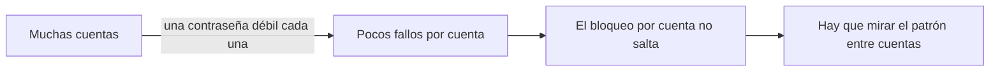
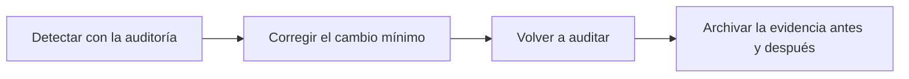

<!-- _class: lead -->

# Módulo 4 - Contraseñas y escalamiento de privilegios

### Ciberseguridad II: pentest con Kali

**Rogelio Arriaga - Raptor Dev Services**

<!--
Este módulo es conceptual a propósito: se explica qué es cada cosa, por qué funciona, cómo se detecta y cómo se cierra. No se practica ningún ataque. La práctica es de administrador: medir, auditar, corregir y verificar en la VM propia.
-->

---

## Agenda del módulo

| Bloque | Qué hacemos | Tiempo aprox. |
|---|---|---|
| Apertura | Lema, alcance del módulo, carta de autorización | 12 min |
| Parte 1 | Cómo guarda Linux una contraseña | 22 min |
| Parte 2 | Cómo se adivina una contraseña (sin herramientas) y cómo se frena | 20 min |
| Parte 3 | La política de contraseñas que sí funciona | 14 min |
| Parte 4 | Escalamiento de privilegios: el error de configuración detrás | 28 min |
| Parte 5 | Detectar y cerrar | 12 min |
| Cierre | Práctica, tarea y quiz | 12 min |

<!-- Hay un descanso de 10 minutos entre la Parte 2 y la Parte 3. -->

---

## El lema del módulo

> Cada técnica de escalamiento corresponde a un error de configuración que se puede corregir.

- Quien escala privilegios no "rompe" nada: usa algo que alguien dejó permitido.
- Por eso el informe de un pentest no termina en "se pudo". Termina en **qué se cambia** y **cómo se comprueba** que quedó cerrado.
- Hoy aprendemos a encontrar esos errores desde el lado de quien administra el sistema.

---

## Al terminar puedes

- Explicar dónde y cómo guarda Linux una contraseña, y por qué el costo del hash importa.
- Distinguir un ataque en línea de uno fuera de línea, y nombrar la defensa de cada uno.
- Escribir una política de contraseñas según NIST SP 800-63B-4.
- Nombrar las clases de error de configuración detrás de un escalamiento de privilegios.
- Auditar tu propia VM, corregir un hallazgo y **demostrar** que la corrección funciona.

---

## Alcance de este módulo

| Sí | No |
|---|---|
| Qué es y por qué funciona cada técnica | Comandos o pasos para ejecutarla |
| Cómo se ve en las bitácoras | Herramientas de ataque a contraseñas |
| Cómo se corrige y cómo se verifica | Explotar un binario o un servicio concreto |
| Auditoría de tu VM como administrador | Nada contra sistemas que no son tuyos |

**Carta de autorización:** la de tu laboratorio, del módulo 1 de este curso. Toda práctica se hace en la red aislada `192.168.56.0/24`: `kali` .10, `victima` .20 (tu Ubuntu Server) y Metasploitable 2 .40.

> Decisión de diseño del curso: la explotación se estudia como concepto y como defensa. La demostración reproducible del riesgo se hace con laboratorios que traen su propia guía.

---

<!-- _class: lead -->

# Parte 1
## Cómo guarda Linux una contraseña

---

## Qué guarda `/etc/shadow`

El sistema no guarda tu contraseña: guarda el resultado de una función de hash sobre ella. Cada línea de `/etc/shadow` tiene campos separados por `:`; el segundo es el hash.

```text
# Ejemplo ilustrativo (hash inventado, no corresponde a ninguna contraseña real)
ana:$y$j9T$SALINVENTADA$HASHINVENTADO:19000:0:99999:7:::
```

- `$y$` dice **qué algoritmo** se usó; luego vienen sus parámetros, la **sal** y el hash.
- El hash vive en `/etc/shadow`, que según shadow(5) no debe ser legible por usuarios comunes si se quiere mantener la seguridad de las contraseñas.
- Un campo vacío significa que esa cuenta entra sin contraseña: otro hallazgo que se busca.

Fuentes: shadow(5), man7.org; crypt(5), Debian (manpages.debian.org).

---

## Hash no es cifrado

| | Cifrado | Hash de contraseña |
|---|---|---|
| ¿Se revierte con la clave? | Sí | No: es de un solo sentido |
| ¿Para qué? | Que alguien con la clave recupere el dato | Comprobar que escribes lo mismo, sin guardar lo que escribes |
| ¿Qué se guarda? | El dato cifrado y se protege la clave | El hash, la sal y el costo |

Al iniciar sesión el sistema calcula el hash de lo que tecleas con la misma sal y compara. Si alguien roba el archivo, no obtiene contraseñas: obtiene la **tarea** de adivinarlas una por una.

<!-- Aclara: "descifrar un hash" es un error de lenguaje. Lo que se hace es adivinar candidatas y calcularles el hash. De ahí sale toda la defensa. -->

---

## La sal: para que dos contraseñas iguales no se vean iguales

- La **sal** es un valor aleatorio distinto para cada contraseña, guardado junto al hash.
- Sin sal, dos usuarios con la misma contraseña tendrían el mismo hash, y una tabla precalculada serviría para todos.
- Con sal, cada hash obliga a su propio cálculo.

Fuente: OWASP, *Password Storage Cheat Sheet*: cada contraseña lleva una sal única; la mayoría de las bibliotecas la generan solas.

NIST SP 800-63B-4, sec. 3.1.1.2: la sal debe tener al menos 32 bits y guardarse con el hash.

---

## Un hash que se calcula rápido es un mal hash de contraseñas

Un SHA-256 de una sola pasada está diseñado para ser **rápido**. Para contraseñas eso es un defecto: quien adivina prueba más candidatas por segundo.

```sim hash
texto: ClaveDePractica-no-es-real
bit: 0
```

- Cambia un solo bit de la entrada y el resultado cambia por completo: así se garantiza que no haya atajos.
- Esto demuestra la función, **no el costo**. El costo de una contraseña se controla con parámetros: iteraciones, memoria.

<!-- Pide que inviertan el bit en la simulación y cuenten cuántos bits del digest cambian. Es la propiedad de avalancha. No se mide velocidad de adivinar: eso lo hace la práctica con TU máquina y TU costo. -->

---

## Los esquemas de contraseñas añaden costo a propósito

| Esquema | Qué se ajusta | Qué dice la fuente |
|---|---|---|
| yescrypt | Costo de CPU y memoria | crypt(5): "Recommended for new hashes" |
| scrypt | CPU y memoria (`N`, `r`, `p`) | OWASP: mínimo `N = 2^17`, `r = 8`, `p = 1` |
| bcrypt | Factor de trabajo | OWASP: solo sistemas heredados, factor 10 o más |
| PBKDF2-HMAC-SHA256 | Iteraciones | OWASP: 600,000, cuando se requiere FIPS-140 |
| sha512crypt | Iteraciones | crypt(5): "Acceptable for new hashes", su costo por omisión es bajo para hardware moderno |
| md5crypt, sha1crypt | Casi nada | crypt(5): no usar en hashes nuevos |

Fuentes: crypt(5), Debian; OWASP *Password Storage Cheat Sheet*. Cifras a noviembre de 2026.

---

## yescrypt: lo que trae tu sistema

- Desde Debian 11 (bullseye), la contraseña de las cuentas locales se guarda por omisión con **yescrypt** en lugar de SHA-512 (notas de la versión 11 de Debian).
- Las contraseñas viejas siguen funcionando con su hash anterior hasta que se cambian.
- Se reconoce por el prefijo `$y$` en el segundo campo de `/etc/shadow`.

```bash
# Inventario defensivo: usuario y prefijo del algoritmo, sin mostrar el hash completo.
# Sintaxis estándar de awk; en la práctica se ejecuta con sudo.
sudo awk -F: '$2 ~ /^\$/ {split($2, p, "$"); print $1, "$" p[2] "$"}' /etc/shadow
```

> Una línea con `$6$` (SHA-512) o, peor, `$1$` (MD5) es un hallazgo de "cuenta con hash anticuado": se corrige al cambiar la contraseña con el sistema ya configurado para yescrypt.

Fuente: notas de la versión de Debian 11, cap. "Issues to be aware of for bullseye".

<!-- Verifica en el aula: en Ubuntu Server de la práctica cada quien mira qué prefijo tiene su cuenta. No des por hecho el resultado: se verifica en la VM. -->

---

## El costo se mide, no se supone

La práctica de hoy mide cuánto tarda **una** verificación con distintos costos.

| Configuración | Lo que se mide |
|---|---|
| SHA-256, 1 pasada | Microsegundos |
| PBKDF2-HMAC-SHA256, 1,000 a 600,000 iteraciones | Crece en línea recta con las iteraciones |
| scrypt con `N = 2^14, 2^15, 2^17` | Crece con CPU y memoria |

- Cada máquina da cifras distintas: **no hay un número de clase**, cada quien mide el suyo.
- La regla de decisión: tu servidor puede pagar décimas de segundo por inicio de sesión; una persona que adivina fuera de línea paga eso por **cada candidata**.

Fuente: Python, `hashlib.pbkdf2_hmac` y `hashlib.scrypt`; RFC 7914 (scrypt).

---

## Error típico: confundir "largo" con "seguro"

```sim password
texto: la nube de mi casa huele a pan tostado
```

- La simulación **supone caracteres al azar**. Una frase real no lo es: la estimación de bits le sale optimista.
- Lo contrario también pasa: `Abc123!x` cumple "mayúscula, número y símbolo" y es de las primeras que alguien probaría.
- Lo que protege no es la regla de composición: es la **longitud** más una **lista de bloqueo** de contraseñas conocidas.

> Simulación simplificada: aquí no hay tasa de intentos citada, por eso no calcula tiempos.

---

<!-- _class: lead -->

# Parte 2
## Cómo se adivina una contraseña, y cómo se frena

---

## Dos situaciones muy distintas

| | En línea | Fuera de línea |
|---|---|---|
| ¿Dónde se prueba? | Contra el servicio de inicio de sesión | Contra una copia de los hashes |
| ¿Quién controla el ritmo? | El defensor | Quien tiene la copia |
| ¿Hay registro? | Sí: cada fallo queda en la bitácora | No: ocurre en otra máquina |
| ¿Defensa principal? | Límite de intentos, bloqueo, MFA, alertas | Costo del hash, sal, contraseñas largas, que la copia no se robe |

La consecuencia: **si el atacante ya tiene los hashes, el límite de intentos ya no ayuda.** Por eso importan el costo del hash y proteger `/etc/shadow` o la base de usuarios.

---

## Los nombres de las técnicas (solo el concepto)

MITRE ATT&CK agrupa los métodos de adivinación bajo *Brute Force* (T1110):

| Subtécnica | Idea en una línea |
|---|---|
| T1110.001 Password Guessing | Probar contraseñas, una por una, contra una cuenta |
| T1110.002 Password Cracking | Adivinar fuera de línea a partir de hashes ya obtenidos |
| T1110.003 Password Spraying | Probar una sola contraseña débil contra muchas cuentas |
| T1110.004 Credential Stuffing | Probar pares usuario-contraseña filtrados de otro sitio |

Fuentes: MITRE ATT&CK, T1110 (v20.1, a noviembre de 2026); OWASP *Credential Stuffing Prevention Cheat Sheet* para las definiciones de *credential stuffing* y *password spraying*.

<!-- Aquí no hay herramientas ni comandos: es vocabulario para el informe. -->

---

## Por qué el spraying esquiva el bloqueo por cuenta



- El bloqueo por cuenta mira **una cuenta**. El spraying reparte los intentos entre **muchas**.
- La defensa es mirar fallos **por origen y por ventana de tiempo, entre cuentas**.

Fuente: MITRE ATT&CK T1110, estrategia de detección que correlaciona fallos y éxitos en varios usuarios.

---

## Credential stuffing: el problema no es tu servidor

- Quien reutiliza contraseña en dos sitios carga con la fuga del más débil.
- Tu servidor no tiene vulnerabilidad alguna y aun así entran.

| Defensa | Fuente |
|---|---|
| MFA: "by far the best defense" contra la mayoría de ataques a contraseñas | OWASP *Credential Stuffing Prevention* |
| Revisar contraseñas nuevas contra listas de contraseñas filtradas | Misma hoja y NIST SP 800-63B-4 |
| Huella del dispositivo y alerta ante dispositivo desconocido | Misma hoja |
| No usar el bloqueo por IP como defensa principal | Misma hoja |

---

## Cómo se ve en una bitácora (lado defensor)

En `auth.log` o en el journal de systemd, cada fallo de `sshd` es una línea con la forma:

```text
Failed password for [invalid user ]<usuario> from <IP> port <puerto> ssh2
```

- Muchas líneas `Failed password` desde un origen: adivinación contra una cuenta.
- Pocas líneas por cuenta, desde un origen, en **muchas cuentas**: spraying.
- Fallos seguidos de un `Accepted`: la señal más importante, porque significa que adivinaron.

Cómo se escribe la regla que lo detecta, y cómo se prueba que suena, está en el curso Blue Team (`/blue-team/`, sesión de bitácoras y detección). Aquí solo hace falta saber **qué buscar**.

Fuente: OpenSSH, función `auth_log` en `auth.c`; MITRE ATT&CK T1110.

---

## Qué ya sabes de Ciberseguridad

En el módulo 6 de Ciberseguridad se vio la fuerza bruta contra SSH y la defensa con **fail2ban**. Aquí cambia el ángulo:

- Entonces: ver el ataque y poner una defensa.
- Ahora: ponerlo en el **informe** como hallazgo con su prioridad y su verificación.

Un hallazgo de contraseñas se redacta así: qué cuenta o servicio, qué control faltaba (límite, MFA, política), qué se cambia y cómo se **comprueba** (el control se dispara ante una prueba controlada en el laboratorio).

---

<!-- _class: lead -->

# Parte 3
## La política de contraseñas que sí funciona

---

## NIST SP 800-63B-4: lo que cambió de fondo

Versión final del 31 de julio de 2025; sustituye a la SP 800-63B de 2020.

| Tema | Lo que dice (sec. 3.1.1) |
|---|---|
| Longitud mínima | 15 caracteres si la contraseña es el único factor; 8 si es parte de MFA |
| Longitud máxima | El verificador debe aceptar al menos 64 caracteres |
| Composición | No imponer otras reglas de composición |
| Caducidad | No exigir cambios periódicos; forzar cambio solo si hay evidencia de compromiso |
| Lista de bloqueo | Rechazar contraseñas comunes, esperadas o comprometidas (incluye términos como el nombre del servicio o del usuario) |
| Almacenamiento | Hash con sal (32 bits o más) y un factor de costo tan alto como sea práctico |

Fuente: NIST SP 800-63B-4, csrc.nist.gov; consultada en noviembre de 2026.

---

## Por qué desaparecieron la caducidad y la composición

- La caducidad empuja a variaciones predecibles (`Clave1`, `Clave2`...): se cambia la contraseña, no el riesgo.
- La composición produce `Abc123!x`: cumple la regla y no aporta.
- Lo que sí cambia el riesgo: **longitud**, **lista de bloqueo**, **MFA** y **hash con costo**.

La política actual cabe en cuatro renglones. Eso la hace fácil de probar, y esa es la práctica de hoy: un verificador pequeño que cumple esos renglones y se ve aceptar y rechazar a propósito.

---

## Demostración: un verificador de política

```python
# Fragmento: el script completo está en la práctica.
MINIMO_UN_FACTOR = 15
MINIMO_CON_MFA = 8
MAXIMO_ACEPTADO = 64

def evaluar(clave, con_mfa, usuario=""):
    problemas = []
    minimo = MINIMO_CON_MFA if con_mfa else MINIMO_UN_FACTOR
    if len(clave) < minimo:
        problemas.append(f"mide {len(clave)}; el mínimo es {minimo}")
    if clave.lower() in BLOQUEO:
        problemas.append("está en la lista de bloqueo")
    if usuario and usuario.lower() in clave.lower():
        problemas.append("contiene el nombre de usuario")
    return problemas
```

La lista `BLOQUEO` de la práctica es un **ejemplo ilustrativo** de cuatro entradas. En producción se usa una lista grande de contraseñas comunes y filtradas.

---

## Error típico: una política que cumple la letra y no el riesgo

- Acepta `xxxxxxxxxxxxxxxxxxxx` porque mide más de 15: sin lista de bloqueo, la longitud sola no basta.
- Rechaza una frase larga porque "no tiene símbolo": se aplicó una regla de 2015.
- Obliga a cambiar cada 90 días y la gente hace `Clave1`, `Clave2`.

La práctica incluye el caso de **verlo fallar**: probar tu verificador con una contraseña de 20 `x` y ver qué dice.

---

<!-- _class: lead -->

# Parte 4
## Escalamiento de privilegios: el error de configuración detrás

---

## Qué es escalar privilegios

MITRE ATT&CK define la táctica así: técnicas que usa un adversario para **obtener permisos de nivel superior** en un sistema (TA0004).

| Tipo | Qué cambia |
|---|---|
| Vertical | De usuario común a administrador (root) |
| Horizontal | De un usuario común a otro usuario común |

- Nunca es el primer paso: antes hay un acceso inicial con pocos permisos.
- Siempre es una oportunidad de **contención**: si el servicio corre sin privilegios y el sistema está bien configurado, el acceso inicial se queda chico.

Fuente: MITRE ATT&CK, táctica TA0004 (v20.1, a noviembre de 2026).

---

## El principio detrás de todo: mínimo privilegio

> Cada cuenta, proceso y archivo tiene solo los permisos que necesita para su tarea, y no más.

Cada clase de error de esta parte es una **violación concreta** de ese principio:

1. Una regla de `sudo` más ancha que la tarea.
2. Un binario con el bit `setuid` que no lo necesita.
3. Un archivo, script o servicio que se ejecuta como root pero lo puede **modificar** un usuario común.
4. Una capacidad del kernel (*capability*) de sobra.
5. Un secreto guardado donde lo lee cualquiera.
6. Un sistema operativo sin parchear.

<!-- Cada una se desarrolla en una lámina: qué es, por qué es un riesgo, cómo se detecta, cómo se cierra. -->

---

## Clase 1: reglas de `sudo` demasiado amplias

**Qué es:** `sudoers` dice quién puede ejecutar qué como otro usuario. Una regla como "todo, sin contraseña" para una cuenta de aplicación convierte esa cuenta en root.

**Por qué es un riesgo:** el comodín `ALL` coincide con cualquier cosa; la etiqueta `NOPASSWD` quita la contraseña. Además, muchos programas permiten ejecutar otros desde dentro, y la etiqueta `NOEXEC` existe justo para limitarlo.

| Cómo se detecta | Cómo se cierra |
|---|---|
| `sudo -l -U <usuario>` lista lo que ese usuario puede hacer | Permitir **un comando concreto con su ruta completa**, no `ALL` |
| Revisar `/etc/sudoers` y `/etc/sudoers.d/` | Editar con `visudo`, que evita errores de sintaxis |
| Alertar cuando el archivo cambia | Pedir contraseña salvo casos justificados |

Fuentes: sudo(8) y sudoers(5), man7.org; MITRE ATT&CK T1548.003 (v2.0).

---

## Clase 1: la corrección es una regla estrecha

```text
# Ejemplo ilustrativo, para una cuenta ficticia de despliegue en TU VM.
# Demasiado amplio:
despliegue ALL=(ALL) NOPASSWD: ALL

# Estrecho: una sola acción, con ruta completa.
despliegue ALL=(root) /usr/bin/systemctl restart nginx
```

- La regla estrecha cubre la **necesidad** (reiniciar nginx) y nada más.
- Se verifica con `sudo -l -U despliegue` **antes y después**: el hallazgo se cierra cuando la salida cambia.
- Los archivos de `/etc/sudoers.d/` se editan con `visudo -f` y la configuración completa se valida con `visudo -c`.

Fuentes: visudo(8), man7.org (`-c` valida la sintaxis; `-f` elige el archivo).

---

## Clase 2: el bit `setuid`

**Qué es:** un archivo ejecutable con el bit `setuid` corre con la identidad de su **dueño**, no de quien lo lanza. `passwd` es el ejemplo clásico: en un servidor Ubuntu, `ls -l /usr/bin/passwd` muestra `-rwsr-xr-x`, con una `s` donde iría la `x` del dueño.

**Por qué es un riesgo:** cada binario `setuid` que no lo necesita es una puerta de entrada más para quien ya está dentro como usuario común; si el dueño es root y el programa tiene un defecto, el defecto corre como root.

| Cómo se detecta | Cómo se cierra |
|---|---|
| Inventario: `find / -perm -4000 -type f 2>/dev/null` | Quitar el bit a lo que no lo necesita: `chmod u-s <archivo>` |
| Comparar el inventario con una línea base guardada | Desinstalar el paquete que no se usa |
| Vigilar cambios con el sistema de auditoría (parte 5) | Mantener los paquetes actualizados |

Fuentes: chmod(1) y find(1), man7.org; MITRE ATT&CK T1548.001.

<!-- El inventario es una herramienta de administrador. Se guarda la lista el primer día y se compara después. Aquí no se explica cómo se aprovecha un binario. -->

---

## Clase 3: lo que root ejecuta y otro puede escribir

**Qué es:** un servicio, un script de arranque o una tarea programada que corre como root, pero cuyo archivo (o su carpeta) lo puede **modificar** un usuario sin privilegios.

**Por qué es un riesgo:** quien puede cambiar lo que root ejecuta, termina ejecutando lo que quiere con los permisos de root.

| Cómo se detecta | Cómo se cierra |
|---|---|
| Revisar dueño y modo de lo que ejecutan servicios y cron | Dueño root y modo sin escritura para grupo ni otros (`chmod go-w`) |
| `systemd-analyze security <servicio>` puntúa la exposición de una unidad | Usuario de servicio propio en la unidad (`User=`) |
| La auditoría de Lynis, que revisa la configuración | Endurecer la unidad hasta bajar su puntuación |

Fuentes: Lynis (CISOfy); systemd-analyze(1): `security` da a cada unidad una puntuación de exposición de 0.0 a 10.0, donde más alto es más expuesto. Enlace con la sesión 4 de Linux para desarrolladores.

---

## Clase 4: *capabilities* de sobra

**Qué es:** Linux divide los poderes de root en piezas llamadas *capabilities*. Un programa puede recibir solo la que necesita, en lugar de todo root.

**Por qué es un riesgo:** una capacidad amplia en un binario que no la necesita reproduce el problema del `setuid` con otro nombre.

| Cómo se detecta | Cómo se cierra |
|---|---|
| Inventario de capacidades asignadas a archivos con `getcap -r /` | Quitar la capacidad con `setcap -r <archivo>` si no se necesita |
| Comparar con la línea base | Dar a cada servicio solo la que su tarea exige |

Fuentes: capabilities(7), getcap(8) (`-r`: búsqueda recursiva) y setcap(8) (`-r`: quita el conjunto de capacidades), man7.org.


---

## Clase 5: secretos donde cualquiera los lee

**Qué es:** contraseñas, tokens o llaves en archivos de configuración, historial de la terminal, variables de entorno o repositorios.

**Por qué es un riesgo:** convierte el acceso a **un** archivo legible en acceso a **otro** sistema.

| Cómo se detecta | Cómo se cierra |
|---|---|
| Revisar el modo de los archivos de configuración con secretos | Modo `600` o `640` y dueño correcto |
| Buscar secretos en repositorios con un escáner de secretos | Gestor de secretos, no archivos sueltos |
| Revisar qué se imprime en la bitácora | Rotar el secreto expuesto y no solo esconderlo |

Fuentes: OWASP *Logging Cheat Sheet* (lo que no debe registrarse); nota `10-cloud/05-secretos-produccion.md` de este repositorio.

---

## Clase 6: el sistema sin parchear

**Qué es:** una versión del kernel o de un servicio con una vulnerabilidad publicada y corregida, pero sin actualizar.

**Por qué es un riesgo:** es el único caso de la lista que **no** es un error de configuración propio, sino del proveedor. Aun así, la defensa depende de ti.

| Cómo se detecta | Cómo se cierra |
|---|---|
| Inventario de versiones y comparación con el catálogo de vulnerabilidades | Actualizar y reiniciar cuando el paquete lo exige |
| Priorizar con KEV y EPSS (módulo 2) | Probar la actualización antes en el laboratorio |

Fuente: el criterio de priorización del módulo 2; CISA, catálogo KEV.

---

## Cómo se ve en tu sistema: `journald` y `sudo`

`sudo` registra cada comando aceptado con la forma `usuario : TTY=... ; PWD=... ; USER=<usuario objetivo> ; COMMAND=<comando>`.

```bash
# Fragmento. Consulta de lectura sobre el journal de systemd (journalctl(1)).
sudo journalctl _COMM=sudo --since "1 hour ago" --no-pager
```

- Esa línea es la evidencia de **quién usó qué privilegio y cuándo**.
- Sin ella, un uso indebido de `sudo` no deja rastro verificable.

Fuentes: journalctl(1), man7.org (`_COMM=` filtra por nombre del proceso); sudoers(5), sección de registro de eventos: va por omisión a syslog y se configura con `syslog` y `logfile`.

---

<!-- _class: lead -->

# Parte 5
## Detectar y cerrar

---

## Auditar la configuración con Lynis

Lynis es una herramienta de auditoría de seguridad del sistema, pensada para administradores: lee la configuración, no ataca.

```bash
# Sintaxis de la documentación oficial (CISOfy), no ejecutada en la construcción del curso.
sudo lynis audit system
```

- Muestra el resultado de cada prueba en pantalla.
- Guarda los hallazgos en `/var/log/lynis-report.dat` y los detalles y sugerencias en `/var/log/lynis.log`.
- `--quiet` deja solo los avisos.

Fuente: CISOfy, documentación de Lynis, "Get started" (consultada en noviembre de 2026).

---

## El ciclo de un hallazgo



1. **Detectar:** `sudo -l -U <usuario>` o la auditoría.
2. **Corregir:** el cambio más pequeño que cierre la clase de error.
3. **Verificar:** la misma consulta, otra salida.
4. **Evidencia:** las dos salidas, con fecha, en el informe.

Un hallazgo sin su verificación es una opinión.

---

## Detección continua: auditd y cambios en `sudoers`

Una forma de ver cambios en archivos sensibles es el sistema de auditoría del kernel (`auditd`):

```bash
# Ejemplo de la página del manual de auditctl(8), sintaxis de vigilancia de archivos:
#   -w <ruta> -p <permisos> -k <clave>
# p = r (lectura), w (escritura), x (ejecución), a (atributos). Aquí, escritura y atributos.
sudo auditctl -w /etc/sudoers -p wa -k cambios-sudoers
```

- **Aviso del propio manual:** esta forma de vigilancia aparece como obsoleta (*deprecated*) por su costo de rendimiento; la recomendación del manual es expresarla como regla sobre llamadas al sistema.
- Para el curso basta el concepto: **el cambio de `sudoers` es un evento que alguien debe ver.**

Fuente: auditctl(8), man7.org. Cómo llevar ese evento a una alerta: curso Blue Team (`/blue-team/`).

---

## Error típico: arreglar el síntoma

| Síntoma | Corrección floja | Corrección que cierra la clase |
|---|---|---|
| Un usuario de aplicación con `sudo ALL` | Cambiarle la contraseña | Regla de un solo comando, con ruta completa |
| Un binario `setuid` innecesario | Esconder el archivo | Quitar el bit o desinstalar el paquete |
| Un secreto en un archivo legible | Borrar el archivo | Rotar el secreto y moverlo a un gestor |
| Un servicio root con un script escribible | Ponerle otro nombre | Dueño root, modo sin escritura para otros |

---

## Cómo se redacta el hallazgo

Estructura de una ficha (se ve completa en el módulo 6):

| Campo | Ejemplo ilustrativo |
|---|---|
| Título | Cuenta de despliegue con `sudo` sin límites |
| Dónde | `victima` (192.168.56.20), `/etc/sudoers.d/90-practica` |
| Qué se vio | `sudo -l -U despliegue` lista `(ALL) NOPASSWD: ALL` |
| Por qué importa | Cualquier acceso a esa cuenta es acceso total |
| Corrección | Regla estrecha de un solo comando |
| Verificación | `sudo -l -U despliegue` después: solo `systemctl restart nginx` |

---

## Tu práctica de hoy

Todo en tu VM `victima`, bajo la carta de autorización:

1. Medir el costo de verificar contraseñas con Python (`hashlib`).
2. Probar un verificador de política NIST y verlo fallar con 20 `x`.
3. Auditar la VM con Lynis y levantar el inventario de `setuid` y de `sudo`.
4. **Verlo fallar:** crear una regla de `sudo` demasiado amplia, detectarla con `sudo -l -U`, corregirla y comprobar con la misma consulta.
5. Entregar la ficha del hallazgo con la evidencia antes y después.

---

<!-- _class: lead -->

# Cierre

## Lo que te llevas

- Una contraseña se guarda como hash con sal y costo; el costo se **mide**.
- En línea se frena con límites y MFA; fuera de línea se frena con costo y con no perder los hashes.
- La política vigente: longitud, lista de bloqueo, MFA; sin composición ni caducidad.
- Cada escalamiento es un error de configuración con corrección y detección.
- Un hallazgo se cierra cuando la misma consulta da otra respuesta.

**Siguiente módulo:** Aplicaciones web con Kali: hallazgo, corrección y verificación.

---

## Referencias

- NIST. (2025). *SP 800-63B-4: Digital identity guidelines: Authentication and authenticator management*. csrc.nist.gov/pubs/sp/800/63/b/4/final
- OWASP. *Password Storage Cheat Sheet*; *Credential Stuffing Prevention Cheat Sheet*; *Logging Cheat Sheet*. cheatsheetseries.owasp.org
- MITRE. *ATT&CK: T1110, T1548, T1548.001, T1548.003, TA0004*. attack.mitre.org
- Debian. *crypt(5)*; *Release Notes for Debian 11 (bullseye)*, cap. 5.
- man7.org. *sudo(8)*, *sudoers(5)*, *visudo(8)*, *auditctl(8)*, *chmod(1)*, *journalctl(1)*.
- CISOfy. *Lynis: Get started*.
- Python Software Foundation. *hashlib*. docs.python.org
- *Learning Kali Linux* (Messier, 2024), caps. 9 y 10. *Mastering Kali Linux for Advanced Penetration Testing* (Velu, 2022), caps. 11 y 12. *Black Hat Bash* (Farhi y Aleks), caps. 8 y 9.
