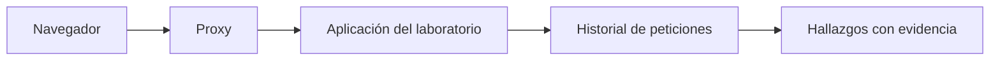

<!-- _class: lead -->

# Módulo 5 - Aplicaciones web con Kali

### Hallazgo, corrección y verificación

**Rogelio Arriaga - Raptor Dev Services**

<!--
Este módulo prueba aplicaciones web de laboratorio con un proxy y las herramientas de Kali al nivel de uso de su documentación. No se enseña a construir ni a lanzar ataques: cada clase de falla se estudia como hallazgo, corrección y verificación.
-->

---

## Agenda del módulo

| Bloque | Qué hacemos | Tiempo aprox. |
|---|---|---|
| Apertura | Lema, alcance, carta de autorización | 10 min |
| Parte 1 | Dónde encaja lo web en el método: WSTG y OWASP Top 10:2025 | 16 min |
| Parte 2 | El proxy de intercepción: ver lo que el navegador envía | 18 min |
| Parte 3 | Cuatro clases de hallazgo y su corrección | 36 min |
| Parte 4 | Los laboratorios: Juice Shop y DVWA | 12 min |
| Parte 5 | El escaneo base pasivo de ZAP y cómo leerlo | 16 min |
| Cierre | Práctica, tarea y quiz | 12 min |

<!-- Descanso de 10 minutos entre la Parte 2 y la Parte 3. -->

---

## El lema del módulo

> La aplicación web suele ser la puerta más abierta del perímetro.

- Es la parte que se publica a propósito: tiene que ser alcanzable.
- Cambia más seguido que el sistema operativo, así que se vuelve a probar más seguido.
- Hoy el criterio no es "qué se rompió", sino **qué se cambia y cómo se comprueba**.

---

## Al terminar puedes

- Colocar una prueba web dentro del método (guía de pruebas y lista de riesgos de OWASP).
- Explicar qué hace un proxy de intercepción y por qué es la herramienta central.
- Leer un hallazgo web y decir su clase, su corrección y cómo se verifica.
- Correr un escaneo base pasivo, leerlo y separar alertas reales de ruido.
- Corregir las cabeceras de seguridad de un servidor propio y **demostrar** el cambio.

---

## Alcance de este módulo

| Sí | No |
|---|---|
| Un proxy para ver peticiones y respuestas | Cargas de ataque listas para pegar |
| Escaneo **pasivo** y navegación manual en laboratorios propios | Escaneo activo contra cualquier cosa que no sea tu laboratorio |
| Hallazgo, corrección y verificación de cada clase | Cadenas de explotación |
| Un sitio propio de laboratorio detrás de nginx | Sitios reales, con o sin "permiso verbal" |

**Carta de autorización:** la de tu laboratorio, del módulo 1. Aplicaciones de práctica: OWASP Juice Shop y DVWA, ambas hechas para esto y con su propia guía; el sitio estático propio de la práctica va en tu VM `victima` (192.168.56.20).

---

<!-- _class: lead -->

# Parte 1
## Dónde encaja lo web en el método

---

## El método: de dónde viene cada etapa

El estándar de ejecución de pruebas de penetración (PTES) ordena el trabajo en siete secciones: *Pre-engagement Interactions*, *Intelligence Gathering*, *Threat Modeling*, *Vulnerability Analysis*, *Exploitation*, *Post Exploitation* y *Reporting*.

- En este curso el tramo web vive en **análisis de vulnerabilidades** y en **informe**.
- La demostración de explotación se estudia como concepto: el valor del trabajo está en el hallazgo bien documentado y la corrección verificada.

Fuente: PTES, pentest-standard.readthedocs.io (consultado en noviembre de 2026).

---

## WSTG: la guía de pruebas web de OWASP

La *Web Security Testing Guide* organiza las pruebas en categorías. En la versión 4.2 (la vigente a noviembre de 2026; la 5.0 está en desarrollo):

| Núm. | Categoría |
|---|---|
| 4.1 | Information Gathering |
| 4.2 | Configuration and Deployment Management Testing |
| 4.3 | Identity Management Testing |
| 4.4 | Authentication Testing |
| 4.5 | Authorization Testing |
| 4.6 | Session Management Testing |
| 4.7 | Input Validation Testing |
| 4.8 | Testing for Error Handling |
| 4.9 | Testing for Weak Cryptography |
| 4.10 | Business Logic Testing |
| 4.11 | Client-side Testing |
| 4.12 | API Testing |

Fuente: OWASP WSTG v4.2, sección 4 (wstg.owasp.org).

---

## OWASP Top 10:2025: la lista de riesgos

| Id | Categoría |
|---|---|
| A01 | Broken Access Control |
| A02 | Security Misconfiguration |
| A03 | Software Supply Chain Failures |
| A04 | Cryptographic Failures |
| A05 | Injection |
| A06 | Insecure Design |
| A07 | Authentication Failures |
| A08 | Software or Data Integrity Failures |
| A09 | Security Logging and Alerting Failures |
| A10 | Mishandling of Exceptional Conditions |

Fuente: OWASP Top 10:2025, top10.owasp.org/2025 (a noviembre de 2026). El ejemplo en C# de cada una está en `10-cloud/07-seguridad-web.md`; hoy se miran desde la **prueba**.

---

## Guía de pruebas contra lista de riesgos

| | WSTG | Top 10 |
|---|---|---|
| ¿Qué es? | Cómo **probar** | Qué **riesgos** importan |
| ¿Cómo se usa en el informe? | Como método: "se aplicaron las pruebas de la categoría 4.7" | Como etiqueta: "hallazgo de clase A05" |
| ¿Cambia seguido? | Por versiones | Por ediciones |

El informe usa las dos: el método que se siguió y la clase de riesgo de cada hallazgo.

---

<!-- _class: lead -->

# Parte 2
## El proxy de intercepción

---

## Qué es y por qué es la herramienta central

Un proxy de intercepción se coloca **entre el navegador y el servidor**. Todo lo que el navegador envía y todo lo que el servidor responde pasa por él y queda a la vista: método, ruta, cabeceras, cookies, cuerpo.

> Lo que ves en la página es lo que el servidor quiso mostrar. Lo que ves en el proxy es lo que realmente se dijeron.

Burp Proxy permite retener una petición, revisarla o modificarla y luego reenviarla; además guarda un historial de todo el tráfico aunque la intercepción esté apagada.

Fuente: PortSwigger, documentación de Burp Suite, "Intercepting HTTP traffic".

---

## Dos proxies que trae Kali

| | Burp Suite | OWASP ZAP |
|---|---|---|
| Edición gratuita | Community | Proyecto de ZAP (zaproxy.org) |
| Cómo se usa aquí | El paquete `burpsuite` de Kali (versión 2026.8 a noviembre de 2026) | Su imagen de Docker, para el escaneo base |
| Escáner | Marcado como solo Profesional en su documentación | Escaneo base pasivo y un escaneo completo que sí "ataca" |
| En este módulo | Navegación manual con el historial | Escaneo base **pasivo** |

Fuentes: kali.org/tools/burpsuite (versión del paquete); PortSwigger (el escáner aparece como función Pro); zaproxy.org.

<!-- El paquete de Kali no declara qué edición empaqueta; la edición gratuita es la Community y su documentación marca el escáner como Pro. Si alguien tiene dudas de licencia, que lo revise en el sitio de PortSwigger. -->

---

## El flujo de trabajo



1. Navegar la aplicación **como un usuario**, completa, con cada rol de prueba.
2. Revisar el historial: rutas, parámetros, cookies, cabeceras de respuesta.
3. Anotar lo que se ve raro con la petición exacta como evidencia.
4. Convertir cada anotación en un hallazgo con clase, corrección y verificación.

---

## Burp trae un navegador ya configurado

Con la pestaña *Proxy > Intercept* abierta, el botón *Open Browser* lanza un navegador preconfigurado para trabajar con Burp sin ajustes manuales. Esto aplica a la edición Community y a la Profesional.

Si usas tu propio navegador, la configuración es del navegador: apuntarlo al puerto del proxy y, para HTTPS, instalar el certificado del proxy. **Hazlo solo en un perfil de laboratorio**, no en tu navegador de diario.

Fuente: PortSwigger, "Intercepting HTTP traffic".

---

## Pasivo y activo no es lo mismo

| | Pasivo | Activo |
|---|---|---|
| Qué hace | Analiza el tráfico que ya pasó por el proxy | Envía peticiones extra para provocar fallas |
| Riesgo para el objetivo | Mínimo: no lanza ataques (la araña solo hace peticiones normales) | Puede alterar datos y tirar el servicio |
| En el curso | Se usa | **No** se usa |

El escaneo base de ZAP que verás es pasivo: su documentación dice que no realiza ningún ataque. El escaneo completo, en cambio, "sí realiza ataques reales" y puede tardar mucho, según la documentación de ZAP (*full scan*). El escaneo activo exige la misma autorización por escrito del módulo 1 y un laboratorio propio.

Fuente: ZAP, "Baseline scan" y "Full scan", zaproxy.org/docs/docker.

---

<!-- _class: lead -->

# Parte 3
## Cuatro clases de hallazgo y su corrección

---

## La ficha que usaremos

Para cada clase, tres campos. Es lo que cambia un hallazgo de "algo raro" a algo que se puede arreglar:

| Campo | Qué dice |
|---|---|
| Hallazgo | Qué se observó y dónde, con la evidencia |
| Corrección | El cambio que cierra la **clase**, no solo el caso |
| Verificación | La prueba que falla antes y pasa después |

---

## Clase 1: inyección (A05)

**Hallazgo.** La aplicación arma sus consultas pegando texto del usuario dentro de la consulta. Quien escribe puede cambiar la **estructura** de la consulta, no solo su dato. OWASP lo describe así: permite que código del atacante cambie la estructura de la sentencia SQL.

**Corrección.** Consultas parametrizadas: la base de datos recibe el código y los datos por separado y trata la entrada como dato, nunca como código.

**Verificación.** Con entradas **inofensivas pero hostiles al texto**, como un apóstrofo en un apellido, la aplicación no falla y guarda lo que se escribió. Si una consulta se rompe con `O'Brien`, hay concatenación.

Fuente: OWASP, *Query Parameterization Cheat Sheet*.

---

## Concatenar contra parametrizar, en una simulación

```sim sqli
usuario: ana
clave: o'brien
```

- Con la entrada `o'brien` la consulta **concatenada** se rompe: el apóstrofo cierra la cadena antes de tiempo. Es un error de lógica que aparece con apellidos reales, sin que nadie ataque nada.
- La consulta **parametrizada** enlaza los valores como datos y no tiene ese problema.

> Los usuarios y filas de la simulación son un ejemplo ilustrativo. Es una simulación: no hay base de datos real.

<!-- Pide que cambien la clave por un valor normal y vean que ambas consultas dan el mismo resultado: la parametrizada no pierde nada, solo gana seguridad. -->

---

## Clase 2: XSS y salida sin codificar (A05)

<!-- En el Top 10:2025 el cross-site scripting (CWE-79) se mapea dentro de A05 Injection. -->

**Hallazgo.** La aplicación pone en la página texto que viene del usuario sin tratarlo como texto. El navegador lo interpreta como parte de la página.

**Corrección.**

1. **Codificar la salida según el contexto** donde se coloca el dato (cuerpo HTML, atributo, JavaScript, CSS, URL): cada contexto tiene sus reglas. Es la defensa principal.
2. **CSP como capa adicional**: una lista de qué puede cargar la página. OWASP advierte que no debe ser la defensa principal porque es fácil de configurar mal.
3. Sanitizar con una biblioteca mantenida solo si los usuarios deben poder escribir HTML.

**Verificación.** En tu propia aplicación de laboratorio, el texto que parece una etiqueta se **muestra como texto** y no se interpreta; y la respuesta lleva su cabecera de CSP.

Fuentes: OWASP, *Cross Site Scripting Prevention Cheat Sheet*; MDN, *Content Security Policy*.

---

## CSP: lo que hace y lo que no

```http
Content-Security-Policy: default-src 'self'
```

- `default-src` es el valor por omisión para los tipos de recurso sin directiva propia: cargar solo recursos del mismo origen.
- Con `default-src` o `script-src`, el JavaScript **en línea** no se ejecuta salvo medidas extra (nonce o hash). MDN pide evitar `'unsafe-inline'` porque anula buena parte del propósito de CSP.
- Se puede desplegar primero en modo solo reporte (`Content-Security-Policy-Report-Only`): no bloquea, solo informa las violaciones.

Fuente: MDN, *Content Security Policy (CSP)*.

---

## Clase 3: control de acceso y autenticación rotos (A01, A07)

**Hallazgo.** La interfaz **oculta** una opción, pero el servidor no impide el acceso: quien conoce la ruta o el identificador de otro recurso lo obtiene. O la autenticación depende de contraseñas débiles sin límites ni segundo factor.

**Corrección.** La autorización se decide **en el servidor**, en cada petición, contra la identidad de la sesión: el servidor verifica que el recurso pertenece a quien lo pide. En autenticación: MFA, límite de intentos y política de contraseñas del módulo 4.

**Verificación.** Con **dos cuentas de prueba de tu laboratorio**, la cuenta B pide un recurso de la A y el servidor lo niega. Con una sola cuenta no se prueba esta clase.

Fuente: OWASP Top 10:2025, A01 y A07; WSTG 4.4 y 4.5. Ejemplo de código en `10-cloud/07-seguridad-web.md`.

---

## Clase 4: configuración y cabeceras (A02)

**Hallazgo.** El servidor entrega las respuestas sin las cabeceras que le piden al navegador activar sus protecciones, o anuncia de más (la versión del servidor).

| Cabecera | Valor recomendado por OWASP | Para qué |
|---|---|---|
| `X-Content-Type-Options` | `nosniff` | El navegador respeta el `Content-Type` declarado |
| `Content-Security-Policy` | Depende de la aplicación | Limitar qué puede cargar la página |
| `Referrer-Policy` | `strict-origin-when-cross-origin` | Controlar qué viaja en `Referer` |
| `X-Frame-Options` | `DENY` (y `frame-ancestors` en CSP si es posible) | Que no te incrusten en otra página |
| `Strict-Transport-Security` | `max-age=63072000; includeSubDomains; preload` | Forzar HTTPS; probar con cuidado antes |

Fuente: OWASP, *HTTP Headers Cheat Sheet*; MDN para `nosniff`.

---

## La corrección en nginx: `add_header ... always`

```nginx
# Fragmento: va dentro del bloque server de tu sitio de laboratorio.
server_tokens off;
add_header X-Content-Type-Options "nosniff" always;
add_header Content-Security-Policy "default-src 'self'" always;
add_header X-Frame-Options "DENY" always;
add_header Referrer-Policy "strict-origin-when-cross-origin" always;
```

- `add_header` añade la cabecera solo en ciertos códigos de respuesta (200, 201, 204, 206, 301, 302, 303, 304, 307 y 308). Con `always` se añade **sea cual sea el código**, por ejemplo en un 404.
- `server_tokens off` quita el número de versión de la cabecera `Server`.
- Se valida con `nginx -t` y se aplica con `nginx -s reload`.

Fuentes: nginx.org, módulo `ngx_http_headers_module` y *Command-line parameters*.

---

## Error típico 1: las cabeceras "desaparecen" en un `location`

Según la documentación de nginx, las directivas `add_header` se heredan del nivel anterior **si y solo si** no hay ninguna `add_header` en el nivel actual.

```nginx
# Fragmento
server {
    add_header X-Content-Type-Options "nosniff" always;
    add_header Content-Security-Policy "default-src 'self'" always;

    location /api/ {
        add_header Cache-Control "no-store" always;   # aquí se pierden las dos de arriba
    }
}
```

La respuesta de `/api/` lleva `Cache-Control` y **ninguna** de las otras. Se comprobó en nginx 1.31.8: `/` devolvió las dos cabeceras y `/api/` solo `Cache-Control`.

> Se corrige repitiendo las cabeceras dentro del `location`, o con `add_header_inherit merge;` (disponible desde nginx 1.29.3).

---

## Error típico 2: olvidar `always`

Sin `always`, la cabecera no sale en respuestas de error. En nginx 1.31.8, con la misma configuración:

| Petición | Con `always` | Sin `always` |
|---|---|---|
| `GET /` (200) | `X-Content-Type-Options: nosniff` | `X-Content-Type-Options: nosniff` |
| `GET /no-existe` (404) | `X-Content-Type-Options: nosniff` | La cabecera **no está** |

Una página de error sin CSP es una página sin protección. Es justo la que más fácilmente puede incluir texto que el usuario controla.

---

## Error típico 3: un cambio que rompe nginx

```text
nginx: [emerg] unexpected "}" in /etc/nginx/conf.d/default.conf:1
nginx: configuration file /etc/nginx/nginx.conf test failed
```

- Esta salida salió de `nginx -t` con una directiva sin `;`. Por eso se corre **antes** de recargar.
- Si `nginx -s reload` recibe una configuración inválida, el proceso maestro la rechaza y sigue con la anterior.

Fuente: nginx.org, *Beginner's guide* y *Command-line parameters*.

---

<!-- _class: lead -->

# Parte 4
## Los laboratorios

---

## OWASP Juice Shop

Una aplicación web con muchas vulnerabilidades **intencionales**, de código abierto bajo OWASP. Su guía la presenta como una herramienta de concientización, entrenamiento y demostración, y aclara que es lo contrario de una plantilla de buenas prácticas.

```bash
# Comando de la guía oficial (sintaxis de su documentación, no ejecutada en la construcción del curso).
docker pull bkimminich/juice-shop
docker run -d -p 127.0.0.1:3000:3000 bkimminich/juice-shop
# Luego, en el navegador de la misma máquina: http://localhost:3000
```

- El `127.0.0.1:` en el puerto la deja **solo en tu máquina**. No la publiques en la red.
- La guía advierte que una instancia es para **un solo usuario** y que el servidor puede caerse ante herramientas automáticas agresivas: al reiniciar, la base y los archivos modificados se pierden.

Fuente: Juice Shop, *Companion Guide*, "Running OWASP Juice Shop" (pwning.owasp-juice.shop).

---

## DVWA

*Damn Vulnerable Web Application*: otra aplicación de práctica, con niveles de seguridad configurables.

- Su README advierte: **no la subas a un hosting público ni a servidores de cara a internet**, o serán comprometidos; recomienda una máquina virtual con red NAT.
- Con Docker: `docker compose up -d` desde su carpeta; queda en `http://localhost:4280` y, según el README, la opción segura es publicar solo en la interfaz de loopback (`127.0.0.1`).
- El nivel de seguridad por omisión se fija en su configuración o con la variable `DEFAULT_SECURITY_LEVEL`.

Fuente: github.com/digininja/DVWA, README (consultado en noviembre de 2026).

---

## Cómo se usan en este módulo

| Aplicación | Qué haces | Qué no haces |
|---|---|---|
| Juice Shop | Navegar con el proxy, correr el escaneo base pasivo y **documentar tres hallazgos con su corrección** | Escaneo activo ni herramientas agresivas |
| DVWA | Ver cómo cambia la misma pantalla entre niveles de seguridad y qué cambió en la respuesta | Exponerla fuera de tu máquina |
| Sitio propio en `victima` | Escanear, corregir las cabeceras y volver a escanear | |

La guía de Juice Shop trae sus propias explicaciones por categoría: úsala para entender el **porqué** de cada hallazgo, y la corrección la redactas tú.

---

<!-- _class: lead -->

# Parte 5
## El escaneo base pasivo de ZAP

---

## Qué hace el *baseline scan*

```bash
# Comando de la documentación de ZAP (no ejecutado en la construcción del curso).
docker run -t ghcr.io/zaproxy/zaproxy:stable zap-baseline.py -t https://www.example.com
```

- Por omisión, **araña el objetivo durante 1 minuto** y espera a que termine el análisis pasivo antes de reportar.
- Es solo pasivo: no realiza ningún ataque, así que dura unos minutos como máximo.
- `-t` es el objetivo (con protocolo), `-m` los minutos de araña, `-r` el reporte HTML, `-J` el JSON y `-I` evita que una advertencia cuente como fallo.
- Para guardar reportes se monta una carpeta del host: `-v $(pwd):/zap/wrk/:rw`.

Fuente: zaproxy.org/docs/docker/baseline-scan.

---

## Los códigos de salida

| Código | Significa |
|---|---|
| 0 | Éxito |
| 1 | Al menos un FAIL |
| 2 | Al menos un WARN y ningún FAIL |
| 3 | Cualquier otro fallo |

- Sirve para automatizar: un script o una tubería de CI puede decidir por el código.
- Un 2 no es un error de la herramienta: es que hay advertencias que revisar.

Fuente: ZAP, "Baseline scan".

---

## Leer las alertas: tres que verás en un sitio sin cabeceras

| Alerta de ZAP | Id | Qué corresponde corregir |
|---|---|---|
| Content Security Policy (CSP) Header Not Set | 10038 | Añadir `Content-Security-Policy` |
| Missing Anti-clickjacking Header | 10020 | `X-Frame-Options` o `frame-ancestors` en CSP |
| X-Content-Type-Options Header Missing | 10021 | `X-Content-Type-Options: nosniff` |

Las tres son **pasivas** según el catálogo de alertas de ZAP.

Fuente: zaproxy.org/docs/alerts. El número exacto de alertas de **tu** escaneo se mide en la práctica; no hay cifra de clase.

---

## De la alerta al hallazgo

Una alerta no es un hallazgo. Falta:

1. **¿Es real?** Revisa la respuesta en el proxy: ¿de verdad falta la cabecera?
2. **¿Importa aquí?** Una API que devuelve JSON no se beneficia igual de `X-Frame-Options` que una página con formularios.
3. **¿Qué se cambia y dónde?** Una línea de configuración con su archivo.
4. **¿Cómo se verifica?** Se repite el escaneo y la alerta debe desaparecer, y se mira la cabecera en la respuesta.

Un falso positivo bien explicado también es un resultado: ahorra una corrección innecesaria.

---

## Verificar una corrección: dos pruebas distintas

| Prueba | Qué demuestra |
|---|---|
| `curl -sI http://192.168.56.20/` | La cabecera **está** en la respuesta |
| Segundo escaneo base | La alerta **ya no** aparece |
| `curl` sobre una ruta inexistente | La cabecera también está en el 404 (el efecto de `always`) |

Se guardan las tres salidas, con fecha, como evidencia antes y después.

---

## El hallazgo web, redactado

| Campo | Ejemplo ilustrativo |
|---|---|
| Título | El sitio no envía `Content-Security-Policy` |
| Clase | A02 Security Misconfiguration |
| Dónde | `http://192.168.56.20/`, todas las rutas |
| Evidencia | Alerta 10038 del escaneo base y la respuesta sin la cabecera |
| Corrección | `add_header Content-Security-Policy "default-src 'self'" always;` en el bloque `server` |
| Verificación | Segundo escaneo sin la alerta; `curl -sI` muestra la cabecera, también en el 404 |
| Prioridad | Baja a media: protege en profundidad, no es la única defensa contra XSS |

---

## Tu práctica de hoy

Todo en tu laboratorio, bajo la carta del módulo 1:

1. Servir un sitio estático propio con nginx en `victima` y correr el escaneo base.
2. Añadir cabeceras de seguridad, validar con `nginx -t`, recargar y **volver a escanear**.
3. **Verlo fallar:** poner un `add_header` en un `location` y comprobar que las cabeceras del nivel superior desaparecen; quitar `always` y comprobar el 404.
4. Juice Shop con el proxy y el escaneo base pasivo: documentar **tres hallazgos** con clase, corrección y verificación.
5. DVWA: comparar un mismo formulario entre niveles de seguridad.

---

<!-- _class: lead -->

# Cierre

## Lo que te llevas

- El tramo web se coloca en el método con WSTG y se etiqueta con el Top 10.
- El proxy muestra lo que el navegador y el servidor realmente se dicen.
- Cada clase se cierra con una corrección que ataca la causa: consultas parametrizadas, salida codificada, autorización en el servidor, cabeceras bien puestas.
- Una corrección se demuestra con una prueba que antes fallaba y ahora pasa.
- Pasivo en el curso; activo solo con autorización y laboratorio propio.

**Siguiente módulo:** Automatizar y entregar el informe.

---

## Referencias

- OWASP. *Top 10:2025*. top10.owasp.org/2025
- OWASP. *Web Security Testing Guide v4.2*. wstg.owasp.org
- OWASP. *Query Parameterization*, *Cross Site Scripting Prevention* y *HTTP Headers* Cheat Sheets. cheatsheetseries.owasp.org
- MDN. *Content Security Policy (CSP)*; *X-Content-Type-Options*. developer.mozilla.org
- PTES. *The Penetration Testing Execution Standard*. pentest-standard.readthedocs.io
- PortSwigger. *Burp Suite documentation*. portswigger.net/burp/documentation
- ZAP. *Baseline scan*; *Alerts*. zaproxy.org
- OWASP Juice Shop. *Companion Guide*. pwning.owasp-juice.shop
- DVWA. README. github.com/digininja/DVWA
- nginx. *ngx_http_headers_module*; *Command-line parameters*; *Beginner's guide*. nginx.org
- Kali Linux. *burpsuite*. kali.org/tools/burpsuite
- *Learning Kali Linux* (Messier, 2024), cap. 8. *Mastering Kali Linux for Advanced Penetration Testing* (Velu, 2022), cap. 7. *The Ultimate Kali Linux Book* (Singh, 2022), caps. 15 y 16.
