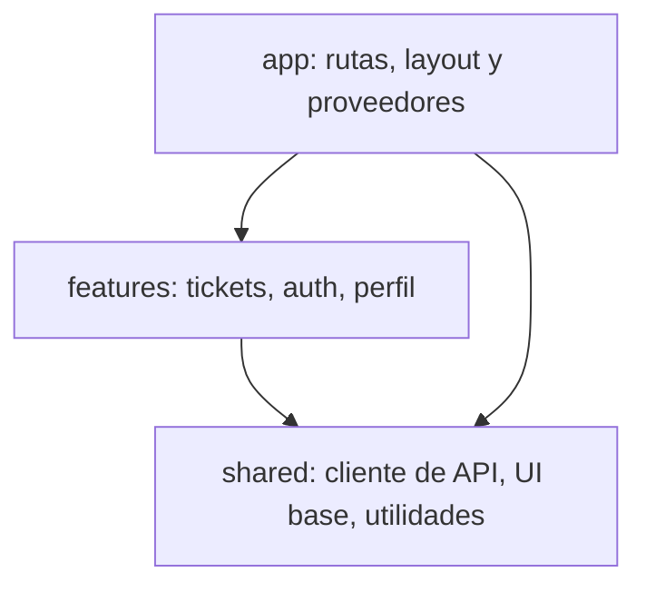

<!-- _class: lead -->

# S02 - Arquitectura por feature

### React en producción con TypeScript

**Rogelio Arriaga - Raptor Dev Services**

<!--
Bienvenida. Cada quien debe traer el proyecto de la sesión 1 funcionando (npm run typecheck sin errores) y el dibujo de su propio árbol de carpetas, con los tres imports "demasiado lejos".
-->

---

## Agenda del día

| Bloque | Qué hacemos | Tiempo aprox. |
|---|---|---|
| Apertura | Lema, objetivos, el dibujo de tu árbol | 20 min |
| Parte 1 | Cómo se pudre una aplicación de React | 45 min |
| Parte 2 | Estructura por feature | 60 min |
| Parte 3 | La capa de dominio y las fronteras que fallan en el lint | 60 min |
| Parte 4 | Práctica: reorganizar y poner la regla | 85 min |
| Cierre | Antipatrones, tarea y quiz | 30 min |

<!-- Hay un descanso de 10 minutos entre la Parte 2 y la Parte 3, y otro a la mitad de la práctica. -->

---

## El lema de la sesión

> Una regla de arquitectura que nadie hace cumplir es una sugerencia.

- Un documento que dice "las features no se importan entre sí" dura hasta el primer viernes con prisa.
- Una regla que **falla en el lint** dura mientras haya pipeline.
- Hoy ponemos la regla donde ya corren todas las demás: en `npm run lint`.

<!-- Pregunta al grupo: ¿alguien tiene una carpeta utils/ o helpers/ con más de 40 archivos? Casi siempre sí. Ahí vive la arquitectura que nadie decidió. -->

---

## Al terminar puedes

- Explicar por qué una carpeta por tipo de archivo (`components/`, `hooks/`, `services/`) se vuelve un problema al crecer.
- Organizar una aplicación por **feature**, con una **API pública** por feature y una dirección única de dependencias.
- Separar el modelo de la aplicación del JSON de la API con una **capa anticorrupción**.
- Escribir una regla de importación con `eslint-plugin-boundaries` y **verla fallar**.
- Componer dos features en `app/` sin que se importen entre sí.
- Reconocer cinco antipatrones comunes y qué hacer con cada uno.

---

## Dónde estamos en el curso

| Sesión | Pregunta que contesta |
|---|---|
| S01 | ¿Cómo hago que el contrato de la API rompa el build? |
| **S02** | **¿Cómo organizo el código para que crezca sin enredarse?** |
| S03 | ¿Dónde vive cada dato y qué pasa cuando falla la red? |
| S04 | ¿Dónde guardo la sesión y cómo me defiendo en el navegador? |
| S05 | ¿Qué optimizo, midiendo, y cómo garantizo que se use sin ratón? |
| S06 | ¿Cómo pruebo, despliego y evito que el usuario vea la versión vieja? |

---

<!-- _class: lead -->

# Parte 1
## Cómo se pudre una aplicación de React

---

## El síntoma

Nadie decidió que la app quedara así. Quedó así porque cada cambio fue razonable:

- "Esta función la usan dos pantallas, a `utils/`."
- "Este componente lo necesito en otro lado, a `components/`."
- "Este hook trae datos de usuarios; lo importo directo desde ahí."

A los seis meses, **tocar los tickets obliga a abrir cinco carpetas** y nadie sabe qué se rompe al borrar una.

*Libro:* este arco, de un proyecto sin estructura a uno ordenado, es el de *React Anti-Patterns* (Qiu, 2023), cap. 3, *Organizing Your React Application*.

---

## Lo medimos: la app "plana" de la Mesa de ayuda

La misma aplicación del curso, organizada **por tipo de archivo**:

```console
src/
  components/   estado-de-datos.tsx  ticket-form.tsx
  hooks/        use-sesion.ts        use-tickets.ts
  pages/        login-page.tsx       tickets-page.tsx   tickets-page.test.tsx
  routes/       router.tsx           ruta-protegida.tsx
  services/     auth-api.ts  client.ts  contract.ts  tickets-api.ts
  main.tsx
```

¿Qué archivos hablan de **tickets**?

```console
$ grep -rlE "ticket|Ticket" src | grep -v test | xargs -n1 dirname | sort -u
src/components
src/hooks
src/pages
src/routes
src/services
```

- Un solo tema, **cinco carpetas**.
- Y `services/contract.ts` mezcla tickets, usuarios y errores: cada feature nueva lo engorda.

<!-- Salida real del proyecto mesa-plana (referencia/mesa-plana). -->

---

## ¿Es malo? Depende de cuándo

| Estructura | Se ve bien con... | Duele cuando... |
|---|---|---|
| Por tipo de archivo | 5 a 10 pantallas, una persona | Hay 30 pantallas y 4 personas: cada cambio toca todas las carpetas |
| Por feature | Cualquier tamaño | Las features empiezan a importarse entre sí |

- El libro de Qiu (cap. 3) compara cuatro estructuras comunes: por **feature**, por **componente**, **atomic design** y **MVVM**. Ninguna es la correcta en abstracto.
- Lo que cambia es **qué cambia junto**: si las cosas que cambian juntas viven juntas, el cambio se queda en un lugar.

---

## Cohesión: lo que cambia junto, vive junto

Agregar un campo `asignadoA` a los tickets:

| Estructura | Archivos a abrir |
|---|---|
| Por tipo | `contract.ts`, `tickets-api.ts`, `use-tickets.ts`, `tickets-page.tsx`, `ticket-form.tsx` en **5 carpetas** |
| Por feature | `shared/api/contract.ts` y la carpeta `features/tickets/` |

- No es magia: los mismos archivos cambian. Lo que cambia es **cuánto tienes que buscar** y **qué puedes ignorar**.
- Una carpeta de feature se puede entender, probar y hasta borrar sin leer el resto.

---

## La otra mitad del problema: las dependencias

La estructura por carpetas no impide nada. Esto compila en cualquiera de las dos:

```tsx
// features/tickets/tickets-page.tsx
import { useSesion } from '../auth/use-sesion';      // 1. un hook de otra feature, por dentro
import { Cabecera } from '../perfil/cabecera';       // 2. un componente de otra feature
import { crearRouter } from '../../app/router';      // 3. una feature que importa a la app
```

- Cada import "se justifica". Juntos forman una **red**: tickets depende de auth y perfil, perfil de auth, y un día auth necesita algo de tickets y aparece un ciclo.
- La carpeta ordena los archivos. **Las reglas de importación ordenan las dependencias.**

---

## Qué queremos en su lugar



- Un **solo sentido**: `app` puede usar `features` y `shared`; `features` solo `shared`; `shared` solo `shared`.
- Una feature **no importa de otra feature** ni de `app`.
- Es la estructura que describe *React Application Architecture for Production* (Alickovic, 2026), cap. 2, sección *How the code flows*.

---

## Resumen de la Parte 1

- La estructura por tipo de archivo **dispersa** lo que cambia junto: un tema, cinco carpetas.
- La estructura por feature **concentra** el cambio.
- Pero las carpetas no controlan **quién importa a quién**: para eso hacen falta reglas.
- La meta es un grafo de dependencias en un solo sentido: `app` → `features` → `shared`.

---

<!-- _class: lead -->

# Parte 2
## Estructura por feature

---

## El árbol de la Mesa de ayuda

```console
src/
  app/
    layout.tsx
    router.tsx
  features/
    auth/      api.ts  index.ts  login-page.tsx  ruta-protegida.tsx  use-sesion.ts
    perfil/    cabecera.tsx  index.ts
    tickets/   api.ts  domain.ts  index.ts  ticket-form.tsx  tickets-page.tsx  use-tickets.ts
  shared/
    api/       client.ts  contract.ts
    ui/        estado-de-datos.tsx
  main.tsx
```

- Cada feature es una **carpeta con lo suyo**: pantallas, hooks, llamadas a la API, modelo y pruebas.
- Las carpetas de tipo (`api`, `ui`) existen **dentro** de `shared`, donde lo compartido sí es "de ningún dominio".

---

## La API pública de una feature: `index.ts`

```ts
// features/tickets/index.ts
export { TicketsPage } from './tickets-page';
```

```ts
// features/auth/index.ts
export { LoginPage } from './login-page';
export { RutaProtegida } from './ruta-protegida';
export { useSesion, useSalir } from './use-sesion';
```

- El archivo `index.ts` dice **qué ofrece** la feature al resto. Todo lo demás es interno.
- Si mañana `ticket-form.tsx` se parte en tres archivos, nadie de afuera se entera.
- Una API pública pequeña es lo que hace **barato** el cambio por dentro.

---

## Lo que va en `shared` y lo que no

| Va en `shared` | No va en `shared` |
|---|---|
| El cliente de API (`pedir`, `ApiError`) | Una función que solo usa tickets |
| Los componentes de UI base (`EstadoDeDatos`) | Un componente que "sabe" qué es un ticket |
| Utilidades sin dominio (fechas, formato) | Algo que "se usará pronto" en otro lado |
| El contrato compartido de la API | Un `utils.ts` que acumula de todo |

- **`shared` no sabe nada del negocio.** Si una función menciona "ticket", vive en `features/tickets`.
- Subir algo a `shared` es fácil; bajarlo cuando ya lo usan diez archivos, no. **Mueve a `shared` cuando un segundo uso real lo pida**, no antes.

<!-- Aquí aparece la regla de tres, que no es un estándar: es una heurística del equipo. Se dice como tal. -->

---

## Las tres restricciones

El libro de Alickovic las enumera al hablar de cómo hacer cumplir la estructura con ESLint (cap. 2):

1. **`shared` es independiente:** no importa de `features` ni de `app`.
2. **Las features no importan de `app`.**
3. **Las dependencias entre features son explícitas y controladas.**

En este curso la tercera es la más estricta: **una feature no importa de otra feature**. Cuando dos necesitan hablar, las junta `app/`.

---

## Componer en `app/`: el ejemplo de la cabecera

`perfil` muestra el nombre y un botón de salir. El nombre lo tiene `auth`. Mal:

```tsx
// features/perfil/malo.tsx
import { useSesion } from '../auth';

export function CabeceraConSesion() {
  const sesion = useSesion();
  return <header>Hola, {sesion.data?.nombre}</header>;
}
```

`perfil` ahora **depende de `auth`**. Bien: `perfil` recibe lo que necesita por props y `app/` los conecta.

```tsx {1-9|11-14|16-25}
// features/perfil/cabecera.tsx
interface Props {
  nombre: string;
  alSalir: () => void;
}

export function Cabecera({ nombre, alSalir }: Props) {
  /* ... un <header> con el nombre y un botón ... */
}

// app/layout.tsx
import { Outlet } from 'react-router';
import { useSalir, useSesion } from '../features/auth';
import { Cabecera } from '../features/perfil';

export function Layout() {
  const sesion = useSesion();
  const salir = useSalir();
  return (
    <>
      {sesion.data && <Cabecera nombre={sesion.data.nombre} alSalir={() => salir.mutate()} />}
      <Outlet />
    </>
  );
}
```

---

## Por qué funciona

- `Cabecera` es **testeable sola**: se le pasa un nombre, sin sesión, sin red.
- `perfil` y `auth` se pueden cambiar, mover o reemplazar sin tocarse.
- Quien entiende cómo se **conectan** las features mira un solo lugar: `app/`.
- El costo: `app/` crece. Es el precio de que las features no se enreden, y es un buen lugar para que crezca: es la capa de arriba.

---

## Error típico 1: la feature "común"

```text
src/features/comun/
  helpers.ts
  hooks.ts
  tipos.ts
```

- Es `utils/` con otro nombre: una carpeta que **todos importan y que importa a todos**.
- Se detecta porque no tiene un tema: tiene un **tipo** de cosa.
- Arreglo: cada pieza vuelve a la feature que la usa o, si de verdad no sabe del negocio, sube a `shared`.

---

## Error típico 2: el import profundo

```ts
import { TicketForm } from '../tickets/ticket-form';                // por dentro
import { TicketsPage } from '../tickets';                         // por la API pública
```

- Importar por dentro congela la estructura interna: ya no se puede renombrar `ticket-form.tsx` sin romper a otra feature.
- La regla: **desde afuera, solo `index.ts`**.
- Otra vez, la carpeta no lo impide. El lint sí.

---

## Resumen de la Parte 2

- Una feature es una carpeta con lo suyo y un `index.ts` como API pública.
- `shared` no sabe del negocio; `app` compone.
- Dos features que se necesitan se conectan **en `app/`**, por props o por composición.
- La carpeta "común" y el import profundo son los dos primeros síntomas de que la estructura se está perdiendo.

<!-- Descanso de 10 minutos. -->

---

<!-- _class: lead -->

# Parte 3
## La capa de dominio y las fronteras que fallan en el lint

---

## El modelo de la API no es el modelo de la aplicación

La API dice:

```json
{ "id": 3, "titulo": "El correo no sincroniza", "prioridad": "alta", "estado": "abierto",
  "creadoEn": "2026-11-04T09:10:00.000Z" }
```

La pantalla necesita saber:

- si es **urgente** (abierto y de prioridad alta),
- la fecha como `Date`, no como texto,
- si está **abierto** como un booleano, no comparar un `'abierto'` en cada componente.

Si cada componente lo calcula, la regla de "qué es urgente" está **repetida** en tantos lugares como componentes.

---

## La capa anticorrupción

```ts {1-8|10-21}
export interface TicketVista {
  id: number;
  titulo: string;
  prioridad: Prioridad;
  abierto: boolean;
  creadoEn: Date;
  urgente: boolean;
}

/** Frontera entre la API y la aplicación: el único lugar que conoce la forma del JSON. */
export function aTicketVista(dto: Ticket): TicketVista {
  const abierto = dto.estado === 'abierto';
  return {
    id: dto.id,
    titulo: dto.titulo,
    prioridad: dto.prioridad,
    abierto,
    creadoEn: new Date(dto.creadoEn),
    urgente: abierto && dto.prioridad === 'alta',
  };
}
```

- Una función pura: entra el **DTO** (lo que dice la API), sale el modelo de la aplicación.
- Si la API renombra `estado`, cambia **esta función** y el resto de la app no se entera.
- Es una **capa anticorrupción** (*anti-corruption layer*, ACL): el contrato externo no se filtra al interior.

*Lectura:* `06-frontend/07-capa-dominio-acl.md` explica la idea completa; aquí solo la conectamos con el proyecto.

---

## Es una función pura: se prueba sin React ni red

```ts
const base: Ticket = { id: 7, titulo: 'Impresora', prioridad: 'alta', estado: 'abierto', creadoEn: '2026-11-02T15:00:00.000Z' };

it('un ticket abierto de prioridad alta es urgente', () => {
  expect(aTicketVista(base).urgente).toBe(true);
});
it('un ticket cerrado ya no es urgente, aunque su prioridad sea alta', () => {
  expect(aTicketVista({ ...base, estado: 'cerrado' }).urgente).toBe(false);
});
```

- Tres pruebas, milisegundos, sin `render`, sin servidor falso.
- La regla de negocio ("¿qué es urgente?") **tiene su prueba** y su lugar.

---

## Dónde se aplica la conversión: `select`

```ts {1-4|6-12}
const aPaginaVista = (pagina: PaginaDeTickets) => ({
  total: pagina.total,
  datos: pagina.datos.map(aTicketVista),
});

export function useTickets(estado: EstadoTicket | 'todos') {
  return useQuery({
    queryKey: ticketsKeys.lista(estado),
    queryFn: ({ signal }) => ticketsApi.listar(estado, signal),
    select: aPaginaVista,
  });
}
```

- La caché de TanStack Query guarda la respuesta **tal cual**; `select` la transforma al leerla.
- Según la documentación de TanStack, `select` solo se vuelve a ejecutar si cambió la función (por referencia) o los datos, y una función **escrita en línea** se ejecuta en cada render: por eso va definida fuera del hook.
- Los componentes reciben `TicketVista`: nunca ven el JSON de la API.

Fuente: documentación de TanStack Query, *Render Optimizations*, secciones *select* y *memoization*.

---

## Una capa más: qué se queda en la feature

| Pieza | Responsabilidad | ¿Sabe de React? |
|---|---|---|
| `api.ts` | Llamadas HTTP de la feature y sus claves de caché | No |
| `domain.ts` | El modelo y las reglas (`aTicketVista`, qué es urgente) | **No** |
| `use-tickets.ts` | Conecta la caché con el modelo | Sí (hooks) |
| `*-page.tsx`, `ticket-form.tsx` | Pantalla y formulario | Sí |

- Lo que **no sabe de React** se prueba sin React.
- La dirección de dependencias dentro de la feature: pantalla → hook → api/dominio. Nunca al revés.

---

## Error típico 3: la lógica en el componente

```tsx
{pagina.datos.map((t) => (
  <li key={t.id} className={t.estado === 'abierto' && t.prioridad === 'alta' ? 'rojo' : ''}>
```

- Esa condición es la **regla de negocio** y está dentro del JSX.
- Mañana el negocio dice "también los de prioridad media después de 48 horas". ¿Cuántos `className` hay que cambiar?
- Esta idea, sacar el modelo del componente, es la de *React Anti-Patterns* (Qiu, 2023), cap. 11, *Introducing Layered Architecture in React*.

---

## Hacer que la regla falle en el lint

Una regla de importación necesita tres cosas:

1. **Clasificar** los archivos: ¿cuáles son `app`, cuáles `feature`, cuáles `shared`?
2. **Declarar** quién puede importar a quién.
3. **Fallar** el lint cuando algo lo rompe, y que el pipeline lo ejecute.

Usamos `eslint-plugin-boundaries` (7.4.2 a noviembre de 2026), compatible con ESLint 10 (`peerDependencies: eslint >=6.0.0`).

---

## La configuración, completa

```js {1-3|10-17|18-30}
import tseslint from 'typescript-eslint';
import boundaries from 'eslint-plugin-boundaries';

export default tseslint.config(
  { ignores: ['dist', 'node_modules'] },
  ...tseslint.configs.recommended,
  {
    files: ['src/**/*.{ts,tsx}'],
    plugins: { boundaries },
    settings: {
      'import/resolver': { node: { extensions: ['.ts', '.tsx', '.js'] } },
      'boundaries/elements': [
        { type: 'app', pattern: 'src/app' },
        { type: 'feature', pattern: 'src/features/*', capture: ['nombre'] },
        { type: 'shared', pattern: 'src/shared' },
      ],
    },
    rules: {
      'boundaries/dependencies': ['error', {
        default: 'disallow',
        policies: [
          { from: { element: { type: 'app' } }, allow: { to: { element: { type: 'feature', fileInternalPath: 'index.ts' } } } },
          { from: { element: { type: 'app' } }, allow: { to: { element: { type: 'shared' } } } },
          { from: { element: { type: 'feature' } }, allow: { to: { element: { type: 'shared' } } } },
          { from: { element: { type: 'feature' } }, allow: { to: { element: { type: 'feature', captured: { nombre: '{{ from.element.captured.nombre }}' } } } } },
          { from: { element: { type: 'shared' } }, allow: { to: { element: { type: 'shared' } } } },
        ],
      }],
    },
  },
);
```

Fuente: documentación de `eslint-plugin-boundaries` (jsboundaries.dev); la configuración se ejecutó con la versión 7.4.2.

---

## Cómo se lee

| Pieza | Qué dice |
|---|---|
| `boundaries/elements` | Cada carpeta de `src/features/*` es un elemento de tipo `feature`, y `nombre` captura el nombre de la carpeta |
| `default: 'disallow'` | Todo está **prohibido** salvo lo que una política permita |
| Política 1 y 2 | `app` importa **solo el `index.ts`** de las features, y puede usar `shared` |
| Política 3 | Una feature usa `shared` |
| Política 4 | Una feature se puede importar **a sí misma**: `nombre` del origen = `nombre` del destino |
| Política 5 | `shared` solo usa `shared` |

- Hace falta `import/resolver` con las extensiones, o el plugin no resuelve los imports sin extensión (`'../auth'`) y **no avisa**: simplemente no detecta nada. Lo vimos fallar en el proyecto de referencia.

<!-- Anécdota real del desarrollo de este curso: la primera configuración pasaba el lint sin ningún error y el import malo estaba ahí. Sin el resolver, el plugin no sabía a qué archivo apuntaba '../auth'. Por eso este curso siempre pide "verlo fallar". -->

---

## Verlo fallar: cuatro violaciones, cuatro mensajes

**1. Una feature que importa a otra**

```console
src/features/perfil/malo.tsx
  1:27  error  There is no policy allowing dependencies from elements of type "feature" and captured values: nombre="perfil" to elements of type "feature" and captured values: nombre="auth"  boundaries/dependencies
```

**2. `shared` que importa una feature**

```console
src/shared/malo2.ts
  1:29  error  There is no policy allowing dependencies from elements of type "shared" to elements of type "feature" and captured values: nombre="tickets"  boundaries/dependencies
```

---

## Las otras dos violaciones

**3. Una feature que importa a `app`**

```console
src/features/auth/malo3.ts
  1:29  error  There is no policy allowing dependencies from elements of type "feature" and captured values: nombre="auth" to elements of type "app"  boundaries/dependencies
```

**4. `app` que importa por dentro de una feature**

```console
src/app/malo.ts
  1:27  error  There is no policy allowing dependencies from elements of type "app" to elements of type "feature" and captured values: nombre="auth"  boundaries/dependencies
```

(`import { LoginPage } from '../features/auth/login-page'`: debía ser `'../features/auth'`.)

Fuente: salida real de `npx eslint .` con ESLint 10.14.0 y `eslint-plugin-boundaries` 7.4.2.

---

## Alternativa sin plugin: `no-restricted-imports`

ESLint trae una regla propia que prohíbe imports por patrón:

```js
{
  files: ['src/shared/**/*.{ts,tsx}'],
  rules: {
    'no-restricted-imports': ['error', { patterns: [
      { regex: '(^|/)features(/|$)', message: 'shared no puede importar de features.' },
      { regex: '(^|/)app(/|$)', message: 'shared no puede importar de app.' },
    ] }],
  },
},
```

```console
src/shared/malo2.ts
  1:1  error  '../features/tickets' import is restricted from being used by a pattern. shared no puede importar de features  no-restricted-imports
```

- Cero dependencias nuevas, pero **mira el texto del import**, no a qué elemento apunta: un alias o una ruta distinta puede escaparse. Sirve para pocas reglas simples.
- Para varias reglas con la misma lógica, un plugin que **clasifica los archivos** es más mantenible.

Fuente: documentación de ESLint, regla `no-restricted-imports`; ejecutada con ESLint 10.14.0.

---

## Una trampa de versiones

La nota `06-frontend/10-fronteras-import.md` del repositorio usa `import/no-restricted-paths`, de `eslint-plugin-import`.

- Con ESLint 10.14.0, `eslint-plugin-import` 2.32.0 declara `eslint: ^2 || ^3 || ... || ^9`. **ESLint 10 no está en su rango de peer.**
- `eslint-plugin-boundaries` 7.4.2 sí acepta ESLint 10.
- Moraleja: antes de adoptar una herramienta de lint, `npm view <paquete> peerDependencies`. La nota 10 sigue siendo válida para proyectos con ESLint 9 o anterior.

Fuente: metadatos de npm (`npm view eslint-plugin-import@2.32.0 peerDependencies.eslint`), 11 de noviembre de 2026.

---

## Adoptarlo en un repo que ya tiene violaciones

1. Activa la regla en `warn` (`1`), no en `error`.
2. Fija un tope con `npx eslint . --max-warnings 40` (el número actual de advertencias): si alguien agrega una, el comando falla y **el número no puede aumentar**.
3. Arregla por feature, de una en una, y baja el tope.
4. Cuando llegues a cero, cambia a `error`.

- Un lint que se activa con 400 errores se apaga la misma tarde.
- La regla de oro: **el número nunca sube**.

Fuente: ESLint, opción `--max-warnings` (eslint.org/docs/latest/use/command-line-interface).

---

## Dónde corre: el pipeline

```bash
npm run lint
```

- La regla de importación vive en la **misma ejecución** que el resto del lint. No hay un paso nuevo que olvidar.
- Si el lint solo corre en el editor de cada quien, es una sugerencia con sintaxis.
- En la sesión 6 el pipeline del front pone `lint`, `typecheck`, pruebas y build en ese orden.

---

## Resumen de la Parte 3

- El modelo de la API y el modelo de la aplicación son cosas distintas; una **ACL** los separa con una función pura.
- `select` aplica la conversión al leer la caché; la función va definida fuera del hook.
- Una regla de importación necesita clasificar, declarar y **fallar** en el lint.
- `eslint-plugin-boundaries` 7.4.2 con `default: 'disallow'`; sin `import/resolver` no detecta imports sin extensión.
- Las trampas de versiones se descubren con `npm view`, no con el titular.

---

<!-- _class: lead -->

# Parte 4
## Práctica: reorganizar y poner la regla

---

## Qué vamos a hacer (85 minutos)

1. **Medir** la aplicación plana: cuántas carpetas toca "tickets".
2. **Reorganizar** por feature con `git mv`, corriendo `tsc` y las pruebas en cada paso.
3. **Escribir la regla** de importación y comprobar que pasa en la estructura buena.
4. **Verlo fallar**: cuatro violaciones, una por una, con su mensaje.
5. **Componer** dos features en `app/`.
6. **Agregar** la capa de dominio con `select` y su prueba.

El enunciado completo está en `practica.md`.

<!-- Parejas. El que escribe mueve archivos; el que lee corre tsc y pruebas después de cada git mv. La disciplina de "un movimiento, una verificación" es la lección. -->

---

## Refactorizar con red: un movimiento, una verificación

```bash
git mv src/hooks/use-tickets.ts src/features/tickets/use-tickets.ts
npx tsc --noEmit        # ¿qué imports se rompieron?
npx vitest run          # ¿sigue todo en verde?
git commit -m "refactor: use-tickets pasa a features/tickets"
```

- `tsc` te dice, uno por uno, **qué imports** arreglar: el compilador es tu lista de tareas.
- Las pruebas de la sesión 1 y 3 ya están: **sin ellas, mover archivos es adivinar**.
- Un commit por movimiento: si algo sale mal, `git revert` de uno solo.

---

## Al terminar la práctica debes poder mostrar

- El árbol `src/` por feature, con `index.ts` en cada una.
- `npm run typecheck`, `npm run lint` y `npm test` en verde.
- Las cuatro violaciones de importación y el mensaje de cada una.
- La cabecera componiendo `perfil` y `auth` desde `app/`.
- `aTicketVista` con sus pruebas y conectada con `select`.

---

<!-- _class: lead -->

# Cierre
## Antipatrones, tarea y quiz

---

## Cinco antipatrones

| Antipatrón | Cómo se ve | Qué hacer |
|---|---|---|
| Carpeta "común" | `features/comun`, `utils/` con 40 archivos | Cada pieza a su feature, o a `shared` si no sabe del negocio |
| Import profundo | `from '../tickets/ticket-form'` | Solo por `index.ts` |
| Features que se importan | `perfil` importa `auth` | Props o composición en `app/` |
| Lógica en el JSX | La condición de negocio dentro del `className` | Una función de dominio con su prueba |
| Contrato filtrado | El JSON de la API llega hasta el componente | Una ACL: `aTicketVista` |

---

## La tarea

**El mapa de features de tu proyecto**:

- El árbol actual y el árbol propuesto, con cada feature y su API pública.
- Los **imports que cruzan** fronteras hoy (con el comando que usaste para contarlos).
- La regla de `eslint-plugin-boundaries` adaptada a tu proyecto, con la configuración mínima.
- Un plan de adopción: cuántas violaciones hay, en qué orden se arreglan y en qué fecha el lint pasa de `warn` a `error`.

Entrega en `tarea.md`: criterios y formato.

---

## Lecturas y libros de la sesión

**Lecturas del repositorio**

- `dev-notes/06-frontend/06-feature-hook.md`.
- `dev-notes/06-frontend/07-capa-dominio-acl.md`.
- `dev-notes/06-frontend/10-fronteras-import.md` (con la advertencia de versiones de esta sesión).

**Libros (por capítulo)**

- *React Application Architecture for Production* (Alickovic, 2026), caps. 1 a 3: *Understanding the Architecture of React Applications*, *Setup and Project Structure Overview* y *Building and Documenting Components*.
- *React Anti-Patterns* (Qiu, 2023), caps. 3, 4 y 11: *Organizing Your React Application*, *Designing Your React Components* y *Introducing Layered Architecture in React*.

Los libros se citan por capítulo; cada quien consigue su copia.

---

## Siguiente sesión

### S03 - Datos, estado y formularios

- Dónde vive cada dato: estado local, de la URL, del servidor.
- Traer datos con caché, invalidar y actualizar de forma optimista.
- Formularios con validación y con los errores del servidor pegados a su campo.
- Que **ninguna pantalla se quede en blanco**, ni se pierda lo escrito si falla la red.

> La mitad de los errores de un front es estado guardado en el lugar equivocado.

---

## Quiz: arquitectura por feature

- 10 preguntas por intento, sacadas de un banco de 12.
- Individual, sin el editor abierto: se contesta con lo que entendiste, no con lo que copias.
- Lo que falles, búscalo en las notas `06-feature-hook`, `07-capa-dominio-acl` y `10-fronteras-import` antes del siguiente intento.

<!-- Últimos 15 minutos. Revisa en voz alta la pregunta que más se falle. -->
