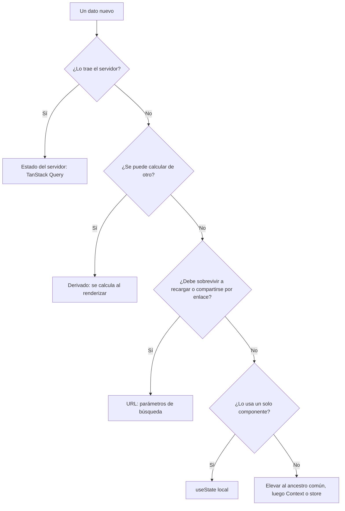
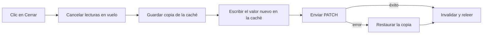

<!-- _class: lead -->

# S03 - Datos, estado y formularios

### React en producción con TypeScript

**Rogelio Arriaga - Raptor Dev Services**

<!--
Bienvenida. Cada quien abre su copia del proyecto "Mesa de ayuda" (Ejemplo ilustrativo, carpeta referencia/ del curso)
con `npm install` hecho y `npm test` en verde antes de empezar. Si no corre, se resuelve en la apertura.
-->

---

## Agenda del día

| Bloque | Qué hacemos | Tiempo aprox. |
|---|---|---|
| Apertura | Lema, objetivos, el proyecto de la sesión | 25 min |
| Parte 1 | Dónde vive cada estado | 50 min |
| Parte 2 | Datos del servidor con caché: TanStack Query | 60 min |
| Parte 3 | Formularios: validar, errores del servidor y no perder lo escrito | 50 min |
| Parte 4 | Práctica: un formulario que aguanta la red caída | 80 min |
| Cierre | Errores típicos, tarea y quiz | 35 min |

<!-- Descanso de 10 minutos entre la Parte 1 y la 2, y otro a la mitad de la práctica. -->

---

## El lema de la sesión

> La mitad de los errores de un front es estado guardado en el lugar equivocado.

- Un dato guardado dos veces es un dato que, tarde o temprano, dice dos cosas distintas.
- Una pantalla que solo sabe pintar "los datos" se queda en blanco el día que el servidor falla.
- Hoy decidimos **dónde vive** cada dato y **qué pinta** la pantalla cuando no hay datos.

<!-- Pregunta al grupo: ¿quién ha visto una pantalla que muestra un dato viejo después de guardar? Esa es la clase de hoy. -->

---

## Al terminar puedes

- Clasificar un dato como estado del servidor, de la interfaz, de la URL o derivado, y ponerlo donde toca.
- Traer datos con caché, claves de consulta y cancelación, sin copiarlos a un `useState`.
- Cambiar un dato con una actualización optimista que vuelve atrás si el servidor falla.
- Construir una pantalla con sus **cuatro estados**: cargando, error, vacío y con datos.
- Validar un formulario en el cliente y pegar los errores del servidor al campo que corresponde.
- Garantizar que lo escrito no se pierde cuando falla la red.

---

## Cómo trabajamos

- El proyecto es **Mesa de ayuda**, una aplicación de tickets de soporte. **Ejemplo ilustrativo**: los datos, el correo y la contraseña de laboratorio son inventados.
- Todo el código de las láminas existe en el proyecto de referencia y corre tal cual.
- Versiones a noviembre de 2026: React 19.3.1, TanStack Query 5.107.1, React Hook Form 7.92.0, `@hookform/resolvers` 7.0.5, Zod 4.6.7, React Router 8.5.1, Vitest 5.1.0, MSW 3.0.5.
- **La regla del curso:** si no lo viste fallar, no lo probaste. Cada práctica rompe algo a propósito.

```bash
npm install
npm test          # todas las pruebas en verde antes de empezar
npm run api       # la API de laboratorio en el puerto 3100
```

Fuente: `package.json` del proyecto de referencia; versiones leídas de npm el 2026-11-11.

---

<!-- _class: lead -->

# Parte 1
## Dónde vive cada estado

---

## Dos familias de estado

| | Estado del servidor | Estado de la interfaz |
|---|---|---|
| Ejemplo | La lista de tickets | Qué menú está abierto |
| Quién es el dueño | El servidor | El navegador |
| Puede quedar viejo | Sí: otra persona lo cambia | No |
| Necesita | Caché, reintentos, invalidación | Un `useState` y ya |
| Herramienta | TanStack Query | `useState`, URL, Context |

- El error clásico es tratar la primera familia como si fuera la segunda: `fetch` en un `useEffect`, resultado a un `useState`, y a rezar.
- Un dato del servidor **es una copia**. Hay que decidir cuándo se renueva, no solo dónde se guarda.

<!-- Es la distinción que ordena toda la sesión. Si el grupo solo se lleva esto, ya valió. -->

---

## Los cinco principios para estructurar estado

1. **Agrupa** lo que cambia junto.
2. **Evita contradicciones**: no `isSending` e `isSent` a la vez; una sola variable `status`.
3. **Evita lo redundante**: si se calcula al renderizar, no se guarda.
4. **Evita duplicados**: guarda el `id` seleccionado, no una copia del objeto.
5. **Evita anidar profundo**: aplana.

```tsx
// Mal: dos copias del mismo ticket
const [tickets, setTickets] = useState<Ticket[]>([]);
const [seleccionado, setSeleccionado] = useState<Ticket | null>(null);

// Bien: una fuente, y el seleccionado se deriva
const [seleccionadoId, setSeleccionadoId] = useState<number | null>(null);
const seleccionado = tickets.find((t) => t.id === seleccionadoId);
```

Fuente: documentación de React, *Choosing the State Structure* (react.dev/learn/choosing-the-state-structure). *Fragmento*: ilustra la regla, no es un archivo del proyecto.

<!-- Estos cinco principios son de la documentación oficial; los dos errores del ejemplo (copia y contradicción) los vamos a provocar en la práctica. -->

---

## La escalera: usa el peldaño más bajo que alcance



Fuente: escalera de la nota `06-frontend/08-estado-donde-vive.md`; la rama del servidor, de la documentación de TanStack Query.

<!-- La nota 08 explica la escalera y el store con selectores. Hoy no la repetimos: la usamos y agregamos el peldaño que más falta: el estado del servidor. -->

---

## Demostración: el filtro vive en la URL

El filtro de la lista de tickets no es un `useState`: es un parámetro de búsqueda.

```tsx {1-5|7-9|10-12|*}
/** El filtro vive en la URL (?estado=abierto): se puede compartir, recargar y volver atrás. Un valor inválido cuenta como "todos". */
function filtroDe(params: URLSearchParams): EstadoTicket | 'todos' {
  const r = estadoTicketSchema.safeParse(params.get('estado'));
  return r.success ? r.data : 'todos';
}

export function TicketsPage() {
  const [params, setParams] = useSearchParams();
  const estado = filtroDe(params);
  // ...
  onChange={(e) => setParams(e.target.value === 'todos' ? {} : { estado: e.target.value })}
}
```

- Recargar conserva el filtro. Pegar el enlace a otra persona, también. El botón Atrás funciona.
- **La URL es entrada del usuario:** cualquiera puede escribir `?estado=inventado`. Se valida con el mismo esquema Zod del contrato y lo inválido cae a un valor seguro.

Fuente: React Router, documentación de `useSearchParams` (reactrouter.com/api/hooks/useSearchParams). *Fragmento* de `src/features/tickets/tickets-page.tsx`.

<!-- Muestra en el navegador: filtra, recarga, copia la URL a otra pestaña. Luego escribe ?estado=inventado. -->

---

## `setSearchParams` reemplaza, no mezcla

```tsx
setParams({ estado: 'abierto' });   // la URL queda ?estado=abierto
// Si tuvieras ?pagina=3, se perdió. Para conservarlo, parte de lo que ya hay:
setParams((previos) => {
  previos.set('estado', 'abierto');
  return previos;
});
```

- La forma con función recibe los parámetros actuales y devuelve los nuevos.
- Varias llamadas en el mismo ciclo **no se encadenan** como las de `setState`.
- `searchParams` es mutable: si lo cambias sin llamar al setter, la URL no se entera.

Fuente: React Router, `useSearchParams`, sección de actualización funcional. *Fragmento*.

---

## Context no es un store

- `Context` reparte un valor sin pasar props. **No decide cuándo re-renderizar**: cuando el valor cambia, todo consumidor se vuelve a pintar.
- Sirve para lo que casi no cambia: el tema, el usuario, el idioma.
- Para lo que cambia seguido (un contador, un filtro, un borrador), un `Context` con un objeto grande vuelve a pintar a todos.
- Los datos del servidor **no** van en Context: ya tienen caché y dueño.

Fuente: nota `06-frontend/08-estado-donde-vive.md`, sección "Por qué Context no escala para estado que cambia"; *Learn React Hooks* (Bugl, 2025), cap. 5.

<!-- Si alguien pregunta por Redux/Zustand: la nota 08 cubre el patrón de store con selectores; aquí basta con saber que lo del servidor no entra. -->

---

## Error típico: copiar el dato del servidor a un `useState`

```tsx
// Mal
const [tickets, setTickets] = useState<Ticket[]>([]);
useEffect(() => {
  fetch('/api/tickets').then((r) => r.json()).then((p) => setTickets(p.datos));
}, []);
```

Lo que este código no tiene, y hay que escribir a mano:

- Estado de carga y de error (se queda en blanco o con la lista vieja).
- Cancelar la petición si el componente desaparece o el filtro cambia: una respuesta lenta pisa a una más nueva.
- Caché: volver a la pantalla repite la petición.
- Reintentos, refresco al volver a la pestaña, invalidar tras guardar.
- Validar que lo que llegó tiene la forma del contrato.

> Cada una de esas cinco cosas es un bug que alguien tuvo que descubrir en producción.

<!-- Verlo fallar en la práctica, paso 2: con ?demora=2000 y cambiando el filtro rápido, la respuesta vieja pisa la nueva. -->

---

## Estado contradictorio: tres booleanos que se pelean

```tsx
const [cargando, setCargando] = useState(false);
const [error, setError] = useState<string | null>(null);
const [datos, setDatos] = useState<Ticket[] | null>(null);
// ¿Qué pinta la pantalla si cargando=true, error="x" y datos=[...]?
```

- Tres variables permiten 8 combinaciones. La pantalla solo tiene 4 estados reales.
- La solución es **una sola variable de estado** (o una unión discriminada, como en la sesión 1):

```ts
type Vista<T> =
  | { estado: 'cargando' }
  | { estado: 'error'; mensaje: string }
  | { estado: 'vacio' }
  | { estado: 'datos'; datos: T };
```

- TanStack Query ya te da `isPending`, `isError` y `data` coherentes entre sí: no los inventes tú.

Fuente: React, *Choosing the State Structure*, principio "Avoid contradictions in state". *Fragmento*.

---

<!-- _class: lead -->

# Parte 2
## Datos del servidor con caché

---

## Qué hace TanStack Query por ti

- Guarda cada respuesta en una caché, indexada por una **clave de consulta** (`queryKey`).
- Decide cuándo un dato está **viejo** (`stale`) y cuándo volver a pedirlo.
- Quita las consultas repetidas: dos componentes con la misma clave comparten una sola petición.
- Reintenta, cancela, refresca al volver a la pestaña o recuperar la red.
- **No** es un cliente HTTP: tú sigues escribiendo `fetch`. Es un administrador de caché asíncrona.

Fuente: documentación de TanStack Query v5, *Overview* y *Important Defaults* (tanstack.com/query/latest). *Learn React with TypeScript* (Rippon, 2025), cap. 8; *React Application Architecture for Production* (Alickovic, 2026), cap. 5.

---

## Los valores por omisión (a noviembre de 2026)

| Opción | Por omisión | Qué significa |
|---|---|---|
| `staleTime` | 0 | Un dato se considera viejo al instante: se vuelve a pedir al montar, al volver a la pestaña y al reconectar |
| `gcTime` | 5 minutos | Una consulta sin nadie mirándola se borra de la caché tras ese tiempo |
| `retry` | 3 | Un fallo se reintenta 3 veces con espera exponencial antes de mostrarse |
| `structuralSharing` | activo | Si el dato no cambió, se conserva la misma referencia: no hay re-render de más |

- `staleTime` no es "cuánto dura el dato": es cuánto tiempo **no vale la pena** volver a pedirlo.
- Un `staleTime` de cero con una API lenta es el origen de "¿por qué pide todo cada vez que cambio de pestaña?".

Fuente: TanStack Query, *Important Defaults* (tanstack.com/query/latest/docs/framework/react/guides/important-defaults), leída el 2026-11-11.

<!-- Los valores pueden cambiar en versiones futuras: por eso llevan fecha. -->

---

## Nuestros valores: un solo lugar

```ts {1-2|3-6|7-8|*}
/** Valores por omisión de la app: un 4xx no se reintenta (repetirlo da lo mismo); la red o un 5xx, hasta 2 veces. */
export const crearQueryClient = () =>
  new QueryClient({
    defaultOptions: {
      queries: {
        staleTime: 30_000,
        retry: (intentos, error) => !(error instanceof ApiError && error.estado < 500) && intentos < 2,
      },
    },
  });
```

- Se crea en una función, no en una constante de módulo: las pruebas necesitan un cliente **nuevo** por prueba.
- Un 404 o un 422 dan lo mismo la segunda vez; reintentarlos solo retrasa el mensaje de error.
- 30 segundos de `staleTime` es una **decisión de producto**: ¿cuánto tolera este dato estar viejo?

Fuente: `src/app/query-client.ts`.

---

## Query keys: el índice de la caché

```ts {1-4|6-9|*}
export const ticketsKeys = {
  todos: ['tickets'] as const,
  lista: (estado: EstadoTicket | 'todos') => ['tickets', 'lista', estado] as const,
};

export function useTickets(estado: EstadoTicket | 'todos') {
  return useQuery({
    queryKey: ticketsKeys.lista(estado),
    queryFn: ({ signal }) => ticketsApi.listar(estado, signal),
  });
}
```

- La clave describe **todo lo que cambia el resultado**. Si el filtro cambia, la clave cambia, y es otra entrada de caché.
- Las claves son jerárquicas: invalidar `['tickets']` alcanza `['tickets', 'lista', 'abierto']` y cualquier otra que empiece así.
- Una fábrica de claves por feature evita escribir el arreglo a mano en diez archivos y equivocarse en uno.

Fuente: `src/features/tickets/api.ts` y `use-tickets.ts`; TanStack Query, *Query Keys*.

---

## Error típico: una clave que no incluye lo que cambia

```ts
// Mal: el filtro cambia el resultado pero no la clave
useQuery({ queryKey: ['tickets'], queryFn: () => ticketsApi.listar(estado) });
```

- Cambias el filtro a "cerrados" y la pantalla sigue mostrando los abiertos: la clave es la misma, así que la caché responde con lo que ya tiene.
- Regla: **todo lo que la `queryFn` lee de afuera va en la clave**.
- Y al revés: una clave con datos que no cambian el resultado crea entradas de caché duplicadas.

Fuente: TanStack Query, *Query Keys*, sección "Query Keys are hashed deterministically". *Fragmento*.

<!-- Se rompe a propósito en la práctica, paso 3. -->

---

## La `queryFn` recibe una `signal`

```ts {1-4|6-9|*}
listar: (estado: EstadoTicket | 'todos', signal?: AbortSignal) =>
  pedir(estado === 'todos' ? '/tickets' : `/tickets?estado=${estado}`, {
    esquema: paginaDeTicketsSchema, signal,
  }),

// en pedir():
const respuesta = await fetch(`/api${ruta}`, {
  method: metodo, credentials: 'same-origin', signal, /* ... */
});
```

- Si la consulta queda obsoleta (cambió el filtro, la pantalla se cerró), TanStack aborta la `signal`. Si se la pasas a `fetch`, la petición se cancela de verdad.
- Si **no** la consumes, la petición termina y su resultado entra a la caché: no se pierde nada, solo gastas red.
- La cancelación no funciona con los hooks de Suspense (`useSuspenseQuery`).

Fuente: TanStack Query, *Query Cancellation* (tanstack.com/query/latest/docs/framework/react/guides/query-cancellation), leída el 2026-11-11. `src/features/tickets/api.ts`, `src/shared/api/client.ts`.

---

## Los datos se validan en la frontera

```ts
export async function pedir<S extends z.ZodType>(ruta: string, { esquema, metodo = 'GET', cuerpo, signal }: Opciones<S>): Promise<z.infer<S>> {
  const respuesta = await fetch(`/api${ruta}`, { /* ... */ });
  const datos: unknown = await respuesta.json().catch(() => null);
  if (!respuesta.ok) { /* convierte el cuerpo en ApiError */ }
  return esquema.parse(datos);
}
```

- Los tipos de TypeScript desaparecen al compilar: no impiden que el servidor mande un campo distinto.
- `esquema.parse(datos)` falla **con nombre** si el contrato cambió, en un solo lugar, y TanStack lo muestra como error de la consulta.
- Los `datos` entran como `unknown`: el compilador te obliga a validarlos antes de usarlos.

Fuente: `src/shared/api/client.ts`; Zod, documentación de `parse` (zod.dev); sesión 1 de este curso.

---

## `isPending` no es `isFetching`

| Bandera | Es verdadera cuando | Para qué sirve |
|---|---|---|
| `isPending` | todavía **no hay datos** en la caché para esa clave | la pantalla de "Cargando" |
| `isFetching` | hay una petición en vuelo, haya o no datos | un indicador discreto de "actualizando" |
| `isError` | la última petición falló tras los reintentos | el mensaje de error con "Reintentar" |

- Con datos en caché y una relectura en segundo plano: `isPending` es falso, `isFetching` es verdadero. La lista se ve, sin parpadeo.
- Confundirlas es lo que hace que una pantalla con datos vuelva a mostrar "Cargando" cada vez que refresca.

Fuente: TanStack Query, *Queries* (tanstack.com/query/latest/docs/framework/react/guides/queries).

---

## Los cuatro estados de una pantalla

```tsx {1-3|4-12|13-14|*}
export function EstadoDeDatos<T>({ consulta, vacio, mensajeVacio, children }: Props<T>) {
  if (consulta.isPending) return <p role="status">Cargando...</p>;
  if (consulta.isError) {
    return (
      <div role="alert">
        <p>No pudimos cargar los datos: {consulta.error.message}</p>
        <button type="button" onClick={() => void consulta.refetch()}>
          Reintentar
        </button>
      </div>
    );
  }
  if (vacio(consulta.data)) return <p>{mensajeVacio}</p>;
  return <>{children(consulta.data)}</>;
}
```

- **Cargando, error, vacío, con datos.** Una pantalla sin los cuatro tiene un hueco que un usuario va a encontrar.
- El estado **vacío** no es el de error: "No hay tickets con ese filtro" le dice al usuario qué hacer; un error le dice que reintente.
- `role="status"` y `role="alert"` hacen que un lector de pantalla anuncie el cambio sin que la persona lo busque.

Fuente: `src/shared/ui/estado-de-datos.tsx`; WAI-ARIA 1.2, roles `status` y `alert` (w3.org/TR/wai-aria-1.2).

<!-- Muestra los cuatro en el navegador: ?demora=3000 (cargando), ?falla=1 (error), un filtro sin resultados (vacío). Eso lo hace el alumno en la práctica. -->

---

## Mutaciones: escribir y renovar lo leído

```ts
export function useCrearTicket() {
  const cliente = useQueryClient();
  return useMutation({
    mutationFn: (nuevo: NuevoTicket) => ticketsApi.crear(nuevo),
    onSuccess: () => cliente.invalidateQueries({ queryKey: ticketsKeys.todos }),
  });
}
```

- Una mutación **no** va a la caché por sí sola: escribe en el servidor y tú avisas qué lecturas quedaron viejas.
- `invalidateQueries({ queryKey: ['tickets'] })` marca como viejas todas las listas de tickets y vuelve a pedir las que están en pantalla.
- Después de crear un ticket, la lista se renueva sola, en todas las variantes de filtro que estén montadas.

Fuente: `src/features/tickets/use-tickets.ts`; TanStack Query, *Mutations* e *Invalidations from Mutations*.

---

## Actualización optimista: se ve ya, se confirma después



- Para acciones simples y poco propensas a fallar (cerrar un ticket, marcar como leído) el usuario no espera.
- Costo: hay que guardar copia y deshacer. Si la acción falla seguido o es cara de deshacer, **no** la hagas optimista.

Fuente: TanStack Query, *Optimistic Updates* (tanstack.com/query/latest/docs/framework/react/guides/optimistic-updates), leída el 2026-11-11.

---

## El código de la actualización optimista

```ts {1-4|5-12|13-15|16|*}
export function useCambiarEstado() {
  const cliente = useQueryClient();
  return useMutation({
    mutationFn: ({ id, estado }: { id: number; estado: EstadoTicket }) => ticketsApi.cambiarEstado(id, estado),
    onMutate: async ({ id, estado }) => {
      await cliente.cancelQueries({ queryKey: ticketsKeys.todos });
      const antes = cliente.getQueriesData<PaginaDeTickets>({ queryKey: ticketsKeys.todos });
      cliente.setQueriesData<PaginaDeTickets>({ queryKey: ticketsKeys.todos }, (pagina) =>
        pagina && { ...pagina, datos: pagina.datos.map((t) => (t.id === id ? { ...t, estado } : t)) },
      );
      return { antes };
    },
    onError: (_error, _vars, contexto) => {
      contexto?.antes.forEach(([clave, datos]) => cliente.setQueryData(clave, datos));
    },
    onSettled: () => cliente.invalidateQueries({ queryKey: ticketsKeys.todos }),
  });
}
```

- `cancelQueries` evita que una lectura que ya iba en camino pise el valor optimista con el viejo.
- Se guardan **todas** las listas que coinciden con `['tickets']`, porque el ticket puede estar en la de "todos" y en la de "abiertos".
- **`onSettled` devuelve la promesa**: la mutación sigue `pending` hasta que la relectura termina, y la pantalla no pasa a "listo" con datos a medias.

Fuente: `src/features/tickets/use-cambiar-estado.ts`; TanStack Query, *Optimistic Updates*.

<!-- Aquí hay un detalle que se descubrió probándolo: como onSettled devuelve la promesa, el estado de error de la mutación (isError) no aparece hasta que la relectura termina. El rollback, en cambio, ya ocurrió en onError. En la práctica lo vemos con una relectura que nunca contesta. -->

---

## Error típico: la actualización optimista sin red de seguridad

| Falta | Qué pasa |
|---|---|
| `cancelQueries` | Una lectura en vuelo llega después y borra el cambio: el ticket "se abre solo" un instante |
| La copia de seguridad | Si el servidor falla, la pantalla queda mostrando algo que **nunca pasó** |
| `onSettled` con invalidación | Si otra persona cambió el ticket, nunca te enteras |
| Un aviso de error visible | El usuario ve que "cerró" y que luego "reabrió" sin saber por qué |

- La pantalla debe decir que no se pudo: en el proyecto, `No se pudo cambiar el estado: ...`.
- Y una prueba que lo demuestre: **quita el rollback y mira cómo cae la prueba**. Es el paso 4 de la práctica.

Fuente: TanStack Query, *Optimistic Updates*; `src/features/tickets/tickets-estado.test.tsx`.

---

<!-- _class: lead -->

# Parte 3
## Formularios

---

## Qué debe hacer un formulario de producción

1. Validar en el cliente **antes** de molestar al servidor.
2. Mostrar el error **junto al campo**, y que un lector de pantalla lo anuncie.
3. Aceptar los errores que el **servidor** devuelve (la unicidad, las reglas de negocio) y pegarlos al campo.
4. Impedir el doble envío mientras guarda.
5. **No perder lo escrito** si algo falla: ni por un error de validación, ni por un 500, ni por una red caída.

- La validación del cliente es comodidad. La del **servidor** es la que cuenta: el cliente se puede saltar con `curl`.

Fuente: *Learn React with TypeScript* (Rippon, 2025), cap. 9; *React Application Architecture for Production* (Alickovic, 2026), cap. 6.

---

## Una validación, un esquema

```ts
export const nuevoTicketSchema = z.object({
  titulo: z.string().trim().min(5, 'El título necesita al menos 5 caracteres.'),
  prioridad: prioridadSchema,
});
export type NuevoTicket = z.infer<typeof nuevoTicketSchema>;
```

- El mismo esquema da el **tipo** (`NuevoTicket`) y la **regla** (`min(5)`): no pueden divergir.
- La regla de 5 caracteres también está en el servidor de laboratorio. Dos lugares: si cambia una, hay que cambiar la otra. Es el costo de validar dos veces, y por eso el servidor devuelve su error en el mismo formato.
- `z.string().trim()` limpia antes de contar: `"   ab "` no pasa por tener espacios.

Fuente: `src/shared/api/contract.ts`; Zod 4, documentación (zod.dev).

---

## React Hook Form con el esquema de Zod

```tsx {1-5|6-8|*}
const crear = useCrearTicket();
const { register, handleSubmit, reset, setError, watch, formState: { errors } } = useForm<NuevoTicket>({
  resolver: zodResolver(nuevoTicketSchema),
  defaultValues: { titulo: borrador.leer(), prioridad: 'media' },
});
<input id="titulo" {...register('titulo')} aria-invalid={errors.titulo ? 'true' : 'false'}
  aria-describedby={errors.titulo ? 'titulo-error' : undefined} />
{errors.titulo && <p id="titulo-error" role="alert">{errors.titulo.message}</p>}
```

- `register` conecta el campo sin guardar su valor en estado de React: escribir no re-renderiza todo el formulario.
- `zodResolver` traduce los errores de Zod al formato de RHF. Cambiar el esquema cambia el formulario.
- `aria-invalid` y `aria-describedby` ligan el campo con su mensaje para el lector de pantalla.
- `useForm<NuevoTicket>`: el tipo sale del esquema; `register('titulo')` solo acepta nombres que existen.

Fuente: `src/features/tickets/ticket-form.tsx`; documentación de React Hook Form (react-hook-form.com/docs/useform) y de `@hookform/resolvers`.

---

## El error 422 del servidor, pegado al campo

```tsx {1-3|4-9|*}
const enviar = handleSubmit((valores) => {
  crear.mutate(valores, {
    onError: (error) => {
      // Errores del servidor (HTTP 422): se pegan al campo que corresponde. Lo escrito se queda.
      if (error instanceof ApiError && error.estado === 422) {
        for (const [campo, mensaje] of Object.entries(error.errores)) {
          if (campo === 'titulo' || campo === 'prioridad') setError(campo, { type: 'server', message: mensaje });
        }
      }
    },
  });
});
```

- La API de laboratorio responde `422` con `{"errores": {"titulo": "..."}}`. `ApiError` lo deja en `error.errores`.
- `setError(campo, { type: 'server', ... })`: la documentación recomienda un `type` propio para distinguir un error del servidor de uno del cliente.
- Solo se pegan los campos que **existen** en el formulario: un campo desconocido no debe lanzar una excepción.
- El estado 422 es el de "entendí tu petición pero los datos no valen" (RFC 9110, sección 15.5.21).

Fuente: React Hook Form, `setError` (react-hook-form.com/docs/useform/seterror), leída el 2026-11-11; RFC 9110, 15.5.21.

---

## Un error del servidor no es lo mismo que una red caída

| Situación | Qué llega | Qué hace el formulario |
|---|---|---|
| Datos inválidos | `ApiError` con estado 422 y `errores` | Pega cada mensaje a su campo |
| Falla del servidor | `ApiError` con estado 500 | Mensaje general: "No se pudo guardar... intenta de nuevo" |
| Sin red | `TypeError` de `fetch` (no hay respuesta) | El mismo mensaje general |

```tsx
const falloGeneral = crear.error && !(crear.error instanceof ApiError && crear.error.estado === 422);
// ...
{falloGeneral && <p role="alert">No se pudo guardar: {crear.error.message}. Lo que escribiste sigue aquí; intenta de nuevo.</p>}
```

- En los tres casos, lo que la persona escribió **sigue en el campo**.
- `fetch` solo rechaza la promesa ante un fallo de red; un 500 **no** la rechaza, por eso `pedir` revisa `respuesta.ok`.

Fuente: `src/features/tickets/ticket-form.tsx`; MDN, `fetch()` (developer.mozilla.org/docs/Web/API/Window/fetch).

---

## Error típico: limpiar el formulario antes de saber el resultado

```tsx
// Mal
const onSubmit = (valores: NuevoTicket) => {
  crear.mutate(valores);
  reset(); // ¿y si el servidor responde 422 o la red cae?
};
```

- La persona escribió tres párrafos, pulsó Enviar, la red falló y **el formulario ya estaba vacío**.
- `reset()` va en `onSuccess`, nunca antes. En el proyecto: `onSuccess: () => { reset(); borrador.guardar(''); }`.
- El mismo error con otra cara: cerrar el modal al pulsar Guardar y no al confirmarse.

Fuente: `src/features/tickets/ticket-form.tsx`.

---

## Doble envío

- Una persona con mala conexión pulsa dos veces; el servidor crea dos tickets.
- Primera defensa, en el cliente: el botón se deshabilita mientras la mutación está en vuelo.

```tsx
<button type="submit" disabled={crear.isPending}>{crear.isPending ? 'Guardando...' : 'Crear ticket'}</button>
```

- **No basta**: se evita el doble clic, no el reintento tras un fallo de red cuando no sabes si el servidor llegó a guardar. Para eso el servidor necesita una **clave de idempotencia** (nota fuera de alcance de hoy; la menciona el curso de API).
- Un botón deshabilitado también debe ser comprensible: el texto cambia a "Guardando...".

Fuente: `src/features/tickets/ticket-form.tsx`; TanStack Query, *Mutations* (`isPending`).

---

## El borrador: la red de seguridad

```ts {1-2|3-9|10-17|*}
const CLAVE = 'borrador-ticket';
/** Un borrador es comodidad, no dato: si el almacenamiento falla o está bloqueado, la app sigue igual. */
export const borrador = {
  leer(): string {
    try {
      return sessionStorage.getItem(CLAVE) ?? '';
    } catch {
      return '';
    }
  },
  guardar(titulo: string) {
    try {
      if (titulo) sessionStorage.setItem(CLAVE, titulo);
      else sessionStorage.removeItem(CLAVE);
    } catch {
      /* sin almacenamiento: no pasa nada */
    }
  },
};
```

- `sessionStorage` vive mientras la pestaña esté abierta: recargar **no** pierde el borrador; cerrar la pestaña, sí.
- Todo acceso va en `try/catch`: el almacenamiento puede estar bloqueado (modo privado, políticas del navegador).
- **Un borrador no lleva secretos.** Todo lo que cae en `sessionStorage` lo puede leer cualquier script de la página: la sesión 4 trata justo ese riesgo.

Fuente: `src/features/tickets/borrador.ts`; MDN, *Window.sessionStorage* (developer.mozilla.org/docs/Web/API/Window/sessionStorage).

---

## Probar el formulario: la red no se mockea a mano

```tsx {1-4|5-9|*}
it('pega el error 422 del servidor al campo y conserva lo escrito', async () => {
  servidor.use(
    http.post('/api/tickets', () => HttpResponse.json({ codigo: 'validacion', mensaje: 'Revisa los campos.', errores: { titulo: 'Ya existe un ticket con ese título.' } }, { status: 422 })),
  );
  renderConProveedores(<TicketsPage />);
  await userEvent.type(screen.getByLabelText('Título'), 'Un título válido');
  await userEvent.click(screen.getByRole('button', { name: 'Crear ticket' }));
  expect(await screen.findByText('Ya existe un ticket con ese título.')).toBeInTheDocument();
  expect(screen.getByLabelText('Título')).toHaveValue('Un título válido');
});
```

- MSW intercepta la red real (`fetch`), no una función: el código de producción corre **sin cambios**.
- La prueba usa lo que ve la persona: la etiqueta, el botón, el texto. Si el mensaje no aparece, la prueba falla.
- En MSW 3 la opción para peticiones sin manejador se llama `onUnhandledFrame`, no `onUnhandledRequest` como en versiones anteriores.

Fuente: `src/features/tickets/tickets-page.test.tsx`, `src/test/setup.ts`; MSW 3.0.5, tipos de `SharedOptions` (node_modules/msw), verificado ejecutando el proyecto el 2026-11-11.

<!-- Trampa real: con la opción vieja, TypeScript marca "Object literal may only specify known properties". Es el compilador avisando que la API cambió. -->

---

<!-- _class: lead -->

# Parte 4
## Práctica: un formulario que aguanta la red caída

---

## Lo que haremos (80 minutos)

1. Correr la app y las pruebas; ver los cuatro estados en el navegador.
2. **Verlo fallar:** un `fetch` en `useEffect` con `useState` y una respuesta lenta que pisa a la nueva.
3. **Verlo fallar:** una clave de consulta que no incluye el filtro.
4. **Verlo fallar:** quitar el rollback de la actualización optimista y ver caer su prueba.
5. Pegar un error 422 al campo y conservar lo escrito con el servidor caído.
6. El borrador que sobrevive a una recarga.

Entrega: la evidencia de cada paso (salida de comando o captura) en `evidencia-s03.md`.

- Documento de la práctica: `practica.md` de esta carpeta.

<!-- Circula entre los equipos. El paso 4 es el que más enseña: la prueba cae con el mensaje "Unable to find an element...". -->

---

<!-- _class: lead -->

# Cierre

---

## Errores típicos de la sesión

| Error | Cómo se ve | Cómo se evita |
|---|---|---|
| Copiar datos del servidor a `useState` | Datos viejos tras guardar | `useQuery` e invalidar |
| Clave sin el filtro | El filtro "no hace nada" | Todo lo que lee la `queryFn` va en la clave |
| Tres booleanos de carga | Spinner y error a la vez | Un solo estado: `isPending`, `isError`, `data` |
| Optimista sin rollback | Un estado que nunca existió | `onMutate` guarda copia, `onError` restaura |
| `reset()` antes del resultado | Formulario vacío tras un fallo | `reset()` solo en `onSuccess` |
| El filtro en `useState` | Recargar lo borra | Parámetros de búsqueda, validados |

---

## Lo que viene en la tarea

- Poner los **cuatro estados** en todas las pantallas de **tu** proyecto y demostrarlos.
- Un formulario de tu proyecto con validación en cliente y error del servidor pegado al campo.
- Una prueba para cada uno: la que cae si quitas la defensa.

> La mitad de los errores de un front es estado guardado en el lugar equivocado.

Detalle completo en `tarea.md`.

---

## Lecturas y libros

**Obligatorias**

- `dev-notes/06-frontend/08-estado-donde-vive.md`, completa.
- `dev-notes/06-frontend/02-react-produccion.md`, secciones de React Hook Form + Zod, TanStack Query y optimistic updates.

**Recomendadas**

- *React Application Architecture for Production* (Alickovic, 2026), caps. 5 y 6.
- *Learn React with TypeScript* (Rippon, 2025), caps. 8 a 10.
- *Learn React Hooks* (Bugl, 2025), caps. 5 a 8.

Los libros se citan por capítulo; cada quien consigue su copia.

---

## Siguiente sesión

### S04 - Autenticación y seguridad en el navegador

- Dónde guardar la sesión: cookie `HttpOnly` frente a un token en `localStorage`.
- XSS: robar un token con una inyección sembrada en **tu propio laboratorio**, y ver cómo lo bloquean la cookie y la CSP.
- CSRF y la política de seguridad de contenido, sin `unsafe-inline`.

> Un token en localStorage es de cualquier script que corra en la página.

---

## Quiz: datos, estado y formularios

- 10 preguntas por intento, sacadas de un banco de 12.
- Individual, sin el proyecto abierto: se contesta con lo que entendiste, no con lo que copias.
- Lo que falles, búscalo en la nota `08-estado-donde-vive` o en la documentación de TanStack Query antes del siguiente intento.

<!-- Últimos 15 minutos. Revisa en voz alta la pregunta que más se falle. -->
